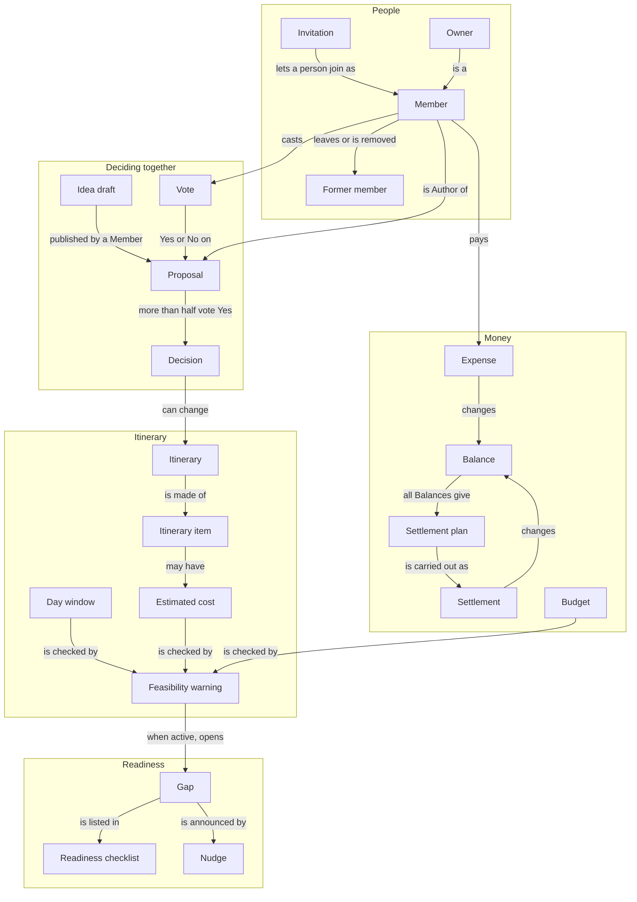

# TripMate

**Version:** 1.7

A shared workspace where a group of friends plan a trip together as equals, track progress while travelling, and settle shared costs fairly at the end.

## Map of terms

How the main terms relate. The definitions below are the rule; the map
only shows where each term sits.

## People

**Owner**:
The one Member of a trip who manages membership: removing Members, creating and revoking the Invitation, and handing ownership to another Member. Has no extra say in decisions. Every trip has exactly one Owner at any time.
_Avoid_: Admin, Organizer, Host, Leader

**Member**:
A person who has joined a trip. All Members, including the Owner, have equal rights over the trip's plan, bookings, tasks and money.
_Avoid_: Participant (except for the people sharing an Expense), User, Traveller

**Former member**:
A person who has left or been removed from a trip. Takes no part in new activity, but remains in past Expenses, Balances and history. While their Balance is not zero they can still read their own money records, and nothing else.
_Avoid_: Removed user, Deleted member

**Invitation**:
The single way to join a trip, shared as a link, a short code, or a QR code; all three forms expire and are revoked together. Someone holding the link who has not joined is not a Member and has no role.
_Avoid_: Guest, Invitee (as a role)

## Trip lifecycle

**Planning**:
The trip is being planned; the state a new trip starts in.

**Confirmed**:
The group has agreed to travel on the current plan. Any Member can undo it, which returns the trip to Planning.

**Ongoing**:
The trip is happening, based on its start and end dates. A trip becomes Ongoing on its start date whether or not it was Confirmed.

**Completed**:
The trip is over, based on its end date.

**Cancelled**:
The trip has been called off; can be undone.
_Avoid_: Deleted

**Archived**:
A Completed or Cancelled trip put away; all history is kept and it can be unarchived.
_Avoid_: Deleted, Closed

## Deciding together

**Proposal**:
Anything waiting for the group to decide: a place, a change to the Itinerary, or a poll question. Written by a Member or drafted by the AI assistant.
_Avoid_: Suggestion, Idea, Place proposal / AI proposal (as separate concepts)

**Author**:
The Member responsible for a Proposal: whoever wrote it, or whoever asked the AI assistant to draft it.
_Avoid_: Creator, Proposer, Owner (of a Proposal)

**Vote**:
A Member's Yes or No on a Proposal. Each Member has one Vote per Proposal.
_Avoid_: Like, Reaction

**Decision**:
A Proposal that more than half of the current Members voted Yes on. A Decision is not a booking.
_Avoid_: Confirmed suggestion, Approved, Accepted

**Rejected**:
A Proposal that more than half of the current Members voted No on.
_Avoid_: Declined, Denied

**Withdrawn**:
A Proposal its Author pulled back before it was decided.
_Avoid_: Cancelled (reserved for trips), Deleted

**Outdated**:
A Proposal closed automatically because another Proposal about the same Itinerary item became a Decision first.
_Avoid_: Superseded, Conflicted

**Duplicate**:
A Proposal a Member marked as the same idea as an earlier open Proposal; it closes, and its Votes do not carry over.
_Avoid_: Merged, Copy

**Idea draft**:
A possible Proposal the AI assistant pulled out of the trip discussion when a Member asked it to. It cannot be voted on; it becomes a Proposal only when a Member publishes it, and that Member becomes its Author.
_Avoid_: Draft proposal, Suggestion, AI proposal

## Itinerary

**Itinerary**:
The days of a trip and the places or activities planned on each. Members edit it directly, except while the trip is Confirmed, when every change must go through a Proposal.
_Avoid_: Plan, Schedule, Agenda

**Itinerary item**:
One place or activity on a day of the Itinerary, with an optional planned time and notes. While travelling it can be marked Visited or Skipped.
_Avoid_: Activity (as the general term), Stop, Event

**Day window**:
The hours of each trip day during which the group is out and about, used to judge whether a day's plan can be followed. Any Member can change it.
_Avoid_: Opening hours, Schedule

**Estimated cost**:
The expected cost of an Itinerary item, entered by a Member or prefilled by the AI assistant and always shown as an estimate. The amount of a booking also counts as an Estimated cost until it is added as an Expense.
_Avoid_: Price, Cost (unqualified)

**Feasibility warning**:
A notice that a day's plan cannot fit in its Day window once travel time is counted, or that Estimated costs exceed the Budget. It informs the group and never blocks a Decision.
_Avoid_: Error, Validation, Conflict

**Saved place**:
A place a Member kept for the trip to consider later. Every Member of the trip sees the same Saved places, and they can be offered as quick choices in a Nudge.
_Avoid_: Favourite, Bookmark, Wishlist

**Visited**:
An Itinerary item the group actually went to.
_Avoid_: Done, Completed

**Skipped**:
An Itinerary item the group decided not to go to after all.
_Avoid_: Cancelled, Removed

## Bookings, tasks and safeguards

These three are written in lower case in running text, like "trip".

**Booking**:
A real-world reservation or purchase that a Member recorded in the trip: a flight, accommodation, transport, an activity, a restaurant, or something else. It is entered by hand, and it is not proof that the supplier confirmed anything. Its status is To book, Booked or Cancelled; only a Booked booking closes a Gap.
_Avoid_: Reservation, Order, Ticket

**Task**:
A piece of preparation work for the trip that can be assigned to one Member, with a status (To Do, In Progress, Completed or Cancelled) and an optional due date.
_Avoid_: To-do, Job, Action item

**Audit log**:
The record of who changed what and when, for every change to trip state, the Itinerary, bookings, tasks, Expenses and Settlements. It is the main safeguard of equal rights.
_Avoid_: History, Activity feed, Changelog

## Readiness

**Gap**:
Something the trip is missing or that looks wrong for the plan, such as no dates yet, a night with nowhere to sleep, or too much travel for the trip's length. It informs and never blocks; any Member can acknowledge a Gap that is intentional.
_Avoid_: Error, Issue, Problem, Missing item

**Readiness checklist**:
The list of a trip's open and acknowledged Gaps, always visible at the top of the trip discussion.
_Avoid_: To-do list, Task list (tasks are assigned work, not Gaps)

**Nudge**:
A message TripMate posts in the trip discussion about open Gaps, timed so it does not interrupt the conversation. Any Member can snooze it.
_Avoid_: Alert, Reminder, Notification (reserved for in-app notifications)

## Money

**Trip currency**:
The single currency in which every Expense and Settlement of a trip is recorded.
_Avoid_: Base currency, Default currency

**Budget**:
The amount the group expects to spend on the trip, in the Trip currency, compared against actual spending while travelling.
_Avoid_: Limit, Cap

**Expense**:
Money one Member paid on behalf of some or all Members (the Participants), split among them.
_Avoid_: Cost, Bill, Transaction

**Participant**:
A Member who shares in an Expense. Only its Participants are charged for an Expense; the Member who paid is a Participant only if selected.
_Avoid_: Sharer, Member (for the people sharing one Expense)

**Balance**:
What a Member has paid minus what they owe across the trip. Positive means they should receive money; negative means they should pay.
_Avoid_: Debt, Net

**Settlement plan**:
The list of "who sends whom how much" that brings every Balance to zero, recomputed from current Balances. A recommendation, not something that has happened.
_Avoid_: Settlement suggestion, Debts list

**Settlement**:
A recorded transfer of money between two Members of a trip; it changes both their Balances. TripMate never moves the money itself.
_Avoid_: Payment, Transfer, Repayment

## Version history

| Version | Date | Changes |
|---------|------|---------|
| 1.1 | 2026-11-16 | First glossary: People, Trip, Proposals and decisions, Itinerary, Money. |
| 1.2 | 2026-11-16 | Readiness terms: Gap, Readiness checklist, Nudge. |
| 1.3 | 2026-11-16 | Added a version number and this history. |
| 1.4 | 2026-11-17 | Invitation: shared as a link, a short code, or a QR code. |
| 1.5 | 2026-11-17 | Added a map of how the main terms relate. No definition changed. |
| 1.6 | 2026-11-17 | New terms: Saved place, Booking, Task, Audit log, Participant. Confirmed can be undone; Ongoing starts on the start date whether or not the trip was Confirmed; a Former member with a Balance can still read their own money records. |
| 1.7 | 2026-11-18 | Booking statuses (To book, Booked, Cancelled) and Task statuses; a booking amount counts as an Estimated cost until it is added as an Expense. |
