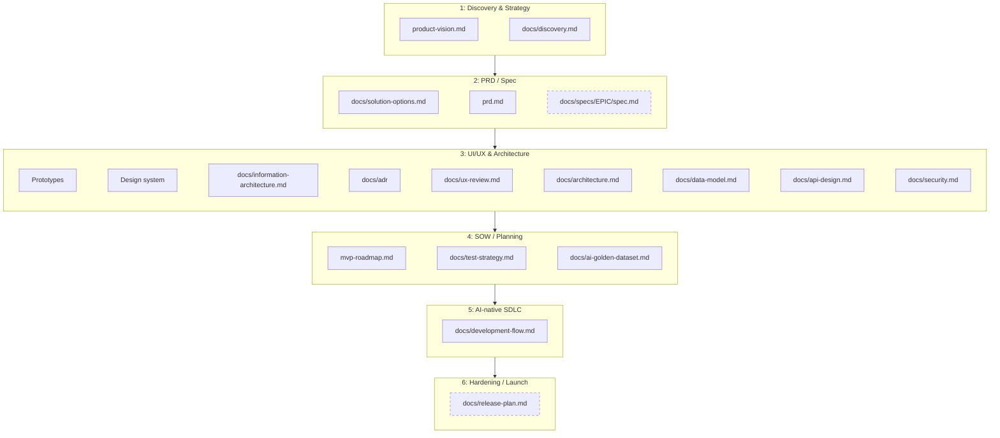

# TripMate Docs

TripMate is a shared workspace where a group of friends plan a trip
together as equals, track progress while travelling, and settle shared
costs fairly at the end.

This repository holds TripMate's product documents. Code lives in
separate repositories.

## Start here

| I want to... | Read |
|--------------|------|
| Understand what TripMate is and why we build it | [product-vision.md](product-vision.md) |
| Know what the MVP must do | [prd.md](prd.md), or its [page version](https://claude.ai/artifact/Jk5fPQpKv96euPj6Kw124U) |
| See what we still need to learn from real groups | [docs/discovery.md](docs/discovery.md) |
| Know why the MVP looks the way it does | [docs/solution-options.md](docs/solution-options.md), then [docs/adr](docs/adr/) |
| Know in what order and by when | [mvp-roadmap.md](mvp-roadmap.md) |
| Know how we work and which document belongs to which stage | [product-workflow.md](product-workflow.md), or its [page version](https://claude.ai/artifact/8yk7w1MUE79bXX58HL1QhA) |
| Look up a term | [GLOSSARY.md](GLOSSARY.md) |
| See where the work stands today | [TripMate Build Tracker](https://claude.ai/artifact/2ZRasgxPpxxeR2WH3SjmxU) |
| See which screens exist and how they connect | [docs/information-architecture.md](docs/information-architecture.md), or its [page version](https://claude.ai/artifact/Uy8kTUhj6nb78edcH64pGS) |
| See what screens look like: colours, type, components | [TripMate Design System](https://claude.ai/artifact/NDUCBnrHZE3Boubq3s8XjX) |
| Try the product | The prototypes under [Live pages](#live-pages) |
| See what testing found and what changed | [docs/ux-review.md](docs/ux-review.md) |
| Know how the system is built: modules, integrations, clients, hosting | [docs/architecture.md](docs/architecture.md) |
| Look up a table, a constraint, or what is stored where | [docs/data-model.md](docs/data-model.md) |
| Look up an endpoint convention, an error code, or a realtime event | [docs/api-design.md](docs/api-design.md) |
| Know who may do what and how data is protected | [docs/security.md](docs/security.md) |
| Know how TripMate is tested and how the assistant is evaluated | [docs/test-strategy.md](docs/test-strategy.md) |
| See the cases the assistant is evaluated on | [docs/ai-golden-dataset.md](docs/ai-golden-dataset.md) |
| Take a task from Trello card to merged, and know when it is Done | [docs/development-flow.md](docs/development-flow.md) |
| Change a document | [CLAUDE.md](CLAUDE.md) |

New to the project? Read the vision, then sections 2 to 4 of the PRD,
then section 1 of the product workflow.

## How the documents fit together

Each document belongs to one stage of the
[product workflow](product-workflow.md). Solid boxes exist today;
dashed boxes are planned and not written yet.



- [GLOSSARY.md](GLOSSARY.md) applies to every stage.
- Stage 7 (Maintenance & Iteration) has no document of its own; it
  updates the roadmap, the PRD, and the discovery notes.
- What each document answers is in the
  [document map](product-workflow.md#6-document-map).

## Live pages

The files in this repository are the source of truth. These pages show
the same content in a form that is easier to read or try. A document
that has a page version also links to it in its own header.

| Page | Shows |
|------|-------|
| [TripMate Product Workflow](https://claude.ai/artifact/8yk7w1MUE79bXX58HL1QhA) | The seven stages as an interactive page |
| [TripMate Build Tracker](https://claude.ai/artifact/2ZRasgxPpxxeR2WH3SjmxU) | Current stage, document versions, daily reports |
| [TripMate Information Architecture](https://claude.ai/artifact/Uy8kTUhj6nb78edcH64pGS) | The Navigation Map as an interactive page: places, links, journeys, platforms |
| [PRD (English)](https://claude.ai/artifact/Jk5fPQpKv96euPj6Kw124U) | prd.md as a document page |
| [TripMate Design System](https://claude.ai/artifact/NDUCBnrHZE3Boubq3s8XjX) | Design System Foundation: tokens, rules, and components for every client |
| [TripMate Software Architecture](https://claude.ai/artifact/JQa8y2nWNf9HWzzdtJ9ZiB) | docs/architecture.md as a document page |
| [TripMate Data Model](https://claude.ai/artifact/KBoRVLJ5qWK3f87PPDLV3H) | docs/data-model.md as a document page |
| [TripMate API Design](https://claude.ai/artifact/RNMJoX3cpUfRNwMYutf8Tf) | docs/api-design.md as a document page |
| [TripMate Security Architecture](https://claude.ai/artifact/7NLzrGuao8L27ey8CiTnvA) | docs/security.md as a document page |
| [TripMate MVP Roadmap](https://claude.ai/artifact/BRWph5dW3isKwQdLVt9ipd) | mvp-roadmap.md as a document page, with the epic dependency map |
| [TripMate Test Strategy](https://claude.ai/artifact/9ES7U3oo9wzvNqkkpafWx9) | docs/test-strategy.md as a document page |
| [TripMate AI Golden Dataset](https://claude.ai/artifact/Lib799999zYpM9xTnkLzNh) | docs/ai-golden-dataset.md as a document page |
| [TripMate Development Flow](https://claude.ai/artifact/NL1pqAnSqERZfZo5gje9eM) | docs/development-flow.md as a document page |
| [TripMate ADR-0005 Authentication](https://claude.ai/artifact/AnngZQmwf1Ax8GWodXwcvz) | docs/adr/0005-authentication-built-into-the-backend.md as a document page |
| [TripMate ADR-0006 Google Maps](https://claude.ai/artifact/2p2MuMoScA9HtFTf6jDgnJ) | docs/adr/0006-google-maps-platform-behind-a-provider-interface.md as a document page |
| [TripMate ADR-0007 Static Web Build](https://claude.ai/artifact/F2Xm35mpu9KMUtjechuCdm) | docs/adr/0007-web-client-is-a-static-build.md as a document page |
| [Web prototype](https://claude.ai/artifact/4prwGmgBsXBv5Jvnc3aEUo) | Clickable Web client |
| [Mobile prototype](https://claude.ai/artifact/MS8Hfa77SzLyhwFwnfFAen) | Clickable Mobile client |
| [Desktop prototype](https://claude.ai/artifact/UHEF5bSEzMDa4k2z62cRRJ) | Clickable Desktop client |

## Repository layout

```text
README.md              This file
CLAUDE.md              Rules for every change, by people or AI agents
GLOSSARY.md            Domain terms
product-vision.md      Stage 1
prd.md                 Stage 2
mvp-roadmap.md         Stage 4
product-workflow.md    The process and the document map
docs/
  discovery.md         Stage 1
  solution-options.md  Stage 2
  information-architecture.md  Stage 3
  ux-review.md         Stage 3
  architecture.md      Stage 3
  data-model.md        Stage 3
  api-design.md        Stage 3
  security.md          Stage 3
  test-strategy.md     Stage 4
  ai-golden-dataset.md Stage 4
  development-flow.md  Stage 5
  adr/                 Decision records
```

Product-level documents sit at the root. Supporting documents and
decision records sit under `docs/`.

## Versions

Every document has a version in its header and a Version History table
at the end. Old versions are kept as git tags:

```bash
git show v1.6:prd.md
```

```bash
git diff v1.5 v1.6 -- prd.md
```

The tag formats and the rules for changing a document are in
[CLAUDE.md](CLAUDE.md).
