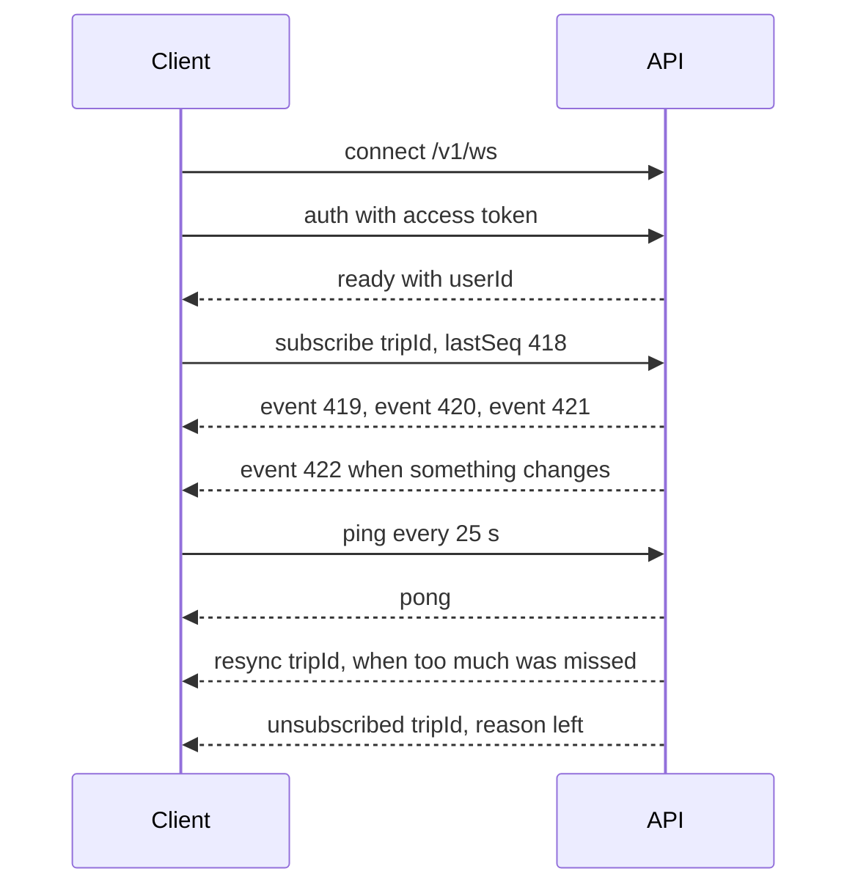
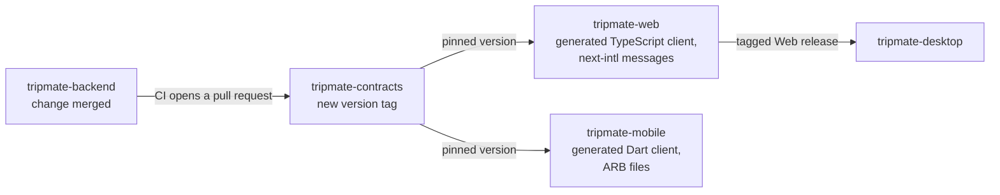

# TripMate -- API Design

**Document type:** API Design\
**Product:** TripMate\
**Status:** Proposed\
**Version:** 1.0\
**Stage:** 3. UI/UX & Software Architecture Design

Terms follow [GLOSSARY.md](../GLOSSARY.md). Requirements and their IDs
are in [prd.md](../prd.md). How the system is organised is in
[architecture.md](architecture.md); the records behind each resource
are in [data-model.md](data-model.md); authentication and access rules
are in [security.md](security.md).

This document answers *how clients talk to the backend*: the REST
conventions, the resources, the error codes, the realtime protocol,
and how the contract moves between repositories. The exact request and
response shapes are not written here: they are the OpenAPI document
that the backend generates and publishes to `tripmate-contracts`
(section 7). Each epic's spec lists the endpoints it adds.

## 1. Principles

- **One API for every client.** Web, Mobile, and Desktop call the same
  endpoints with the same rules (PRD section 6). There is no
  client-specific endpoint.
- **The backend decides, the client displays.** Every rule (money,
  voting, Gaps, access) is applied by the backend. A client never
  computes a Balance or a vote outcome itself.
- **Codes, not text.** The backend returns error codes and message
  keys; each client turns them into text in the device language.
- **Generated, not handwritten.** Clients use code generated from the
  published contract. A request written by hand is a review finding.
- **Additive by default.** New fields and endpoints are added without
  breaking existing clients; a breaking change needs a new path
  version.

## 2. Conventions

| Topic | Convention |
|-------|------------|
| Transport | JSON over HTTPS; `Content-Type: application/json; charset=utf-8` |
| Base path | `/v1`; trip-scoped resources under `/v1/trips/{tripId}/...` |
| Field names | `camelCase` in JSON; resource paths in `kebab-case`, plural nouns |
| Authentication | `Authorization: Bearer <access token>` on every request except sign-up, sign-in, refresh, and the health check ([security.md](security.md)) |
| Device | `X-Device-Id: <uuid>` on every request, created once per install; used for rate limits and session names only |
| Request ID | The server returns `X-Request-Id` on every response; clients send it when reporting a problem |
| Idempotency | `Idempotency-Key: <uuid>` required on every `POST` that creates a record; the key is made once per user action and reused on retry ([data-model.md](data-model.md), section 6.3) |
| Concurrency | Responses carry the record's version in `ETag`; `PATCH`, `PUT`, and `DELETE` send `If-Match`. A missing `If-Match` returns `428 request.version_required`; a stale one returns `409 conflict.stale_version` with the current record. |
| Money | `{ "amount": 3000000, "currency": "VND" }`; `amount` is an integer in the smallest unit of the Trip currency |
| Dates and times | ISO 8601. Trip dates as `YYYY-MM-DD`, Day window and planned times as `HH:MM` in the trip's time zone, moments in UTC with `Z` |
| Lists | Cursor pagination: `?cursor=<opaque>&limit=<1..100>`; the response has `items` and `nextCursor` |
| Partial updates | `PATCH` with only the fields that change |
| Actions that are not edits | `POST` to a named sub-resource, for example `POST /v1/trips/{tripId}/confirm` |
| Empty values | A field with no value is `null`, never left out, so generated clients see one shape |

### 2.1 Methods and status codes

| Method | Used for | Success |
|--------|----------|---------|
| `GET` | Read a record or a list | `200` |
| `POST` | Create a record, or run an action | `201` with the record, or `200` for an action; `202` for work that finishes later (assistant requests) |
| `PATCH` | Change some fields of a record | `200` with the record |
| `DELETE` | Remove a record (soft delete for money, bookings, tasks) | `204` |

## 3. Resources

Grouped by the module that owns them
([architecture.md](architecture.md), section 4). Paths under a trip are
written from `/v1/trips/{tripId}`.

### 3.1 Accounts

| Method and path | Does | PRD |
|-----------------|------|-----|
| `POST /v1/auth/register` | Create an account with email and password | AUTH-01 |
| `POST /v1/auth/login` | Sign in; returns an access token and a refresh token | AUTH-01 |
| `POST /v1/auth/refresh` | Exchange a refresh token for new tokens | AUTH-02 |
| `POST /v1/auth/logout` | End this session | AUTH-02 |
| `GET /v1/auth/sessions`, `DELETE /v1/auth/sessions/{id}` | List and end signed-in devices | AUTH-02 |
| `GET /v1/me`, `PATCH /v1/me` | Read and edit the profile | AUTH-03, AUTH-04 |
| `GET /v1/me/readiness-summary` | Open Gaps across the user's trips, for the Desktop tray | DESK-04 |

### 3.2 Trips and membership

| Method and path | Does | PRD |
|-----------------|------|-----|
| `GET /v1/trips`, `POST /v1/trips` | List my trips; create a trip | TRIP-01 |
| `GET`, `PATCH /v1/trips/{tripId}` | Read and edit trip details | TRIP-02 |
| `POST .../confirm`, `.../undo-confirm`, `.../cancel`, `.../undo-cancel`, `.../archive`, `.../unarchive` | Change the trip state | TRIP-07 |
| `GET .../members` | Members and Former members | TRIP-05 |
| `DELETE .../members/{memberId}` | Remove a Member (Owner) | TRIP-06 |
| `POST .../transfer-ownership` | Hand ownership to a Member (Owner) | TRIP-06 |
| `POST .../leave` | Leave the trip | TRIP-08 |
| `GET .../invitation` | See the Invitation as link, code, and QR content | TRIP-09 |
| `POST .../invitation`, `DELETE .../invitation` | Create or regenerate, and revoke (Owner) | TRIP-03 |
| `GET /v1/invitations/{code}` | Preview the trip behind a code before joining | TRIP-04 |
| `POST /v1/invitations/{code}/join` | Join with a link, code, or QR code | TRIP-04 |

### 3.3 Discussion and deciding together

| Method and path | Does | PRD |
|-----------------|------|-----|
| `GET`, `POST .../messages` | Read and post discussion messages | COL-01, COL-02 |
| `GET`, `POST .../proposals` | List and create Proposals; the response to create lists similar open Proposals | COL-03, COL-06, COL-09 |
| `GET .../proposals/{id}` | A Proposal with its Votes, Feasibility warnings, and Gaps | COL-05, ITN-11, RDY-03 |
| `PUT .../proposals/{id}/votes/me` | Cast or change my Vote | COL-05 |
| `POST .../proposals/{id}/withdraw` | Withdraw (Author) | COL-08 |
| `POST .../proposals/{id}/mark-duplicate` | Mark as a Duplicate of an earlier open Proposal | COL-10 |
| `POST .../idea-drafts/capture` | Ask the assistant for Idea drafts | AI-09 |
| `GET .../idea-drafts`, `POST .../idea-drafts/{id}/publish`, `DELETE .../idea-drafts/{id}` | List, publish, dismiss Idea drafts | AI-09 |

### 3.4 Itinerary and places

| Method and path | Does | PRD |
|-----------------|------|-----|
| `GET`, `POST .../days` | List and create Itinerary days | ITN-01 |
| `POST .../days/{dayId}/items`, `PATCH`, `DELETE .../items/{id}` | Add, edit, remove items (direct edits, outside Confirmed) | ITN-02 to ITN-04 |
| `PUT .../days/{dayId}/order` | Reorder a day's items; sends the full ordered list and the day's version | ITN-03 |
| `PUT .../items/{id}/progress` | Mark Visited or Skipped, or clear it | ITN-08 |
| `GET .../progress` | Visited, Skipped, and remaining counts | ITN-09 |
| `GET .../feasibility` | Feasibility warnings by day and for the trip | ITN-11 |
| `GET`, `POST`, `DELETE .../saved-places` | Saved places | ITN-07 |
| `GET /v1/places/search`, `GET /v1/places/{placeId}` | Search places and read details through the backend | ITN-02, ITN-05 |

### 3.5 Assistant

| Method and path | Does | PRD |
|-----------------|------|-----|
| `POST .../assistant/requests` | Start a request: suggest places, draft an Itinerary, revise a draft; returns `202` | AI-01 to AI-04 |
| `GET .../assistant/requests/{id}` | Status and result: the Proposal created, or the error code | FR-04 |

### 3.6 Bookings, tasks, and money

| Method and path | Does | PRD |
|-----------------|------|-----|
| `GET`, `POST .../bookings`, `PATCH`, `DELETE .../bookings/{id}` | Booking records | BOOK-01 to BOOK-09 |
| `POST .../bookings/{id}/files` | Get a presigned upload URL for a booking document (P1) | BOOK-05 |
| `GET .../files/{fileId}` | Get a presigned download URL | BOOK-05 |
| `GET`, `POST .../tasks`, `PATCH`, `DELETE .../tasks/{id}` | Tasks | TASK-01 to TASK-05 |
| `GET`, `POST .../expenses`, `PATCH`, `DELETE .../expenses/{id}` | Expenses with their split | EXP-01 to EXP-06 |
| `GET`, `POST .../settlements`, `PATCH`, `DELETE .../settlements/{id}` | Settlements | EXP-10 |
| `GET .../balances` | Balances of every Member and Former member | EXP-08 |
| `GET .../settlement-plan` | The Settlement plan | EXP-09 |
| `GET .../spending` | Totals and spending against the Budget, for the group and for me | EXP-07, EXP-12 |

### 3.7 Readiness and history

| Method and path | Does | PRD |
|-----------------|------|-----|
| `GET .../readiness` | The Readiness checklist with open and acknowledged Gaps | RDY-01, RDY-02 |
| `POST .../gaps/{gapKey}/acknowledge`, `DELETE .../gaps/{gapKey}/acknowledge` | Acknowledge a Gap, and undo it | RDY-05 |
| `POST .../gaps/{gapKey}/snooze`, `DELETE .../gaps/{gapKey}/snooze` | Snooze a Gap's Nudge, and undo it | RDY-05 |
| `GET .../history` | The Audit log of the trip, newest first | PRD section 3.2 |

## 4. Errors

### 4.1 Format

```json
{
  "error": {
    "code": "invitation.expired",
    "params": { "expiredAt": "2026-12-01T10:00:00Z" },
    "fields": null,
    "requestId": "01JD3Q7Z8K..."
  }
}
```

- `code` is `<area>.<reason>` in snake case.
- `params` holds the values the client needs to build the message.
- `fields` lists validation problems as `{ "field": "amount", "code": "money.not_positive" }`, or is `null`.
- The text for every code lives in the shared translation source in
  `tripmate-contracts`. CI in `tripmate-backend` fails if the backend
  can return a code that has no text in both languages.

### 4.2 Status codes

| Status | When | Example code |
|--------|------|--------------|
| `400` | The request is malformed or fails validation | `request.invalid`, `money.split_mismatch` |
| `401` | No valid access token | `auth.token_expired`, `auth.not_signed_in` |
| `403` | The caller can see the trip but may not do this | `trip.owner_only`, `trip.former_member_read_only` |
| `404` | The record does not exist, or the caller may not see the trip | `trip.not_found`, `invitation.not_found` |
| `409` | The request conflicts with the current state | `conflict.stale_version`, `proposal.already_closed`, `trip.currency_locked` |
| `410` | The thing existed but is no longer usable | `invitation.expired`, `invitation.revoked` |
| `422` | The request is valid but a business rule refuses it | `trip.member_limit_reached`, `trip.owner_must_transfer`, `itinerary.confirmed_needs_proposal` |
| `428` | `If-Match` is missing on a change | `request.version_required` |
| `429` | A rate limit or quota is reached; `Retry-After` says when to try again | `rate.limited`, `assistant.quota_reached` |
| `503` | A provider the request needs is down | `assistant.unavailable`, `places.unavailable` |

A request about a trip the caller cannot see returns `404
trip.not_found`, never `403`, so the response never reveals that a
trip exists. A wrong Invitation code returns `404 invitation.not_found`
whether or not any trip uses a similar code (PRD FR-02).

### 4.3 First codes by area

| Area | Codes |
|------|-------|
| `auth` | `not_signed_in`, `token_expired`, `invalid_credentials`, `email_taken`, `session_revoked` |
| `trip` | `not_found`, `owner_only`, `former_member_read_only`, `owner_must_transfer`, `member_limit_reached`, `invalid_dates`, `currency_locked`, `state_transition_not_allowed` |
| `invitation` | `not_found`, `expired`, `revoked`, `already_member` |
| `proposal` | `already_closed`, `not_author`, `duplicate_of_closed`, `duplicate_of_self` |
| `itinerary` | `confirmed_needs_proposal`, `day_outside_trip`, `no_trip_dates` |
| `money` | `split_mismatch`, `not_positive`, `participant_not_member`, `pay_self` |
| `booking`, `task` | `assignee_not_member` |
| `assistant` | `unavailable`, `quota_reached`, `invalid_output`, `failed` |
| `places` | `unavailable`, `not_found` |
| `file` | `too_large`, `type_not_allowed` |
| `conflict`, `request`, `rate` | `stale_version`, `invalid`, `version_required`, `idempotency_mismatch`, `limited` |

Each epic spec adds the codes it needs; the published contract holds
the full list.

## 5. Change Rules That Show in the API

Some product rules decide which endpoint a client must call. The
backend enforces them; this table tells client developers what to
expect.

| Situation | What the client does | What the backend returns otherwise |
|-----------|----------------------|------------------------------------|
| The trip is Confirmed and a Member changes the Itinerary | Create a Proposal with a change set (COL-11) | `422 itinerary.confirmed_needs_proposal` on a direct item edit |
| A date change would move Itinerary items while Confirmed | Create a Proposal | `422 itinerary.confirmed_needs_proposal` |
| A date change leaves days with items outside the trip, outside Confirmed | Send the change; the response lists the items moved to Saved places | -- |
| A booking is saved as Booked with a payer and an amount | Offer to add an Expense; `POST .../expenses` with `bookingId` | -- |
| A Vote decides a Proposal | Nothing extra; the response and events show the Decision and the changed Itinerary | -- |

## 6. Realtime Protocol

One WebSocket per client at `wss://<api host>/v1/ws`. Messages are JSON
objects with a `type`.



### 6.1 Messages

| Direction | Type | Fields | Meaning |
|-----------|------|--------|---------|
| Client to server | `auth` | `token` | First message. The token is never put in the URL. A new token can be sent the same way before the old one expires. |
| Client to server | `subscribe` | `tripId`, `lastSeq` (optional) | Receive the trip's events; with `lastSeq`, first receive what was missed |
| Client to server | `unsubscribe` | `tripId` | Stop receiving the trip's events |
| Client to server | `ping` | -- | Keep the connection alive |
| Server to client | `ready` | `userId` | Authentication passed |
| Server to client | `event` | `tripId`, `seq`, `event`, `id`, `version`, `at` | A committed change |
| Server to client | `resync` | `tripId` | Too much was missed; reload the trip's open screens over REST |
| Server to client | `unsubscribed` | `tripId`, `reason` | Access ended, for example the user left or was removed |
| Server to client | `error` | `code` | For example `auth.token_expired`; the client refreshes and sends `auth` again |
| Server to client | `pong` | -- | Answer to `ping` |

### 6.2 Events

Events are thin: they name what changed, not its new content. The
client fetches the record over REST, so access rules and field
filtering exist in one place. A Former member's connection receives
money events only.

| Area | Events |
|------|--------|
| Trip | `trip.updated`, `trip.state_changed`, `member.joined`, `member.left`, `member.removed`, `ownership.transferred`, `invitation.changed` |
| Discussion | `message.created` |
| Deciding | `proposal.created`, `proposal.updated`, `proposal.closed`, `vote.changed`, `idea_drafts.ready` |
| Itinerary | `itinerary.changed`, `item.progress_changed`, `saved_place.changed`, `feasibility.changed` |
| Bookings and tasks | `booking.changed`, `task.changed` |
| Money | `expense.changed`, `settlement.changed`, `balances.changed` |
| Readiness | `readiness.changed`, `nudge.posted` |
| Assistant | `assistant.request_updated` |

- `seq` numbers each trip's events without gaps
  ([data-model.md](data-model.md), section 6.2).
- The server keeps a trip's events for 24 hours. A client that
  reconnects sends its `lastSeq` and receives what it missed, or a
  `resync`.
- An event is sent only after its change is committed.
- Desktop shows a native notification for `nudge.posted` (DESK-03);
  Mobile has no push in the MVP.

## 7. The Contract Across Repositories

Backend, Web, Mobile, and Desktop live in separate repositories
([architecture.md](architecture.md), section 14). Everything they must
agree on lives in `tripmate-contracts`.

| In `tripmate-contracts` | Written by |
|-------------------------|------------|
| `openapi.json`, the REST contract | Generated by `tripmate-backend`, never edited by hand |
| `events.schema.json`, the realtime messages and events | Written with the backend change that adds an event |
| `translations/en.json`, `translations/vi.json` | Anyone; every interface text, error code, and message key |



- When a backend change touches the contract, its CI opens a pull
  request in `tripmate-contracts` with the new `openapi.json`. Merging
  it creates a version tag, for example `contracts-v1.4.0`.
- Web and Mobile pin a contracts version and regenerate their client
  when they move to a newer one. Moving is a normal pull request in
  their own repository.
- A change to the contract lands in this order: backend (additive and
  backward compatible), contracts, then the clients. A client never
  depends on an endpoint that is not yet in production.
- CI in `tripmate-contracts` compares each new `openapi.json` with the
  previous tag and fails on a breaking change unless the path version
  changes.
- An endpoint that will be removed is marked `deprecated` in the
  contract and returns a `Sunset` header for at least one release
  before it goes.
- Contract tests in the backend check that responses match the
  published schema; Web and Mobile test against the same pinned
  version (PRD section 9, cross-client API contract tests).

## 8. Version History

| Version | Date | Changes |
|---------|------|---------|
| 1.0 | 2026-11-19 | First version: principles, REST conventions, resources by module with their requirements, error format and status codes with the first codes, product rules that show in the API, realtime protocol and events, how the contract moves between repositories. |
