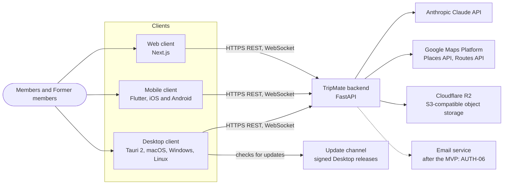
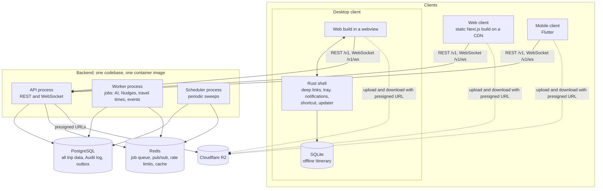
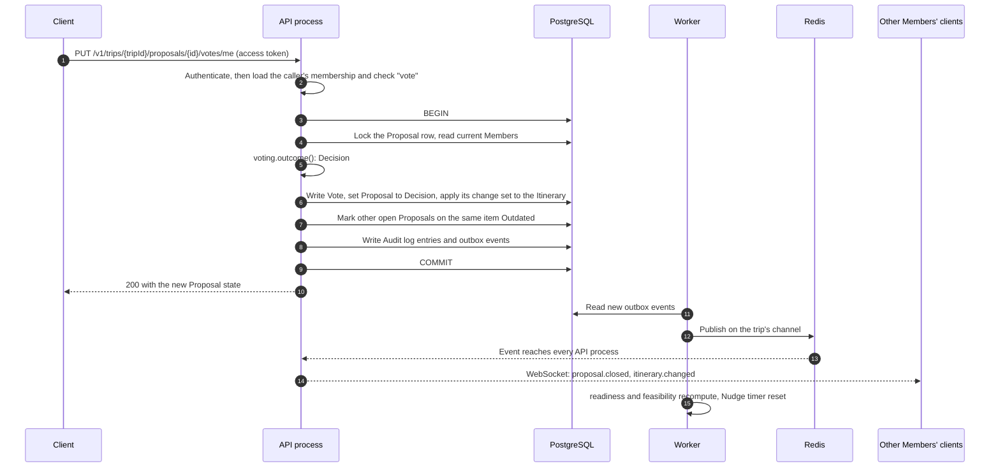
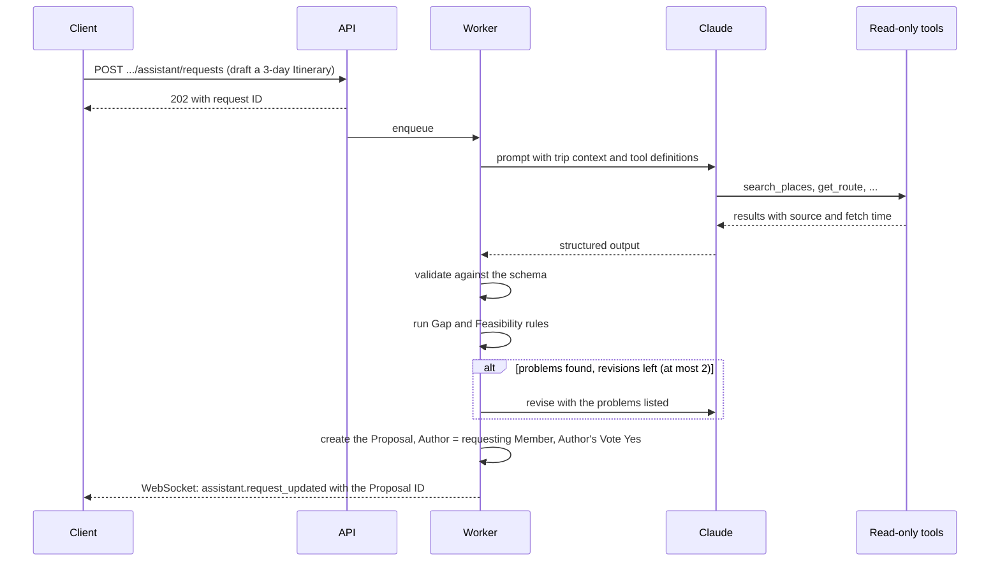
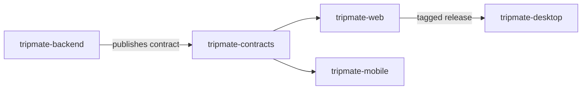

# TripMate -- Software Architecture

**Document type:** Software Architecture Document\
**Product:** TripMate\
**Status:** Approved\
**Version:** 1.7\
**Stage:** 3. UI/UX & Software Architecture Design\
**Page version:** [TripMate Software Architecture artifact](https://claude.ai/artifact/JQa8y2nWNf9HWzzdtJ9ZiB)

Terms follow [GLOSSARY.md](../GLOSSARY.md). Requirements and their IDs
are in [prd.md](../prd.md); this document does not repeat the product
rules, it says where each one is enforced. The technology stack comes
from [mvp-roadmap.md](../mvp-roadmap.md), section 2. Decisions with
lasting consequences are recorded in [docs/adr](adr/).

This document answers *how the system is organised*: the parts, how
they talk, where data lives, and how it is observed and deployed.
Three companion documents hold the detail that is shared by the whole
system:

| Document | Holds |
|----------|-------|
| [data-model.md](data-model.md) | Every entity, entity relationship diagrams, conventions, database constraints |
| [api-design.md](api-design.md) | REST conventions, resources, error codes, realtime protocol, the contract across repositories |
| [security.md](security.md) | Authentication, capabilities, data protection, threats and controls |

Each epic's technical design (the endpoints, tables, and jobs it adds)
lives in the technical design section of its
`docs/specs/<epic>/spec.md` and must stay within these four documents.

## 1. Architectural Drivers

The requirements that shape the architecture most. Everything else in
this document follows from them.

| # | Driver | Source | Consequence |
|---|--------|--------|-------------|
| D1 | Money, voting, Gap, and authorization rules must give the same answer on every client | PRD section 6, business rules 10 and 14 | All domain rules run in the backend as pure, tested functions. Clients only display. |
| D2 | Equal rights, so the Audit log is the main safeguard | ADR-0002, PRD section 3.2 | Every change writes its Audit log entry in the same database transaction as the change itself. |
| D3 | Three clients (Web, Mobile, Desktop) on one backend | PRD section 6 | One versioned REST API with a machine-readable contract; typed clients generated from it. |
| D4 | Votes, messages, and trip updates appear promptly for connected Members | PRD section 8, Realtime | A WebSocket channel per client that carries change events after they are committed. |
| D5 | AI never changes the trip directly | PRD FR-04, business rule 8 | The assistant can only read through tools; its output is validated and turned into a Proposal by backend code. |
| D6 | External services fail without corrupting data, and planning works without AI | PRD section 8, Reliability; FR-04 | Maps and AI sit behind adapters with timeouts, run outside the request transaction, and degrade to "could not be checked". |
| D7 | Time-based behaviour: trip states change by date, Nudges wait for a quiet chat | PRD FR-02, FR-10 | A worker and a scheduler next to the API, with due work derived from the database so it survives restarts. |
| D8 | Every Member sees TripMate's own messages in their device language | PRD section 6, shared requirements | The backend stores and sends message keys with parameters and error codes, never text. |
| D9 | Desktop reuses the Web client, reads the Itinerary offline, and runs on macOS, Windows, and Linux | PRD section 6, Desktop client; Linux decided on 2026-11-19 (section 12.1) | The Web client is a static build with no server-side code; Rust only bridges to the operating system. |
| D10 | A small team, 13 weeks, learning Rust on the side | mvp-roadmap.md | A modular monolith, managed hosting, and no infrastructure the team must run by hand. |

## 2. System Context

Who and what TripMate talks to.



| External system | Used for | Requirements |
|-----------------|----------|--------------|
| Anthropic Claude API | Place suggestions, Itinerary drafts, idea capture | AI-01 to AI-10 |
| Google Maps Platform | Place search and details, travel time between Itinerary items, map display (P1) | ITN-05, ITN-06, ITN-11, Gap 5 |
| Cloudflare R2 | Booking documents (P1), avatars (P1), through the S3 API | BOOK-05, AUTH-04 |
| Email service | Password reset links, after the MVP | AUTH-06 |
| Update channel | Signed Desktop installers and updates | DESK-07 |

## 3. Containers

The deployable parts and how they connect.



| Container | Technology | Responsibility | Does not |
|-----------|------------|----------------|----------|
| Web client | Next.js App Router, TypeScript, static export | All screens for browsers; the same build runs inside Desktop | Hold domain rules or call external providers directly |
| Mobile client | Flutter | Screens optimised for use while travelling | Hold domain rules |
| Desktop client | Tauri 2, Rust; macOS, Windows, Linux | Runs the Web build; DESK-02 to DESK-07 | Run money, voting, or Gap logic |
| API process | FastAPI on Uvicorn | Authentication, authorization, every read and write, WebSocket connections | Call the LLM, or call any provider inside a database transaction. Place search is its only provider call (section 6.2) |
| Worker process | Same codebase, job runner | AI requests, Nudge evaluation, travel-time lookups, publishing committed events | Accept client connections |
| Scheduler process | Same codebase, periodic trigger | Finds due work in PostgreSQL every minute and enqueues it | Hold state of its own |
| PostgreSQL | Managed PostgreSQL 16+ | The only source of truth | -- |
| Redis | Managed Redis | Job queue, WebSocket fan-out, rate limits, short-lived caches | Hold anything that cannot be rebuilt from PostgreSQL |
| Object storage | Cloudflare R2, private bucket, used through the S3 API | Files | Serve files without a presigned URL |

**The Web client is a static build.** Desktop wraps the static output
of the Web client (D9), so the Web client is built with Next.js static
export: no server-side rendering, no Next.js API routes, no server
actions. Every page fetches its data from the TripMate API in the
browser. Nothing in TripMate is public, so server rendering would add
no search or sharing value. Paths with a variable part, such as the
Invitation link, are handled in the browser: the CDN serves the join
page for every `/join/*` path, and the page reads the code from the
URL.

## 4. Backend Modules

The backend is a modular monolith, as decided in
[mvp-roadmap.md](../mvp-roadmap.md). Modules follow the PRD's
functional areas, so each epic changes as few modules as possible.

| Module | Owns | Requirements | Epic |
|--------|------|--------------|------|
| `identity` | Users, credentials, sessions, profiles | FR-01 | EPIC-01 |
| `trips` | Trips, trip lifecycle, Members, Former members, ownership, Invitation | FR-02 | EPIC-02 |
| `discussion` | Discussion messages, TripMate's own messages (key and parameters) | COL-01, COL-02 | EPIC-03 |
| `decisions` | Proposals, Votes, Idea drafts, Duplicate marking, applying a Decision | COL-03 to COL-11 | EPIC-03 |
| `itinerary` | Itinerary days and items, Saved places, Visited and Skipped, Estimated costs, Feasibility warnings | FR-05 | EPIC-05 |
| `places` | The adapter to Google Maps Platform, place and travel-time caches | ITN-05, ITN-06 | EPIC-05 |
| `assistant` | LLM orchestration, tools, output schemas, revision loop | FR-04 | EPIC-04 |
| `bookings` | Booking records, booking documents | FR-06 | EPIC-06 |
| `tasks` | Tasks and assignees | FR-07 | EPIC-07 |
| `money` | Expenses, splits, Settlements, Balances, Settlement plan, spending against the Budget | FR-08 | EPIC-08, EPIC-09 |
| `readiness` | Gap rules, Readiness checklist, acknowledgements, snoozes, Nudge engine | FR-10 | EPIC-13 |
| `notifications` | Personal in-app notifications (P1) | COL-07 | EPIC-03 |
| `audit` | The Audit log | PRD section 3.2 | EPIC-02 |
| `files` | Presigned upload and download URLs, file metadata | BOOK-05, AUTH-04 | EPIC-06 |
| `platform` | Access guard, error codes, idempotency, outbox, configuration, logging | Cross-cutting | EPIC-11 |

```mermaid
flowchart TB
    decisions --> itinerary
    decisions --> discussion
    assistant --> decisions
    assistant --> places
    assistant --> itinerary
    itinerary --> places
    readiness --> itinerary
    readiness --> bookings
    readiness --> tasks
    readiness --> money
    readiness --> discussion
    bookings --> money
    money --> trips
    itinerary --> trips
    decisions --> trips
    bookings --> trips
    tasks --> trips
    discussion --> trips
    trips --> identity
```



An arrow means "calls the public interface of". `audit`, `files`, and
`platform` are used by every module and are left out of the diagram.

**Module rules**

- Each module exposes a small public interface (`<module>/service.py`
  and its data types). Other modules call only that interface; they
  never import another module's internals or query its tables.
- The dependency graph has no cycles. An import-linter contract in CI
  enforces both rules.
- Each module's domain rules are pure functions with no database or
  network access, so they can be unit- and property-tested on their
  own.
- When a module must react to another module's change without
  depending on it (for example `readiness` after a booking changes), it
  listens to a domain event (section 5.2) instead of being called.

**Where each domain rule lives**

| Rule | Module | Pure function | PRD |
|------|--------|---------------|-----|
| Trip state transitions, undo, start and end by date | `trips` | `lifecycle.next_state` | FR-02 |
| Vote outcome: Decision, Rejected, tie, recount when Members change | `decisions` | `voting.outcome` | FR-03 |
| Proposals that become Outdated | `decisions` | `voting.outdated_by` | FR-03 |
| Similar open Proposals | `decisions` | `similarity.find_similar` | COL-09 |
| Time and Budget Feasibility warnings | `itinerary` | `feasibility.evaluate` | FR-05 |
| Group Budget from Budget per person | `itinerary` | `feasibility.group_budget` | FR-02 |
| Equal and custom splits, remainder by join order | `money` | `splits.allocate` | FR-08, ADR-0001 |
| Balances | `money` | `balances.compute` | FR-08 |
| Settlement plan through the hub | `money` | `settlement.hub_plan` | FR-08, ADR-0004 |
| Gaps 1 to 10, nights needed | `readiness` | `gaps.compute` | FR-10 |
| When a Nudge may be posted | `readiness` | `nudges.due` | FR-10 |
| Who may do what | `platform` | `access.capabilities` | PRD section 3.2 |

## 5. How a Change Flows Through the System

### 5.1 Commands

Every write follows the same path. The example is a Member casting the
Vote that turns a Proposal into a Decision.



**Rules for every command**

- Authorization happens before any read of trip data
  ([security.md](security.md), section 3).
- Domain rules, the change, its Audit log entries, and its outbox
  events are written in one transaction. If any part fails, nothing
  is written.
- Records that decide an outcome are locked (`SELECT ... FOR UPDATE`)
  so two Votes arriving together cannot both miss the threshold.
- A Member joining or leaving re-runs `voting.outcome` for every open
  Proposal of the trip inside the same transaction, because the
  threshold changes (ADR-0002).
- Nothing slow happens inside the transaction: no LLM call, no Maps
  call. Those run in the worker.
- A create is safe to retry. Every `POST` that creates a record carries
  an `Idempotency-Key`, and the same key returns the stored response
  instead of writing twice ([api-design.md](api-design.md), section 2;
  [data-model.md](data-model.md), section 6.3). Casting a Vote is a
  `PUT` of the caller's own Vote, so repeating it changes nothing.

### 5.2 Events and the outbox

- Every committed change produces domain events (for example
  `expense.changed`, `proposal.closed`, `member.left`), written to
  the `outbox_events` table in the same transaction. The full list is
  in [api-design.md](api-design.md), section 5.2.
- The worker reads the outbox in order and publishes each event to the
  trip's Redis channel. A client is told about a change only after it
  is committed.
- Modules that react to others subscribe to these events: `readiness`
  recomputes Gaps and resets the Nudge timer, `itinerary` requests
  travel times for new items, `notifications` (P1) creates personal
  notifications.
- Handlers are idempotent, so an event delivered twice does no harm.

## 6. External Integrations

### 6.1 AI assistant

The assistant runs in the worker through LangChain, using Anthropic
Claude models: a larger model for place suggestions and Itinerary
drafts, a smaller, cheaper model for idea capture. Model IDs live in
configuration, so a model can be changed without a code change.



| Rule | How it is enforced |
|------|--------------------|
| AI never changes the trip (FR-04, business rule 8) | Tools are read-only. Only backend code creates a Proposal or an Idea draft, after validation, through the same `decisions` service a Member uses. |
| Outputs match a schema (FR-04) | Every output is parsed into a Pydantic model; invalid output is retried once, then the request fails with `assistant.invalid_output`. |
| Estimates are labelled (AI-08, AI-10) | Schemas have explicit fields for source, fetch time, and "estimate"; the client labels them. |
| AI down does not stop planning (FR-04) | Assistant endpoints return `assistant.unavailable`; every other endpoint is unaffected. |
| Cost stays bounded | Per-user and per-trip daily request quotas in Redis, a token limit per request, prompt caching for the fixed part of prompts, and token and cost metrics per request. |

Prompt injection, keeping the tools inside one trip, and what data
reaches the provider are in [security.md](security.md), section 6.

`get_weather` from the PRD's suggested tools is not built until a
weather provider is chosen; the assistant says weather is not checked.

How AI quality is measured (golden dataset, metrics, release gates) is
owned by `docs/test-strategy.md`.

### 6.2 Maps and places

TripMate uses Google Maps Platform: Places API for search and details,
Routes API for travel time between consecutive Itinerary items.

- Every call goes through the `places` module's provider interface, so
  another provider can be added later without touching other modules.
- Clients never call Places or Routes directly. Place search goes
  through `/v1/places/search`, which keeps the server key private and
  lets the backend apply quotas. Map display (ITN-05, P1) uses a
  separate client key restricted to the TripMate apps and domains.
- Only Google place IDs are stored permanently. Other place content and
  travel times are cached in Redis no longer than the Google terms
  allow, and fetched again when needed.
- Travel times are requested by the worker when items change, not
  during the Member's request. Until they arrive, or if the call fails,
  the time Feasibility warning and Gap 5 say "could not be checked"
  (FR-05, FR-10).
- The city of each item, needed for Gap 5 and Gap 9, comes from the
  place's address data.
- Route estimates are shown with Google attribution (FR-05).
- Usage is capped with daily quotas and a billing alert on the Google
  Cloud project.

### 6.3 Failure handling

| Provider | Timeout | When it fails |
|----------|---------|---------------|
| Claude | 60 s per call, whole request at most 3 minutes | Request ends as failed; the Member can retry; nothing is written |
| Places API | 3 s | Search shows "could not search places"; manual items still work |
| Routes API | 5 s | Warning says "could not be checked"; retried with backoff |
| Cloudflare R2 | 10 s | Upload fails; the booking itself is saved |

## 7. Languages

- One shared translation source, `translations/en.json` and
  `translations/vi.json` in `tripmate-contracts`, in ICU message
  format.
- A build step in each client generates the `next-intl` messages for
  Web and Desktop and the ARB files for Mobile
  (`flutter_localizations`) from the pinned contracts version, so every
  client uses the same keys and wording.
- The backend sends error codes and stores TripMate's own messages
  (Nudges, Gap cards, status lines) as a key with parameters; each
  client renders them in its device language. Desktop native
  notifications for Nudges are rendered on the device the same way.
- Amounts, dates, and times are formatted on the client with the device
  locale and the Trip currency.
- CI fails if any key is missing in either language.

## 8. Clients

### 8.1 Web

- Next.js App Router, TypeScript, static export (section 3).
- Server data through the generated API client and a query cache
  (TanStack Query); WebSocket events invalidate the cached records they
  name.
- A small `platform` interface hides what differs inside Desktop
  (notifications, offline cache, keychain); on the plain Web it does
  nothing or uses browser features.

### 8.2 Mobile

- Flutter, with the Dart API client generated from the pinned
  contracts version.
- Invitation links open the app through iOS Universal Links and
  Android App Links on the same `https://` join URL as the Web.
- No offline mode and no push in the MVP. Expense entry on a weak
  connection is safe to retry because of idempotency keys (section 5.1).

### 8.3 Desktop

The Rust shell does only what the PRD lists; the screens are the Web
build. Desktop ships for macOS, Windows, and Linux.

| Requirement | Built with |
|-------------|------------|
| DESK-01 Web client in a native window | Tauri 2 window loading the bundled static Web build |
| DESK-02 `tripmate://join/...` links | Tauri deep-link plugin; opens the join screen |
| DESK-03 Native notifications for Nudges | Tauri notification plugin, called by the Web code when a Nudge event arrives; the app keeps running in the tray, so its WebSocket stays open |
| DESK-04 Tray count of open Gaps | Tray icon updated from `/v1/me/readiness-summary` and readiness events; on Linux the tray uses AppIndicator |
| DESK-05 Quick-add Expense shortcut | Tauri global-shortcut plugin; opens a small window on the Web build's quick-add route, which saves through the API like any other Expense. The tray menu has the same "Add Expense" entry. |
| DESK-06 Offline Itinerary | SQLite in the app data folder; after each sync, Rust stores each trip's Itinerary snapshot with its sync time; offline, the Web code reads it and shows a read-only view with "last synced" |
| DESK-07 Signed auto-update | Tauri updater plugin with signed update manifests; per platform below |

**Per platform**

| | macOS | Windows | Linux |
|---|-------|---------|-------|
| Webview | WKWebView | WebView2 (Chromium) | WebKitGTK |
| Packages | `.dmg` | `.msi` and `.exe` installer | AppImage and `.deb` |
| Auto-update (DESK-07) | Yes | Yes | AppImage only; `.deb` users update by installing the new package |
| Global shortcut (DESK-05) | Yes | Yes | On X11. Wayland, the default on current Ubuntu and Fedora, does not allow global shortcuts; users there add an Expense from the tray menu |
| Tray (DESK-04) | Menu bar | Notification area | AppIndicator; GNOME shows it only with the AppIndicator extension, KDE shows it by default |
| Release check | Clean macOS machine | Clean Windows machine | Clean Ubuntu LTS, on both X11 and Wayland |

- How installers are signed and where each platform keeps the refresh
  token are in [security.md](security.md), sections 5 and 2.1.
- `tripmate-desktop` builds from a tagged release of `tripmate-web`, so
  Desktop always ships a known Web version.
- WebKitGTK renders slightly differently from the other two webviews,
  so the Desktop UI checks run on Linux too.
- The offline cache is cleared at sign-out.

## 9. Deployment and Operations

### 9.1 Hosting

The backend runs on a managed platform-as-a-service in the Singapore
region, the closest region to the first users in Vietnam. It runs the
containers of section 3: at least two API instances behind the
platform's HTTPS load balancer, one worker, and one scheduler.

The platform is chosen in Phase 0 against these needs:

| Need | Why |
|------|-----|
| Singapore region | Latency for users in Vietnam |
| Managed PostgreSQL with point-in-time recovery | Financial records must never be lost |
| Managed Redis | Queue and WebSocket fan-out |
| Long-lived WebSocket connections | Realtime (D4) |
| Separate worker and scheduler processes from one image | Section 3 |
| Preview environment per pull request | Review in the AI-native SDLC |
| Container images | Moving to AWS later needs no code change |

### 9.2 Environments

| Environment | Purpose | Data |
|-------------|---------|------|
| Local | Development | Docker Compose with PostgreSQL and Redis; test API keys |
| Preview | One per pull request on the backend and Web | Seed data |
| Staging | Release candidates, Desktop update tests, beta | Test data only |
| Production | Real groups | Real data |

### 9.3 Delivery

- CI on GitHub Actions: lint, type checks, unit and property tests,
  integration tests against real PostgreSQL and Redis, contract
  checks, translation checks, import-linter, dependency scan.
- Database migrations run as a release step before the new version
  takes traffic; expand-then-contract keeps old and new versions
  working during the switch.
- Rollback is a redeploy of the previous image; migrations are written
  so the previous version still runs.
- How releases, rollbacks, and launch checks are run day to day is
  owned by `docs/release-plan.md`.

### 9.4 Observability

| Signal | Design |
|--------|--------|
| Logs | Structured JSON with request ID, user ID, and trip ID; no personal data ([security.md](security.md), section 4) |
| Traces | OpenTelemetry across API, worker, database, Redis, and outgoing calls to Claude and Google |
| Metrics | Request rate, errors, and latency per endpoint (P95 target 500 ms, PRD section 8); queue depth and job age; WebSocket connections; LLM tokens and cost; Maps calls and cost; Nudges posted |
| Errors | Error reporting with release tags for backend, Web, Mobile, and Desktop |
| Alerts | P95 over target, error rate, job age over 5 minutes, outbox not draining, AI or Maps spend over budget |

## 10. Background Work

The worker runs jobs from a Redis-backed queue. The scheduler
does not keep timers of its own: every minute it asks PostgreSQL what
is due and enqueues it. Losing Redis therefore loses no work, only a
minute of delay.

| Job | Trigger | Rules from |
|-----|---------|------------|
| Publish outbox events | New outbox rows; also every few seconds | Section 5.2 |
| Start and complete trips | Scheduler: trips whose start date or the day after their end date has begun in the trip's time zone | FR-02 |
| Evaluate Nudges | 10 minutes after the last message of a trip, at Confirm, the day before departure, and when a snooze ends | FR-10 |
| Start Preparation Nudges | Scheduler: 14 days before the start date (as set on the trip) | FR-10 |
| Run an assistant request | Member request | FR-04 |
| Fetch travel times | Item added, moved, or changed | FR-05 |
| Clean up | Daily: expired idempotency keys, published outbox rows | [data-model.md](data-model.md), section 6 |

- Every job is idempotent and re-checks the database before acting. A
  Nudge job that finds a new message, or the Gap already closed, does
  nothing (FR-10).
- The daily Nudge limit is checked against the `gap_states` history in
  PostgreSQL, not a timer, so restarts cannot cause a second Nudge.
- Invitation expiry needs no job: an Invitation is checked against its
  expiry time when it is used.

## 11. Repositories

Every part has its own repository.

| Repository | Holds | Depends on |
|------------|-------|------------|
| `tripmate-backend` | FastAPI app, worker, scheduler, migrations | -- |
| `tripmate-contracts` | `openapi.json`, realtime event schema, shared translations | Generated from `tripmate-backend` |
| `tripmate-web` | Next.js client | A pinned `tripmate-contracts` version |
| `tripmate-mobile` | Flutter client | A pinned `tripmate-contracts` version |
| `tripmate-desktop` | Tauri app for macOS, Windows, and Linux | A tagged `tripmate-web` release |
| `tripmate-docs` | This document and the other product documents | -- |



- A feature that touches the API lands in order: backend first, kept
  backward compatible; then the contract; then each client in its own
  pull request. How the contract is versioned and checked is in
  [api-design.md](api-design.md), section 6.
- Each repository has its own CI, its own `CLAUDE.md` pointing to the
  glossary and these documents, and its own release tags.
- Separate repositories keep each client's tooling (Python, Node,
  Flutter, Rust) and permissions apart. The cost is one pull request
  per repository for a cross-cutting feature, which the contract order
  above keeps safe.

On a developer's machine every repository is cloned side by side in
one folder, so the code repositories read the documents in place
instead of copying them.

```text
tripmate/
├── tripmate-docs/
├── tripmate-backend/
├── tripmate-contracts/
├── tripmate-web/
├── tripmate-mobile/
└── tripmate-desktop/
```

- Each code repository's `CLAUDE.md` points to `../tripmate-docs/`:
  the glossary, prd.md, this document, and the spec of the epic being
  built.
- Product documents are never copied into a code repository. A code
  repository keeps only what is about its own code: setup, commands,
  and coding conventions.
- Tasks are tracked on a Trello board; how a card links to its code is
  in [product-workflow.md](../product-workflow.md), section 7.

## 12. Decisions and Open Questions

### 12.1 Decisions made in this document

| Decision | Alternatives set aside | ADR |
|----------|------------------------|-----|
| Authentication built into the backend, with rotating refresh tokens | A hosted identity service (Supabase Auth, Clerk, Auth0) | [ADR-0005](adr/0005-authentication-built-into-the-backend.md) |
| Managed PaaS in Singapore | AWS from the start; a self-managed server | No: reversible, since the backend ships as a container |
| Anthropic Claude through LangChain | OpenAI, Google Gemini | No: models are configuration |
| Google Maps Platform behind a provider interface | Goong, Mapbox | [ADR-0006](adr/0006-google-maps-platform-behind-a-provider-interface.md) |
| Web client as a static export, no server rendering | Server rendering with a separate Desktop build | [ADR-0007](adr/0007-web-client-is-a-static-build.md) |
| Outbox and thin events for realtime | Publishing events directly from the request | No |
| Balances and Gaps computed, not stored | Stored running totals | No |
| One repository per part, with shared contracts and translations in `tripmate-contracts` | One repository for backend, Web, and Mobile | No |
| Cloudflare R2 for files, through the S3 API | AWS S3, Backblaze B2, a Vietnamese provider | No: any S3-compatible store works with a configuration change |
| Desktop on Linux in the MVP, with the Wayland and GNOME limits in section 8.3 | Linux after the MVP | No: a scope decision, recorded in prd.md |

The three ADRs were written on 2026-11-19 with the product owner's
agreement. The other decisions need no ADR, for the reason given in
the table.

### 12.2 Open questions

| Question | Proposed answer | Needed by |
|----------|-----------------|-----------|
| Which PaaS? | Chosen in Phase 0 against section 9.1 | Phase 0 |
| Which job queue library runs the worker? | Celery on Redis is the candidate; chosen in Phase 0 with the PaaS | Phase 0 |
| Which weather source for `get_weather`? | None in the MVP; the assistant says weather is not checked | EPIC-04 spec |
| Which email service for password reset? | Chosen with AUTH-06, after the MVP | AUTH-06 |
| What happens to a user's data when they delete their account? | Not in the MVP; needs a product rule because Expenses must keep the person | Before public launch |

## 13. Version History

| Version | Date | Changes |
|---------|------|---------|
| 1.0 | 2026-11-18 | First version: drivers, system context, containers, backend modules and where each domain rule lives, data model, command and event flow, API and realtime conventions, security, AI and Maps integration, languages, clients, deployment, background work, repositories, non-functional requirements, decisions and open questions. Authentication built in, PaaS in Singapore, Claude, and Google Maps chosen by the product owner. |
| 1.1 | 2026-11-19 | Data model, API, and security details moved to the new data-model.md, api-design.md, and security.md; this document keeps a summary of each. Desktop also runs on Linux, with a per-platform table (packages, signing, auto-update, Wayland shortcut and GNOME tray limits). Files stored in Cloudflare R2. Every part in its own repository, with shared contracts and translations in tripmate-contracts. Vote path and event names match api-design.md. Header links to the page version of this document. |
| 1.2 | 2026-11-19 | Shorter, with nothing repeated from the companion documents. Removed: the Data Model, API and Realtime, and Security summaries; the non-functional requirements table, whose rows only pointed at other sections; the hosting diagram; the security rows of the assistant and Desktop tables. Idempotency is one rule in section 5.1. Sections renumbered. Corrected: the scheduler reads PostgreSQL in the containers diagram; the API process calls no provider inside a transaction, and place search is its only provider call; the job queue library is an open question, no longer named as chosen; prd.md and mvp-roadmap.md do not name Linux yet. |
| 1.3 | 2026-11-19 | Linux on Desktop is now recorded in prd.md and mvp-roadmap.md, so the follow-up in section 12.2 is closed and removed, and driver D9 cites the PRD's Desktop client section. |
| 1.4 | 2026-11-19 | Status: Approved. The product owner approved the document; no content changes. |
| 1.5 | 2026-11-19 | The time zone question in section 12.2 is closed: prd.md now says a trip starts and ends in the time zone of the place the group departs from, taken from the creating Member's device. |
| 1.6 | 2026-11-19 | The three ADR candidates in section 12.1 are written and linked: ADR-0005 (authentication built into the backend), ADR-0006 (Google Maps Platform behind a provider interface), ADR-0007 (the Web client is a static build). |
| 1.7 | 2026-11-19 | Section 11: every repository is cloned side by side in one `tripmate/` folder, and code repositories read the documents at `../tripmate-docs/` instead of copying them; tasks are tracked on a Trello board. |
