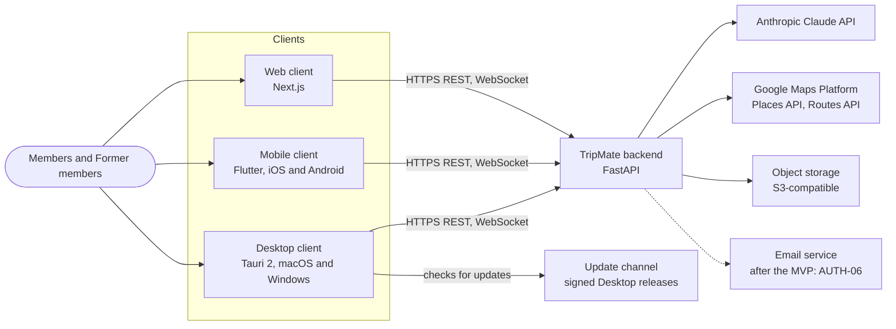
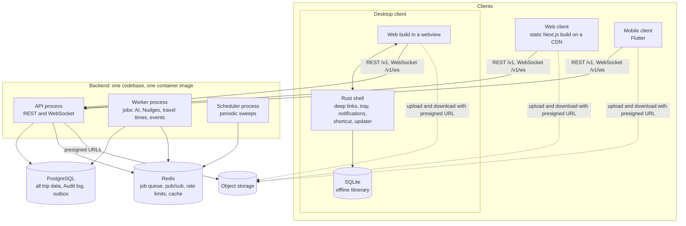
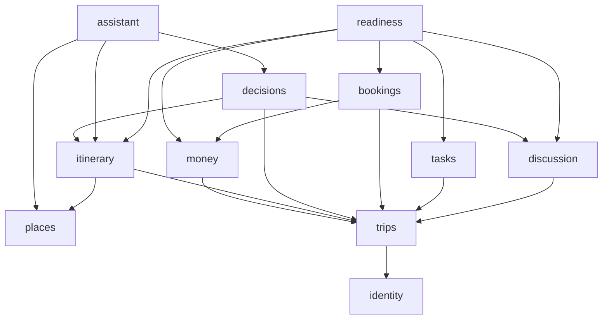
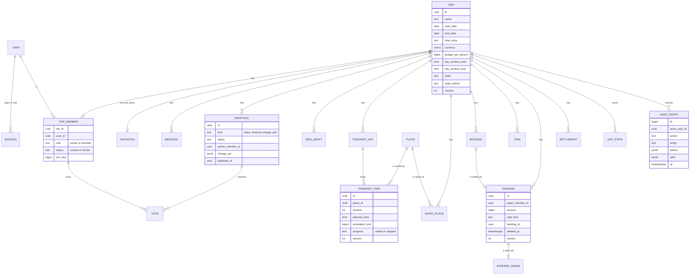
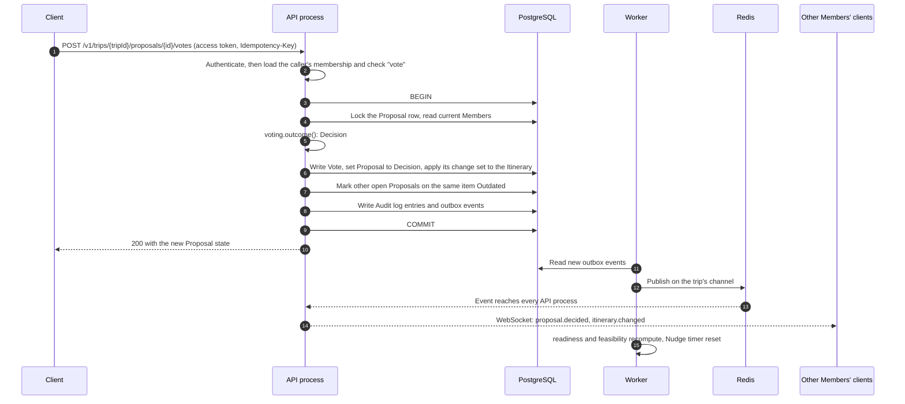
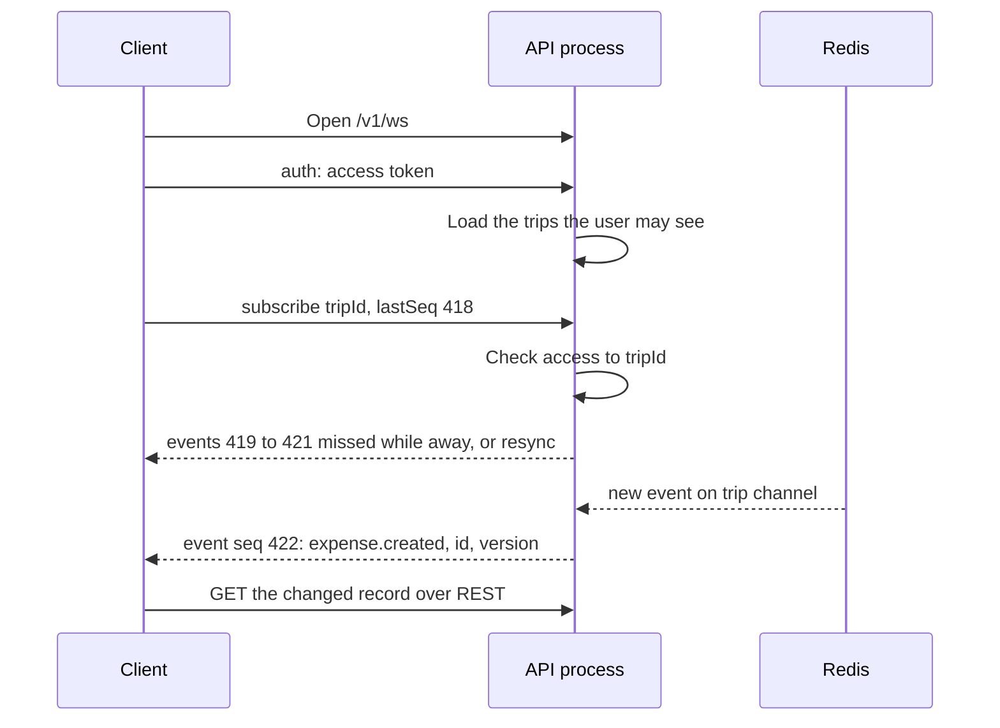
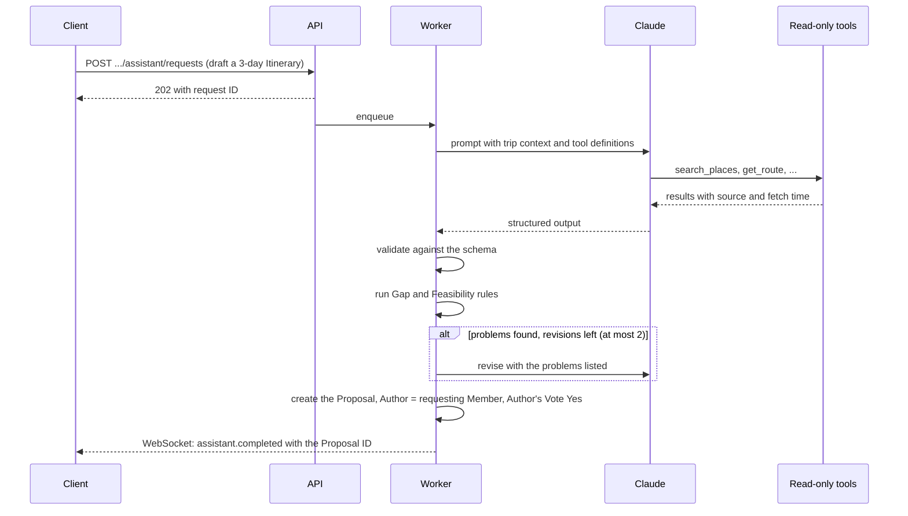
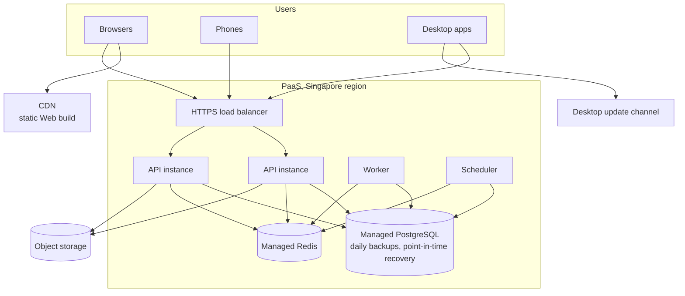

# TripMate -- Software Architecture

**Document type:** Software Architecture Document\
**Product:** TripMate\
**Status:** Proposed\
**Version:** 1.0\
**Stage:** 3. UI/UX & Software Architecture Design

Terms follow [GLOSSARY.md](../GLOSSARY.md). Requirements and their IDs
are in [prd.md](../prd.md); this document does not repeat the product
rules, it says where each one is enforced. The technology stack comes
from [mvp-roadmap.md](../mvp-roadmap.md), section 2. Decisions with
lasting consequences are recorded in [docs/adr](adr/).

This document answers *how the system is organised*: the parts, how
they talk, where data lives, and how it is secured, observed, and
deployed. Each epic's detailed technical design (exact endpoints,
tables, and jobs) lives in the technical design section of its
`docs/specs/<epic>/spec.md` and must stay within what is written here.

## 1. Architectural Drivers

The requirements that shape the architecture most. Everything else in
this document follows from them.

| # | Driver | Source | Consequence |
|---|--------|--------|-------------|
| D1 | Money, voting, Gap, and authorization rules must give the same answer on every client | PRD section 6, business rules 10 and 14 | All domain rules run in the backend as pure, tested functions. Clients only display. |
| D2 | Equal rights, so the Audit log is the main safeguard | ADR-0002, PRD section 3.2 | Every change writes its Audit log entry in the same database transaction as the change itself. |
| D3 | Three clients (Web, Mobile, Desktop) on one backend | PRD section 6 | One versioned REST API with a machine-readable contract; typed clients generated from it. |
| D4 | Votes, messages, and trip updates appear promptly for connected Members | PRD section 8, Realtime | A WebSocket channel per client that carries change events after they are committed. |
| D5 | AI never changes the trip directly | PRD FR-04, business rule 8 | The assistant can only read through tools; its output is validated and turned into a Proposal by backend code. |
| D6 | External services fail without corrupting data, and planning works without AI | PRD section 8, Reliability; FR-04 | Maps and AI sit behind adapters with timeouts, run outside the request transaction, and degrade to "could not be checked". |
| D7 | Time-based behaviour: trip states change by date, Nudges wait for a quiet chat | PRD FR-02, FR-10 | A worker and a scheduler next to the API, with due work derived from the database so it survives restarts. |
| D8 | Every Member sees TripMate's own messages in their device language | PRD section 6, shared requirements | The backend stores and sends message keys with parameters and error codes, never text. |
| D9 | Desktop reuses the Web client and reads the Itinerary offline | PRD DESK-01, DESK-06 | The Web client is a static build with no server-side code; Rust only bridges to the operating system. |
| D10 | A small team, 13 weeks, learning Rust on the side | mvp-roadmap.md | A modular monolith, managed hosting, and no infrastructure the team must run by hand. |

## 2. System Context

Who and what TripMate talks to.



| External system | Used for | Requirements |
|-----------------|----------|--------------|
| Anthropic Claude API | Place suggestions, Itinerary drafts, idea capture | AI-01 to AI-10 |
| Google Maps Platform | Place search and details, travel time between Itinerary items, map display (P1) | ITN-05, ITN-06, ITN-11, Gap 5 |
| Object storage | Booking documents (P1), avatars (P1) | BOOK-05, AUTH-04 |
| Email service | Password reset links, after the MVP | AUTH-06 |
| Update channel | Signed Desktop installers and updates | DESK-07 |

## 3. Containers

The deployable parts and how they connect.



| Container | Technology | Responsibility | Does not |
|-----------|------------|----------------|----------|
| Web client | Next.js App Router, TypeScript, static export | All screens for browsers; the same build runs inside Desktop | Hold domain rules or call external providers directly |
| Mobile client | Flutter | Screens optimised for use while travelling | Hold domain rules |
| Desktop client | Tauri 2, Rust | Runs the Web build; DESK-02 to DESK-07 | Run money, voting, or Gap logic |
| API process | FastAPI on Uvicorn | Authentication, authorization, every read and write, WebSocket connections | Call the LLM or wait for slow providers inside a request |
| Worker process | Same codebase, job runner | AI requests, Nudge evaluation, travel-time lookups, publishing committed events | Accept client connections |
| Scheduler process | Same codebase, periodic trigger | Finds due work in PostgreSQL every minute and enqueues it | Hold state of its own |
| PostgreSQL | Managed PostgreSQL 16+ | The only source of truth | -- |
| Redis | Managed Redis | Job queue, WebSocket fan-out, rate limits, short-lived caches | Hold anything that cannot be rebuilt from PostgreSQL |
| Object storage | S3-compatible bucket, private | Files | Serve files without a presigned URL |

**The Web client is a static build.** Desktop wraps the static output
of the Web client (D9), so the Web client is built with Next.js static
export: no server-side rendering, no Next.js API routes, no server
actions. Every page fetches its data from the TripMate API in the
browser. Nothing in TripMate is public, so server rendering would add
no search or sharing value. Paths with a variable part, such as the
Invitation link, are handled in the browser: the CDN serves the join
page for every `/join/*` path, and the page reads the code from the
URL.

## 4. Backend Modules

The backend is a modular monolith, as decided in
[mvp-roadmap.md](../mvp-roadmap.md). Modules follow the PRD's
functional areas, so each epic changes as few modules as possible.

| Module | Owns | Requirements | Epic |
|--------|------|--------------|------|
| `identity` | Users, credentials, sessions, profiles | FR-01 | EPIC-01 |
| `trips` | Trips, trip lifecycle, Members, Former members, ownership, Invitation | FR-02 | EPIC-02 |
| `discussion` | Discussion messages, TripMate's own messages (key and parameters) | COL-01, COL-02 | EPIC-03 |
| `decisions` | Proposals, Votes, Idea drafts, Duplicate marking, applying a Decision | COL-03 to COL-11 | EPIC-03 |
| `itinerary` | Itinerary days and items, Saved places, Visited and Skipped, Estimated costs, Feasibility warnings | FR-05 | EPIC-05 |
| `places` | The adapter to Google Maps Platform, place and travel-time caches | ITN-05, ITN-06 | EPIC-05 |
| `assistant` | LLM orchestration, tools, output schemas, revision loop | FR-04 | EPIC-04 |
| `bookings` | Booking records, booking documents | FR-06 | EPIC-06 |
| `tasks` | Tasks and assignees | FR-07 | EPIC-07 |
| `money` | Expenses, splits, Settlements, Balances, Settlement plan, spending against the Budget | FR-08 | EPIC-08, EPIC-09 |
| `readiness` | Gap rules, Readiness checklist, acknowledgements, snoozes, Nudge engine | FR-10 | EPIC-13 |
| `notifications` | Personal in-app notifications (P1) | COL-07 | EPIC-03 |
| `audit` | The Audit log | PRD section 3.2 | EPIC-02 |
| `files` | Presigned upload and download URLs, file metadata | BOOK-05, AUTH-04 | EPIC-06 |
| `platform` | Access guard, error codes, idempotency, outbox, configuration, logging | Cross-cutting | EPIC-11 |



An arrow means "calls the public interface of". `audit`, `files`, and
`platform` are used by every module and are left out of the diagram.

**Module rules**

- Each module exposes a small public interface (`<module>/service.py`
  and its data types). Other modules call only that interface; they
  never import another module's internals or query its tables.
- The dependency graph has no cycles. An import-linter contract in CI
  enforces both rules.
- Each module's domain rules are pure functions with no database or
  network access, so they can be unit- and property-tested on their
  own.
- When a module must react to another module's change without
  depending on it (for example `readiness` after a booking changes), it
  listens to a domain event (section 6.3) instead of being called.

**Where each domain rule lives**

| Rule | Module | Pure function | PRD |
|------|--------|---------------|-----|
| Trip state transitions, undo, start and end by date | `trips` | `lifecycle.next_state` | FR-02 |
| Vote outcome: Decision, Rejected, tie, recount when Members change | `decisions` | `voting.outcome` | FR-03 |
| Proposals that become Outdated | `decisions` | `voting.outdated_by` | FR-03 |
| Similar open Proposals | `decisions` | `similarity.find_similar` | COL-09 |
| Time and Budget Feasibility warnings | `itinerary` | `feasibility.evaluate` | FR-05 |
| Group Budget from Budget per person | `itinerary` | `feasibility.group_budget` | FR-02 |
| Equal and custom splits, remainder by join order | `money` | `splits.allocate` | FR-08, ADR-0001 |
| Balances | `money` | `balances.compute` | FR-08 |
| Settlement plan through the hub | `money` | `settlement.hub_plan` | FR-08, ADR-0004 |
| Gaps 1 to 10, nights needed | `readiness` | `gaps.compute` | FR-10 |
| When a Nudge may be posted | `readiness` | `nudges.due` | FR-10 |
| Who may do what | `platform` | `access.capabilities` | PRD section 3.2 |

## 5. Data Model

### 5.1 Entities

The main entities and how they relate. Columns shown are the ones that
carry a rule; each epic spec defines the full tables.



### 5.2 Conventions

| Topic | Rule | Why |
|-------|------|-----|
| Identifiers | UUIDv7 for every entity | Safe to expose, sortable by creation time |
| Trip scope | Every trip-scoped table has a non-null `trip_id`; every query goes through a repository that requires it | PRD business rule 2; makes a missing scope check impossible to write by accident |
| Money | `bigint` in the Trip currency's smallest unit; the currency lives on the trip only | ADR-0001 |
| Join order | `trip_members.join_seq` from a sequence, kept when a Former member rejoins | Remainders and hub ties go by join order (ADR-0001, ADR-0004) |
| Time | `timestamptz` in UTC for moments; `date` and `time` for trip days and the Day window, read in the trip's `time_zone` | Trip states change on the start date where the trip happens |
| Concurrency | A `version` column on every record Members edit; a write must send the version it read | PRD business rule 14: no silent overwrite |
| Deletion | Expenses, Settlements, bookings, and tasks are soft-deleted (`deleted_at`); nothing financial is removed from the database | PRD business rule 12 and 13 |
| Derived values | Balances, the Settlement plan, Feasibility warnings, and Gaps are computed from the records, not stored | One source of truth; a trip has at most 20 Members, so computing is cheap |
| TripMate's own messages | Stored as `message_key` plus `params` (JSON), never as text | PRD section 6, D8 |
| Migrations | Alembic, expand-then-contract so a deploy never needs downtime | Section 12 |

### 5.3 What is stored where

| Data | Stored in | Kept for |
|------|-----------|----------|
| All trip, Member, money, and Audit log records | PostgreSQL | For the life of the account; nothing financial is deleted |
| Gap acknowledgements, snoozes, and when each Gap was nudged | PostgreSQL, `gap_states` keyed by Gap type and subject (for example "night of 17 Nov") | As long as the trip |
| Outbox of committed events | PostgreSQL | Until published, then 7 days |
| Idempotency keys and their responses | PostgreSQL | 24 hours |
| Google place IDs | PostgreSQL, `places` | Indefinitely, as the Google terms allow |
| Other Google place content and travel times | Redis cache | No longer than the Google terms allow; refreshed on use |
| Job queue, WebSocket fan-out, rate-limit counters | Redis | Seconds to days; rebuilt from PostgreSQL if lost |
| Booking documents and avatars | Object storage, private bucket | Until the record is deleted |
| Offline Itinerary on Desktop | SQLite on the user's machine | Replaced at each sync; cleared at sign-out |

## 6. How a Change Flows Through the System

### 6.1 Commands

Every write follows the same path. The example is a Member casting the
Vote that turns a Proposal into a Decision.



**Rules for every command**

- Authorization happens before any read of trip data (section 8.3).
- Domain rules, the change, its Audit log entries, and its outbox
  events are written in one transaction. If any part fails, nothing
  is written.
- Records that decide an outcome are locked (`SELECT ... FOR UPDATE`)
  so two Votes arriving together cannot both miss the threshold.
- A Member joining or leaving re-runs `voting.outcome` for every open
  Proposal of the trip inside the same transaction, because the
  threshold changes (ADR-0002).
- Nothing slow happens inside the transaction: no LLM call, no Maps
  call. Those run in the worker.

### 6.2 Idempotency

Clients send an `Idempotency-Key` header (a UUID created once per user
action) on every `POST` that creates something: Expenses, Settlements,
bookings, tasks, messages, Proposals, Votes. The API stores the key
with the response for 24 hours and returns the stored response if the
same key arrives again. This is how a double tap or a retry on a weak
mobile connection never records an Expense twice (FR-08 acceptance
criteria).

### 6.3 Events and the outbox

- Every committed change produces domain events (for example
  `expense.created`, `proposal.decided`, `member.left`), written to
  the `outbox` table in the same transaction.
- The worker reads the outbox in order and publishes each event to the
  trip's Redis channel. A client is told about a change only after it
  is committed.
- Modules that react to others subscribe to these events: `readiness`
  recomputes Gaps and resets the Nudge timer, `itinerary` requests
  travel times for new items, `notifications` (P1) creates personal
  notifications.
- Handlers are idempotent, so an event delivered twice does no harm.

## 7. API and Realtime

### 7.1 REST API

| Topic | Convention |
|-------|------------|
| Style | JSON over HTTPS, resources under `/v1`; trip-scoped resources under `/v1/trips/{tripId}/...` |
| Contract | The OpenAPI 3.1 document produced by FastAPI is the contract. It is checked in as `contracts/openapi.json` and versioned with the code. |
| Clients | TypeScript types and client generated for Web and Desktop; a Dart client generated for Mobile. Nobody writes request code by hand. |
| Breaking changes | A CI step compares the contract with `main` and fails on a breaking change unless the path version changes (`/v2`). |
| Actions that are not edits | Named sub-resources: `POST .../confirm`, `.../undo-confirm`, `.../cancel`, `.../archive`, `.../unarchive`, `.../leave`, `.../transfer-ownership`, `.../withdraw`, `.../mark-duplicate`, `.../publish` |
| Concurrency | Responses carry the record's version in `ETag`; writes send `If-Match`. A stale version returns `409` with code `conflict.stale_version` and the current record. |
| Money | `{ "amount": 3000000, "currency": "VND" }`, amount in the smallest unit |
| Dates and times | ISO 8601; trip dates as `YYYY-MM-DD`; moments in UTC |
| Lists | Cursor pagination: `?cursor=...&limit=...` |
| Errors | Codes, never text (section 7.2) |

Main resources, grouped by module:

| Module | Resources |
|--------|-----------|
| `identity` | `/v1/auth/register`, `/v1/auth/login`, `/v1/auth/refresh`, `/v1/auth/logout`, `/v1/auth/sessions`, `/v1/me` |
| `trips` | `/v1/trips`, `/v1/trips/{tripId}`, `.../members`, `.../invitation`, `/v1/invitations/{code}/join` |
| `discussion` | `.../messages` |
| `decisions` | `.../proposals`, `.../proposals/{id}/votes`, `.../idea-drafts`, `.../idea-drafts/capture` |
| `itinerary` | `.../days`, `.../days/{dayId}/items`, `.../items/{id}/progress`, `.../saved-places`, `.../feasibility` |
| `places` | `/v1/places/search`, `/v1/places/{placeId}` |
| `assistant` | `.../assistant/requests`, `.../assistant/requests/{id}` |
| `bookings`, `tasks` | `.../bookings`, `.../tasks` |
| `money` | `.../expenses`, `.../settlements`, `.../balances`, `.../settlement-plan`, `.../spending` |
| `readiness` | `.../readiness`, `.../gaps/{gapKey}/acknowledge`, `.../gaps/{gapKey}/snooze`, `/v1/me/readiness-summary` |

### 7.2 Errors

The backend never returns text meant for people (PRD section 6).

```json
{
  "error": {
    "code": "invitation.expired",
    "params": { "expiredAt": "2026-12-01T10:00:00Z" },
    "requestId": "01JD3Q..."
  }
}
```

- Codes are `<area>.<reason>`, for example `trip.not_member`,
  `proposal.already_closed`, `money.split_mismatch`,
  `assistant.unavailable`.
- Every code has a message in both languages in the shared translation
  source (section 10). CI fails if the backend can return a code that
  has no translation.
- A request about a trip the caller cannot see returns `404
  trip.not_found`, never `403`, so the response does not reveal that
  the trip exists. The same holds for wrong Invitation codes (PRD FR-02).

### 7.3 Realtime



- One WebSocket per client. The access token is sent as the first
  message, never in the URL, so it does not end up in logs.
- Events are thin: a type, the record's ID and version, and a per-trip
  sequence number. The client fetches the record over REST, so
  authorization and field filtering exist in one place only. A Former
  member's client receives only money events.
- The API keeps the last events of each trip in Redis for 24 hours. A
  client that reconnects sends its last sequence number and receives
  what it missed; if too much is missing it is told to reload.
- When membership changes (a Member is removed, a Member leaves), the
  API drops that user's subscription to the trip at once.
- Mobile has no push in the MVP: events arrive while the app is open,
  and the app reloads open screens when it returns to the foreground.

## 8. Security

### 8.1 Authentication

TripMate runs its own authentication inside the `identity` module.

| Part | Design |
|------|--------|
| Sign-up and sign-in | Email and password (AUTH-01). Passwords hashed with Argon2id. |
| Social sign-in (P1) | Google through OpenID Connect (AUTH-05); an account is linked by verified email. |
| Access token | Signed JWT, 15 minutes, holds only the user ID and session ID. Membership is never read from the token; it is loaded per request. |
| Refresh token | Random, opaque, stored hashed in `sessions`, valid 30 days, replaced at every use. Reusing an old refresh token revokes the whole session. |
| Sessions | One row per signed-in device. Signing out ends that session; "sign out other devices" and a password change (AUTH-06) end the others. |
| Rate limits | Sign-in attempts per email and per IP address; Invitation code attempts per user and per device (PRD FR-02), in Redis. |
| Password reset (after the MVP) | Single-use, short-lived token sent by email; the same response whether or not the account exists (AUTH-06). |

Where each client keeps its tokens:

| Client | Access token | Refresh token |
|--------|--------------|---------------|
| Web | Memory only | `HttpOnly`, `Secure`, `SameSite=Strict` cookie, path `/v1/auth`, on the API's domain |
| Desktop | Memory of the webview | The operating-system keychain, through one narrow Rust command |
| Mobile | Memory | Keychain on iOS, Keystore on Android (`flutter_secure_storage`) |

The Desktop webview loads the Web build from the app bundle, not from
the Web client's domain, so it cannot rely on the API's cookie; this is
why Desktop keeps its refresh token in the keychain.

### 8.2 Clients and devices

Each install creates a random device ID, sent as a header. It is used
only for rate limits on Invitation codes and for naming sessions, never
for authorization.

### 8.3 Authorization

- One access guard runs before every trip-scoped handler: it loads the
  caller's membership in that trip from the database and checks the
  capability the endpoint declares.
- A trip ID or user ID from the client is only a lookup key, never
  proof of access (PRD section 3.2).
- Capabilities follow the "Rights at a glance" table in the PRD:

| Capability | Owner | Member | Former member with a Balance |
|------------|-------|--------|------------------------------|
| `trip.read` | Yes | Yes | No |
| `trip.edit` (details, state, Itinerary, bookings, tasks, money, discussion, votes) | Yes | Yes | No |
| `membership.manage` (remove, Invitation, transfer ownership) | Yes | No | No |
| `money.read_own` (Expenses they took part in, own Balance, Settlement plan) | Yes | Yes | Yes |

- Every endpoint must declare a capability; a test fails the build if
  one does not.
- An automated test calls every trip-scoped endpoint as a non-member, a
  Member, the Owner, and a Former member, and checks the result
  against the table.
- Row-level security in PostgreSQL is not used in the MVP; the
  repository's required `trip_id` and the guard are the controls. It
  can be added later as a second layer.

### 8.4 Data protection

| Topic | Rule |
|-------|------|
| Transport | HTTPS and WSS only; HSTS on the Web domain |
| At rest | Managed PostgreSQL, Redis, and object storage encrypted at rest by the provider |
| Files | Private bucket. The API issues a presigned upload or download URL, valid 5 minutes, only after the access guard passes (FR-06). File type and size are checked. |
| Secrets | Held in the hosting provider's secret store; never in the repositories or the client builds |
| Web | Content Security Policy that allows only the API, Google Maps, and object-storage origins |
| Desktop | Tauri capabilities allow only the commands TripMate defines; the webview may only reach the API origin |
| Logs | No passwords, tokens, email addresses, message text, or money amounts in logs |
| Data sent to the LLM | Only the trip context the request needs; Members appear as display names, never email addresses |
| Dependencies | Dependency and secret scanning in CI for every repository |

## 9. External Integrations

### 9.1 AI assistant

The assistant runs in the worker through LangChain, using Anthropic
Claude models: a larger model for place suggestions and Itinerary
drafts, a smaller, cheaper model for idea capture. Model IDs live in
configuration, so a model can be changed without a code change.



| Rule | How it is enforced |
|------|--------------------|
| AI never changes the trip (FR-04, business rule 8) | Tools are read-only. Only backend code creates a Proposal or an Idea draft, after validation, through the same `decisions` service a Member uses. |
| Outputs match a schema (FR-04) | Every output is parsed into a Pydantic model; invalid output is retried once, then the request fails with `assistant.invalid_output`. |
| Tools stay inside the trip | The trip ID is bound by the backend when the tools are created; the model cannot choose another trip. |
| Chat text cannot steer the assistant (prompt injection) | Discussion messages are passed as quoted data, never as instructions; the tools can do no harm even if the model is misled. |
| Estimates are labelled (AI-08, AI-10) | Schemas have explicit fields for source, fetch time, and "estimate"; the client labels them. |
| AI down does not stop planning (FR-04) | Assistant endpoints return `assistant.unavailable`; every other endpoint is unaffected. |
| Cost stays bounded | Per-user and per-trip daily request quotas in Redis, a token limit per request, prompt caching for the fixed part of prompts, and token and cost metrics per request. |

`get_weather` from the PRD's suggested tools is not built until a
weather provider is chosen; the assistant says weather is not checked.

How AI quality is measured (golden dataset, metrics, release gates) is
owned by `docs/test-strategy.md`.

### 9.2 Maps and places

TripMate uses Google Maps Platform: Places API for search and details,
Routes API for travel time between consecutive Itinerary items.

- Every call goes through the `places` module's provider interface, so
  another provider can be added later without touching other modules.
- Clients never call Places or Routes directly. Place search goes
  through `/v1/places/search`, which keeps the server key private and
  lets the backend apply quotas. Map display (ITN-05, P1) uses a
  separate client key restricted to the TripMate apps and domains.
- Only Google place IDs are stored permanently. Other place content and
  travel times are cached in Redis no longer than the Google terms
  allow, and fetched again when needed.
- Travel times are requested by the worker when items change, not
  during the Member's request. Until they arrive, or if the call fails,
  the time Feasibility warning and Gap 5 say "could not be checked"
  (FR-05, FR-10).
- The city of each item, needed for Gap 5 and Gap 9, comes from the
  place's address data.
- Route estimates are shown with Google attribution (FR-05).
- Usage is capped with daily quotas and a billing alert on the Google
  Cloud project.

### 9.3 Failure handling

| Provider | Timeout | When it fails |
|----------|---------|---------------|
| Claude | 60 s per call, whole request at most 3 minutes | Request ends as failed; the Member can retry; nothing is written |
| Places API | 3 s | Search shows "could not search places"; manual items still work |
| Routes API | 5 s | Warning says "could not be checked"; retried with backoff |
| Object storage | 10 s | Upload fails; the booking itself is saved |

## 10. Languages

- One shared translation source, `translations/en.json` and
  `translations/vi.json`, in ICU message format.
- A build step generates the `next-intl` messages for Web and Desktop
  and the ARB files for Mobile (`flutter_localizations`), so every
  client uses the same keys and wording.
- The backend sends error codes and stores TripMate's own messages
  (Nudges, Gap cards, status lines) as a key with parameters; each
  client renders them in its device language. Desktop native
  notifications for Nudges are rendered on the device the same way.
- Amounts, dates, and times are formatted on the client with the device
  locale and the Trip currency.
- CI fails if any key is missing in either language.

## 11. Clients

### 11.1 Web

- Next.js App Router, TypeScript, static export (section 3).
- Server data through the generated API client and a query cache
  (TanStack Query); WebSocket events invalidate the cached records they
  name.
- A small `platform` interface hides what differs inside Desktop
  (notifications, offline cache, keychain); on the plain Web it does
  nothing or uses browser features.

### 11.2 Mobile

- Flutter, with the generated Dart API client.
- Invitation links open the app through iOS Universal Links and
  Android App Links on the same `https://` join URL as the Web.
- No offline mode and no push in the MVP. Expense entry on a weak
  connection is safe to retry because of idempotency keys (section 6.2).

### 11.3 Desktop

The Rust shell does only what the PRD lists; the screens are the Web
build.

| Requirement | Built with |
|-------------|------------|
| DESK-01 Web client in a native window | Tauri 2 window loading the bundled static Web build |
| DESK-02 `tripmate://join/...` links | Tauri deep-link plugin; opens the join screen |
| DESK-03 Native notifications for Nudges | Tauri notification plugin, called by the Web code when a Nudge event arrives; the app keeps running in the tray, so its WebSocket stays open |
| DESK-04 Tray count of open Gaps | Tray icon updated from `/v1/me/readiness-summary` and readiness events |
| DESK-05 Quick-add Expense shortcut | Tauri global-shortcut plugin; opens a small window on the Web build's quick-add route, which saves through the API like any other Expense |
| DESK-06 Offline Itinerary | SQLite in the app data folder; after each sync, Rust stores each trip's Itinerary snapshot with its sync time; offline, the Web code reads it and shows a read-only view with "last synced" |
| DESK-07 Signed auto-update | Tauri updater plugin with signed update manifests; Apple Developer ID signing and notarization, Windows Authenticode signing |

- `tripmate-desktop` builds from a tagged release of the Web client, so
  Desktop always ships a known Web version.
- The offline cache is cleared at sign-out.

## 12. Deployment and Operations

### 12.1 Hosting

The backend runs on a managed platform-as-a-service in the Singapore
region, the closest region to the first users in Vietnam.



The platform is chosen in Phase 0 against these needs:

| Need | Why |
|------|-----|
| Singapore region | Latency for users in Vietnam |
| Managed PostgreSQL with point-in-time recovery | Financial records must never be lost |
| Managed Redis | Queue and WebSocket fan-out |
| Long-lived WebSocket connections | Realtime (D4) |
| Separate worker and scheduler processes from one image | Section 3 |
| Preview environment per pull request | Review in the AI-native SDLC |
| Container images | Moving to AWS later needs no code change |

### 12.2 Environments

| Environment | Purpose | Data |
|-------------|---------|------|
| Local | Development | Docker Compose with PostgreSQL and Redis; test API keys |
| Preview | One per pull request on the backend and Web | Seed data |
| Staging | Release candidates, Desktop update tests, beta | Test data only |
| Production | Real groups | Real data |

### 12.3 Delivery

- CI on GitHub Actions: lint, type checks, unit and property tests,
  integration tests against real PostgreSQL and Redis, contract
  checks, translation checks, import-linter, dependency scan.
- Database migrations run as a release step before the new version
  takes traffic; expand-then-contract keeps old and new versions
  working during the switch.
- Rollback is a redeploy of the previous image; migrations are written
  so the previous version still runs.
- How releases, rollbacks, and launch checks are run day to day is
  owned by `docs/release-plan.md`.

### 12.4 Observability

| Signal | Design |
|--------|--------|
| Logs | Structured JSON with request ID, user ID, and trip ID; no personal data (section 8.4) |
| Traces | OpenTelemetry across API, worker, database, Redis, and outgoing calls to Claude and Google |
| Metrics | Request rate, errors, and latency per endpoint (P95 target 500 ms, PRD section 8); queue depth and job age; WebSocket connections; LLM tokens and cost; Maps calls and cost; Nudges posted |
| Errors | Error reporting with release tags for backend, Web, Mobile, and Desktop |
| Alerts | P95 over target, error rate, job age over 5 minutes, outbox not draining, AI or Maps spend over budget |

## 13. Background Work

The worker runs jobs from a Redis-backed queue (Celery). The scheduler
does not keep timers of its own: every minute it asks PostgreSQL what
is due and enqueues it. Losing Redis therefore loses no work, only a
minute of delay.

| Job | Trigger | Rules from |
|-----|---------|------------|
| Publish outbox events | New outbox rows; also every few seconds | Section 6.3 |
| Start and complete trips | Scheduler: trips whose start date or the day after their end date has begun in the trip's time zone | FR-02 |
| Evaluate Nudges | 10 minutes after the last message of a trip, at Confirm, the day before departure, and when a snooze ends | FR-10 |
| Start Preparation Nudges | Scheduler: 14 days before the start date (as set on the trip) | FR-10 |
| Run an assistant request | Member request | FR-04 |
| Fetch travel times | Item added, moved, or changed | FR-05 |
| Clean up | Daily: expired idempotency keys, published outbox rows | Section 5.3 |

- Every job is idempotent and re-checks the database before acting. A
  Nudge job that finds a new message, or the Gap already closed, does
  nothing (FR-10).
- The daily Nudge limit is checked against the `gap_states` history in
  PostgreSQL, not a timer, so restarts cannot cause a second Nudge.
- Invitation expiry needs no job: an Invitation is checked against its
  expiry time when it is used.

## 14. Repositories

| Repository | Holds |
|------------|-------|
| `tripmate` | `backend/` (FastAPI), `web/` (Next.js), `mobile/` (Flutter), `contracts/` (OpenAPI document), `translations/` (shared source) |
| `tripmate-desktop` | The Tauri app (PRD section 6); builds against a tagged Web release |
| `tripmate-docs` | This document and the other product documents |

Backend, Web, and Mobile share one repository so a change to the API,
its generated clients, and the translations lands in one pull request
and one contract check. Each repository has a `CLAUDE.md` pointing to
the glossary and this document.

## 15. How the Non-Functional Requirements Are Met

| PRD requirement | Met by |
|-----------------|--------|
| Performance: API P95 under 500 ms | Slow work (LLM, Maps) moved to the worker; small trips (at most 20 Members) so derived values are computed per request; indexes on `trip_id`; P95 metric and alert |
| Realtime | WebSocket with Redis fan-out, sequence numbers, and catch-up (section 7.3) |
| Security | Own authentication with rotating refresh tokens; access guard with declared capabilities; rate limits (section 8) |
| Privacy | 404 for trips a user cannot see; presigned file URLs after the guard; no personal data in logs |
| Integrity | One transaction per command with row locks; idempotency keys; integer money; property tests for splits and the Settlement plan |
| Auditability | Audit log entry written in the same transaction as every change |
| Reliability | Provider adapters with timeouts outside transactions; outbox; jobs derived from the database |
| Compatibility | Static Web build for browsers and Desktop; Flutter for iOS and Android; Tauri for macOS and Windows |
| Observability | Logs, traces, metrics, error reporting, alerts (section 12.4) |
| AI safety | Read-only tools bound to one trip; schema validation; Proposals instead of changes; quotas (section 9.1) |
| Accessibility | Owned by the design system and each epic's design; no architectural constraint |

## 16. Decisions and Open Questions

### 16.1 Decisions made in this document

| Decision | Alternatives set aside | ADR |
|----------|------------------------|-----|
| Authentication built into the backend, with rotating refresh tokens | A hosted identity service (Supabase Auth, Clerk, Auth0) | Candidate |
| Managed PaaS in Singapore | AWS from the start; a self-managed server | No: reversible, since the backend ships as a container |
| Anthropic Claude through LangChain | OpenAI, Google Gemini | No: models are configuration |
| Google Maps Platform behind a provider interface | Goong, Mapbox | Candidate: the caching limits shape the data model |
| Web client as a static export, no server rendering | Server rendering with a separate Desktop build | Candidate: hard to reverse once screens are built |
| Outbox and thin events for realtime | Publishing events directly from the request | No |
| Balances and Gaps computed, not stored | Stored running totals | No |
| One repository for backend, Web, and Mobile | One repository per client | No |

ADR candidates are proposed to the product owner before they are
written, following [CLAUDE.md](../CLAUDE.md).

### 16.2 Open questions

| Question | Proposed answer | Needed by |
|----------|-----------------|-----------|
| In which time zone does a trip start and end? The PRD says "on the start date" | The destination's time zone, from the place data; the creating Member's device time zone when there is no destination yet | EPIC-02 spec |
| Which PaaS? | Chosen in Phase 0 against section 12.1 | Phase 0 |
| Which weather source for `get_weather`? | None in the MVP; the assistant says weather is not checked | EPIC-04 spec |
| Which email service for password reset? | Chosen with AUTH-06, after the MVP | AUTH-06 |
| What happens to a user's data when they delete their account? | Not in the MVP; needs a product rule because Expenses must keep the person | Before public launch |

## 17. Version History

| Version | Date | Changes |
|---------|------|---------|
| 1.0 | 2026-11-18 | First version: drivers, system context, containers, backend modules and where each domain rule lives, data model, command and event flow, API and realtime conventions, security, AI and Maps integration, languages, clients, deployment, background work, repositories, non-functional requirements, decisions and open questions. Authentication built in, PaaS in Singapore, Claude, and Google Maps chosen by the product owner. |
