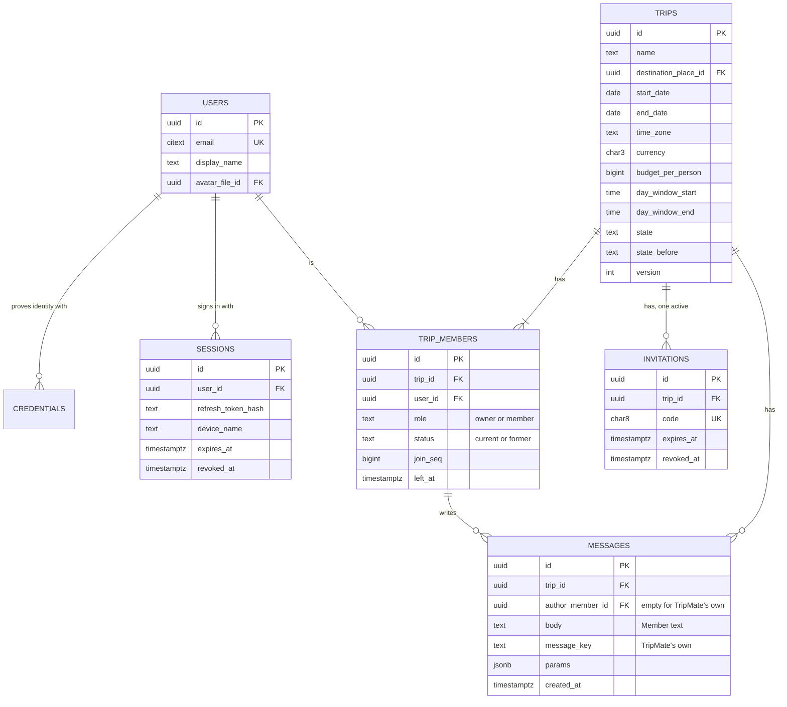
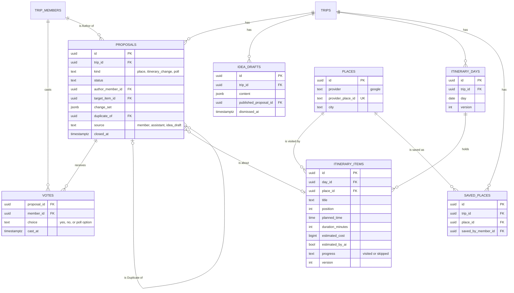
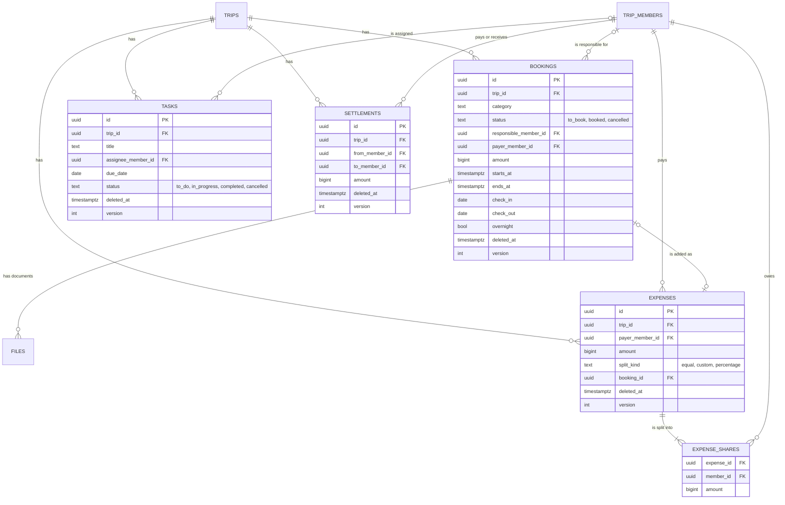
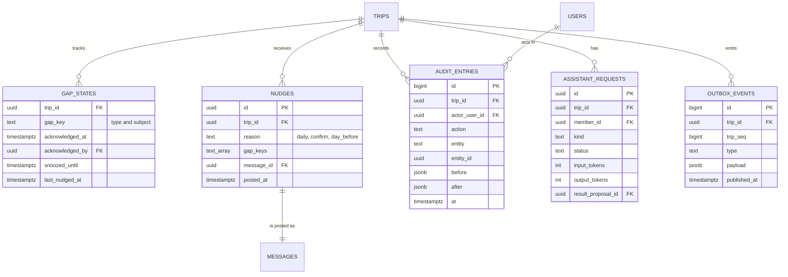

# TripMate -- Data Model

**Document type:** Data Model (Database ERD)\
**Product:** TripMate\
**Status:** Approved\
**Version:** 1.4\
**Stage:** 3. UI/UX & Software Architecture Design\
**Page version:** [TripMate Data Model artifact](https://claude.ai/artifact/KBoRVLJ5qWK3f87PPDLV3H)

Terms follow [GLOSSARY.md](../GLOSSARY.md). Requirements and their IDs
are in [prd.md](../prd.md). How the system around this data is
organised is in [architecture.md](architecture.md); who may read or
change which records is in [security.md](security.md).

This document answers *what TripMate stores and which rules the
database keeps*. It holds the whole model in one place. Each epic's
spec says which tables and columns that epic adds or changes, and the
same change updates this document, so it always shows the current
model.

## 1. Entities by Area

Every entity, the module that owns it, and the requirements it serves.
Only the owning module writes to its tables
([architecture.md](architecture.md), section 4).

| Area | Entity | Holds | Module | PRD |
|------|--------|-------|--------|-----|
| People | `users` | A person's account and profile | `identity` | FR-01 |
| People | `credentials` | Password hash, or the Google or Apple identity, of a user | `identity` | AUTH-01, AUTH-05 |
| People | `sessions` | One signed-in device, with its hashed refresh token | `identity` | AUTH-02 |
| Trips | `trips` | Trip details, state, Trip currency, Budget per person, Day window | `trips` | FR-02 |
| Trips | `trip_members` | A user's membership of a trip: Owner or Member, current or Former member, join order | `trips` | FR-02 |
| Trips | `invitations` | The trip's Invitation: code, expiry, revoked time | `trips` | TRIP-03, TRIP-04, TRIP-09 |
| Discussion | `messages` | Discussion messages and TripMate's own messages | `discussion` | COL-01, COL-02 |
| Deciding | `proposals` | Proposals of every kind, their state and change set | `decisions` | COL-03 to COL-11 |
| Deciding | `votes` | One Vote per current Member per Proposal | `decisions` | COL-05 |
| Deciding | `idea_drafts` | Idea drafts from "Capture ideas" | `decisions` | AI-09 |
| Itinerary | `itinerary_days` | One day of the trip | `itinerary` | ITN-01 |
| Itinerary | `itinerary_items` | A place or activity on a day, with time, notes, Estimated cost, Visited or Skipped | `itinerary` | ITN-02 to ITN-10 |
| Itinerary | `saved_places` | Saved places shared by the trip | `itinerary` | ITN-07 |
| Places | `places` | Google place ID and the city of the place | `places` | ITN-05, ITN-06 |
| Bookings | `bookings` | Booking records | `bookings` | FR-06 |
| Bookings | `files` | Metadata of a stored file: owner, trip, type, size, storage key | `files` | BOOK-05, AUTH-04 |
| Tasks | `tasks` | Tasks and assignees | `tasks` | FR-07 |
| Money | `expenses` | Expenses: payer, amount, split kind, link to a booking | `money` | EXP-01 to EXP-06 |
| Money | `expense_shares` | Each Participant's share of an Expense | `money` | EXP-03 to EXP-05 |
| Money | `settlements` | Settlements recorded between two Members | `money` | EXP-10 |
| Readiness | `gap_states` | Acknowledgements, snoozes, and Nudge history of each Gap | `readiness` | FR-10 |
| Readiness | `nudges` | Each posted Nudge and the Gaps it covered | `readiness` | RDY-04 |
| Notifications | `notifications` | Personal in-app notifications (P1) | `notifications` | COL-07 |
| Assistant | `assistant_requests` | Each assistant request, its status, token use and cost | `assistant` | FR-04 |
| System | `audit_entries` | The Audit log | `audit` | PRD section 3.2 |
| System | `outbox_events` | Domain events waiting to be published | `platform` | [architecture.md](architecture.md), section 5.2 |
| System | `idempotency_keys` | Keys of recent create requests and their responses | `platform` | FR-08 |

## 2. Entity Relationship Diagrams

The model is drawn in four parts so each stays readable. Columns shown
are the ones that carry a rule; section 4 lists the constraints.

### 2.1 People, trips, and discussion

### 2.2 Deciding together and the Itinerary

### 2.3 Bookings, tasks, and money

### 2.4 Readiness and system records

## 3. Conventions

| Topic | Rule | Why |
|-------|------|-----|
| Identifiers | UUIDv7 for every entity, except the append-only `audit_entries` and `outbox_events`, which use a `bigint` sequence | Safe to expose and sortable by time; sequences keep the logs in strict order |
| Names | Tables in plural snake case; foreign keys end in `_id`; members are referenced by `trip_members.id`, never by `users.id`, inside a trip | A Former member who rejoins is the same row (ADR-0003) |
| Trip scope | Every trip-scoped table has a non-null `trip_id`; every query goes through a repository that requires it | PRD business rule 2 |
| Money | `bigint` in the smallest unit of the Trip currency; the currency lives on `trips` only | ADR-0001 |
| Join order | `trip_members.join_seq` comes from a sequence and is kept when a Former member rejoins | Remainders and hub ties go by join order (ADR-0001, ADR-0004) |
| Time | `timestamptz` in UTC for moments. Trip dates and Itinerary days are `date` values read in `trips.time_zone`, which is set from the creating Member's device when the trip is created. The Day window and planned times are `time` values, local at the place and never converted | Trip time zone rules (FR-02): a trip starts and ends in the time zone of the place the group departs from |
| Concurrency | A `version` column on every record Members edit, raised by one on each write; a write must name the version it read | PRD business rule 14 |
| Deletion | Expenses, Settlements, bookings, and tasks are soft-deleted with `deleted_at`; trips are never deleted, only Cancelled or Archived | PRD business rules 12 and 13 |
| Enumerations | Stored as `text` with a `CHECK` constraint, not a PostgreSQL enum type | Adding a value needs no table rewrite |
| TripMate's own messages | `message_key` plus `params`, never text | PRD section 6 |
| Text from Members | Stored as written, plain text, never HTML | Shown as written, never translated (PRD section 6); see [security.md](security.md) |

## 4. Constraints the Database Keeps

The domain rules run in the backend's pure functions
([architecture.md](architecture.md), section 4). The database adds a
second line of defence for the rules that must never break.

| Table | Constraint | Rule from |
|-------|------------|-----------|
| `trip_members` | Unique `(trip_id, user_id)` | A person is one Member of a trip, also after rejoining (ADR-0003) |
| `trip_members` | Exactly one row per trip with `role = 'owner'` and `status = 'current'`, by a partial unique index | Business rule 1 |
| `trip_members` | At most 20 rows with `status = 'current'` per trip, checked in the join transaction under a row lock on the trip | FR-02 Invitation rules |
| `invitations` | Partial unique index: one row per trip with `revoked_at` empty | One Invitation at a time (FR-02) |
| `invitations` | `code` unique, 8 characters from the alphabet without 0, O, 1, I, L, stored in upper case | FR-02 Invitation rules |
| `votes` | Primary key `(proposal_id, member_id)` | One Vote per Member per Proposal (FR-03) |
| `proposals` | `duplicate_of` must point to a different Proposal of the same trip | COL-10 |
| `itinerary_days` | Unique `(trip_id, day)`; `day` within the trip's dates is checked by the service when dates change | FR-05 |
| `expenses` | `amount > 0` | FR-08 |
| `expense_shares` | Primary key `(expense_id, member_id)`; `amount >= 0`; the shares add up to the Expense amount, checked by a deferred constraint trigger at commit | "Expense splits must sum exactly to the Expense total" (FR-08) |
| `expenses` | `booking_id` unique where not deleted | An Expense added from a booking is counted once (FR-06, FR-08) |
| `settlements` | `from_member_id <> to_member_id`; `amount > 0` | No Member pays themselves (FR-08) |
| `trips` | `currency` cannot change once an Expense or Settlement exists, checked by a trigger | Trip detail rules (FR-02), ADR-0001 |
| `audit_entries` | The application role has `INSERT` and `SELECT` only; no `UPDATE` or `DELETE` | The Audit log cannot be rewritten |

## 5. Values That Are Computed, Not Stored

These values are computed from the records each time they are read. A
trip has at most 20 Members and a few hundred records, so computing is
cheap, and there is no stored total that can drift away from the
records. The rule behind each value, and the module it lives in, are
in [architecture.md](architecture.md), section 4.

| Value | Computed from |
|-------|---------------|
| Group Budget | `budget_per_person` times current Members |
| Balances | `expenses`, `expense_shares`, `settlements` not deleted |
| Settlement plan | Balances |
| Spending against the Budget | Expenses and the group Budget, also per Member |
| Feasibility warnings | Items, planned times, travel times, Estimated costs, bookings not yet added as an Expense, the Day window, the group Budget |
| Gaps and the Readiness checklist | Trip details, Itinerary, bookings, tasks, Feasibility warnings, `gap_states` |
| Proposal outcome | Votes and current Members |
| Visited, Skipped, and remaining counts | `itinerary_items.progress` |

The stored Proposal `status` is the outcome at the moment a Proposal
closes. Once closed it never changes (FR-03).

## 6. System Records

### 6.1 Audit log

- One `audit_entries` row for every change to trip details and state,
  membership, the Itinerary, Proposals and Votes, bookings, tasks,
  Expenses, Settlements, and Gap acknowledgements (PRD section 3.2).
- Written in the same transaction as the change, by the module that
  makes it, through the `audit` service.
- `before` and `after` hold the changed fields only, so the history of
  any record can be shown as "who changed what, from what, to what".
- Entries are kept for the life of the trip and are never edited.
- Members see the history of their trip; a Former member sees only the
  entries about Expenses they took part in and Settlements
  ([security.md](security.md)).

### 6.2 Outbox

- `outbox_events` gets one row per domain event, in the same
  transaction as the change ([architecture.md](architecture.md),
  section 5.2).
- `trip_seq` numbers a trip's events without gaps, so a client can tell
  whether it missed any ([api-design.md](api-design.md), section 5).
- The worker publishes rows in `id` order and sets `published_at`.
  Published rows are deleted after 7 days.

### 6.3 Idempotency keys

- `idempotency_keys` holds `(user_id, key)`, a hash of the request
  body, the response status, and the response body.
- The same key with the same body returns the stored response; the
  same key with a different body returns `409
  request.idempotency_mismatch`.
- Rows are deleted after 24 hours.

## 7. What Is Stored Where

| Data | Stored in | Kept for |
|------|-----------|----------|
| All trip, Member, money, and Audit log records | PostgreSQL | For the life of the account; nothing financial is deleted |
| Outbox events | PostgreSQL | Until published, then 7 days |
| Idempotency keys | PostgreSQL | 24 hours |
| Google place IDs and the city of each place | PostgreSQL, `places` | Indefinitely, as the Google terms allow |
| Other Google place content and travel times | Redis cache | No longer than the Google terms allow; fetched again when needed |
| Recent events per trip for reconnecting clients | Redis | 24 hours |
| Job queue, rate-limit counters | Redis | Seconds to days; rebuilt from PostgreSQL if lost |
| Booking documents and avatars | Cloudflare R2, private bucket; metadata in `files` | Until the record that owns them is deleted |
| Offline Itinerary on Desktop | SQLite on the user's machine | Replaced at each sync; cleared at sign-out |

## 8. Migrations

- Alembic migrations live in `tripmate-backend` and run as a release
  step before the new version takes traffic.
- Every change is expand-then-contract: add the new column or table,
  deploy code that writes both, backfill, switch reads, and remove the
  old one in a later release. The previous version keeps working at
  every step, so a rollback is a redeploy.
- A migration that changes a table in this document updates this
  document in the same epic.

## 9. Version History

| Version | Date | Changes |
|---------|------|---------|
| 1.0 | 2026-11-19 | First version: every entity with its module and requirements, four entity relationship diagrams, naming and storage conventions, constraints the database keeps, values computed instead of stored, Audit log, outbox and idempotency records, what is stored where, migrations. Header links to the page version of this document. |
| 1.1 | 2026-11-19 | Section 5 no longer names the function behind each computed value; architecture.md owns that list. References follow the new section numbers of architecture.md and api-design.md. |
| 1.2 | 2026-11-19 | Status: Approved. The product owner approved the document; no content changes. |
| 1.3 | 2026-11-19 | `credentials` also holds an Apple identity, following AUTH-05 in prd.md. |
| 1.4 | 2026-11-19 | Time convention follows the Trip time zone rules in prd.md: `trips.time_zone` comes from the creating Member's device and is used for dates; the Day window and planned times are local at the place. |
