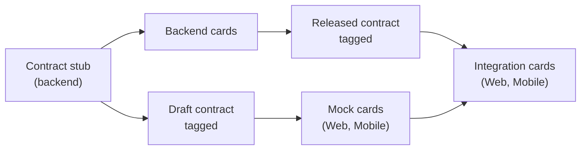
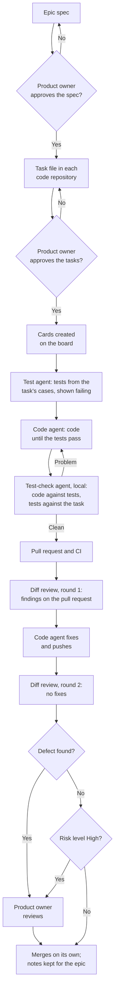

# TripMate -- Development Flow

**Document type:** Development Flow and Definition of Done\
**Product:** TripMate\
**Status:** Proposed\
**Version:** 2.0\
**Stage:** 5. AI-native SDLC\
**Page version:** [TripMate Development Flow artifact](https://claude.ai/artifact/NL1pqAnSqERZfZo5gje9eM)

Terms follow [GLOSSARY.md](../GLOSSARY.md). The loop and its quality
gates are set in [product-workflow.md](../product-workflow.md), Stage
5; this document makes them concrete for one task. Which tests run when
is owned by [test-strategy.md](test-strategy.md), and the rules a task
implements are in [prd.md](../prd.md) and its epic spec.

This document answers *how a task goes from an approved spec to
merged, and when it is Done*: the task files and the board, the risk
levels, the steps and who takes each, what each step writes, the
Definition of Done, and how defects are handled.

## 1. The Trello Board

**Who.** The team is the product owner and Claude Code. Claude Code
plans each epic, writes its task files, the tests, and the code, and
reviews them. The product owner approves each epic's spec and its task
files, answers what a spec does not decide, and reviews a pull request
when its card is High-risk (section 2.1) or when the second review
round finds a defect (section 2.3).

**Machines.** The work runs on three machines, one per group of code
repositories, so no two machines change the same code repository.
`tripmate-docs` is the exception: any machine may change it, guarded
by the version check below.

| Machine | Repositories | Why here |
|---------|--------------|----------|
| Mac 1 | `tripmate-backend`, `tripmate-contracts` | The backend comes first for every feature; the Trello cards and the Build Tracker are planned from one place |
| Mac 2 | `tripmate-mobile` | An iOS build needs macOS |
| Windows | `tripmate-web`, `tripmate-desktop` | Desktop wraps the Web build, and Windows is checked on the real system |

- Every machine has the same folder layout
  ([architecture.md](architecture.md), section 11) and pulls
  `tripmate-docs` before it starts a card.
- One card runs in one Claude Code session. Cards of one repository
  that run at the same time each use their own git worktree.
- The rules every session follows are in the `CLAUDE.md` of
  `tripmate-docs`; each code repository's `CLAUDE.md` points to them.
- The task files of an epic (below) are added to every code
  repository from Mac 1, by one planning pull request per repository
  that changes only `tasks/`. No card changes its task file; a
  correction to an approved task goes through the same kind of
  planning pull request and the product owner's approval.
- Desktop builds for macOS and Linux come from CI; they are checked by
  hand on a Mac and on an Ubuntu virtual machine.
- A session changes a document in `tripmate-docs` only for its own
  card, or when the product owner asks. Two machines can still change
  the same document at the same time, so every document pull request
  passes a version check in CI before it merges, and its branch must
  be up to date with `main`. The first to merge keeps the version; the
  other rebases and takes the next one. The steps are in the
  `CLAUDE.md` of `tripmate-docs`.

**The board.** Tasks are cards on the [TripMate board](https://trello.com/b/zsxAnzsz/tripmate). Every task
is one card. A card moves left to right, and only the condition in the
table moves it.

| Column | A card moves here when |
|--------|------------------------|
| Discussion | It is a question or an idea that is not a task yet. It leaves this column as a task in Backlog, as a change to a document, or archived. |
| Backlog | Its task is in an approved task file. The card is created from that task. |
| ToDo | It meets the Definition of Ready below |
| In-Progress | Its test agent starts (section 2.2) |
| Review | Its pull request is open |
| Done | It meets the Definition of Done (section 3) |

**Definition of Ready.** A card may move to ToDo only when it has:

- The requirement ID at the start of its title, for example
  `INV-01 Create an Invitation`.
- A link to its task in the task file, and to the spec section that
  describes the behaviour.
- Its scope in one or two sentences, and what is out of scope.
- Its dependencies: the cards or epics that must be Done first, all
  Done or named (the epic order is in
  [mvp-roadmap.md](../mvp-roadmap.md), section 6.1).
- Its test cases in its task file: the main cases, the error cases,
  and the edge cases, each with its expected result, matching the rows
  of the matrix in [test-strategy.md](test-strategy.md), section 5.
- Its risk level, which says whether the product owner reviews its
  pull request (section 2.1).
- A link to the design, if it changes a screen.
- The repository it changes, and its kind from the table below. A
  feature that changes the API has one card per repository, in the
  order of [architecture.md](architecture.md), section 11.

A card for the next epic that is not in ToDo is the signal that Stage 4
work is not finished for that epic.

**Task files.** After the product owner approves an epic's spec,
Claude Code writes one task file for each code repository the epic
changes, for example `tripmate-backend/tasks/EPIC-11.md` and
`tripmate-mobile/tasks/EPIC-11.md`. The product owner reads it in its
planning pull request to check the business rules and the edge cases
before any card exists. Each task in the file holds everything its
Trello card will say:

| Part | Content |
|------|---------|
| Title | The ID and the card title, for example `F1 Backend skeleton and health check` |
| Facts | Epic, repository, machine, size, risk level with its reason, depends on, requirement IDs, spec sections |
| Scope | What the task does, and what it leaves out |
| Done when | The conditions that close it |
| Test cases | One row per case: ID, kind (main, error, edge), given, expected result, level of [test-strategy.md](test-strategy.md), section 2 |
| Manual checks | The cases of level M, and the checkpoint items the task closes, as a checklist |

- The file starts with a header (epic, spec link, status, version) and
  a list of its tasks in order, and ends with a Version History, as
  every document does.
- The spec keeps what spans repositories: the behaviour, the
  acceptance criteria, the design, the order of the cards across
  repositories, and the checkpoints. The cards themselves and their
  test cases live only in the task files.
- When the planning pull request merges, the file is Approved and
  its cards are created on the board, each with its task copied into
  the description and a link to the task.

**Cards for a feature with an API and screens.** The backend and the
clients are built at the same time, against a draft contract
([api-design.md](api-design.md), section 6):

| Card kind | Repository | Done when | Starts after |
|-----------|------------|-----------|--------------|
| Contract stub | `tripmate-backend` | Every route of the feature exists with its request and response schemas and its error codes, returns `501`, and CI publishes a draft contract | -- |
| Backend | `tripmate-backend` | The behaviour works and its tests pass | The stub |
| Mock | `tripmate-web` or `tripmate-mobile` | Every state of the screens works against a mock API generated from the draft contract, with screen or widget tests in both languages | The draft is tagged |
| Integration | `tripmate-web` or `tripmate-mobile` | The client pins the released contract, works against the local stack in Docker, and its contract and end-to-end tests pass | The backend cards and its own mock card |

- A client card's title ends with its client and kind, for example
  `AUTH-01 Register (Web, mock)` and `AUTH-01 Register (Web,
  integration)`.
- A mock card never ships on its own: a client release pins only a
  released contract.
- When the backend has to change a shape the draft gave, the same pull
  request publishes a new draft; the integration card absorbs the
  change.
- Desktop cards, and cards that change no screen, are not split.

## 2. From Card to Merge

The product owner approves two things before any card starts: the
epic's spec, then its task files, with every task, its risk level, and
its test cases. After that Claude Code writes the tests, writes the
code, checks the tests, and reviews the diff in two rounds on the pull
request. A card merges on its own when every check passes and the
second round finds no defect, unless its risk level is High.

### 2.1 Risk levels

Every card has one risk level. It decides whether the product owner
reviews the pull request; a defect found in the second review round
brings the product owner in at any level.

| Level | A card is at this level when it changes | Before the merge |
|-------|------------------------------------------|------------------|
| Low | One module or one screen, and nothing in the rows below | It merges on its own when every check passes |
| Medium | A domain rule: a pure rule file of [architecture.md](architecture.md), section 4 | As Low, and mutation testing runs on the changed rule files |
| High | Any item of the list below | The product owner reviews the pull request. Mutation testing runs as for Medium when a rule file changes. |

A card is High when it changes any of these:

- The API contract or an event schema, including a contract stub.
- A migration or a table.
- Authentication, tokens, sessions, the access guard, or capabilities.
- A money calculation: Expenses, Balances, or the Settlement plan.
- The assistant's prompts, tools, schemas, or model settings.
- A dependency: one added, one removed, or a new major version.
- Hosting, the image, or how secrets are read.
- A CI workflow, a check of section 2.3, a `CLAUDE.md`, or an agent
  role.

Rules:

- The task file gives each task its level and the reason, and the
  product owner sees it when approving the tasks.
- CI works the level out again from the files the pull request
  changes. The higher of the two applies, so a card planned as Low
  that touches a migration becomes High.
- When the level is not clear, it is High.
- For a High card the product owner reads the impact part of the
  first review round first, then the diff, and approves by adding the
  label `human-approved` to the pull request. Claude Code never adds
  this label.

### 2.2 The steps

| Step | Who | Reads | Produces |
|------|-----|-------|----------|
| 1. Plan the epic | Claude Code, in a planning session | prd.md, the architecture documents, the code | The epic spec: behaviour, acceptance criteria, technical design, decisions, the order of the cards across repositories, and the checkpoints. An ADR for a decision that is hard to reverse. |
| 2. Approve the spec | The product owner | The epic spec | The spec is Approved |
| 3. Write the task files | Claude Code, in the planning session | The approved spec | One task file per code repository (section 1), each in its own planning pull request |
| 4. Approve the tasks | The product owner | The planning pull requests | The planning pull requests merge. The cards are created on the board from the files; those that are ready move to ToDo. |
| 5. Write the tests | The test agent | The task, the spec, the pinned contract | A test commit with one test for each case of the task, a run that shows each new test failing, and the case-to-test table. The card moves to In-Progress. |
| 6. Write the code | The code agent | The task, the spec, the test files | Code on the same branch until every test passes, with any further unit tests it needs, a note of each decision it made, and the results of the repository's lint, type, and test commands |
| 7. Check the tests | The test-check agent, on the developer machine | The task, the test files, the code, the test results | The test-check report (section 2.3). A problem goes back to the agent that owns it before the pull request opens. |
| 8. Open the pull request | The code agent | -- | A pull request with the description of section 2.5. The card moves to Review, and CI runs. |
| 9. Review, round 1 | The diff-review agent | The pull request's diff, the task, the spec | Its findings, posted on the pull request |
| 10. Fix | The code agent | The round 1 findings | Fixes pushed to the same branch, and a reply to each finding |
| 11. Review, round 2 | A new diff-review agent | The diff since round 1, the replies | Its findings, posted on the pull request; nothing is fixed. A defect asks the product owner to review; every other finding becomes a note (section 2.4). |
| 12. Merge | GitHub, when every required check passes; for a High card, or when round 2 found a defect, after the product owner's approval | -- | A merge commit. The card moves to Done. |
| 13. Close the epic | The product owner and Claude Code | Every notes file of the epic, in every repository | The notes in three lists, by level, and a decision on each. A project note becomes a change to the document that owns it in `tripmate-docs`; a repository note becomes a change to that repository's `CLAUDE.md` or an agent role, or a card; an epic note becomes a card in this epic or a later one. A note can also be dropped, with the reason. |

### 2.3 The four agents

One lead session takes a card and starts the agents, each in a new
session with no memory of the others. Only files pass between them:
the test files, the code, the reports, and the comments on the pull
request.

| Agent | Starts with | May change | Never |
|-------|-------------|------------|-------|
| Test agent | The task, its spec sections, the pinned contract | Test files | Reads the code written for the card; makes up an expected result the task does not give |
| Code agent | The task, its spec sections, the test files, and later the review findings | Code, and tests of its own | Changes, skips, or deletes a test of the test agent; reads the conversation of another agent |
| Test-check agent | The task, the test files, the code, the test results | Nothing | Changes code or tests; reads the conversation of another agent |
| Diff-review agent | The pull request's diff, the task, its spec sections | Nothing; it only posts on the pull request | Changes code or tests; reads the conversation of another agent |

- Each code repository defines the four roles in `.claude/agents/`,
  written by its skeleton card, so every card runs with the same
  instructions.
- A test commit carries the trailer `Agent: test` in its message.
- When the code agent finds a test it believes is wrong, it stops and
  names the case and the reason. A new test agent session checks the
  case against the task and corrects the test, or keeps it.
- When the spec or the task does not decide something, the agent stops
  and asks. The answer goes into the spec or the task file before the
  tests or the code.

**The test check** runs before the pull request opens and is about the
tests only. Its report goes in the pull request description.

| Part | Checks |
|------|--------|
| Cases | Each case of the task has a test, and the test asserts the task's expected result, not a weaker one |
| Lock | The test agent's tests are unchanged since its commit, and each failed before the code |
| Code against tests | The code passes because it does what the case says, not because it detects the test or returns a fixed value |
| Matrix | Each test carries its requirement ID, and the rows of [test-strategy.md](test-strategy.md), section 5, for the task's requirements have a test |
| Results | The commands run and what they returned |

A problem in the tests goes to a new test agent session; a problem in
the code goes to the code agent. The pull request opens only when the
report is clean.

**The diff review** runs after the pull request opens, on the
developer machine, in two rounds. Each finding is posted on the pull
request at its file and line, and a summary comment gives the impact:
what the diff changes outside the card (the contract, tables, callers
in other modules, clients, settings) and the risk level the agent
sees. Every finding says what goes wrong and how to fix it. No remark
about style that lint decides, and nothing CI already checks.

| Round | Who | What happens to the findings |
|-------|-----|------------------------------|
| 1 | A diff-review agent | The code agent fixes each finding and replies to it, or replies with the reason it does not apply. Then it pushes. |
| 2 | A new diff-review agent, on the diff since round 1 and the replies | Nothing is fixed. A defect asks the product owner to review the pull request. Every other finding is written to the card's notes file (section 2.4), with its proposed fix. |

A **defect** in round 2 is a Critical, High, or Medium problem of
section 4, a test case the code does not meet, a security problem, a
break of the spec or the contract, or a change outside the card's
scope. When the product owner asks for a fix, the code agent pushes
it and round 2 runs again on the new commits.

**Checks that hold these rules.** They run in CI on every pull request
and are built in the [EPIC-11 spec](specs/epic-11/spec.md).

| Check | Fails when |
|-------|------------|
| Failing first | A new test of the test commit passes before the code exists |
| Test lock | A commit that is not a test commit changes, skips, or deletes a test of the card's test commit |
| Requirement-to-test report | An acceptance criterion of a P0 requirement in the epics built so far has no test with its ID |
| Mutation | A changed rule file has a surviving mutant that the pull request does not explain. Backend only in the MVP. |
| Risk gate | The files changed make the card High and the pull request has no `human-approved` label |

### 2.4 What is written where

| Record | Written at | Where |
|--------|------------|-------|
| Behaviour, acceptance criteria, technical design, the order of the cards across repositories, checkpoints | Step 1 | `docs/specs/<epic>/spec.md` |
| A design decision of the epic | Step 1 | The decisions table of the epic spec |
| A decision that is hard to reverse | Step 1, or any step that finds one: the agent stops and asks | An ADR in [docs/adr](adr/) |
| The tasks, with their risk levels and test cases | Step 3 | `tasks/<epic>.md` in each code repository, for example `tasks/EPIC-11.md` |
| The card | Step 4 | A card on the Trello board, created from its task |
| The tests and the case-to-test table | Step 5 | The test commit; the table goes in the pull request |
| A technical decision inside one card | Step 6 | "Decisions" in the pull request. It moves to the epic spec when it binds another card. |
| The test-check report | Step 7 | The pull request description |
| The review findings and the replies | Steps 9 to 11 | Comments on the pull request |
| The notes of round 2 | Step 11 | `tasks/<epic>-notes/<card>.md` in the card's repository, for example `tasks/EPIC-11-notes/F1.md`, committed in the card's pull request. One file per card, so cards that run at the same time do not touch the same file. |
| The decision on each note | Step 13 | The notes file, and a new card when one is made |
| Which test proves which requirement | Every CI run | The requirement-to-test report, generated from test names |
| A changed rule, endpoint, or table | Step 6, in the same card | The document that owns it, with a new version (section 3) |

**Three levels.** Every record belongs to one of three levels, and
goes to the lowest level that still reaches everyone who needs it. A
business rule or anything two repositories share is always at the
project level.

| Level | Holds | Where |
|-------|-------|-------|
| Project | What every repository shares: the product, the business rules, the contract, the architecture, this flow, and the rules every session follows | `tripmate-docs` |
| Repository | How one repository is built: setup, commands, coding conventions, the agent roles | The repository's `CLAUDE.md` and `.claude/agents/` |
| Epic | What one epic builds: its behaviour across repositories, then its tasks and notes in each repository | `docs/specs/<epic>/spec.md` in `tripmate-docs`; `tasks/<epic>.md` and `tasks/<epic>-notes/` in each code repository |

**A notes file** has one row per note. It stays one file per card in
the card's repository whatever the level of its notes, so a card
never opens a second pull request for a note.

| Column | Content |
|--------|---------|
| Note | What the round 2 agent saw, at its file and line |
| Level | Project, repository, or epic, by the table above |
| Proposed fix | How to solve it, concrete enough to become a card |
| Priority | High, Medium, or Low, by what it costs to leave it |
| Decision | Empty until the epic closes; then the change or card it became, or "dropped" with the reason |

### 2.5 Naming

| What | Rule | Example |
|------|------|---------|
| Branch | `<type>/<ID>-<short-name>`; type is `feat`, `fix`, `refactor`, `test`, or `chore` | `feat/INV-01-create-invitation` |
| Commit message | Starts with the requirement ID | `INV-01 Expire an Invitation after 7 days` |
| Pull request title | Starts with the requirement ID | `INV-01 Create an Invitation` |
| Pull request description | The card and task links, the risk level, what changed and what is left out, the case-to-test table with its failing and passing runs, decisions, and the test-check report | -- |

### 2.6 Rules

- One card has one pull request per repository.
- No card only checks another card. Each card checks its own work by
  the steps above. A case of level M, and a checkpoint item of the
  epic spec, is a line in the Manual checks of the task that closes
  it; its result goes in that card's pull request.
- A pull request that fails a check is fixed on the same branch; the
  checks it affects run again.
- At each checkpoint of the epic spec the product owner may read any
  pull request that merged on its own.
- A defect that got past the checks adds a test (section 4). When a
  check should have caught it, the check changes too.

## 3. Definition of Done

A card is Done only when every item that applies is true. An item that
does not apply is marked "not applicable" in the pull request, with the
reason.

**Every task**

- [ ] Scope: the change does only what the card says. Anything more has
  its own card or the product owner's approval in the pull request.
- [ ] Every acceptance criterion of the requirement is met.
- [ ] Each acceptance criterion has at least one test with the
  requirement ID in its name, for example
  `test_INV_01_invitation_expires_after_7_days`, and the matrix row in
  [test-strategy.md](test-strategy.md), section 5, names it.
- [ ] Each test case of the card's task has a test, written before the
  code and shown failing. No later commit changed, skipped, or deleted
  it.
- [ ] The test check was clean before the pull request opened, and its
  report is in the pull request.
- [ ] Everything that runs on every pull request passed: CI (lint,
  types, unit, property, integration, API and authorization, contract,
  screens, translations) and the end-to-end smoke set
  ([test-strategy.md](test-strategy.md), section 4).
- [ ] Both diff review rounds ran on the pull request. Every round 1
  finding is fixed or answered, and every round 2 note is in the
  card's notes file with its proposed fix.
- [ ] For a High card, or when round 2 found a defect, the product
  owner approved the pull request.
- [ ] Every manual check of the task is ticked, with its result in the
  pull request.
- [ ] No Critical or High defect (section 4) is open in the area the
  card changes.
- [ ] The pull request is merged and attached to the card.

**When the task changes the backend**

- [ ] Every state and money change writes its Audit log entry in the
  same transaction.
- [ ] A new endpoint declares its capability, so the generated access
  and audit tests cover it ([test-strategy.md](test-strategy.md),
  section 5.11).
- [ ] Every `POST` that creates a record takes an `Idempotency-Key`
  ([api-design.md](api-design.md), section 2).
- [ ] The backend returns error codes and message keys, never text.
- [ ] Domain rules are pure functions with unit tests; money, voting,
  and Gap rules also have property tests.
- [ ] A changed rule file has no surviving mutant, or the pull request
  explains each one.

**When the task changes the API or a screen**

- [ ] An API change went backend first and backward compatible, then
  `tripmate-contracts`, then each client
  ([architecture.md](architecture.md), section 11).
- [ ] Every new message key is in both languages, in the file of its
  area.
- [ ] A changed screen follows the design system and its screen test
  shows it in Vietnamese and in English.

**When the task changes the assistant**

- [ ] A change to prompts, tools, schemas, or model settings passed the
  AI smoke set ([test-strategy.md](test-strategy.md), section 7.4).
- [ ] AI output reaches the trip only as a Proposal or an Idea draft.
- [ ] Tokens, cost, and latency are recorded for each request.

**When the task changes a rule, an endpoint, or a table**

- [ ] The document that owns it (the epic spec,
  [api-design.md](api-design.md), [data-model.md](data-model.md)) is
  updated with a new version.
- [ ] A decision that is hard to reverse has an ADR.

Mobile and Desktop are checked by hand at the end of each phase, not on
every card ([test-strategy.md](test-strategy.md), section 6). The full
AI evaluation and the AI release gate run when the assistant changes
and before a release ([test-strategy.md](test-strategy.md), sections
7.4 and 7.5), not on every card.

## 4. Defects

| Severity | Meaning | Example |
|----------|---------|---------|
| Critical | Money is wrong, data is lost, or someone sees a trip they do not belong to | Balances do not add up to zero |
| High | A core journey cannot be finished and there is no workaround | A Member cannot vote |
| Medium | A journey works, with a wrong result in a corner case or real effort | A Nudge is posted twice in one day |
| Low | Wording, layout, or friction | A label is cut off on a small phone |

- A defect is a card with the requirement ID it breaks, for example
  `fix/EXP-04-remainder-order`.
- The fix adds a test that fails without the fix. A defect in the
  assistant also adds a golden case
  ([ai-golden-dataset.md](ai-golden-dataset.md)).
- A Critical or High defect blocks every merge in its area until it is
  fixed, except the fix itself.
- Usability findings from the prototypes and test sessions are not
  defects; they are recorded in [ux-review.md](ux-review.md).

## 5. Decisions and Open Questions

### 5.1 Decisions made in this document

| Decision | Alternatives set aside | Why |
|----------|------------------------|-----|
| The Definition of Done lives here, with the flow it closes | In test-strategy.md or in mvp-roadmap.md | The document map gives this document "how a task goes from card to merged"; the test strategy says which tests exist, not when a card is finished |
| A Definition of Ready on the board | Cards start as soon as someone takes them | The Stage 4 gate asks that every task of the next epic has scope, dependencies, and a test before building starts |
| Every agent runs in a separate session | The authoring session reviews its own change | A reviewer that saw the reasoning tends to accept it |
| The product owner reviews High cards, and a pull request whose second review round found a defect | A person reviews every pull request | The checks and the agents are there to find defects. A person's review is kept for the changes whose effects reach beyond the card (the contract, the schema, access, money, and the gates themselves) and for a defect the agents could not settle. |
| The tasks of an epic are written to a task file in each code repository, and the product owner approves them before any card exists | Cards written on the board straight from the spec; one task file for the whole epic in `tripmate-docs` | The product owner reads every task with its edge cases in one place, in git, and a correction is a reviewed change. Each machine finds its tasks in its own repository. The spec no longer repeats the cards. |
| The test check runs locally before the pull request; the diff review runs on the pull request, in two rounds | One review agent before the pull request | A wrong or weak test is fixed before anyone waits on the pull request. The diff review is on the pull request, where the product owner can read it. Round 2 fixes nothing, so the loop always ends. |
| Round 2 findings that are not defects become notes with a proposed fix, settled when the epic closes | Every finding is fixed at once | Suggestions do not hold up a card, and seen together at the end of an epic they show which ones are worth a card |
| Records are kept at three levels: project, repository, and epic. Notes keep their level in a column of one file per card. | Everything in `tripmate-docs`; a notes folder at each level | Each record sits where the sessions that need it look first, and a shared business rule never hides in one repository. One notes file per card means a card writes only in its own repository, and the levels are sorted when the epic closes. |
| No card only checks another card | A check card after each group of cards | Each card checks its own work; the manual checks and the checkpoint items are lines in the task that closes them |
| A separate agent writes the tests first, from the card's test cases | The author writes the tests with the code | A test written next to the code tends to repeat the code's mistake. The expected results come from the spec the product owner approved, and a test that fails first is known to check something. |
| The agents run on the developer machine, not in CI | An AI review as a CI job | No model key in CI. The cost: GitHub cannot prove the agents ran; the test-check report and the review comments on the pull request are the evidence. |
| CI works out the risk level from the changed files | The author states the level | An author judges its own change too kindly. The plan's level is a forecast; the files decide. |
| The product owner approves a High card with a label | A second GitHub account for Claude Code and a required approving review | Both act through one GitHub account, which cannot approve its own pull request. The label is a rule, not a technical barrier; a bot account can replace it later. |
| Mutation testing only on changed rule files, in the backend | The whole repository on every pull request; the clients as well | The rules live in the backend ([test-strategy.md](test-strategy.md), section 1), and a full run is too slow for every pull request |
| Four defect severities | No scale | "No open Critical or High defect" is a quality gate and needs a definition |
| A client card is split into a mock card and an integration card | One client card after the backend is done | Web and Mobile are built while the backend is, against the same draft; the integration card catches any difference between the draft and the real API |
| Any machine may change `tripmate-docs`, guarded by a version check in CI and branches kept up to date with `main` | Only Mac 1 changes the documents; the other machines hand their answers to Mac 1 | The answer to a question found on Mac 2 or Windows belongs in the spec before that card's tests. A hand-off to Mac 1 delays the card and can lose the answer; the check stops two changes from taking the same version. |

### 5.2 Open questions

None. Each repository's coding conventions live in its own
`CLAUDE.md`, written by its skeleton card in the EPIC-11 spec.

## 6. Version History

| Version | Date | Changes |
|---------|------|---------|
| 1.0 | 2026-11-20 | First version: the Trello board and the Definition of Ready, the steps from card to merge with naming rules, the Definition of Done, defect severities, decisions and open questions. |
| 1.1 | 2026-11-20 | Approved by the product owner. Section 1 names the team (the product owner and Claude Code), links the TripMate Trello board, and uses its columns: Discussion, Backlog, ToDo, In-Progress, Review, Done. The open question about the board is narrowed to the GitHub Power-Up. |
| 1.2 | 2026-11-20 | The open question about Trello's GitHub Power-Up is closed: the product owner added it to the board. |
| 1.3 | 2026-11-20 | Section 1: a feature with an API and screens is built as a contract stub, backend cards, mock cards against the draft contract, and integration cards against the released contract, so the backend and the clients are built at the same time. Decision added to section 5.1. |
| 1.4 | 2026-11-20 | There are no preview environments: an integration card works against the local stack in Docker, and the end-to-end smoke set runs in CI. The open question about coding conventions is closed: each repository's `CLAUDE.md`, written in EPIC-11. |
| 1.5 | 2026-11-23 | Section 2 rewritten. The product owner approves each epic's plan and reviews only High-risk cards; every other card merges on its own when its checks pass. Three risk levels, set in the epic spec and worked out again by CI from the changed files. Three agents in separate sessions: a test agent writes the tests first from the card's test cases, a code agent writes the code, a review agent reads the diff before the pull request. Five CI checks hold the rules: failing first, test lock, the requirement-to-test report, mutation, and the risk gate. A table says which record is written at which step. The Definition of Ready, the board columns, and the Definition of Done follow. Status back to Proposed. |
| 1.6 | 2026-11-23 | Approved by the product owner. No content changed. |
| 1.7 | 2026-11-23 | Section 3: the full AI evaluation runs when the assistant changes and before a release, as test-strategy.md now says, not nightly. |
| 1.8 | 2026-11-23 | Section 1: the work runs on three machines, one per group of repositories (Mac 1: backend, contracts, documents; Mac 2: Mobile; Windows: Web and Desktop), with one session per card and a git worktree for cards of one repository that run at the same time. The Definition of Done follows the translation files split by area. |
| 1.9 | 2026-11-23 | Section 1: any machine may change `tripmate-docs`, not only Mac 1. A session changes a document only for its own card or when the product owner asks; every document pull request passes a version check in CI and must be up to date with `main`. Mac 1 still plans the Trello cards and the Build Tracker. Decision added to 5.1. |
| 2.0 | 2026-11-25 | The product owner changed how tasks are planned and reviewed. After the spec is approved, Claude Code writes a task file in each code repository (`tasks/<epic>.md`) with every task, its risk level, and its test cases; the product owner approves it, and the cards are created from it. The spec keeps what spans repositories. A test-check agent checks the tests against the task and the code against the tests before the pull request. A diff-review agent reviews the pull request in two rounds: the code agent fixes round 1; round 2 fixes nothing, asks the product owner only for a defect, and writes every other finding to the card's notes file with its proposed fix and its level (project, repository, or epic), settled when the epic closes. Section 2.4 says which records belong to which of the three levels. No card only checks another card. Status back to Proposed. |
