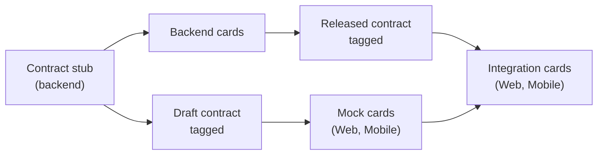
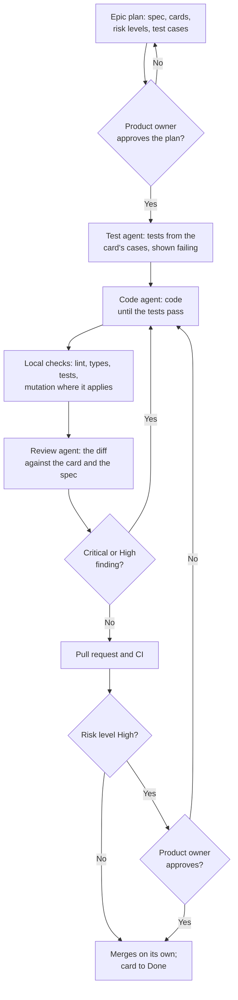

# TripMate -- Development Flow

**Document type:** Development Flow and Definition of Done\
**Product:** TripMate\
**Status:** Proposed\
**Version:** 1.5\
**Stage:** 5. AI-native SDLC\
**Page version:** [TripMate Development Flow artifact](https://claude.ai/artifact/NL1pqAnSqERZfZo5gje9eM)

Terms follow [GLOSSARY.md](../GLOSSARY.md). The loop and its quality
gates are set in [product-workflow.md](../product-workflow.md), Stage
5; this document makes them concrete for one task. Which tests run when
is owned by [test-strategy.md](test-strategy.md), and the rules a task
implements are in [prd.md](../prd.md) and its epic spec.

This document answers *how a task goes from a Trello card to merged,
and when it is Done*: the board, the risk levels, the steps and who
takes each, what each step writes, the Definition of Done, and how
defects are handled.

## 1. The Trello Board

**Who.** The team is the product owner and Claude Code. Claude Code
plans each epic, writes the tests and the code, and reviews them. The
product owner approves each epic's plan, answers what a spec does not
decide, and reviews the pull requests of High-risk cards (section
2.1).

**The board.** Tasks are cards on the [TripMate board](https://trello.com/b/zsxAnzsz/tripmate). Every task
is one card. A card moves left to right, and only the condition in the
table moves it.

| Column | A card moves here when |
|--------|------------------------|
| Discussion | It is a question or an idea that is not a task yet. It leaves this column as a task in Backlog, as a change to a document, or archived. |
| Backlog | It is written: a requirement ID and a title |
| ToDo | It meets the Definition of Ready below |
| In-Progress | Its test agent starts (section 2.2) |
| Review | Its pull request is open |
| Done | It meets the Definition of Done (section 3) |

**Definition of Ready.** A card may move to ToDo only when it has:

- The requirement ID at the start of its title, for example
  `INV-01 Create an Invitation`.
- A link to the spec section that describes the behaviour.
- Its scope in one or two sentences, and what is out of scope.
- Its dependencies: the cards or epics that must be Done first, all
  Done or named (the epic order is in
  [mvp-roadmap.md](../mvp-roadmap.md), section 6.1).
- Its test cases in the epic spec: the main cases and the edge cases,
  each with its expected result, matching the rows of the matrix in
  [test-strategy.md](test-strategy.md), section 5.
- Its risk level, which says whether the product owner reviews its
  pull request (section 2.1).
- A link to the design, if it changes a screen.
- The repository it changes, and its kind from the table below. A
  feature that changes the API has one card per repository, in the
  order of [architecture.md](architecture.md), section 11.

A card for the next epic that is not in ToDo is the signal that Stage 4
work is not finished for that epic.

**Cards for a feature with an API and screens.** The backend and the
clients are built at the same time, against a draft contract
([api-design.md](api-design.md), section 6):

| Card kind | Repository | Done when | Starts after |
|-----------|------------|-----------|--------------|
| Contract stub | `tripmate-backend` | Every route of the feature exists with its request and response schemas and its error codes, returns `501`, and CI publishes a draft contract | -- |
| Backend | `tripmate-backend` | The behaviour works and its tests pass | The stub |
| Mock | `tripmate-web` or `tripmate-mobile` | Every state of the screens works against a mock API generated from the draft contract, with screen or widget tests in both languages | The draft is tagged |
| Integration | `tripmate-web` or `tripmate-mobile` | The client pins the released contract, works against the local stack in Docker, and its contract and end-to-end tests pass | The backend cards and its own mock card |

- A client card's title ends with its client and kind, for example
  `AUTH-01 Register (Web, mock)` and `AUTH-01 Register (Web,
  integration)`.
- A mock card never ships on its own: a client release pins only a
  released contract.
- When the backend has to change a shape the draft gave, the same pull
  request publishes a new draft; the integration card absorbs the
  change.
- Desktop cards, and cards that change no screen, are not split.

## 2. From Card to Merge

The product owner approves the plan of an epic once: its spec, with
every card, its risk level, and its test cases. After that Claude Code
writes the tests, writes the code, and reviews each card. A card merges
on its own when every check passes, unless its risk level is High.

### 2.1 Risk levels

Every card has one risk level. It decides whether the product owner
reviews the pull request.

| Level | A card is at this level when it changes | Before the merge |
|-------|------------------------------------------|------------------|
| Low | One module or one screen, and nothing in the rows below | It merges on its own when every check passes |
| Medium | A domain rule: a pure rule file of [architecture.md](architecture.md), section 4 | As Low, and mutation testing runs on the changed rule files |
| High | Any item of the list below | The product owner reviews the pull request. Mutation testing runs as for Medium when a rule file changes. |

A card is High when it changes any of these:

- The API contract or an event schema, including a contract stub.
- A migration or a table.
- Authentication, tokens, sessions, the access guard, or capabilities.
- A money calculation: Expenses, Balances, or the Settlement plan.
- The assistant's prompts, tools, schemas, or model settings.
- A dependency: one added, one removed, or a new major version.
- Hosting, the image, or how secrets are read.
- A CI workflow, a check of section 2.3, a `CLAUDE.md`, or an agent
  role.

Rules:

- The epic spec gives each card its level, and the product owner sees
  it when approving the plan.
- CI works the level out again from the files the pull request
  changes. The higher of the two applies, so a card planned as Low
  that touches a migration becomes High.
- When the level is not clear, it is High.
- For a High card the product owner reads the impact part of the
  review report first, then the diff, and approves by adding the label
  `human-approved` to the pull request. Claude Code never adds this
  label.

### 2.2 The steps

| Step | Who | Reads | Produces |
|------|-----|-------|----------|
| 1. Plan the epic | Claude Code, in a planning session | prd.md, the architecture documents, the code | The epic spec: behaviour, acceptance criteria, technical design, decisions, and the cards with their risk levels and test cases. An ADR for a decision that is hard to reverse. |
| 2. Approve the plan | The product owner | The epic spec | The spec is Approved. The cards are created on the board; those that are ready move to ToDo. |
| 3. Write the tests | The test agent | The card, the spec, the pinned contract | A test commit with one test for each case of the card, a run that shows each new test failing, and the case-to-test table. The card moves to In-Progress. |
| 4. Write the code | The code agent | The card, the spec, the test files | Code on the same branch until every test passes, with any further unit tests it needs, and a note of each decision it made |
| 5. Local checks | The code agent | -- | The results of the repository's lint, type, and test commands, and of mutation testing where it applies |
| 6. Review | The review agent | The diff, the card, the spec | The review report (section 2.3) |
| 7. Open the pull request | The code agent | -- | A pull request with the description of section 2.5. The card moves to Review, and CI runs. |
| 8. Merge | GitHub, when every required check passes; for a High card, after the product owner's approval | -- | A merge commit. The card moves to Done. |

### 2.3 The three agents

One lead session takes a card and starts three agents, each in a new
session with no memory of the others. Only files pass between them:
the test files, the code, and the reports.

| Agent | Starts with | May change | Never |
|-------|-------------|------------|-------|
| Test agent | The card, its spec sections, the pinned contract | Test files | Reads the code written for the card; makes up an expected result the spec does not give |
| Code agent | The card, its spec sections, the test files | Code, and tests of its own | Changes, skips, or deletes a test of the test agent; reads the test agent's conversation |
| Review agent | The diff, the card, its spec sections, the test results | Nothing | Changes code or tests; reads the conversation of either agent |

- Each code repository defines the three roles in `.claude/agents/`,
  written by its skeleton card, so every card runs with the same
  instructions.
- A test commit carries the trailer `Agent: test` in its message.
- When the code agent finds a test it believes is wrong, it stops and
  names the case and the reason. A new test agent session checks the
  case against the spec and corrects the test, or keeps it.
- When the spec does not decide something, the agent stops and asks.
  The answer goes into the spec before the tests or the code.

**The review report** has three parts:

| Part | Content |
|------|---------|
| Test cases | For each case of the card: covered, missing, or tested with a wrong expected result |
| Findings | Each with a severity of section 4, the file and line, and what goes wrong. No remark about style that lint decides, and nothing CI already checks. |
| Impact | What the diff changes outside the card: the contract, tables, callers in other modules, clients, settings; and the risk level the review agent sees |

| Finding | What happens |
|---------|--------------|
| Critical or High | The pull request is not opened. The code agent fixes it, the checks run again, and the review agent reads the new diff only. |
| Medium | Fixed in the same pull request, or it gets its own card |
| Low | Left to the code agent |

After two rounds with a Critical or High finding still open, the card
goes to the product owner.

**Checks that hold these rules.** They run in CI on every pull request
and are built in the [EPIC-11 spec](specs/epic-11/spec.md).

| Check | Fails when |
|-------|------------|
| Failing first | A new test of the test commit passes before the code exists |
| Test lock | A commit that is not a test commit changes, skips, or deletes a test of the card's test commit |
| Requirement-to-test report | An acceptance criterion of a P0 requirement in the epics built so far has no test with its ID |
| Mutation | A changed rule file has a surviving mutant that the pull request does not explain. Backend only in the MVP. |
| Risk gate | The files changed make the card High and the pull request has no `human-approved` label |

### 2.4 What is written where

| Record | Written at | Where |
|--------|------------|-------|
| Behaviour, acceptance criteria, technical design, cards, risk levels, test cases | Step 1 | `docs/specs/<epic>/spec.md` |
| A design decision of the epic | Step 1 | The decisions table of the epic spec |
| A decision that is hard to reverse | Step 1, or any step that finds one: the agent stops and asks | An ADR in [docs/adr](adr/) |
| The task | Step 2 | A card on the Trello board, linking to its spec section |
| The tests and the case-to-test table | Step 3 | The test commit; the table goes in the pull request |
| A technical decision inside one card | Step 4 | "Decisions" in the pull request. It moves to the epic spec when it binds another card. |
| The review report | Step 6 | The pull request |
| Which test proves which requirement | Every CI run | The requirement-to-test report, generated from test names |
| A changed rule, endpoint, or table | Step 4, in the same card | The document that owns it, with a new version (section 3) |

### 2.5 Naming

| What | Rule | Example |
|------|------|---------|
| Branch | `<type>/<ID>-<short-name>`; type is `feat`, `fix`, `refactor`, `test`, or `chore` | `feat/INV-01-create-invitation` |
| Commit message | Starts with the requirement ID | `INV-01 Expire an Invitation after 7 days` |
| Pull request title | Starts with the requirement ID | `INV-01 Create an Invitation` |
| Pull request description | The card link, the risk level, what changed and what is left out, the case-to-test table with its failing and passing runs, decisions, and the review report | -- |

### 2.6 Rules

- One card has one pull request per repository.
- A pull request that fails a check is fixed on the same branch; the
  checks it affects run again.
- At each checkpoint of the epic spec the product owner may read any
  pull request that merged on its own.
- A defect that got past the checks adds a test (section 4). When a
  check should have caught it, the check changes too.

## 3. Definition of Done

A card is Done only when every item that applies is true. An item that
does not apply is marked "not applicable" in the pull request, with the
reason.

**Every task**

- [ ] Scope: the change does only what the card says. Anything more has
  its own card or the product owner's approval in the pull request.
- [ ] Every acceptance criterion of the requirement is met.
- [ ] Each acceptance criterion has at least one test with the
  requirement ID in its name, for example
  `test_INV_01_invitation_expires_after_7_days`, and the matrix row in
  [test-strategy.md](test-strategy.md), section 5, names it.
- [ ] Each test case of the card in the epic spec has a test, written
  before the code and shown failing. No later commit changed, skipped,
  or deleted it.
- [ ] Everything that runs on every pull request passed: CI (lint,
  types, unit, property, integration, API and authorization, contract,
  screens, translations) and the end-to-end smoke set
  ([test-strategy.md](test-strategy.md), section 4).
- [ ] The review agent ran before the pull request was opened. No
  Critical or High finding is open, and every other finding is fixed,
  answered, or has a card.
- [ ] For a High card, the product owner approved the pull request.
- [ ] No Critical or High defect (section 4) is open in the area the
  card changes.
- [ ] The pull request is merged and attached to the card.

**When the task changes the backend**

- [ ] Every state and money change writes its Audit log entry in the
  same transaction.
- [ ] A new endpoint declares its capability, so the generated access
  and audit tests cover it ([test-strategy.md](test-strategy.md),
  section 5.11).
- [ ] Every `POST` that creates a record takes an `Idempotency-Key`
  ([api-design.md](api-design.md), section 2).
- [ ] The backend returns error codes and message keys, never text.
- [ ] Domain rules are pure functions with unit tests; money, voting,
  and Gap rules also have property tests.
- [ ] A changed rule file has no surviving mutant, or the pull request
  explains each one.

**When the task changes the API or a screen**

- [ ] An API change went backend first and backward compatible, then
  `tripmate-contracts`, then each client
  ([architecture.md](architecture.md), section 11).
- [ ] Every new message key is in both `en.json` and `vi.json`.
- [ ] A changed screen follows the design system and its screen test
  shows it in Vietnamese and in English.

**When the task changes the assistant**

- [ ] A change to prompts, tools, schemas, or model settings passed the
  AI smoke set ([test-strategy.md](test-strategy.md), section 7.4).
- [ ] AI output reaches the trip only as a Proposal or an Idea draft.
- [ ] Tokens, cost, and latency are recorded for each request.

**When the task changes a rule, an endpoint, or a table**

- [ ] The document that owns it (the epic spec,
  [api-design.md](api-design.md), [data-model.md](data-model.md)) is
  updated with a new version.
- [ ] A decision that is hard to reverse has an ADR.

Mobile and Desktop are checked by hand at the end of each phase, not on
every card ([test-strategy.md](test-strategy.md), section 6). The full
AI evaluation and the AI release gate run nightly and before a release
([test-strategy.md](test-strategy.md), section 7.5), not on every card.

## 4. Defects

| Severity | Meaning | Example |
|----------|---------|---------|
| Critical | Money is wrong, data is lost, or someone sees a trip they do not belong to | Balances do not add up to zero |
| High | A core journey cannot be finished and there is no workaround | A Member cannot vote |
| Medium | A journey works, with a wrong result in a corner case or real effort | A Nudge is posted twice in one day |
| Low | Wording, layout, or friction | A label is cut off on a small phone |

- A defect is a card with the requirement ID it breaks, for example
  `fix/EXP-04-remainder-order`.
- The fix adds a test that fails without the fix. A defect in the
  assistant also adds a golden case
  ([ai-golden-dataset.md](ai-golden-dataset.md)).
- A Critical or High defect blocks every merge in its area until it is
  fixed, except the fix itself.
- Usability findings from the prototypes and test sessions are not
  defects; they are recorded in [ux-review.md](ux-review.md).

## 5. Decisions and Open Questions

### 5.1 Decisions made in this document

| Decision | Alternatives set aside | Why |
|----------|------------------------|-----|
| The Definition of Done lives here, with the flow it closes | In test-strategy.md or in mvp-roadmap.md | The document map gives this document "how a task goes from card to merged"; the test strategy says which tests exist, not when a card is finished |
| A Definition of Ready on the board | Cards start as soon as someone takes them | The Stage 4 gate asks that every task of the next epic has scope, dependencies, and a test before building starts |
| The review agent runs in a separate session | The authoring session reviews its own change | A reviewer that saw the reasoning tends to accept it |
| The product owner reviews only High cards | A person reviews every pull request | The checks and the review agent are there to find defects. A person's review is kept for the changes whose effects reach beyond the card: the contract, the schema, access, money, and the gates themselves. |
| A separate agent writes the tests first, from the card's test cases | The author writes the tests with the code | A test written next to the code tends to repeat the code's mistake. The expected results come from the spec the product owner approved, and a test that fails first is known to check something. |
| The review agent runs before the pull request, on the developer machine | An AI review as a CI job | No model key in CI, and a finding is fixed before anyone waits on the pull request. The cost: GitHub cannot prove the review ran; the report in the pull request is the evidence. |
| CI works out the risk level from the changed files | The author states the level | An author judges its own change too kindly. The plan's level is a forecast; the files decide. |
| The product owner approves a High card with a label | A second GitHub account for Claude Code and a required approving review | Both act through one GitHub account, which cannot approve its own pull request. The label is a rule, not a technical barrier; a bot account can replace it later. |
| Mutation testing only on changed rule files, in the backend | The whole repository on every pull request; the clients as well | The rules live in the backend ([test-strategy.md](test-strategy.md), section 1), and a full run is too slow for every pull request |
| Four defect severities | No scale | "No open Critical or High defect" is a quality gate and needs a definition |
| A client card is split into a mock card and an integration card | One client card after the backend is done | Web and Mobile are built while the backend is, against the same draft; the integration card catches any difference between the draft and the real API |

### 5.2 Open questions

None. Each repository's coding conventions live in its own
`CLAUDE.md`, written by its skeleton card in the EPIC-11 spec.

## 6. Version History

| Version | Date | Changes |
|---------|------|---------|
| 1.0 | 2026-11-20 | First version: the Trello board and the Definition of Ready, the steps from card to merge with naming rules, the Definition of Done, defect severities, decisions and open questions. |
| 1.1 | 2026-11-20 | Approved by the product owner. Section 1 names the team (the product owner and Claude Code), links the TripMate Trello board, and uses its columns: Discussion, Backlog, ToDo, In-Progress, Review, Done. The open question about the board is narrowed to the GitHub Power-Up. |
| 1.2 | 2026-11-20 | The open question about Trello's GitHub Power-Up is closed: the product owner added it to the board. |
| 1.3 | 2026-11-20 | Section 1: a feature with an API and screens is built as a contract stub, backend cards, mock cards against the draft contract, and integration cards against the released contract, so the backend and the clients are built at the same time. Decision added to section 5.1. |
| 1.4 | 2026-11-20 | There are no preview environments: an integration card works against the local stack in Docker, and the end-to-end smoke set runs in CI. The open question about coding conventions is closed: each repository's `CLAUDE.md`, written in EPIC-11. |
| 1.5 | 2026-11-23 | Section 2 rewritten. The product owner approves each epic's plan and reviews only High-risk cards; every other card merges on its own when its checks pass. Three risk levels, set in the epic spec and worked out again by CI from the changed files. Three agents in separate sessions: a test agent writes the tests first from the card's test cases, a code agent writes the code, a review agent reads the diff before the pull request. Five CI checks hold the rules: failing first, test lock, the requirement-to-test report, mutation, and the risk gate. A table says which record is written at which step. The Definition of Ready, the board columns, and the Definition of Done follow. Status back to Proposed. |
