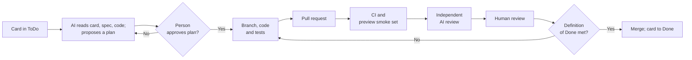

# TripMate -- Development Flow

**Document type:** Development Flow and Definition of Done\
**Product:** TripMate\
**Status:** Approved\
**Version:** 1.1\
**Stage:** 5. AI-native SDLC\
**Page version:** [TripMate Development Flow artifact](https://claude.ai/artifact/NL1pqAnSqERZfZo5gje9eM)

Terms follow [GLOSSARY.md](../GLOSSARY.md). The loop and its quality
gates are set in [product-workflow.md](../product-workflow.md), Stage
5; this document makes them concrete for one task. Which tests run when
is owned by [test-strategy.md](test-strategy.md), and the rules a task
implements are in [prd.md](../prd.md) and its epic spec.

This document answers *how a task goes from a Trello card to merged,
and when it is Done*: the board, the steps and who takes each, the
Definition of Done, and how defects are handled.

## 1. The Trello Board

**Who.** The team is the product owner and Claude Code. Claude Code
plans, builds, and reviews; the product owner approves every plan,
reviews every pull request, and owns every epic. "A person" in this
document is the product owner.

**The board.** Tasks are cards on the [TripMate board](https://trello.com/b/zsxAnzsz/tripmate). Every task
is one card. A card moves left to right, and only the condition in the
table moves it.

| Column | A card moves here when |
|--------|------------------------|
| Discussion | It is a question or an idea that is not a task yet. It leaves this column as a task in Backlog, as a change to a document, or archived. |
| Backlog | It is written: a requirement ID and a title |
| ToDo | It meets the Definition of Ready below |
| In-Progress | Its plan is approved |
| Review | Its pull request is open and CI is green |
| Done | It meets the Definition of Done (section 3) |

**Definition of Ready.** A card may move to ToDo only when it has:

- The requirement ID at the start of its title, for example
  `INV-01 Create an Invitation`.
- A link to the spec section that describes the behaviour.
- Its scope in one or two sentences, and what is out of scope.
- Its dependencies: the cards or epics that must be Done first, all
  Done or named (the epic order is in
  [mvp-roadmap.md](../mvp-roadmap.md), section 6.1).
- The tests it adds, by requirement ID, matching the rows of the
  matrix in [test-strategy.md](test-strategy.md), section 5.
- A link to the design, if it changes a screen.
- The repository it changes. A feature that changes the API has one
  card per repository, in the order of
  [architecture.md](architecture.md), section 11.

A card for the next epic that is not in ToDo is the signal that Stage 4
work is not finished for that epic.

## 2. From Card to Merge

| Step | Who | What comes out |
|------|-----|----------------|
| Plan | The AI, from the card, the spec, and the code | The files to change, the tests by requirement ID, whether the contract changes, and the questions the spec does not answer |
| Approve the plan | A person | Yes, or what to change. The card moves to In-Progress. |
| Build | The AI, within the approved plan | Code and tests on the branch |
| Open the pull request | The author | A pull request linked to the card. The card moves to Review. |
| Checks | CI and the preview | Everything listed for every pull request in [test-strategy.md](test-strategy.md), section 4 |
| AI review | A separate AI session that did not write the code | Findings on correctness, tests, scope, and security. It changes no code. |
| Human review | A person | Approval, or changes requested |
| Merge | The author, after approval | A merge commit. The card moves to Done. |

**Naming**

| What | Rule | Example |
|------|------|---------|
| Branch | `<type>/<ID>-<short-name>`; type is `feat`, `fix`, `refactor`, `test`, or `chore` | `feat/INV-01-create-invitation` |
| Commit message | Starts with the requirement ID | `INV-01 Expire an Invitation after 7 days` |
| Pull request title | Starts with the requirement ID | `INV-01 Create an Invitation` |
| Pull request description | The card link, what changed, the tests added, and what is left out | -- |

**Rules**

- One card has one pull request per repository.
- If the plan finds that the spec does not decide something, the AI
  stops and asks. The answer goes into the spec before the code.
- The AI review reads the diff, the card, and the spec, never the
  author's conversation, so it judges the change on its own.
- A pull request that fails a check is fixed on the same branch; the
  checks and the reviews run again.

## 3. Definition of Done

A card is Done only when every item that applies is true. An item that
does not apply is marked "not applicable" in the pull request, with the
reason.

**Every task**

- [ ] Scope: the change does only what the card says. Anything more has
  its own card or the product owner's approval in the pull request.
- [ ] Every acceptance criterion of the requirement is met.
- [ ] Each acceptance criterion has at least one test with the
  requirement ID in its name, for example
  `test_INV_01_invitation_expires_after_7_days`, and the matrix row in
  [test-strategy.md](test-strategy.md), section 5, names it.
- [ ] Tests changed with the code, in the same pull request.
- [ ] Everything that runs on every pull request passed: CI (lint,
  types, unit, property, integration, API and authorization, contract,
  screens, translations) and the end-to-end smoke set on the preview
  ([test-strategy.md](test-strategy.md), section 4).
- [ ] The independent AI review ran, and each finding is fixed or
  answered in the pull request.
- [ ] A person approved the pull request.
- [ ] No Critical or High defect (section 4) is open in the area the
  card changes.
- [ ] The pull request is merged and attached to the card.

**When the task changes the backend**

- [ ] Every state and money change writes its Audit log entry in the
  same transaction.
- [ ] A new endpoint declares its capability, so the generated access
  and audit tests cover it ([test-strategy.md](test-strategy.md),
  section 5.11).
- [ ] Every `POST` that creates a record takes an `Idempotency-Key`
  ([api-design.md](api-design.md), section 2).
- [ ] The backend returns error codes and message keys, never text.
- [ ] Domain rules are pure functions with unit tests; money, voting,
  and Gap rules also have property tests.

**When the task changes the API or a screen**

- [ ] An API change went backend first and backward compatible, then
  `tripmate-contracts`, then each client
  ([architecture.md](architecture.md), section 11).
- [ ] Every new message key is in both `en.json` and `vi.json`.
- [ ] A changed screen follows the design system and its screen test
  shows it in Vietnamese and in English.

**When the task changes the assistant**

- [ ] A change to prompts, tools, schemas, or model settings passed the
  AI smoke set ([test-strategy.md](test-strategy.md), section 7.4).
- [ ] AI output reaches the trip only as a Proposal or an Idea draft.
- [ ] Tokens, cost, and latency are recorded for each request.

**When the task changes a rule, an endpoint, or a table**

- [ ] The document that owns it (the epic spec,
  [api-design.md](api-design.md), [data-model.md](data-model.md)) is
  updated with a new version.
- [ ] A decision that is hard to reverse has an ADR.

Mobile and Desktop are checked by hand at the end of each phase, not on
every card ([test-strategy.md](test-strategy.md), section 6). The full
AI evaluation and the AI release gate run nightly and before a release
([test-strategy.md](test-strategy.md), section 7.5), not on every card.

## 4. Defects

| Severity | Meaning | Example |
|----------|---------|---------|
| Critical | Money is wrong, data is lost, or someone sees a trip they do not belong to | Balances do not add up to zero |
| High | A core journey cannot be finished and there is no workaround | A Member cannot vote |
| Medium | A journey works, with a wrong result in a corner case or real effort | A Nudge is posted twice in one day |
| Low | Wording, layout, or friction | A label is cut off on a small phone |

- A defect is a card with the requirement ID it breaks, for example
  `fix/EXP-04-remainder-order`.
- The fix adds a test that fails without the fix. A defect in the
  assistant also adds a golden case
  ([ai-golden-dataset.md](ai-golden-dataset.md)).
- A Critical or High defect blocks every merge in its area until it is
  fixed, except the fix itself.
- Usability findings from the prototypes and test sessions are not
  defects; they are recorded in [ux-review.md](ux-review.md).

## 5. Decisions and Open Questions

### 5.1 Decisions made in this document

| Decision | Alternatives set aside | Why |
|----------|------------------------|-----|
| The Definition of Done lives here, with the flow it closes | In test-strategy.md or in mvp-roadmap.md | The document map gives this document "how a task goes from card to merged"; the test strategy says which tests exist, not when a card is finished |
| A Definition of Ready on the board | Cards start as soon as someone takes them | The Stage 4 gate asks that every task of the next epic has scope, dependencies, and a test before building starts |
| The AI review runs in a separate session | The authoring session reviews its own change | A reviewer that saw the reasoning tends to accept it |
| Four defect severities | No scale | "No open Critical or High defect" is a quality gate and needs a definition |

### 5.2 Open questions

| Question | Proposed answer | Needed by |
|----------|-----------------|-----------|
| Who adds Trello's GitHub Power-Up to the board, so a pull request attaches to its card? | The product owner | Phase 0 |
| Where do each repository's coding conventions live? | In that repository's `CLAUDE.md`, next to the code | Phase 0 |

## 6. Version History

| Version | Date | Changes |
|---------|------|---------|
| 1.0 | 2026-11-20 | First version: the Trello board and the Definition of Ready, the steps from card to merge with naming rules, the Definition of Done, defect severities, decisions and open questions. |
| 1.1 | 2026-11-20 | Approved by the product owner. Section 1 names the team (the product owner and Claude Code), links the TripMate Trello board, and uses its columns: Discussion, Backlog, ToDo, In-Progress, Review, Done. The open question about the board is narrowed to the GitHub Power-Up. |
