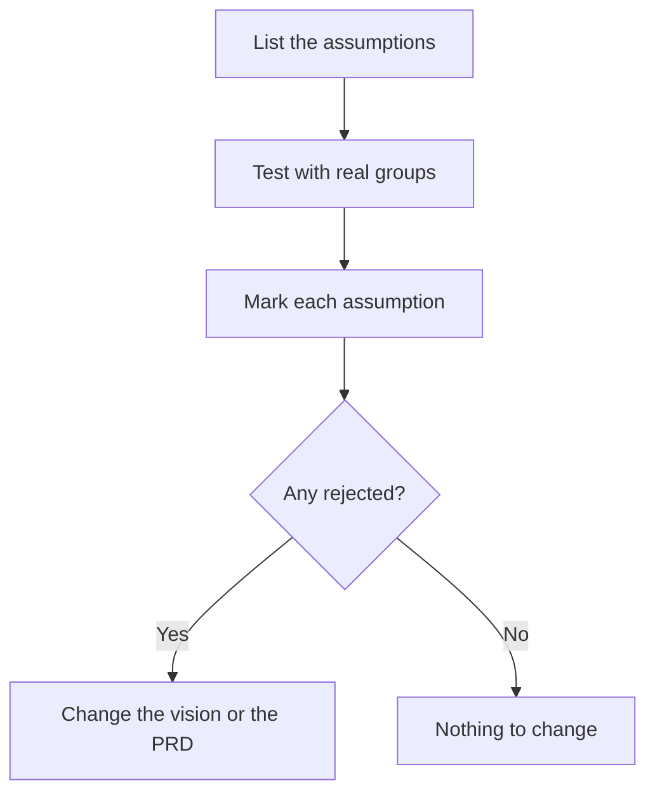

# TripMate -- Discovery

**Document type:** Discovery\
**Product:** TripMate\
**Status:** Approved\
**Version:** 1.4\
**Stage:** 1. Discovery & Strategy

Terms follow [GLOSSARY.md](../GLOSSARY.md). This document answers
*what we still need to learn before we trust the plan*: which
assumptions TripMate rests on, how each one will be tested, and what
real groups told us. What the product is and why is in
[product-vision.md](../product-vision.md); this document does not
repeat it.

## 1. Where Stage 1 Stands

Stage 1 of the [product workflow](../product-workflow.md) is finished
when these three conditions hold.

| Condition | Today |
|-----------|-------|
| At least five conversations or tests with real groups | Waived by the product owner on 2026-11-17; 1 session recorded |
| Each core assumption is marked validated, rejected, or still open | Listed in section 3; four validated after session 1, eight still open |
| Vision, goals, non-goals, and principles are written, and each goal has a metric | Written in [product-vision.md](../product-vision.md); six of the seven goals have an agreed metric; the metric for consistency across platforms is left until after the MVP |

**Stage 1 is closed.** On 2026-11-17 the product owner waived the
five sessions for this internal project and closed the stage. The
assumptions in section 3 are therefore not validated: they stay open
and are tested as the work goes on, in prototype tests and in the beta
(Phase 7 of [mvp-roadmap.md](../mvp-roadmap.md)).

How an assumption is settled from here on:

## 2. The Problems We Believe Exist

The seven problems are listed once, in
[product-vision.md](../product-vision.md) section 2, and carry the IDs
P1 to P7 in [solution-options.md](solution-options.md) section 1. They
come from the team's own experience of group trips. No outside group
has confirmed them yet.

## 3. Core Assumptions

Each assumption is something that must be true for TripMate to work as
designed. Status is one of **Open**, **Validated**, or **Rejected**.

| ID | Assumption | If it is false | How to test | Status |
|----|------------|----------------|-------------|--------|
| A1 | Groups of friends lose decisions and ideas in chat often enough to want a tool for it (P1, P2, P7). | The core problem is too small to build for. | Ask each group how their last trip was planned and what went wrong. | Validated (session 1) |
| A2 | A group will plan in a shared workspace next to their usual messaging app. | Nobody opens TripMate after the first day. | Let a group plan a real trip in the prototype and watch where the discussion happens. | Open |
| A3 | Friends accept that nobody decides alone, including the person who started the trip. | Groups want one organiser with the final say. | Run majority voting in the prototype and ask the person who would normally organise. | Validated (session 1) |
| A4 | Members will vote in the app instead of agreeing informally in chat. | Proposals stall without a majority. | Count Proposals that reach a Decision during the test. | Validated (session 1: 8 of 10) |
| A5 | Nudges help more than they annoy. | Groups mute or ignore TripMate. | Show Nudges in the prototype and ask each Member how they felt about them. | Open |
| A6 | Groups trust an AI-drafted Itinerary enough to use it as a starting point. | The assistant is ignored and its cost is wasted. | Offer an AI draft as a Proposal and see whether the group votes on it or rewrites it. | Open (session 1: read it, then edited and rewrote parts) |
| A7 | Idea capture finds the ideas the group cares about. | A P0 feature produces drafts nobody publishes. | Run idea capture on the group's real discussion and count the drafts they publish. | Open |
| A8 | Members record Expenses during the trip, not only afterwards. | Spending against the Budget is empty while travelling. | Ask how the group tracked money on their last trip, and at what moment. | Open (session 1: mixed; some note costs during the trip, others after) |
| A9 | "Pay whoever paid the most" is seen as fair and easy to follow. | The Settlement plan is disputed. | Show a Settlement plan for a sample trip and ask each Member to explain what they owe. | Open |
| A10 | Groups will enter booking details by hand. | Booking records stay empty and Preparation Gaps are wrong. | Ask the group to record one real booking and time it. | Open |
| A11 | Members plan on a computer often enough for a desktop app to matter. | Desktop work in every phase is spent on few users. | Ask which device each Member used to plan their last trip. | Open (session 1: most planned on a phone, evidence against) |
| A12 | Groups think about a trip's Budget per person, not as a group total. | Members misread the Budget and the warnings against it. | Ask the group how much the trip should cost before showing the Create trip screen, and note whether they answer per person or in total. | Validated (session 1) |

## 4. Conversations and Tests

The five sessions that Stage 1 asks for were waived, so none is
required. Every session that does happen is still recorded here:
testing the prototype with friends who are planning a real trip, and
each beta group. The prototypes are linked from the
[README](../README.md#live-pages).

For each session record the date, who the group was (size, how well
they know each other, where they were going), what they did, what was
learned, and which assumptions it touches.

| # | Date | Group | Method | What we learned | Assumptions touched |
|---|------|-------|--------|-----------------|---------------------|
| 1 | 2026-11-18 | Not recorded yet | Conversation about the group's last trip, then the Mobile prototype | Last trip planned in a group chat: with many messages nobody knew which plan had been chosen, one person had to summarise, looking back was hard, late joiners could not see what had been said, and splitting the bookings was hard. Members decide for themselves; with no other idea they follow the Proposal's Author, and firm decisions go by majority. 8 of 10 Proposals reached a Decision. They read an AI draft, then edited and rewrote parts of it. Some note costs during the trip and others after; usually they photograph the receipt or post it in the group chat after paying. Most planned on a phone. Everyone gave the Budget per person. | A1, A3, A4, A6, A8, A11, A12 |
| 2 | | | | | |
| 3 | | | | | |
| 4 | | | | | |
| 5 | | | | | |

## 5. Not Covered Yet

The workflow lists these Stage 1 deliverables. None of them is written.

- Competitor analysis and market research.
- Product strategy and business model hypothesis.
- A risk list for the assumptions that turn out false.

## 6. How This Document Changes

- After each session, fill in a row in section 4 and update the status
  of every assumption it touches in section 3.
- When an assumption is rejected, change
  [product-vision.md](../product-vision.md) or [prd.md](../prd.md) in
  the same change and say so in section 4.
- When an assumption is validated, say which session showed it.

## 7. Version History

| Version | Date | Changes |
|---------|------|---------|
| 1.0 | 2026-11-17 | First version: Stage 1 conditions and where they stand, assumptions A1 to A11 (all open), an empty log for five sessions, and the deliverables not covered yet. |
| 1.1 | 2026-11-17 | Stage 1 closed by the product owner, who waived the five sessions. Assumptions stay open and are tested in prototype tests and the beta. Status: Approved. |
| 1.2 | 2026-11-17 | Metrics settled: six goals have an agreed metric; the cross-platform metric is left until after the MVP. |
| 1.3 | 2026-11-18 | New assumption A12: groups think about the Budget per person, which prd.md now follows. |
| 1.4 | 2026-11-18 | Session 1 recorded. A1, A3, A4 and A12 validated; A6, A8 and A11 stay open with notes (A11: most of the group planned on a phone). A7 and A10 were not tested. |
