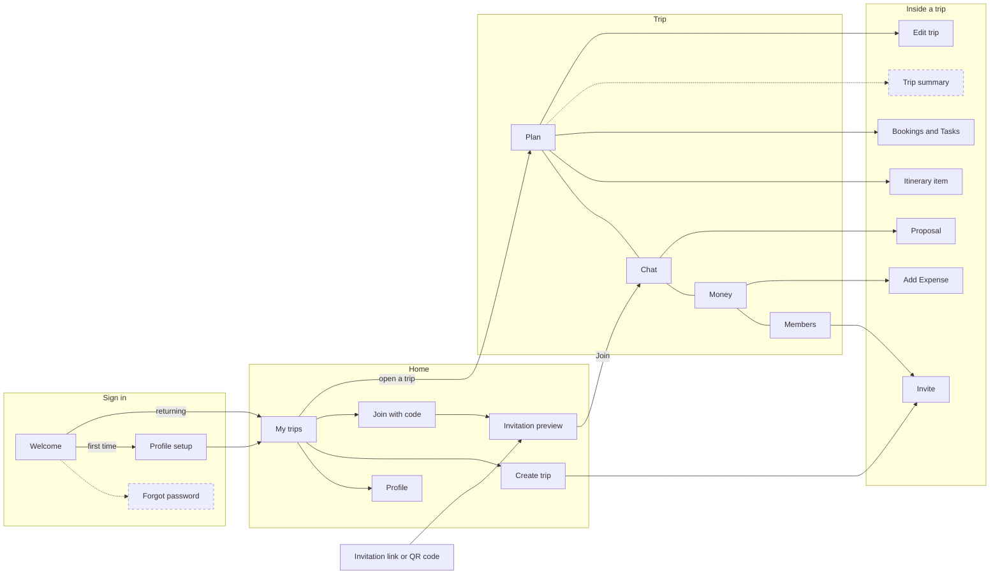
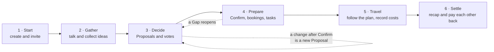
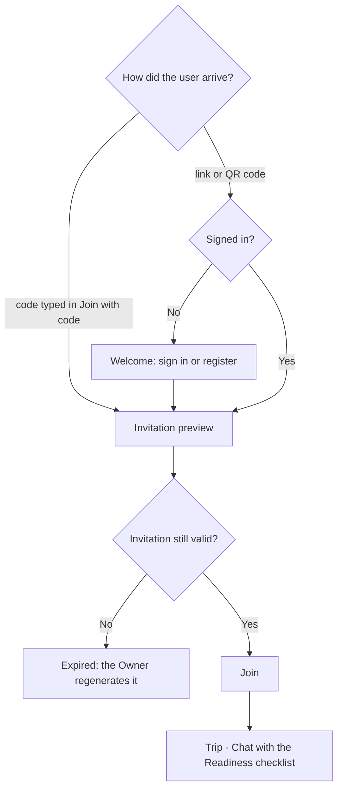
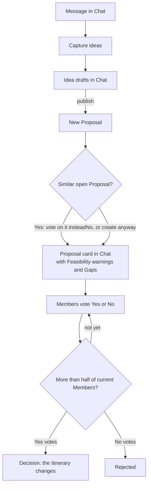
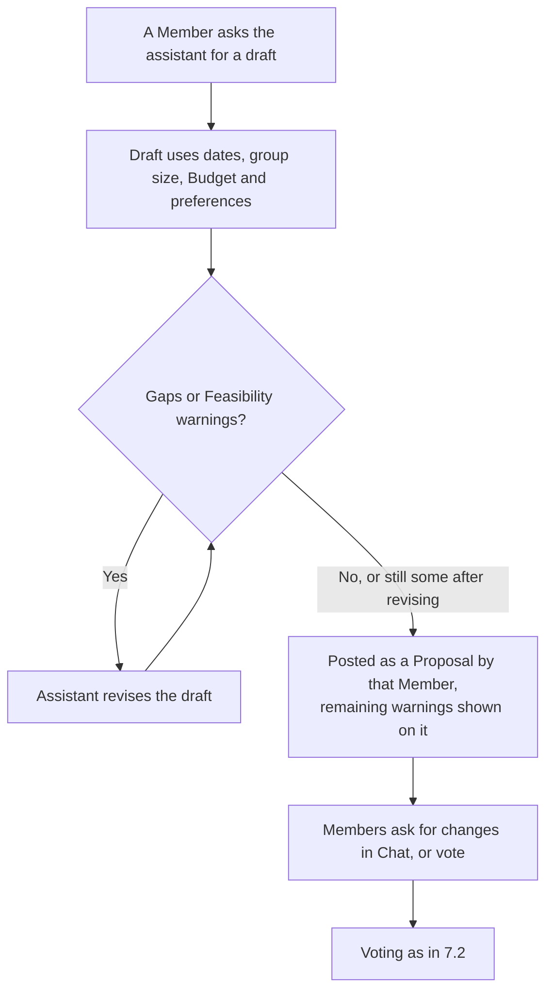
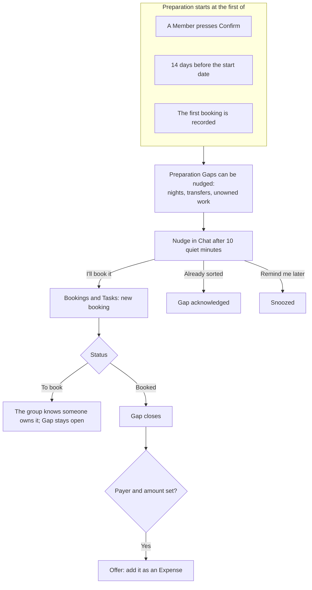
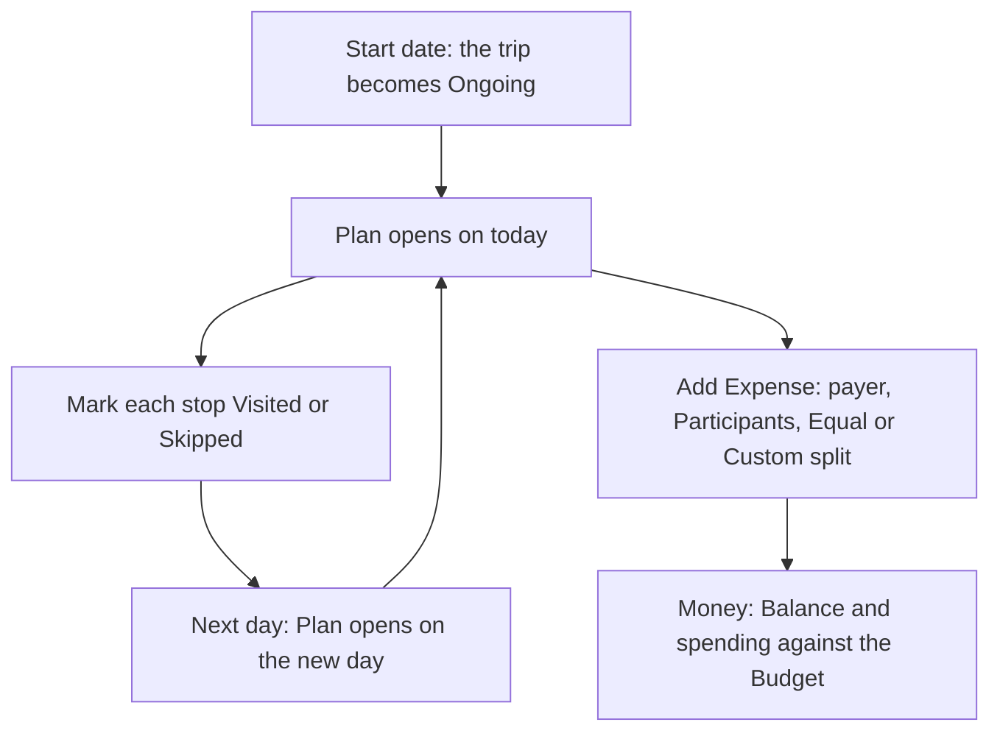
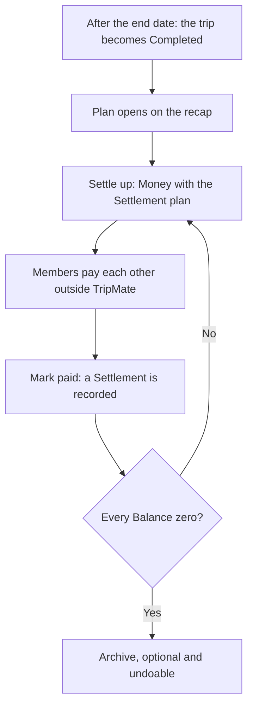

# TripMate -- Information Architecture

**Document type:** Information Architecture\
**Product:** TripMate\
**Status:** Proposed\
**Version:** 1.1\
**Visual version:** [TripMate Information Architecture artifact](https://claude.ai/artifact/Uy8kTUhj6nb78edcH64pGS)\
**Stage:** 3. UI/UX & Software Architecture Design

Terms follow [GLOSSARY.md](../GLOSSARY.md). Requirements and their IDs
are in [prd.md](../prd.md). This document answers *where things live
in TripMate and how people move between them*. The places and links
are the same for Web, Mobile, and Desktop; each prototype canvas shows
how its platform presents them. The artifact shows the same content as
an interactive map and is updated with every version of this file.

## 1. Scope

| In this document | Not in this document |
|------------------|----------------------|
| The places a user can be in, and what each holds | Screen layouts and visual design (prototype canvases) |
| How places connect: the Navigation Map | Business rules (prd.md) |
| Rules that decide where a user lands | Platform-only features beyond navigation (prd.md section 6) |
| How each platform presents the same map | Usability findings (`docs/ux-review.md`, planned) |

Sections 6 and 7 add the Global User Journey and the High-level User
Flow Diagrams that follow it.

## 2. Places

A place is anything a user can navigate to. Sheets and dialogs that
only finish one action (for example "Mark paid") are not places.

| Place | Holds | Requirements |
|-------|-------|--------------|
| Welcome | Sign in and register, with Google or email and password | AUTH-01, AUTH-05 |
| Forgot password | Request a reset link, then set a new password. After the MVP | AUTH-06 |
| Profile setup | Display name and avatar, once after registering | AUTH-03, AUTH-04 |
| My trips | Home. The user's trips grouped as Happening now, Upcoming, Past, and Archived | TRIP-01, TRIP-07 |
| Profile | The user's profile, trip counts, sign out | AUTH-02, AUTH-03 |
| Create trip | Name, destination, dates, currency, Budget, Day window | TRIP-01 |
| Join with code | Enter an Invitation code; also reached by scanning a QR code | TRIP-04 |
| Invitation preview | The trip a valid Invitation leads to, and Join | TRIP-04 |
| Trip | One trip, with four tabs: Plan, Chat, Money, Members | |
| Trip · Plan | Itinerary by day with each Booking on the day it applies, Feasibility warnings, Visited and Skipped, progress, Saved places, map | ITN-01 to ITN-11 |
| Trip · Chat | The trip discussion, the Readiness checklist pinned on top, Nudges, Proposal cards, Idea drafts, the assistant | COL-01 to COL-10, AI-01 to AI-09, RDY-01 to RDY-08 |
| Trip · Money | Balance, spending against the Budget, Settlement plan, Expenses | EXP-01 to EXP-12 |
| Trip · Members | Member list with Balances, Former members, leave, remove, transfer ownership | TRIP-05, TRIP-06, TRIP-08 |
| Invite | The Invitation as QR code, code, and link; share; revoke and regenerate | TRIP-03, TRIP-09 |
| Edit trip | The fields from Create trip, plus confirm, cancel, archive, and undo | TRIP-02, TRIP-07 |
| Proposal | One Proposal with its Votes, Feasibility warnings, and Gaps | COL-03, COL-05, COL-08, ITN-11, RDY-03 |
| Itinerary item | Time, notes, order, Estimated cost, route | ITN-02, ITN-03, ITN-06, ITN-10 |
| Add Expense | Amount, payer, Participants, split | EXP-01 to EXP-05 |
| Bookings and Tasks | Every Booking and Task, opened from the top of Plan | BOOK-01 to BOOK-09, TASK-01 to TASK-05 |
| Trip summary | The recap of a Completed trip. After the MVP | FR-09 |

## 3. Navigation Map

Solid arrows are links a user follows. Dashed boxes are places planned
for after the MVP.

## 4. Navigation rules

**Where a user lands**

| Situation | Lands on |
|-----------|----------|
| Signs in for the first time | Profile setup, then My trips |
| Signs in again | My trips |
| Opens an Invitation link or scans its QR code while signed out | Welcome, then the Invitation preview after signing in |
| Joins a trip | Trip · Chat, where the Readiness checklist shows what is still missing |

**Which tab a trip opens on**

| Trip state | Opens on | Why |
|------------|----------|-----|
| Planning, Confirmed | Chat | Deciding happens in the discussion; the Readiness checklist is pinned there |
| Ongoing | Plan, on today | Marking Visited and Skipped is the main job while travelling |
| Completed | Plan, with the recap at the top | The recap leads to Settle up in Money |
| Cancelled, Archived | Plan, read-only, with a banner and its undo | Nothing is lost; the state can be undone (TRIP-07) |

**Moving around**

- My trips is the only home. Every trip, current or past, is reached
  from it; there is no separate history screen.
- Earlier days of a trip are reached inside Plan, by day, not from a
  separate place.
- The four Trip tabs stay visible inside a trip. Back from a tab
  returns to My trips.
- Detail places (Itinerary item, Bookings and Tasks, Proposal, Add
  Expense, Invite, Edit trip) return to the tab they were opened from.
- Bookings and Tasks live in Plan, not in a tab of their own. Each
  Booking also shows on the day it applies, for example a hotel
  check-in on its first night or a bus at its departure time; the top
  of Plan shows how many Bookings there are and how many Tasks are due,
  and opens the full list.
- A Nudge or a Gap links to the place that fixes it, for example a
  missing accommodation Booking opens Bookings and Tasks.

## 5. Platform presentation

The places and links above are the same everywhere. Only the way they
are shown differs.

| | Mobile | Web | Desktop |
|---|--------|-----|---------|
| Trip tabs | Bottom tab bar | Left sidebar inside the trip | Same as Web (DESK-01) |
| My trips | Full screen, avatar opens Profile | Left list next to the open trip on wide screens | Same as Web |
| Detail places | Full screen, back arrow | Side panel or dialog | Same as Web |
| Invitation | Share sheet, QR code shown on screen | Copy link or code, QR code shown | `tripmate://join/...` opens the join screen (DESK-02) |
| Extra entry points | None in the MVP | None | Tray count of open Gaps (DESK-04), quick-add Expense shortcut (DESK-05), native Nudge notifications (DESK-03) |

## 6. Global User Journey

The journey of one group through one trip, from the first idea to the
last Settlement. It is the same on every platform. Each phase names the
places it happens in (section 2) and what TripMate does without being
asked.

| Phase | Trip state | What the group wants | Where it happens | What TripMate does on its own | Requirements |
|-------|-----------|----------------------|------------------|-------------------------------|--------------|
| 1 · Start | Planning | Get everyone into one place | Create trip, Invite, Join with code, Invitation preview | Lands each new Member in Chat with the Readiness checklist on top | TRIP-01, TRIP-03, TRIP-04, TRIP-09 |
| 2 · Gather | Planning | Throw ideas around without losing them | Chat, Plan (Saved places) | Turns ideas in the discussion into Idea drafts on request; Foundation Nudges for missing dates, destination or Budget | COL-01, AI-01, AI-09, ITN-07, RDY-04 |
| 3 · Decide | Planning | Agree on the plan without one person deciding | Chat, Proposal, Plan | Drafts an Itinerary as a Proposal on request; shows Feasibility warnings and Gaps on a Proposal before anyone votes; warns about similar open Proposals; Itinerary Nudges | COL-03, COL-05, COL-09, AI-02, ITN-11, RDY-03 |
| 4 · Prepare | Planning or Confirmed | Make sure nothing is forgotten before leaving | Edit trip (Confirm), Bookings and Tasks, Chat | Starts Preparation Nudges on Confirm, 14 days before departure, or at the first booking; suggests Confirm once after the first hotel or flight is Booked; counts booking amounts as Estimated costs; one Nudge the day before departure | TRIP-07, BOOK-01 to BOOK-09, TASK-01 to TASK-05, RDY-04 |
| 5 · Travel | Ongoing | Know what is next today and keep track of money | Plan (opens on today), Add Expense, Money | Becomes Ongoing on the start date; shows progress and spending against the Budget | ITN-08, ITN-09, EXP-01 to EXP-05, EXP-12 |
| 6 · Settle | Completed, then Archived | Pay each other back with as few transfers as possible | Plan (recap), Money | Becomes Completed after the end date; opens Plan on the recap with a Settle up shortcut; computes the Settlement plan | EXP-08 to EXP-10, TRIP-07 |

**Rules the journey follows**

- Phases overlap. A group can record a booking while still voting, and
  anyone can go back to Decide at any time: after Confirm, a change to
  the Itinerary is a new Proposal.
- No phase needs a button press to begin. Only Confirm is a deliberate
  step, and it can be undone; the trip starts and ends on its dates
  whether or not it was Confirmed.
- Every Member can do every step except managing membership (ADR-0002).
- Where TripMate acts on its own, it informs: it never changes the
  Itinerary, confirms the trip or moves money by itself.

## 7. High-level User Flow Diagrams

One diagram per core flow, at the level of places and decisions, not
screens. Business rules stay in [prd.md](../prd.md); each flow names
the requirements it follows. The prototype canvases show every screen
of these flows.

### 7.1 Join a trip

- A revoked or regenerated Invitation stops working as a link, a code
  and a QR code at once (TRIP-03).
- A user who registers on the way is sent to Profile setup first, then
  back to the Invitation preview.

### 7.2 From an idea to a Decision

- Nobody votes automatically, the Author included; there is no approve
  button (COL-05, ADR-0002).
- A Member can mark a Proposal as a Duplicate of an earlier open one;
  the Author can withdraw it while it is open (COL-08, COL-10).

### 7.3 AI draft Itinerary

- The draft never changes the Itinerary by itself; only a Decision does
  (AI-02, AI-04).

### 7.4 Confirm and prepare

- Bookings need no vote in any trip state; each one posts a status line
  in Chat (FR-06).
- If the first hotel or flight is Booked while the trip is still in
  Planning, TripMate suggests Confirm once in Chat and never confirms by
  itself.
- A booking amount counts as an Estimated cost until it is added as an
  Expense, so the Budget never counts it twice.

### 7.5 During the trip

- Earlier days stay reachable in Plan and can still be corrected
  (ITN-08).
- Save on Add Expense works only when the split adds up to the amount
  exactly (EXP-05).

### 7.6 Settle up and close

- TripMate never moves money; it only records Settlements (EXP-10).
- A Member may leave with a non-zero Balance and keeps read-only access
  to their own money records (ADR-0003).

## 8. Version History

| Version | Date | Changes |
|---------|------|---------|
| 1.0 | 2026-11-17 | First version: places, Navigation Map, navigation rules (Bookings and Tasks live in Plan), and platform presentation, with an interactive artifact. |
| 1.1 | 2026-11-18 | Added the Global User Journey (section 6) and six High-level User Flow Diagrams (section 7); status set to Proposed. |
