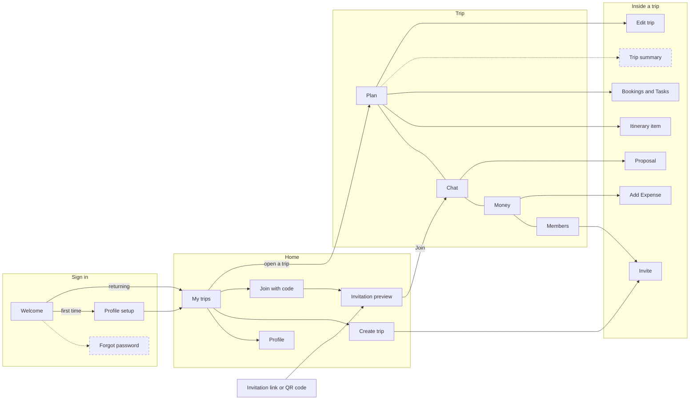

# TripMate -- Information Architecture

**Document type:** Information Architecture\
**Product:** TripMate\
**Status:** Draft\
**Version:** 1.0\
**Visual version:** [TripMate Information Architecture artifact](https://claude.ai/artifact/Uy8kTUhj6nb78edcH64pGS)\
**Stage:** 3. UI/UX & Software Architecture Design

Terms follow [GLOSSARY.md](../GLOSSARY.md). Requirements and their IDs
are in [prd.md](../prd.md). This document answers *where things live
in TripMate and how people move between them*. The places and links
are the same for Web, Mobile, and Desktop; each prototype canvas shows
how its platform presents them. The artifact shows the same content as
an interactive map and is updated with every version of this file.

## 1. Scope

| In this document | Not in this document |
|------------------|----------------------|
| The places a user can be in, and what each holds | Screen layouts and visual design (prototype canvases) |
| How places connect: the Navigation Map | Business rules (prd.md) |
| Rules that decide where a user lands | Platform-only features beyond navigation (prd.md section 6) |
| How each platform presents the same map | Usability findings (`docs/ux-review.md`, planned) |

The Global User Journey and the High-level User Flow Diagrams will be
added to this document as sections 6 and 7.

## 2. Places

A place is anything a user can navigate to. Sheets and dialogs that
only finish one action (for example "Mark paid") are not places.

| Place | Holds | Requirements |
|-------|-------|--------------|
| Welcome | Sign in and register, with Google or email and password | AUTH-01, AUTH-05 |
| Forgot password | Request a reset link, then set a new password. After the MVP | AUTH-06 |
| Profile setup | Display name and avatar, once after registering | AUTH-03, AUTH-04 |
| My trips | Home. The user's trips grouped as Happening now, Upcoming, Past, and Archived | TRIP-01, TRIP-07 |
| Profile | The user's profile, trip counts, sign out | AUTH-02, AUTH-03 |
| Create trip | Name, destination, dates, currency, Budget, Day window | TRIP-01 |
| Join with code | Enter an Invitation code; also reached by scanning a QR code | TRIP-04 |
| Invitation preview | The trip a valid Invitation leads to, and Join | TRIP-04 |
| Trip | One trip, with four tabs: Plan, Chat, Money, Members | |
| Trip · Plan | Itinerary by day with each Booking on the day it applies, Feasibility warnings, Visited and Skipped, progress, Saved places, map | ITN-01 to ITN-11 |
| Trip · Chat | The trip discussion, the Readiness checklist pinned on top, Nudges, Proposal cards, Idea drafts, the assistant | COL-01 to COL-10, AI-01 to AI-09, RDY-01 to RDY-08 |
| Trip · Money | Balance, spending against the Budget, Settlement plan, Expenses | EXP-01 to EXP-12 |
| Trip · Members | Member list with Balances, Former members, leave, remove, transfer ownership | TRIP-05, TRIP-06, TRIP-08 |
| Invite | The Invitation as QR code, code, and link; share; revoke and regenerate | TRIP-03, TRIP-09 |
| Edit trip | The fields from Create trip, plus confirm, cancel, archive, and undo | TRIP-02, TRIP-07 |
| Proposal | One Proposal with its Votes, Feasibility warnings, and Gaps | COL-03, COL-05, COL-08, ITN-11, RDY-03 |
| Itinerary item | Time, notes, order, Estimated cost, route | ITN-02, ITN-03, ITN-06, ITN-10 |
| Add Expense | Amount, payer, Participants, split | EXP-01 to EXP-05 |
| Bookings and Tasks | Every Booking and Task, opened from the top of Plan | BOOK-01 to BOOK-09, TASK-01 to TASK-05 |
| Trip summary | The recap of a Completed trip. After the MVP | FR-09 |

## 3. Navigation Map

Solid arrows are links a user follows. Dashed boxes are places planned
for after the MVP.

## 4. Navigation rules

**Where a user lands**

| Situation | Lands on |
|-----------|----------|
| Signs in for the first time | Profile setup, then My trips |
| Signs in again | My trips |
| Opens an Invitation link or scans its QR code while signed out | Welcome, then the Invitation preview after signing in |
| Joins a trip | Trip · Chat, where the Readiness checklist shows what is still missing |

**Which tab a trip opens on**

| Trip state | Opens on | Why |
|------------|----------|-----|
| Planning, Confirmed | Chat | Deciding happens in the discussion; the Readiness checklist is pinned there |
| Ongoing | Plan, on today | Marking Visited and Skipped is the main job while travelling |
| Completed | Plan, with the recap at the top | The recap leads to Settle up in Money |
| Cancelled, Archived | Plan, read-only, with a banner and its undo | Nothing is lost; the state can be undone (TRIP-07) |

**Moving around**

- My trips is the only home. Every trip, current or past, is reached
  from it; there is no separate history screen.
- Earlier days of a trip are reached inside Plan, by day, not from a
  separate place.
- The four Trip tabs stay visible inside a trip. Back from a tab
  returns to My trips.
- Detail places (Itinerary item, Bookings and Tasks, Proposal, Add
  Expense, Invite, Edit trip) return to the tab they were opened from.
- Bookings and Tasks live in Plan, not in a tab of their own. Each
  Booking also shows on the day it applies, for example a hotel
  check-in on its first night or a bus at its departure time; the top
  of Plan shows how many Bookings there are and how many Tasks are due,
  and opens the full list.
- A Nudge or a Gap links to the place that fixes it, for example a
  missing accommodation Booking opens Bookings and Tasks.

## 5. Platform presentation

The places and links above are the same everywhere. Only the way they
are shown differs.

| | Mobile | Web | Desktop |
|---|--------|-----|---------|
| Trip tabs | Bottom tab bar | Left sidebar inside the trip | Same as Web (DESK-01) |
| My trips | Full screen, avatar opens Profile | Left list next to the open trip on wide screens | Same as Web |
| Detail places | Full screen, back arrow | Side panel or dialog | Same as Web |
| Invitation | Share sheet, QR code shown on screen | Copy link or code, QR code shown | `tripmate://join/...` opens the join screen (DESK-02) |
| Extra entry points | None in the MVP | None | Tray count of open Gaps (DESK-04), quick-add Expense shortcut (DESK-05), native Nudge notifications (DESK-03) |

## 6. Global User Journey

Not written yet.

## 7. High-level User Flow Diagrams

Not written yet.

## 8. Version History

| Version | Date | Changes |
|---------|------|---------|
| 1.0 | 2026-11-17 | First version: places, Navigation Map, navigation rules (Bookings and Tasks live in Plan), and platform presentation, with an interactive artifact. |
