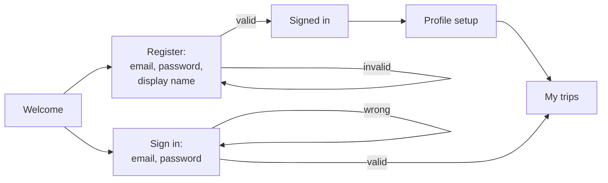
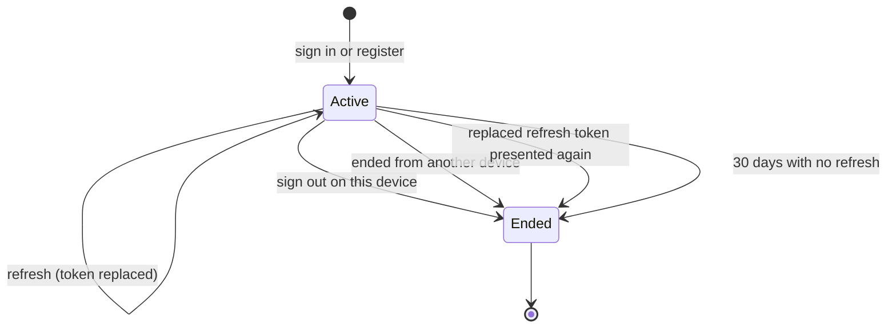

# TripMate -- EPIC-01 Spec: Authentication and User Profiles

**Document type:** Epic Spec\
**Product:** TripMate\
**Status:** Proposed\
**Version:** 1.0\
**Stage:** 2--4, epic level\
**Epic:** EPIC-01, Phase 1\
**Page version:** [TripMate EPIC-01 Spec artifact](https://claude.ai/artifact/CDUhq8v5rqC2f3neCN53Rs)

Terms follow [GLOSSARY.md](../../../GLOSSARY.md). The requirements are
FR-01 in [prd.md](../../../prd.md). This spec does not repeat what other
documents own; it links to them:

| Topic | Owned by |
|-------|----------|
| Passwords, tokens, sessions, rate limits | [security.md](../../security.md), section 2 |
| Endpoints and the error format | [api-design.md](../../api-design.md), sections 3.1 and 4 |
| Tables `users`, `credentials`, `sessions` | [data-model.md](../../data-model.md), section 2.1 |
| Where authentication runs, and why | [ADR-0005](../../adr/0005-authentication-built-into-the-backend.md) |
| Screens Welcome, Profile setup, Profile | [information-architecture.md](../../information-architecture.md), section 2 |
| What each test level proves | [test-strategy.md](../../test-strategy.md), section 5.1 |

This spec answers *how accounts behave in the MVP, how they are built,
and which cards build them*.

## 1. Scope

| In this epic | Priority | Out of this epic |
|--------------|----------|------------------|
| AUTH-01 register and sign in with email and password | P0 | Social sign-in, AUTH-05 (P1) |
| AUTH-02 sign out, and see and end signed-in devices | P0 | Password reset by email, AUTH-06 (P1, after the MVP) |
| AUTH-03 view and edit the profile: display name | P0 | Avatar, AUTH-04 (P1) |
| | | Changing the email, deleting the account, email verification |

The P1 items get their sections in a later version of this spec, in the
change that schedules them ([test-strategy.md](../../test-strategy.md),
section 5.12).

## 2. Behaviour

### 2.1 Register (AUTH-01)

| Rule | Detail |
|------|--------|
| Email | Trimmed; compared without case (`citext`); one account per email |
| Password | At least 10 characters, not on the list of common passwords ([security.md](../../security.md), section 2) |
| Display name | Required at registration: 1 to 40 characters after trimming, any script, no line breaks |
| After registering | The user is signed in at once: the response carries the tokens, as sign-in does |
| First screen | Profile setup, then My trips. If the user came from an Invitation link, the Invitation preview follows ([information-architecture.md](../../information-architecture.md), section 7.1) |

### 2.2 Sign in (AUTH-01)

| Rule | Detail |
|------|--------|
| Wrong email or wrong password | The same answer, `401 auth.invalid_credentials`, so the screen never says which one was wrong |
| Too many attempts | `429 rate.limited` with `Retry-After`, keyed by email and by IP address ([security.md](../../security.md), section 2.2) |
| Result | A new session for this device, an access token, and a refresh token |

### 2.3 Sessions and sign out (AUTH-02)

| Rule | Detail |
|------|--------|
| One session per device | Named from the device type and the client, for example "iPhone · TripMate app" or "Chrome on macOS · Web" |
| Refresh | The refresh token is replaced at every use; the old one stops working at once |
| Reuse of an old refresh token | Ends that whole session. The device that presented it must sign in again. |
| Sign out | Ends this device's session and clears its tokens; the user lands on Welcome |
| Devices list | On Profile: every active session with its name and last use; the current one is marked and cannot be ended from the list |
| End a device | Ends that session at once; its next request fails with `401 auth.token_expired`, and its refresh fails with `401 auth.session_ended` |
| Sign out other devices | Ends every session except the current one |
| Access token expiry | 15 minutes. A client refreshes once on `401 auth.token_expired`, then retries the request once. If the refresh fails, the user lands on Welcome. |

### 2.4 Profile (AUTH-03)

| Rule | Detail |
|------|--------|
| What the profile shows | Display name, email (read only), the number of trips by group, signed-in devices, Sign out |
| What can be edited | The display name, with the rules of 2.1 |
| Who | Only the user, through `/v1/me`; there is no endpoint that reads or edits another user's profile |
| Where a display name shows | Everywhere the user appears in a trip, for every Member, after the next load or realtime update |

### 2.5 Errors this epic adds

| Status | Code | When |
|--------|------|------|
| `400` | `request.invalid` with `fields` | Email malformed; password or display name breaks a rule. Field codes: `auth.password_too_short`, `auth.password_too_common`, `profile.display_name_invalid` |
| `401` | `auth.invalid_credentials` | Wrong email or password |
| `401` | `auth.session_ended` | A refresh for a session that was ended or revoked |
| `409` | `auth.email_taken` | Register with an email that has an account |

`auth.not_signed_in` and `auth.token_expired` already exist
([api-design.md](../../api-design.md), section 4.2). Every code has text
in both languages before its card is Done.

## 3. Acceptance Criteria

Each criterion has at least one test named with its requirement ID
([docs/development-flow.md](../../development-flow.md), section 3).

| ID | Criterion | Levels |
|----|-----------|--------|
| AUTH-01 | A user registers with email, password, and display name, and is signed in | I, A, S, E |
| AUTH-01 | A password is stored only as an Argon2id hash; a short or common password is refused | U, I |
| AUTH-01 | An email that differs only in case is the same account | I, A |
| AUTH-01 | Wrong email and wrong password give the same answer | A |
| AUTH-01 | Sign-in and sign-up are rate limited | A |
| AUTH-02 | A refresh replaces the refresh token, and the old one no longer works | I, A |
| AUTH-02 | Presenting a replaced refresh token ends the session | I, A |
| AUTH-02 | Sign out ends the session at once | A |
| AUTH-02 | A user lists their devices and ends another one; that device's next refresh fails | A |
| AUTH-02 | Each client keeps the refresh token where [security.md](../../security.md), section 2.1, says, and never in `localStorage` | S, M |
| AUTH-03 | A user reads and edits only their own profile | A |
| AUTH-03 | A changed display name shows in every trip of the user | I, S |
| FR-01 | Every endpoint except register, sign-in, refresh, and the health check refuses a missing, expired, or forged token (generated from the contract) | A |

## 4. Technical Design

### 4.1 Module and dependencies

All backend work is in the `identity` module
([architecture.md](../../architecture.md), section 4). It needs the
EPIC-11 platform foundation first: the access guard, error codes,
idempotency keys, structured logging, and CI
([mvp-roadmap.md](../../../mvp-roadmap.md), section 6.1).

### 4.2 Endpoints

The endpoints are listed in [api-design.md](../../api-design.md),
section 3.1. This epic builds all of them except
`GET /v1/me/readiness-summary` (EPIC-13).

| Endpoint | Token | Idempotency-Key | Notes |
|----------|-------|-----------------|-------|
| `POST /v1/auth/register` | None | Required | Returns the same body as sign-in, with `201` |
| `POST /v1/auth/login` | None | Not taken (5.2) | |
| `POST /v1/auth/refresh` | Refresh token | Not taken (5.2) | Web sends the cookie; Mobile and Desktop send the token in the body |
| `POST /v1/auth/logout` | Access | -- | Web also clears the cookie |
| `GET /v1/auth/sessions`, `DELETE /v1/auth/sessions/{id}`, `POST /v1/auth/sessions/end-others` | Access | -- | `end-others` is new in this epic; api-design.md lists it in the same change |
| `GET /v1/me`, `PATCH /v1/me` | Access | -- | No `If-Match`: only the user changes their profile |

### 4.3 Data

The tables are in [data-model.md](../../data-model.md), section 2.1.
This epic adds:

- `sessions.last_used_at`, updated at each refresh, for the devices
  list.
- `sessions.replaced_token_hash`, the previous refresh token's hash, so
  a reused token can be recognized and its session ended.

Account changes are not trip-scoped, so they write no Audit log entry;
sign-in, sign-out, and session ends are written to the structured log
without the email ([security.md](../../security.md), section 4).

### 4.4 Clients

| Client | Work |
|--------|------|
| Web | Welcome, Register, Sign in, Profile setup, Profile with devices; refresh on `401 auth.token_expired`; refresh cookie as in security.md |
| Mobile | The same screens; refresh token in `flutter_secure_storage` |
| Desktop | The Web screens; one Rust command that stores, reads, and deletes the refresh token in the operating system's store |

## 5. Decisions and Open Questions

### 5.1 Decisions made in this spec

| Decision | Alternatives set aside | Why |
|----------|------------------------|-----|
| The display name is asked at registration and is P0 | Only with AUTH-04, which is P1 | A Member must be shown by name in the discussion, in Votes, and in Expenses; avatar stays P1 |
| Register says when an email is taken | The same answer whether or not the account exists | The user needs to know to sign in instead. Sign-up is rate limited to 5 per hour per IP address, which keeps guessing slow. |
| No email verification in the MVP | Verify the email before the first sign-in | No email service is chosen before AUTH-06 ([architecture.md](../../architecture.md), section 12.2); an unverified email is never used to link a Google or Apple account ([security.md](../../security.md), section 2) |
| No Audit log entry for account changes | Audit sign-ins | The Audit log is per trip (business rule 13); account events go to the structured log |

### 5.2 Open questions

| Question | Proposed answer | Needed by |
|----------|-----------------|-----------|
| Do sign-in and refresh take an `Idempotency-Key`? [api-design.md](../../api-design.md), section 2, asks for one on every `POST` that creates a record, and a session is a record. | No. A repeated sign-in makes one more session, which the user can end; a repeated refresh is refused as a reused token. api-design.md names the exception in the same change. | AUTH-01 card |
| prd.md, AUTH-06, says a user who forgets their password "signs in with Google or Apple", but both are P1. What does the MVP offer? | Nothing in the app; the product owner resets the password by hand on request during the beta | Phase 7 |

## 6. Tasks

One card per row, on the [TripMate board](https://trello.com/b/zsxAnzsz/tripmate).
Cards in one repository are built in the order shown; the API comes
before the clients ([architecture.md](../../architecture.md), section 11).

| Card | Repository | Depends on | Tests it adds | Design |
|------|------------|------------|---------------|--------|
| `AUTH-01 Register and sign in` | `tripmate-backend` | EPIC-11 foundation | The AUTH-01 rows of section 3 | -- |
| `AUTH-02 Refresh, sign out, and devices` | `tripmate-backend` | AUTH-01 backend | The AUTH-02 rows, backend levels | -- |
| `AUTH-03 Read and edit the profile` | `tripmate-backend` | AUTH-01 backend | The AUTH-03 rows, backend levels | -- |
| `FR-01 Protected endpoints test` | `tripmate-backend` | AUTH-02 backend | The FR-01 row | -- |
| `AUTH-01 Publish the accounts contract` | `tripmate-contracts` | The three backend cards | Contract check; texts in both languages | -- |
| `AUTH-01 Welcome, Register, Sign in (Web)` | `tripmate-web` | Contract published | Screen tests in both languages; J2 start | [Web prototype](https://claude.ai/artifact/4prwGmgBsXBv5Jvnc3aEUo) |
| `AUTH-02 Token refresh and devices (Web)` | `tripmate-web` | AUTH-01 Web | Refresh and sign-out screen tests | [Web prototype](https://claude.ai/artifact/4prwGmgBsXBv5Jvnc3aEUo) |
| `AUTH-03 Profile setup and Profile (Web)` | `tripmate-web` | AUTH-01 Web | Screen tests in both languages | [Web prototype](https://claude.ai/artifact/4prwGmgBsXBv5Jvnc3aEUo) |
| `AUTH-01 Welcome, Register, Sign in (Mobile)` | `tripmate-mobile` | Contract published | Widget tests in both languages | [Mobile prototype](https://claude.ai/artifact/MS8Hfa77SzLyhwFwnfFAen) |
| `AUTH-02 Token refresh and devices (Mobile)` | `tripmate-mobile` | AUTH-01 Mobile | Secure storage and refresh tests | [Mobile prototype](https://claude.ai/artifact/MS8Hfa77SzLyhwFwnfFAen) |
| `AUTH-03 Profile setup and Profile (Mobile)` | `tripmate-mobile` | AUTH-01 Mobile | Widget tests in both languages | [Mobile prototype](https://claude.ai/artifact/MS8Hfa77SzLyhwFwnfFAen) |
| `AUTH-02 Refresh token in the OS store (Desktop)` | `tripmate-desktop` | AUTH-02 Web; the DESK-01 shell | `cargo test` for the command; checked by hand on each OS | [Desktop prototype](https://claude.ai/artifact/UHEF5bSEzMDa4k2z62cRRJ) |

## 7. Version History

| Version | Date | Changes |
|---------|------|---------|
| 1.0 | 2026-11-20 | First version: scope (AUTH-01 to AUTH-03; AUTH-04 to AUTH-06 later), behaviour for register, sign-in, sessions and profile, the error codes it adds, acceptance criteria by requirement ID, technical design, decisions and open questions, and twelve cards. |
