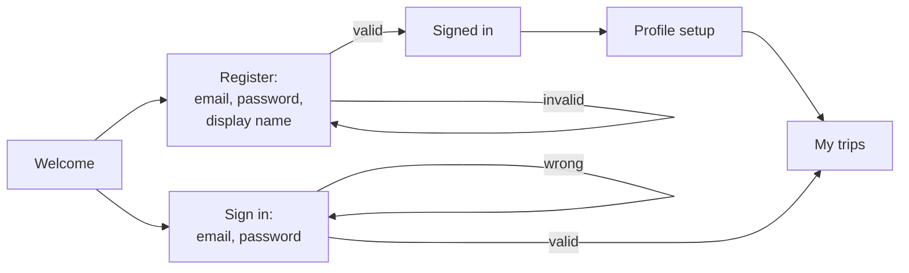
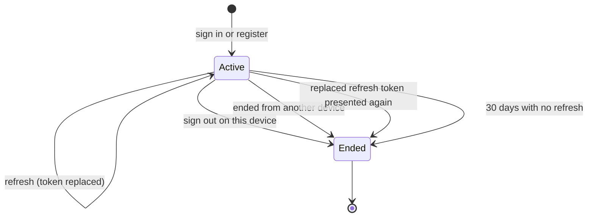
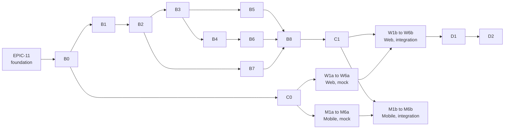

# TripMate -- EPIC-01 Spec: Authentication and User Profiles

**Document type:** Epic Spec\
**Product:** TripMate\
**Status:** Proposed\
**Version:** 1.4\
**Stage:** 2--4, epic level\
**Epic:** EPIC-01, Phase 1\
**Page version:** [TripMate EPIC-01 Spec artifact](https://claude.ai/artifact/CDUhq8v5rqC2f3neCN53Rs)

Terms follow [GLOSSARY.md](../../../GLOSSARY.md). The requirements are
FR-01 in [prd.md](../../../prd.md). This spec does not repeat what other
documents own; it links to them:

| Topic | Owned by |
|-------|----------|
| Passwords, tokens, sessions, rate limits | [security.md](../../security.md), section 2 |
| Endpoints and the error format | [api-design.md](../../api-design.md), sections 3.1 and 4 |
| Tables `users`, `credentials`, `sessions` | [data-model.md](../../data-model.md), section 2.1 |
| Where authentication runs, and why | [ADR-0005](../../adr/0005-authentication-built-into-the-backend.md) |
| Screens Welcome, Profile setup, Profile | [information-architecture.md](../../information-architecture.md), section 2 |
| What each test level proves | [test-strategy.md](../../test-strategy.md), section 5.1 |

This spec answers *how accounts behave in the MVP, how they are built,
which cards build them, and which test cases prove each card*.

## 1. Scope

| In this epic | Priority | Out of this epic |
|--------------|----------|------------------|
| AUTH-01 register and sign in with email and password | P0 | Social sign-in, AUTH-05 (P1) |
| AUTH-02 sign out, and see and end signed-in devices | P0 | Password reset by email, AUTH-06 (P1, after the MVP) |
| AUTH-03 view and edit the profile: display name | P0 | Avatar, AUTH-04 (P1) |
| | | Changing the email, deleting the account, email verification |

The P1 items get their sections in a later version of this spec, in the
change that schedules them ([test-strategy.md](../../test-strategy.md),
section 5.12).

## 2. Behaviour

### 2.1 Register (AUTH-01)

| Rule | Detail |
|------|--------|
| Email | Trimmed; compared without case (`citext`); one account per email |
| Password | At least 10 characters, not on the list of common passwords ([security.md](../../security.md), section 2) |
| Display name | Required at registration: 1 to 40 characters after trimming, any script, no line breaks |
| After registering | The user is signed in at once: the response carries the tokens, as sign-in does |
| First screen | Profile setup, then My trips. If the user came from an Invitation link, the Invitation preview follows ([information-architecture.md](../../information-architecture.md), section 7.1) |

### 2.2 Sign in (AUTH-01)

| Rule | Detail |
|------|--------|
| Wrong email or wrong password | The same answer, `401 auth.invalid_credentials`, so the screen never says which one was wrong |
| Too many attempts | `429 rate.limited` with `Retry-After`, keyed by email and by IP address ([security.md](../../security.md), section 2.2) |
| Result | A new session for this device, an access token, and a refresh token |

### 2.3 Sessions and sign out (AUTH-02)

| Rule | Detail |
|------|--------|
| One session per device | Named from the device type and the client, for example "iPhone · TripMate app" or "Chrome on macOS · Web" |
| Refresh | The refresh token is replaced at every use; the old one stops working at once |
| Reuse of an old refresh token | Ends that whole session. The device that presented it must sign in again. |
| Sign out | Ends this device's session and clears its tokens; the user lands on Welcome |
| Devices list | On Profile: every active session with its name and last use; the current one is marked and cannot be ended from the list |
| End a device | Ends that session at once; its next request fails with `401 auth.token_expired`, and its refresh fails with `401 auth.session_ended` |
| Sign out other devices | Ends every session except the current one |
| Access token expiry | 15 minutes. A client refreshes once on `401 auth.token_expired`, then retries the request once. If the refresh fails, the user lands on Welcome. |

### 2.4 Profile (AUTH-03)

| Rule | Detail |
|------|--------|
| What the profile shows | Display name, email (read only), the number of trips by group, signed-in devices, Sign out |
| What can be edited | The display name, with the rules of 2.1 |
| Who | Only the user, through `/v1/me`; there is no endpoint that reads or edits another user's profile |
| Where a display name shows | Everywhere the user appears in a trip, for every Member, after the next load or realtime update |

### 2.5 Errors this epic adds

| Status | Code | When |
|--------|------|------|
| `400` | `request.invalid` with `fields` | Email malformed; password or display name breaks a rule. Field codes: `auth.password_too_short`, `auth.password_too_common`, `profile.display_name_invalid` |
| `401` | `auth.invalid_credentials` | Wrong email or password |
| `401` | `auth.session_ended` | A refresh for a session that was ended or revoked |
| `409` | `auth.email_taken` | Register with an email that has an account |

`auth.not_signed_in` and `auth.token_expired` already exist
([api-design.md](../../api-design.md), section 4.2). Every code has text
in both languages before its card is Done.

## 3. Acceptance Criteria

Each criterion has at least one test named with its requirement ID
([docs/development-flow.md](../../development-flow.md), section 3).

| ID | Criterion | Levels |
|----|-----------|--------|
| AUTH-01 | A user registers with email, password, and display name, and is signed in | I, A, S, E |
| AUTH-01 | A password is stored only as an Argon2id hash; a short or common password is refused | U, I |
| AUTH-01 | An email that differs only in case is the same account | I, A |
| AUTH-01 | Wrong email and wrong password give the same answer | A |
| AUTH-01 | Sign-in and sign-up are rate limited | A |
| AUTH-02 | A refresh replaces the refresh token, and the old one no longer works | I, A |
| AUTH-02 | Presenting a replaced refresh token ends the session | I, A |
| AUTH-02 | Sign out ends the session at once | A |
| AUTH-02 | A user lists their devices and ends another one; that device's next refresh fails | A |
| AUTH-02 | Each client keeps the refresh token where [security.md](../../security.md), section 2.1, says, and never in `localStorage` | S, M |
| AUTH-03 | A user reads and edits only their own profile | A |
| AUTH-03 | A changed display name shows in every trip of the user | I, S |
| FR-01 | Every endpoint except register, sign-in, refresh, and the health check refuses a missing, expired, or forged token (generated from the contract) | A |

## 4. Technical Design

### 4.1 Module and dependencies

All backend work is in the `identity` module
([architecture.md](../../architecture.md), section 4). It needs the
EPIC-11 platform foundation first: the access guard, error codes,
idempotency keys, structured logging, and CI
([EPIC-11 spec](../epic-11/spec.md)).

### 4.2 Endpoints

The endpoints are listed in [api-design.md](../../api-design.md),
section 3.1. This epic builds all of them except
`GET /v1/me/readiness-summary` (EPIC-13).

| Endpoint | Token | Idempotency-Key | Notes |
|----------|-------|-----------------|-------|
| `POST /v1/auth/register` | None | Required | Returns the same body as sign-in, with `201` |
| `POST /v1/auth/login` | None | Not taken (5.2) | |
| `POST /v1/auth/refresh` | Refresh token | Not taken (5.2) | Web sends the cookie; Mobile and Desktop send the token in the body |
| `POST /v1/auth/logout` | Access | -- | Web also clears the cookie |
| `GET /v1/auth/sessions`, `DELETE /v1/auth/sessions/{id}`, `POST /v1/auth/sessions/end-others` | Access | -- | `end-others` is new in this epic; api-design.md lists it in the same change |
| `GET /v1/me`, `PATCH /v1/me` | Access | -- | No `If-Match`: only the user changes their profile |

### 4.3 Data

The tables are in [data-model.md](../../data-model.md), section 2.1.
This epic adds:

- `sessions.last_used_at`, updated at each refresh, for the devices
  list.
- `sessions.replaced_token_hash`, the previous refresh token's hash, so
  a reused token can be recognized and its session ended.

Account changes are not trip-scoped, so they write no Audit log entry;
sign-in, sign-out, and session ends are written to the structured log
without the email ([security.md](../../security.md), section 4).

### 4.4 Clients

| Client | Work |
|--------|------|
| Web | Welcome, Register, Sign in, Profile setup, Profile with devices; refresh on `401 auth.token_expired`; refresh cookie as in security.md |
| Mobile | The same screens; refresh token in `flutter_secure_storage` |
| Desktop | The Web screens; one Rust command that stores, reads, and deletes the refresh token in the operating system's store |

## 5. Decisions and Open Questions

### 5.1 Decisions made in this spec

| Decision | Alternatives set aside | Why |
|----------|------------------------|-----|
| The display name is asked at registration and is P0 | Only with AUTH-04, which is P1 | A Member must be shown by name in the discussion, in Votes, and in Expenses; avatar stays P1 |
| Register says when an email is taken | The same answer whether or not the account exists | The user needs to know to sign in instead. Sign-up is rate limited to 5 per hour per IP address, which keeps guessing slow. |
| No email verification in the MVP | Verify the email before the first sign-in | No email service is chosen before AUTH-06 ([architecture.md](../../architecture.md), section 12.2); an unverified email is never used to link a Google or Apple account ([security.md](../../security.md), section 2) |
| No Audit log entry for account changes | Audit sign-ins | The Audit log is per trip (business rule 13); account events go to the structured log |

### 5.2 Open questions

| Question | Proposed answer | Needed by |
|----------|-----------------|-----------|
| Do sign-in and refresh take an `Idempotency-Key`? [api-design.md](../../api-design.md), section 2, asks for one on every `POST` that creates a record, and a session is a record. | No. A repeated sign-in makes one more session, which the user can end; a repeated refresh is refused as a reused token. api-design.md names the exception in the same change. | AUTH-01 card |
| How does the backend know to answer with the refresh cookie and not with a token in the body? | Register and sign-in name the client kind in the body: `web`, `mobile`, or `desktop`. For `web` the refresh token is set as the cookie and left out of the body. The kind also names the session. The Web build sends `desktop` when it runs in the Desktop shell. | B0 |
| A second sign-in from a device ID that already has a session: one more session, or the same one? 2.3 says one session per device. | It ends that device's earlier session, so the devices list has one row per device | B3 |
| What does refresh answer for a token that was never issued? | `401 auth.session_ended`, the same as an ended session, so the answer does not say whether a token was once valid | B4 |
| What happens when the same refresh token arrives twice at the same moment, as a retry can cause? | The rule holds: the second is a reuse and ends the session. Each client keeps one refresh in flight (cases W3-3 and M3), so it does not send two. | B4 |
| Which codes does ending a device return for the current session, and for a session that is not the caller's? | `422 auth.session_is_current`, and `404 auth.session_not_found` for another user's session and for an unknown ID alike. Both are added to 2.5 and to the contract. | B0 |
| What does `PATCH /v1/me` answer when the body carries the email? | `400 request.invalid`: the schema takes the display name only | B7 |
| "A changed display name shows in every trip" cannot be tested before trips exist. Where is it built? | In the EPIC-02 spec: the membership card reads the name from `users` and keeps no copy. Case B7-6 moves there. | EPIC-02 spec |
| prd.md, AUTH-06, says a user who forgets their password "signs in with Google or Apple", but both are P1. What does the MVP offer? | Nothing in the app; the product owner resets the password by hand on request during the beta | Phase 7 |

## 6. Tasks

Each row is one card on the [TripMate board](https://trello.com/b/zsxAnzsz/tripmate),
with the ID of the row in its title, for example
`B2 AUTH-01 Register`. Every card is one behaviour a user or a test
can see working, small enough for one focused session:

| Size | Means |
|------|-------|
| XS | One rule or one setting |
| S | One endpoint or one screen, with its tests |
| M | One behaviour across a few parts, for example an endpoint with its table change and rate limit |

A card that would be larger is split before it moves to ToDo. Every
card also meets the Definition of Done
([docs/development-flow.md](../../development-flow.md), section 3); the
files it changes are named in its pull request.

The Risk column is the level of
[docs/development-flow.md](../../development-flow.md), section 2.1.
The product owner reviews the pull request of a High card: here, the
cards that change the contract, a table, tokens, or sessions. A Low
card merges on its own when its checks pass. B1 changes rule files, so
mutation testing runs on them. Each card's test cases are in section
7.

The backend and the clients are built at the same time: B0 publishes a
draft contract, Web and Mobile build every screen against a mock API
generated from it (cards ending in `a`), and each screen is switched
to the real API once the contract is released (cards ending in `b`).
The card kinds are defined in
[docs/development-flow.md](../../development-flow.md), section 1.

### 6.1 Backend: `tripmate-backend`, module `identity`

| ID | Card | Size | Risk | Depends on | Done when |
|----|------|------|------|------------|-----------|
| B0 | `AUTH-01 Accounts contract stub` | S | High | EPIC-11 foundation | Every endpoint of 4.2 exists with its request and response schemas and the error codes of 2.5, and returns `501`; CI publishes the draft contract; the IDs of this epic are in `tests/requirement-ids.txt` |
| B1 | `AUTH-01 Account tables and input rules` | S | High | B0 | Migration for `users`, `credentials`, `sessions` with the fields of 4.3; Argon2id hashing; the email, password, and display name rules of 2.1 as unit tests |
| B2 | `AUTH-01 Register` | M | High | B1 | `POST /v1/auth/register` with `Idempotency-Key` returns `201` and tokens; `409 auth.email_taken`, also for an email in other case; sign-up rate limit |
| B3 | `AUTH-01 Sign in` | S | High | B2 | `POST /v1/auth/login` makes a session; wrong email and wrong password both give `401 auth.invalid_credentials`; rate limits by email and by IP address |
| B4 | `AUTH-02 Refresh with token rotation` | M | High | B3 | `POST /v1/auth/refresh` replaces the refresh token and sets `last_used_at`; a replaced token ends the session; an ended session gives `401 auth.session_ended` |
| B5 | `AUTH-02 Sign out` | XS | High | B3 | `POST /v1/auth/logout` ends the session at once and clears the Web cookie |
| B6 | `AUTH-02 Devices list and ending devices` | M | High | B4 | `GET /v1/auth/sessions` marks the current one; `DELETE /v1/auth/sessions/{id}` refuses the current one; `POST /v1/auth/sessions/end-others`; an ended device's next refresh fails |
| B7 | `AUTH-03 Read and edit the profile` | S | Low | B2 | `GET` and `PATCH /v1/me` with the display name rules; no way to read another user; the new name shows in a trip |
| B8 | `FR-01 Protected endpoints test` | S | Low | B5, B6, B7 | A test generated from the contract: every endpoint except register, sign-in, refresh, and the health check refuses a missing, expired, or forged token |

### 6.2 Contract: `tripmate-contracts`

| ID | Card | Size | Risk | Depends on | Done when |
|----|------|------|------|------------|-----------|
| C0 | `AUTH-01 Accounts contract draft` | XS | High | B0 | The draft `openapi.json` is tagged, for example `contracts-v1.1.0-draft.1`; every error code of 2.5 has text in both languages |
| C1 | `AUTH-01 Accounts contract release` | XS | High | B8 | The released `openapi.json` is tagged; the contract check against the last draft passes |

### 6.3 Web: `tripmate-web`

| ID | Card | Size | Risk | Depends on | Done when | Design |
|----|------|------|------|------------|-----------|--------|
| W1a | `AUTH-01 Welcome and Register (Web, mock)` | S | Low | C0 | Register shows each field error of 2.5 in both languages and signs the user in | [Web prototype](https://claude.ai/artifact/4prwGmgBsXBv5Jvnc3aEUo) |
| W1b | `AUTH-01 Welcome and Register (Web, integration)` | XS | Low | C1, W1a | The account is created on the local stack; a taken email shows `auth.email_taken` | [Web prototype](https://claude.ai/artifact/4prwGmgBsXBv5Jvnc3aEUo) |
| W2a | `AUTH-01 Sign in (Web, mock)` | S | Low | W1a | Sign in, with the one wrong-credentials message and the rate limit message | [Web prototype](https://claude.ai/artifact/4prwGmgBsXBv5Jvnc3aEUo) |
| W2b | `AUTH-01 Sign in (Web, integration)` | S | Low | C1, W2a | Sign in works on the local stack; the start of journey J2 passes | [Web prototype](https://claude.ai/artifact/4prwGmgBsXBv5Jvnc3aEUo) |
| W3a | `AUTH-02 Token refresh and sign out (Web, mock)` | S | High | W2a | One refresh on `401 auth.token_expired`, then one retry; a failed refresh or Sign out lands on Welcome; no token in `localStorage` | [Web prototype](https://claude.ai/artifact/4prwGmgBsXBv5Jvnc3aEUo) |
| W3b | `AUTH-02 Token refresh and sign out (Web, integration)` | S | High | C1, W3a | The refresh cookie works with the local stack; a reused token ends the session | [Web prototype](https://claude.ai/artifact/4prwGmgBsXBv5Jvnc3aEUo) |
| W4a | `AUTH-03 Profile setup (Web, mock)` | S | Low | W2a | Shown once after registering, then My trips, or the Invitation preview when the user came from a link | [Web prototype](https://claude.ai/artifact/4prwGmgBsXBv5Jvnc3aEUo) |
| W4b | `AUTH-03 Profile setup (Web, integration)` | XS | Low | C1, W4a | The display name is saved on the local stack | [Web prototype](https://claude.ai/artifact/4prwGmgBsXBv5Jvnc3aEUo) |
| W5a | `AUTH-03 Profile and display name (Web, mock)` | S | Low | W4a | Profile shows the fields of 2.4; editing the display name follows the rules of 2.1 | [Web prototype](https://claude.ai/artifact/4prwGmgBsXBv5Jvnc3aEUo) |
| W5b | `AUTH-03 Profile and display name (Web, integration)` | XS | Low | C1, W5a | The edited name is read back from `GET /v1/me` | [Web prototype](https://claude.ai/artifact/4prwGmgBsXBv5Jvnc3aEUo) |
| W6a | `AUTH-02 Devices on Profile (Web, mock)` | S | Low | W3a, W5a | List with the current device marked; end one device; sign out other devices | [Web prototype](https://claude.ai/artifact/4prwGmgBsXBv5Jvnc3aEUo) |
| W6b | `AUTH-02 Devices on Profile (Web, integration)` | XS | Low | C1, W6a | Ending a device on the local stack signs that device out | [Web prototype](https://claude.ai/artifact/4prwGmgBsXBv5Jvnc3aEUo) |

### 6.4 Mobile: `tripmate-mobile`

| ID | Card | Size | Risk | Depends on | Done when | Design |
|----|------|------|------|------------|-----------|--------|
| M1a | `AUTH-01 Welcome and Register (Mobile, mock)` | S | Low | C0 | As W1a, with widget tests | [Mobile prototype](https://claude.ai/artifact/MS8Hfa77SzLyhwFwnfFAen) |
| M1b | `AUTH-01 Welcome and Register (Mobile, integration)` | XS | Low | C1, M1a | As W1b | [Mobile prototype](https://claude.ai/artifact/MS8Hfa77SzLyhwFwnfFAen) |
| M2a | `AUTH-01 Sign in (Mobile, mock)` | S | Low | M1a | As W2a, with widget tests | [Mobile prototype](https://claude.ai/artifact/MS8Hfa77SzLyhwFwnfFAen) |
| M2b | `AUTH-01 Sign in (Mobile, integration)` | S | Low | C1, M2a | As W2b | [Mobile prototype](https://claude.ai/artifact/MS8Hfa77SzLyhwFwnfFAen) |
| M3a | `AUTH-02 Token refresh and sign out (Mobile, mock)` | S | High | M2a | Refresh token only in `flutter_secure_storage`; refresh and sign out as W3a; tests for storage and refresh | [Mobile prototype](https://claude.ai/artifact/MS8Hfa77SzLyhwFwnfFAen) |
| M3b | `AUTH-02 Token refresh and sign out (Mobile, integration)` | S | High | C1, M3a | As W3b | [Mobile prototype](https://claude.ai/artifact/MS8Hfa77SzLyhwFwnfFAen) |
| M4a | `AUTH-03 Profile setup (Mobile, mock)` | S | Low | M2a | As W4a, with widget tests | [Mobile prototype](https://claude.ai/artifact/MS8Hfa77SzLyhwFwnfFAen) |
| M4b | `AUTH-03 Profile setup (Mobile, integration)` | XS | Low | C1, M4a | As W4b | [Mobile prototype](https://claude.ai/artifact/MS8Hfa77SzLyhwFwnfFAen) |
| M5a | `AUTH-03 Profile and display name (Mobile, mock)` | S | Low | M4a | As W5a, with widget tests | [Mobile prototype](https://claude.ai/artifact/MS8Hfa77SzLyhwFwnfFAen) |
| M5b | `AUTH-03 Profile and display name (Mobile, integration)` | XS | Low | C1, M5a | As W5b | [Mobile prototype](https://claude.ai/artifact/MS8Hfa77SzLyhwFwnfFAen) |
| M6a | `AUTH-02 Devices on Profile (Mobile, mock)` | S | Low | M3a, M5a | As W6a, with widget tests | [Mobile prototype](https://claude.ai/artifact/MS8Hfa77SzLyhwFwnfFAen) |
| M6b | `AUTH-02 Devices on Profile (Mobile, integration)` | XS | Low | C1, M6a | As W6b | [Mobile prototype](https://claude.ai/artifact/MS8Hfa77SzLyhwFwnfFAen) |

### 6.5 Desktop: `tripmate-desktop`

Desktop has no screens of its own, so its cards are not split.

| ID | Card | Size | Risk | Depends on | Done when | Design |
|----|------|------|------|------------|-----------|--------|
| D1 | `AUTH-02 Refresh token command (Desktop)` | S | High | W3b; the DESK-01 shell | One Rust command stores, reads, and deletes the refresh token in the operating system's store: Keychain, Windows Credential Manager, or Secret Service on Linux ([security.md](../../security.md), section 2.1); `cargo test` passes | [Desktop prototype](https://claude.ai/artifact/UHEF5bSEzMDa4k2z62cRRJ) |
| D2 | `AUTH-02 Stay signed in after restart (Desktop)` | S | High | D1 | The Web build uses the command on Desktop. Checked by hand on macOS, Windows, and Ubuntu LTS: restart keeps the user signed in, and Sign out removes the token. On Linux with no Secret Service, the app still works and asks the user to sign in at each start. | [Desktop prototype](https://claude.ai/artifact/UHEF5bSEzMDa4k2z62cRRJ) |

### 6.6 Checkpoints

| After | The product owner checks |
|-------|--------------------------|
| C0 | The draft contract: every request, response, and error code the screens need, before the mock cards start |
| B3 and W2a | Register and sign in through the API on the local stack, and the same screens against the mock |
| B8 | Every backend row of section 3 has a passing test, before the contract is released |
| The last card | Every row of section 3 has a passing test on every client it names; sign in, edit the profile, and end a device on Web, Mobile, and Desktop |

## 7. Test Cases

Each card has its test cases here: the main cases, the error cases,
and the edge cases, each with its expected result. The product owner
approves them with this spec. The test agent turns each case into one
test before the code is written
([docs/development-flow.md](../../development-flow.md), section 2);
it adds no expected result of its own. The columns are those of the
[EPIC-11 spec](../epic-11/spec.md), section 7.

A case marked (5.2) rests on the proposed answer to an open question
of section 5.2 and changes with it.

### 7.1 Backend

**B0 Accounts contract stub**

| Case | Kind | Given | Expected | Level |
|------|------|-------|----------|-------|
| B0-1 | Main | Each endpoint of 4.2, called as its access declaration allows | `501`, and the contract marks the operation `x-stub: true` | A, C |
| B0-2 | Main | The generated contract | Every response schema has an example; every code of 2.5 is listed, the field codes too | C |
| B0-3 | Edge | A `signed_in` stub called with no token | `401 auth.not_signed_in`, not `501` | A |
| B0-4 | Main | `tests/requirement-ids.txt` | It holds AUTH-01, AUTH-02, AUTH-03, and FR-01 | U |

**B1 Account tables and input rules**

| Case | Kind | Given | Expected | Level |
|------|------|-------|----------|-------|
| B1-1 | Main | A password is hashed | The stored value is an Argon2id hash; the right password verifies and a wrong one does not | U |
| B1-2 | Edge | The same password hashed twice | Two different hashes | U |
| B1-3 | Edge | A password of 10 characters, and one of 9 | Accepted; refused with `auth.password_too_short` | U |
| B1-4 | Error | A password of 12 characters on the common list | Refused with `auth.password_too_common` | U |
| B1-5 | Edge | An email with spaces around it, and one in capital letters | Both are stored trimmed, and compare equal to the lower-case form | U |
| B1-6 | Error | An email with no `@`, and an empty one | Refused | U |
| B1-7 | Edge | Display names of 1 and of 40 characters, and a Vietnamese name with marks | Accepted, stored as typed after trimming | U |
| B1-8 | Error | Display names of 41 characters, of spaces only, and with a line break | Refused with `profile.display_name_invalid` | U |
| B1-9 | Main | An empty database | The migration creates `users`, `credentials`, and `sessions` with the fields of 4.3, and migrates down again | I |
| B1-10 | Error | A second user row with the same email in other case | The database refuses it | I |

**B2 Register**

| Case | Kind | Given | Expected | Level |
|------|------|-------|----------|-------|
| B2-1 | Main | A new email, a valid password, and a display name | `201` with the body of sign-in; one user, one session | A, I |
| B2-2 | Error | An email that has an account | `409 auth.email_taken`; no new user | A |
| B2-3 | Edge | That email in other case, or with spaces around it | `409 auth.email_taken` | A |
| B2-4 | Error | A short password and an invalid display name together | `400 request.invalid` with both field codes | A |
| B2-5 | Edge | The same `Idempotency-Key` and body sent twice | The same response; one user | A |
| B2-6 | Error | No `Idempotency-Key` | `400 request.idempotency_key_required` | A |
| B2-7 | Edge | Six sign-ups from one IP address within an hour | The first five pass; the sixth returns `429 rate.limited` with `Retry-After` | A |
| B2-8 | Main | Any register response and its log line | Neither holds the password or its hash | A |
| B2-9 | Edge | The client kind is Web; then Mobile (5.2) | The refresh token is set as the cookie of security.md, section 2.1, and is not in the body; then it is in the body and no cookie is set | A |

**B3 Sign in**

| Case | Kind | Given | Expected | Level |
|------|------|-------|----------|-------|
| B3-1 | Main | The right email and password | `200` with an access token and a refresh token; a session named from the device type and the client | A, I |
| B3-2 | Error | The right email and a wrong password | `401 auth.invalid_credentials` | A |
| B3-3 | Error | An email with no account | The same status, code, and body as B3-2 | A |
| B3-4 | Edge | The email in other case, or with spaces around it | Signs in | A |
| B3-5 | Edge | Eleven attempts for one email within 15 minutes, the last with the right password | The eleventh returns `429 rate.limited` with `Retry-After` | A |
| B3-6 | Edge | Eleven attempts from one IP address, each for a different email | The eleventh returns `429 rate.limited` | A |
| B3-7 | Edge | The 15 minutes have passed | Sign-in works again | A |
| B3-8 | Edge | A second sign-in from the same device ID (5.2) | That device's earlier session is ended; the devices list shows one row for the device | A, I |

**B4 Refresh with token rotation**

| Case | Kind | Given | Expected | Level |
|------|------|-------|----------|-------|
| B4-1 | Main | A valid refresh token | A new access token and a new refresh token; `last_used_at` is set | A, I |
| B4-2 | Error | The replaced refresh token, presented again | `401 auth.session_ended`; the newer refresh token of that session fails as well | A, I |
| B4-3 | Error | The refresh token of a session that was signed out | `401 auth.session_ended` | A |
| B4-4 | Edge | A session last refreshed 29 days ago, and one 30 days ago | The first refreshes; the second returns `401 auth.session_ended` | A |
| B4-5 | Error | A refresh token that was never issued (5.2) | `401 auth.session_ended` | A |
| B4-6 | Edge | The same refresh token sent twice at the same moment (5.2) | One request gets new tokens; the session is then ended as a reuse | I |
| B4-7 | Main | Web sends the cookie; Mobile sends the token in the body | Both refresh; Web gets the new cookie | A |
| B4-8 | Edge | A Web refresh from another `Origin` | Refused | A |
| B4-9 | Main | The `sessions` table after a refresh | It holds hashes only, never a refresh token | I |

**B5 Sign out**

| Case | Kind | Given | Expected | Level |
|------|------|-------|----------|-------|
| B5-1 | Main | A signed-in device signs out | Its refresh returns `401 auth.session_ended`, and its access token returns `401 auth.token_expired` at the next request | A |
| B5-2 | Main | A Web sign-out | The response clears the refresh cookie | A |
| B5-3 | Edge | The user's other devices | They stay signed in | A |
| B5-4 | Edge | Sign out sent a second time with the same access token | `401 auth.token_expired` | A |

**B6 Devices list and ending devices**

| Case | Kind | Given | Expected | Level |
|------|------|-------|----------|-------|
| B6-1 | Main | A user with three active sessions and one ended | The list has the three active ones, each with its name and last use, and marks the current one | A |
| B6-2 | Edge | Another user's sessions | They are never in the list | A |
| B6-3 | Main | `DELETE` on another session of the user | `204`; that device's refresh returns `401 auth.session_ended`, and its next request `401 auth.token_expired` | A |
| B6-4 | Error | `DELETE` on the current session (5.2) | `422 auth.session_is_current`; the session stays | A |
| B6-5 | Error | `DELETE` on a session of another user, or on an unknown ID (5.2) | `404 auth.session_not_found` for both | A |
| B6-6 | Main | `end-others` with three active sessions | The two others are ended; the current one still works | A |
| B6-7 | Edge | `end-others` with only the current session | `200`; nothing changes | A |

**B7 Read and edit the profile**

| Case | Kind | Given | Expected | Level |
|------|------|-------|----------|-------|
| B7-1 | Main | `GET /v1/me` for a new user | The display name, the email, and zero trips in each group | A |
| B7-2 | Main | `PATCH /v1/me` with a valid display name | `200`; `GET /v1/me` returns the new name, trimmed | A |
| B7-3 | Error | A display name of 41 characters, of spaces only, or with a line break | `400 request.invalid` with `profile.display_name_invalid`; the name is unchanged | A |
| B7-4 | Error | `PATCH /v1/me` with an `email` field (5.2) | `400 request.invalid`; the email is unchanged | A |
| B7-5 | Edge | The contract | No operation takes a user ID to read or edit a profile | C |
| B7-6 | Main | A user in a trip changes their display name (5.2) | Built with the EPIC-02 spec, when trips exist | I |

**B8 Protected endpoints test**

| Case | Kind | Given | Expected | Level |
|------|------|-------|----------|-------|
| B8-1 | Main | Every operation of the contract except register, sign-in, refresh, and the health check, with no token | `401 auth.not_signed_in` | A |
| B8-2 | Main | The same operations with an expired token, and with a forged one | `401 auth.token_expired`; `401 auth.not_signed_in` | A |
| B8-3 | Edge | The same operations with the token of an ended session | `401 auth.token_expired` | A |
| B8-4 | Edge | The four operations left out, with no token | None answers `401 auth.not_signed_in` | A |
| B8-5 | Edge | A contract with one more operation | The test covers it with no change to the test | A |

### 7.2 Contract

**C0 Accounts contract draft**

| Case | Kind | Given | Expected | Level |
|------|------|-------|----------|-------|
| C0-1 | Main | The merged stub | A draft tag whose `openapi.json` has every endpoint of 4.2 | C |
| C0-2 | Main | Every code of 2.5, the field codes too | Text in Vietnamese and in English; the translation check passes | C |
| C0-3 | Edge | The draft against the last release tag | The breaking-change check passes: it only adds | C |

**C1 Accounts contract release**

| Case | Kind | Given | Expected | Level |
|------|------|-------|----------|-------|
| C1-1 | Main | The contract after B8 | No operation is marked `x-stub`; a release tag | C |
| C1-2 | Main | The backend against the released contract | Schemathesis passes on every accounts operation | C |
| C1-3 | Edge | A shape that differs from the last draft | The check names it, and the integration cards take the change | C |

### 7.3 Web

One table per screen. The `a` cases belong to the mock card and run
against the mock API; the `b` cases belong to the integration card and
run on the local stack. Every `a` case that shows text is checked in
Vietnamese and in English.

**W1 Welcome and Register**

| Case | Card | Kind | Given | Expected | Level |
|------|------|------|-------|----------|-------|
| W1-1 | a | Main | A valid email, password, and display name | The user is signed in and sees Profile setup | S |
| W1-2 | a | Error | `400 request.invalid` with each field code of 2.5 | Each message shows at its field; what was typed stays | S |
| W1-3 | a | Error | `409 auth.email_taken` | The message for a taken email, with a way to Sign in | S |
| W1-4 | a | Error | `429 rate.limited` | The rate limit message, with the wait from `Retry-After` | S |
| W1-5 | a | Edge | The button is pressed twice | One request; a retry carries the same `Idempotency-Key` | S |
| W1-6 | a | Edge | The request fails with `500`, or there is no network | A general error; what was typed stays | S |
| W1-7 | b | Main | A new email on the local stack | The account exists: the user can sign out and sign in | E |
| W1-8 | b | Error | A taken email on the local stack | The message of W1-3 | E |

**W2 Sign in**

| Case | Card | Kind | Given | Expected | Level |
|------|------|------|-------|----------|-------|
| W2-1 | a | Main | The right email and password | My trips | S |
| W2-2 | a | Error | `401 auth.invalid_credentials` | One message that does not say which of the two was wrong | S |
| W2-3 | a | Error | `429 rate.limited` | The rate limit message, with the wait from `Retry-After` | S |
| W2-4 | a | Edge | An empty email or password | No request is sent | S |
| W2-5 | b | Main | An account on the local stack | Sign-in works; the start of journey J2 passes | E |

**W3 Token refresh and sign out**

| Case | Card | Kind | Given | Expected | Level |
|------|------|------|-------|----------|-------|
| W3-1 | a | Main | A request answered `401 auth.token_expired` | One refresh, then the request once more; the user sees no error | U |
| W3-2 | a | Error | The refresh is answered `401 auth.session_ended` | Welcome; the access token is gone from memory | U, S |
| W3-3 | a | Edge | Three requests answered `401 auth.token_expired` at the same moment | Exactly one refresh; all three are sent again | U |
| W3-4 | a | Edge | The request fails with `401` again after the refresh | No second refresh; Welcome | U |
| W3-5 | a | Main | Sign out | The sign-out request is sent, the access token is gone from memory, and the user is on Welcome | S |
| W3-6 | a | Error | Any time after signing in | `localStorage` and `sessionStorage` hold no token | U |
| W3-7 | b | Main | A page reload on the local stack | The user stays signed in, through the refresh cookie | E |
| W3-8 | b | Error | The session is ended on the local stack, then a request is made | Welcome | E |

**W4 Profile setup**

| Case | Card | Kind | Given | Expected | Level |
|------|------|------|-------|----------|-------|
| W4-1 | a | Main | The user has just registered | Profile setup, then My trips | S |
| W4-2 | a | Edge | The user signs in on a later day | Profile setup is not shown | S |
| W4-3 | a | Edge | The user came from an Invitation link | The Invitation preview follows, not My trips | S |
| W4-4 | a | Error | `400` with `profile.display_name_invalid` | The message at the field; what was typed stays | S |
| W4-5 | b | Main | A display name saved on the local stack | It is still there after a reload | E |

**W5 Profile and display name**

| Case | Card | Kind | Given | Expected | Level |
|------|------|------|-------|----------|-------|
| W5-1 | a | Main | The Profile screen | The display name, the email with no way to edit it, the number of trips by group, the devices, and Sign out | S |
| W5-2 | a | Main | A valid new display name | Saved and shown | S |
| W5-3 | a | Error | `400` with `profile.display_name_invalid` | The message at the field; the old name is still the saved one | S |
| W5-4 | a | Edge | The save fails with `500`, or there is no network | A general error; what was typed stays | S |
| W5-5 | b | Main | An edited name on the local stack | `GET /v1/me` returns it after a reload | E |

**W6 Devices on Profile**

| Case | Card | Kind | Given | Expected | Level |
|------|------|------|-------|----------|-------|
| W6-1 | a | Main | Three devices | Each with its name and last use; the current one is marked and cannot be ended | S |
| W6-2 | a | Main | One device is ended | It leaves the list | S |
| W6-3 | a | Main | Sign out other devices | Only the current device stays in the list | S |
| W6-4 | a | Error | Ending a device is answered `404 auth.session_not_found` | The list is loaded again without it; no error stays on screen | S |
| W6-5 | b | Main | Two browsers signed in on the local stack; one ends the other | The other lands on Welcome at its next request | E |

### 7.4 Mobile

M1 to M6 take the cases of W1 to W6. The `a` cases are widget tests,
level S. The `b` cases are run by hand with the `dev` flavor on the
local stack, level M, because end-to-end runs are automated on Web
only ([test-strategy.md](../../test-strategy.md), section 6). Three
cases change, and M3 adds four:

| Case | Card | Kind | Given | Expected | Level |
|------|------|------|-------|----------|-------|
| W3-6 | -- | -- | Does not apply on Mobile | Replaced by M3-1 | -- |
| W3-7 | b | Main | The app is closed and opened again on the local stack | The user stays signed in | M |
| W6-5 | b | Main | A phone and a browser signed in; the browser ends the phone | The phone lands on Welcome at its next request | M |
| M3-1 | a | Main | After signing in | The refresh token is in `flutter_secure_storage` and nowhere else: not in shared preferences, not in a file | U |
| M3-2 | a | Main | The app starts with a refresh token in secure storage | It refreshes and opens My trips | S |
| M3-3 | a | Main | Sign out | The refresh token is deleted from secure storage | U |
| M3-4 | a | Edge | The app starts with a refresh token that is answered `401 auth.session_ended` | The token is deleted; Welcome | S |

### 7.5 Desktop

**D1 Refresh token command**

| Case | Kind | Given | Expected | Level |
|------|------|-------|----------|-------|
| D1-1 | Main | Store, then read | The same token | U |
| D1-2 | Main | Delete, then read | Nothing | U |
| D1-3 | Edge | Store twice | The second token replaces the first | U |
| D1-4 | Edge | Delete with nothing stored | Succeeds | U |
| D1-5 | Error | The operating system's store is not available | The command says so; the app does not stop | U |
| D1-6 | Edge | The command's inputs | It takes no entry name: it can reach only TripMate's refresh token | U |

**D2 Stay signed in after restart**

Checked by hand on macOS, Windows, and Ubuntu LTS.

| Case | Kind | Given | Expected | Level |
|------|------|-------|----------|-------|
| D2-1 | Main | Sign in, quit, and open the app again | The user is still signed in | M |
| D2-2 | Main | Sign out, quit, and open the app again | Welcome; the token is gone from the operating system's store | M |
| D2-3 | Edge | Ubuntu with no Secret Service | The app works, and asks the user to sign in at each start | M |
| D2-4 | Edge | The session is ended from another device, then the app is opened | Welcome | M |
| D2-5 | Error | The webview's `localStorage` after signing in | No token | M |

## 8. Version History

| Version | Date | Changes |
|---------|------|---------|
| 1.0 | 2026-11-20 | First version: scope (AUTH-01 to AUTH-03; AUTH-04 to AUTH-06 later), behaviour for register, sign-in, sessions and profile, the error codes it adds, acceptance criteria by requirement ID, technical design, decisions and open questions, and 23 cards of size XS to M with checkpoints. |
| 1.1 | 2026-11-20 | Section 6: the backend and the clients are built at the same time. B0 publishes a draft contract (C0); every Web and Mobile card is split into a mock card against the draft and an integration card against the released contract (C1). 37 cards; checkpoints in their own table. |
| 1.2 | 2026-11-20 | Cards D1 and D2 cover Linux: the refresh token goes to Secret Service, D2 is checked by hand on Ubuntu LTS as well, and without a Secret Service the user signs in at each start. D2 is now size S. |
| 1.3 | 2026-11-20 | Integration cards work against the local stack in Docker instead of a preview backend; section 4.1 links the EPIC-11 spec for the foundation. |
| 1.4 | 2026-11-23 | Follows the new development flow. Every card has a risk level (section 6): the cards that change the contract, a table, tokens, or sessions are High, the others Low. Section 7 is new: the test cases of every card, with error and edge cases and their expected results. Writing them found seven points the spec did not decide, now open questions in 5.2: the client kind, a second sign-in from one device, a refresh token never issued, two refreshes at once, the codes for ending a device, the email in a profile edit, and where the display name in trips is tested. B0 adds this epic's IDs to the requirement-to-test report. |
