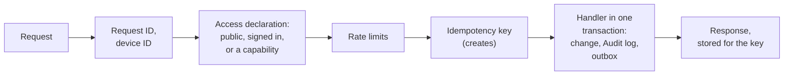
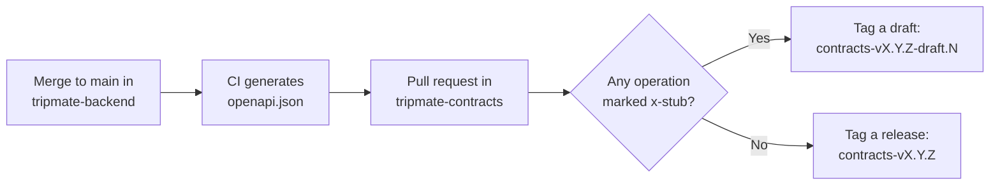
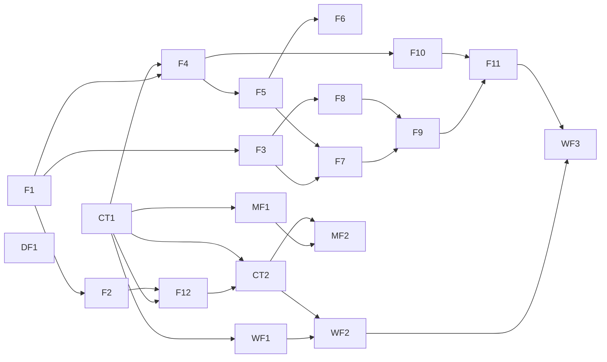

# TripMate -- EPIC-11 Spec: Platform Foundation

**Document type:** Epic Spec\
**Product:** TripMate\
**Status:** Proposed\
**Version:** 1.0\
**Stage:** 2--4, epic level\
**Epic:** EPIC-11, first part, Phase 1\
**Page version:** [TripMate EPIC-11 Spec artifact](https://claude.ai/artifact/U3abYrK3zy9Fm2CaQETpT2)

Terms follow [GLOSSARY.md](../../../GLOSSARY.md). This spec builds the
first part of EPIC-11, the platform every endpoint and every screen
uses ([mvp-roadmap.md](../../../mvp-roadmap.md), section 6.1). It does
not repeat what other documents own; it links to them:

| Topic | Owned by |
|-------|----------|
| Containers, modules and their rules, background work, hosting on Render | [architecture.md](../../architecture.md), sections 3, 4, 9, 10 |
| Request conventions, the error format, how the contract moves between repositories | [api-design.md](../../api-design.md), sections 2, 4, 6 |
| Tokens, the access guard, capabilities, rate limits | [security.md](../../security.md), sections 2 and 3 |
| `outbox_events`, `idempotency_keys`, migrations | [data-model.md](../../data-model.md), sections 6 and 8 |
| Test levels and what runs when | [test-strategy.md](../../test-strategy.md), sections 2 to 4 |
| Card kinds and the Definition of Done | [docs/development-flow.md](../../development-flow.md), sections 1 and 3 |

This spec answers *what the platform gives every epic, how it is
built, and which cards build it*.

## 1. Scope

| In this part (Phase 1) | Out of this part |
|------------------------|------------------|
| The backend skeleton: layout, the three processes, configuration, the database session, migrations | Trip-scoped capability checks, which need `trip_members` (EPIC-02 plugs them into the guard) |
| The request pipeline: request ID, device ID, the access declaration, token check, rate limits, errors, idempotency | The WebSocket gateway (5.2) |
| The outbox, the Taskiq worker, the scheduler, cleanup jobs | Hardening, load tests, the security assessment, the release plan: EPIC-11, second part, Phase 7 |
| Logs, traces, metrics, error reporting, and the P95 alert | Navigation shells and shared screens: EPIC-10 |
| The local stack in Docker, and production on Render; staging is added before the beta | The Desktop window and installers: EPIC-12 (DESK-01, DESK-07) |
| CI in all five code repositories, and the contract pipeline with draft and released tags | |
| Web and Mobile foundations: project, generated client, mock mode, translations | |

## 2. What the Platform Gives Every Epic

### 2.1 Backend layout

One package per module of [architecture.md](../../architecture.md),
section 4, all with the same shape, so a card names its files the same
way in every module.

```text
tripmate-backend/
├── app/
│   ├── main.py            API process (FastAPI)
│   ├── worker.py          Worker process (Taskiq)
│   ├── scheduler.py       Scheduler process
│   ├── platform/          access, errors, idempotency, outbox, jobs, config, db, logging
│   └── <module>/          identity, trips, money, ...
│       ├── api.py         Routes: access declaration, request and response schemas
│       ├── schemas.py     Pydantic models; the contract is generated from them
│       ├── service.py     The module's public interface
│       ├── <rule>.py      Pure domain rules, named as in architecture.md, section 4
│       ├── repository.py  Queries; every trip-scoped query takes a trip ID
│       ├── models.py      Tables
│       ├── jobs.py        Taskiq jobs
│       └── events.py      Handlers for other modules' events
├── migrations/            Alembic
├── tests/                 unit, property, integration, api, contract
├── Dockerfile             One image for the three processes
├── render.yaml            Render blueprint
├── compose.yaml           Local PostgreSQL and Redis
└── CLAUDE.md              Setup, commands, coding conventions
```

- `platform` imports no other module. A module imports only another
  module's `service.py` and its data types; import-linter fails CI
  otherwise.
- A module registers with `platform` at start-up (its routes, jobs,
  event handlers, due-work queries, error codes), so `platform` never
  imports it.

### 2.2 The request pipeline

Every request passes the same steps, in this order.



| Step | Rule |
|------|------|
| Request ID | A new ID for every request, returned in `X-Request-Id` and written in every log line and error |
| Device ID | `X-Device-Id` is required on every request except the health check; a missing or malformed one returns `400 request.invalid` |
| Access declaration | Every route declares `public`, `signed_in`, or a capability of [security.md](../../security.md), section 3.2. A route with no declaration fails a test in CI. |
| Token check | For any route that is not `public`: the EdDSA access token's signature and expiry are checked, and `identity` is asked through its registered hook whether the session is still active. A failure returns `401 auth.not_signed_in` or `401 auth.token_expired`. |
| Capability | For a capability route, the guard asks `trips` for the caller's membership (registered by EPIC-02). Until then only `public` and `signed_in` routes exist. |
| Rate limits | The general ceiling of [security.md](../../security.md), section 2.2, on every route; a route can add its own limit with its key. Counters live in Redis. A limit returns `429 rate.limited` with `Retry-After`. |
| Idempotency | Every `POST` that creates a record declares it; the platform applies 2.4. |
| Transaction | The handler runs in one database transaction. The change, its Audit log entries, and its outbox events are written together or not at all. |

### 2.3 Errors

- Every error a module returns is one exception type with a status,
  a code, `params`, and `fields`; the platform turns it into the format
  of [api-design.md](../../api-design.md), section 4.1.
- A request that breaks its schema returns `400 request.invalid` with
  one entry in `fields` per problem.
- Anything unexpected returns `500 server.error` with the request ID
  and no detail; the full error goes to error reporting (2.6).
- A module registers the codes it can return. A test fails when a
  registered code has no text in both languages in the pinned
  contracts version.

Codes this epic adds:

| Status | Code | When |
|--------|------|------|
| `400` | `request.idempotency_key_required` | A create `POST` with no `Idempotency-Key` |
| `409` | `request.idempotency_in_progress` | The same key arrives while the first request is still running |
| `500` | `server.error` | Anything unexpected |
| `503` | `server.unavailable` | The health check finds PostgreSQL or Redis unreachable |

`request.invalid`, `request.idempotency_mismatch`, `rate.limited`,
`auth.not_signed_in`, and `auth.token_expired` already exist
([api-design.md](../../api-design.md), section 4.2;
[data-model.md](../../data-model.md), section 6.3).

### 2.4 Idempotency keys

The rules are in [data-model.md](../../data-model.md), section 6.3.
This epic builds them:

| Case | Answer |
|------|--------|
| A new key | The request runs; its status and body are stored with the key |
| The same key and the same body | The stored response, without running the request again |
| The same key and a different body | `409 request.idempotency_mismatch` |
| The same key while the first request runs | `409 request.idempotency_in_progress`; the client retries later |
| The request fails with `5xx` | Nothing is stored, so a retry runs again |

A key belongs to the signed-in user. Before sign-in, for registering,
it belongs to the device ID.

### 2.5 Outbox, worker, and scheduler

- A module adds a domain event with one call inside its transaction;
  `trip_seq` is assigned in the same transaction
  ([data-model.md](../../data-model.md), section 6.2).
- The worker publishes new events in `id` order to the trip's Redis
  channel and sets `published_at`. It runs a few seconds after each
  commit and every few seconds as a sweep
  ([architecture.md](../../architecture.md), section 10).
- Handlers registered by other modules run as Taskiq jobs, one per
  event and handler, and are idempotent.
- The scheduler wakes every minute, runs each registered due-work
  query against PostgreSQL, and enqueues what is due. It keeps no
  timers of its own.
- Cleanup runs daily: idempotency keys after 24 hours, published
  outbox rows after 7 days.

### 2.6 Logs, traces, metrics, and errors

| Signal | What this epic builds |
|--------|-----------------------|
| Logs | JSON lines with request ID, user ID, and trip ID. No email, name, token, or request body; a test checks a log line made from a sign-in request. |
| Traces | OpenTelemetry across the API, the worker, PostgreSQL, Redis, and outgoing HTTP calls |
| Metrics | Request rate, errors, and latency per endpoint; queue depth and job age; outbox rows waiting |
| Errors | Error reporting with the release tag, on the backend, Web, and Mobile |
| Alerts | P95 latency over 500 ms, error rate, job age over 5 minutes, outbox not draining ([architecture.md](../../architecture.md), section 9.4) |

### 2.7 Configuration, secrets, and the health check

- All settings come from environment variables, read once at start-up
  and checked; the app does not start with a missing setting.
- Secrets live only in Render environment groups and GitHub Actions
  secrets. The repositories are public, so `.env.example` lists every
  setting with no value, and a secret scan runs in CI.
- `GET /v1/health` is `public` and returns `200` with the release
  version when PostgreSQL and Redis answer, or `503
  server.unavailable`. Render uses it to decide when an instance takes
  traffic.

### 2.8 Environments

Until the beta there are two environments
([architecture.md](../../architecture.md), section 9.2).

| Environment | What runs | Data | How it starts |
|-------------|-----------|------|---------------|
| Local | `compose.yaml`: the API, worker, and scheduler from the backend image, PostgreSQL, Redis. Web and Mobile run against it. | Seed data ([test-strategy.md](../../test-strategy.md), section 3) | `docker compose up` |
| CI | The same `compose.yaml`, for the end-to-end smoke set | Seed data | On every pull request |
| Production | On Render, from `render.yaml`: two API instances, one worker, one scheduler, Postgres with point-in-time recovery, Key Value, and the Web static site | Real | A tagged release, by hand |

- The backend image is published to GitHub Container Registry for
  every release tag; a client's `compose.yaml` runs the image of the
  release its pinned contract came from.
- Migrations run in production as Render's pre-deploy step; a failing
  migration stops the deploy and the previous version keeps serving.
- A rollback is a redeploy of the previous image.
- Staging joins `render.yaml` before the beta (Phase 7), for release
  candidates, Desktop update tests, and the AI evaluation with live
  providers.

### 2.9 CI in every code repository

| Repository | Every pull request runs |
|------------|-------------------------|
| `tripmate-backend` | Ruff, mypy, unit and property tests, integration and API tests against PostgreSQL and Redis service containers, import-linter, the access declaration test, the error code text check, Schemathesis against the contract, pip-audit, secret scan, image build |
| `tripmate-contracts` | The breaking-change check against the last tag and the latest draft, the translation check (every key in both languages, valid ICU) |
| `tripmate-web` | ESLint, TypeScript, Vitest, the static build, the generated client and messages against the pinned contracts version |
| `tripmate-mobile` | `flutter analyze`, `flutter test`, the generated client and ARB files against the pinned contracts version, an Android build |
| `tripmate-desktop` | `cargo clippy`, `cargo test` |

The end-to-end smoke set runs in CI against the stack of 2.8: in
`tripmate-backend` with the latest Web release, and in `tripmate-web`
with the backend image of its pinned release.

When a repository's CI exists, its checks become required on `main`,
next to the branch protection already set.

### 2.10 The contract pipeline

How drafts and releases work is in
[api-design.md](../../api-design.md), section 6. This epic builds it:



- A stub route is marked `x-stub: true` in the generated contract and
  returns `501`. Every response schema of a stub carries an example,
  which the mock modes of Web and Mobile return.
- The pull request in `tripmate-contracts` is opened with a token kept
  in the backend's GitHub Actions secrets.

### 2.11 Web and Mobile foundations

| | Web | Mobile |
|---|-----|--------|
| Project | Next.js App Router, TypeScript strict, static export ([ADR-0007](../../adr/0007-web-client-is-a-static-build.md)) | Flutter, with two flavors, `dev` and `prod`, so both apps can be installed on one phone |
| API client | Generated from the pinned contracts version with Orval: typed client, TanStack Query hooks | Generated from the pinned contracts version with OpenAPI Generator, `dart-dio` |
| Mock mode | MSW handlers generated with the client, on when `NEXT_PUBLIC_API_MODE=mock` and in screen tests | A Dio interceptor that answers from the contract's examples, on when built with `--dart-define=API_MODE=mock` and in widget tests |
| Headers sent on every request | `X-Device-Id`; `Idempotency-Key` on creates, kept for retries of the same action | The same |
| Translations | `next-intl` messages generated from `translations/*.json` | ARB files generated from the same source |
| Where it runs | `localhost:3000` against the local stack; in production, a Render static site with every `/join/*` path served the join page | The `dev` flavor against the local stack (`10.0.2.2:8000` from the Android emulator, `localhost:8000` from the iOS simulator); `prod` against production |

A mock card ([docs/development-flow.md](../../development-flow.md),
section 1) runs in mock mode; its integration card switches the same
screens to the real API by configuration only.

## 3. Acceptance Criteria

Each criterion has at least one test named with its requirement
([docs/development-flow.md](../../development-flow.md), section 3).
The requirements are the cross-cutting rows of
[test-strategy.md](../../test-strategy.md), section 5.11.

| Requirement | Criterion | Levels |
|-------------|-----------|--------|
| Business rules 3 and 4, access | A route with no access declaration fails the build | A |
| Business rules 3 and 4, access | A `signed_in` route refuses a missing, expired, or forged token, and a token of an ended session | A |
| Input validation | A request that breaks its schema returns `400 request.invalid` with its fields; the cases are generated from the contract | C, A |
| Integrity | A command that fails part way writes no record, no Audit log entry, and no outbox event | I |
| Idempotency | Each case of 2.4 returns the answer in its row | I, A |
| Realtime | An outbox event is published only after its transaction commits, in `id` order, once per event | I |
| Background work | A job run twice changes nothing the second time; the scheduler enqueues due work after a restart | I |
| Language tests | A registered error code with no text in either language fails CI | C |
| Cross-client API contract tests | A breaking change against the last tag or the latest draft fails CI in `tripmate-contracts`; Web and Mobile build against the pinned version | C |
| Data protection | A log line from a sign-in request holds no email, password, or token | U |
| Performance | The P95 latency metric and its alert exist in production | M |

## 4. Technical Design

### 4.1 Backend stack

| Concern | Choice |
|---------|--------|
| Language and packages | Python 3.13, `uv` with a lock file |
| Web framework | FastAPI on Uvicorn, Pydantic v2 |
| Database | SQLAlchemy 2 with `asyncpg`; Alembic for migrations |
| Background jobs | Taskiq with `taskiq-redis` ([architecture.md](../../architecture.md), section 12.1) |
| Logs and traces | `structlog`; OpenTelemetry SDK |
| Quality | Ruff, mypy in strict mode, import-linter |
| Tests | pytest, Hypothesis, Schemathesis, an HTTP test client |
| Supply chain | pip-audit, a secret scan, Dependabot |

### 4.2 Data

The tables are in [data-model.md](../../data-model.md), section 6.
This epic creates `idempotency_keys` and `outbox_events` in the first
migration. `outbox_events.trip_id` gets its foreign key in the EPIC-02
migration that creates `trips`.

`idempotency_keys` holds `device_id` next to `user_id`, which is empty
before sign-in (2.4); data-model.md says so in the same change.

### 4.3 Each repository's `CLAUDE.md`

The skeleton card of each repository writes its `CLAUDE.md`: setup,
commands, coding conventions, and a pointer to `../tripmate-docs/` for
the glossary, prd.md, the architecture documents, and the spec of the
epic being built ([architecture.md](../../architecture.md), section
11). This closes the open question of
[docs/development-flow.md](../../development-flow.md), section 5.2.

## 5. Decisions and Open Questions

### 5.1 Decisions made in this spec

| Decision | Alternatives set aside | Why |
|----------|------------------------|-----|
| Web and Mobile foundations are in this epic | In EPIC-10, cross-platform experience | The mock cards of EPIC-01 need a project, a generated client, and mock mode before they start |
| A route is a stub when the contract marks it `x-stub` | A label on the pull request; a separate draft branch | The contract itself says what is not built yet, so the tag follows from the file |
| Mock responses come from the contract's examples | Hand-written mock data in each client | One source for both clients; a stub without examples fails CI |
| An idempotency key before sign-in belongs to the device ID | No key on register; a key with no owner | Register creates a record and api-design.md asks for a key on every create |
| The WebSocket gateway is built with the first epic that sends an event to a screen | In this epic | The outbox already publishes to Redis; the gateway's rules (subscriptions, Former members) need trips |
| Two environments until the beta: local in Docker, and production | A preview per pull request and a staging environment from Phase 1 | A team of two reviews in CI and locally; production has no real users before the beta. It saves the Render Pro plan and a second server to keep running. Staging is added before the beta. |
| Mobile has two flavors; mock mode is a build setting | One flavor per environment, and one for mock | A flavor is needed only to install two apps on one phone |

### 5.2 Open questions

| Question | Proposed answer | Needed by |
|----------|-----------------|-----------|
| Which service takes error reports, traces, and metrics? | Sentry for errors on the backend, Web, and Mobile; Grafana Cloud for traces, metrics, and alerts; both on free plans in the MVP | F10 |
| Which token opens the pull request in `tripmate-contracts`? | A fine-grained GitHub token limited to `tripmate-contracts`, created by the product owner and stored as a backend secret | F12 |
| The Web refresh cookie is `SameSite=Strict` on the API's domain ([security.md](../../security.md), section 2.1), and two `onrender.com` addresses count as different sites, so the cookie is not sent between them. Which domain do the Web client and the API use? | The product owner registers one domain. Production uses `app.` and `api.` under it. Locally both are `localhost`, so nothing waits for it before production. | WF3 |
| Is the WebSocket gateway part of EPIC-02 or EPIC-03? | EPIC-02, if its exit criterion "Web and Mobile display consistent trip information" needs live updates; otherwise EPIC-03 | EPIC-02 spec |

## 6. Tasks

Each row is one card on the [TripMate board](https://trello.com/b/zsxAnzsz/tripmate),
with the ID of the row in its title, for example
`F5 Access declaration and token check`. Sizes are those of the
[EPIC-01 spec](../epic-01/spec.md), section 6: XS, S, or M. These
cards change no feature screen, so none is split into a mock and an
integration card.



### 6.1 Backend: `tripmate-backend`, module `platform`

| ID | Card | Size | Depends on | Done when |
|----|------|------|------------|-----------|
| F1 | `Backend skeleton and health check` | M | -- | The layout of 2.1; the three processes start from one image; settings checked at start-up; `compose.yaml`; `GET /v1/health`; `CLAUDE.md` (4.3) |
| F2 | `Backend CI` | S | F1 | Every backend check of 2.9 that has code to run; the checks are required on `main` |
| F3 | `Database session and migrations` | S | F1 | One transaction per request; Alembic set up with its first empty migration; integration tests get a clean database; test builders have their base |
| F4 | `Error format and error codes` | S | F1, CT1 | 2.3: one exception type, `request.invalid` with fields, `500 server.error`, request ID; registered codes checked for text in both languages |
| F5 | `Access declaration and token check` | M | F4 | 2.2: every route declares its access; the declaration test; device ID required; EdDSA token check with test keys; the session hook for `identity` |
| F6 | `Rate limits` | S | F5 | The general ceiling and per-route limits in Redis; `429 rate.limited` with `Retry-After` |
| F7 | `Idempotency keys` | M | F3, F5 | The `idempotency_keys` migration; every case of 2.4 as a test |
| F8 | `Outbox` | S | F3 | The `outbox_events` migration; adding an event inside a transaction; the integrity test |
| F9 | `Worker, scheduler, and cleanup` | M | F7, F8 | 2.5: Taskiq on Redis, the outbox publisher, event handlers as jobs, the scheduler's due-work queries, daily cleanup; the background work tests |
| F10 | `Logs, traces, metrics, and error reporting` | M | F4 | 2.6, with the service of 5.2; the log line test |
| F11 | `Local stack, image, and production on Render` | M | F9, F10 | 2.8: `compose.yaml` runs the whole stack with seed data; the image is published for every release tag; `render.yaml` for production with migrations as the pre-deploy step; the alerts of 2.6 |
| F12 | `Contract publishing` | S | F2, CT1 | 2.10: `openapi.json` generated from the app, `x-stub` on stub routes, examples required on stubs, the pull request in `tripmate-contracts` |

### 6.2 Contract: `tripmate-contracts`

| ID | Card | Size | Depends on | Done when |
|----|------|------|------------|-----------|
| CT1 | `Contracts repository and translation check` | S | -- | `openapi.json`, `events.schema.json`, `translations/en.json` and `vi.json` in place; the translation check of 2.9; `CLAUDE.md` |
| CT2 | `Draft and release tags` | S | CT1, F12 | 2.10: a draft tag when any operation is a stub, a release tag otherwise; the breaking-change check against the last tag and the latest draft |

### 6.3 Web: `tripmate-web`

| ID | Card | Size | Depends on | Done when |
|----|------|------|------------|-----------|
| WF1 | `Web skeleton and CI` | M | CT1 | Next.js static export, TypeScript strict, Vitest with Testing Library, `next-intl` messages generated from the pinned contracts version, the checks of 2.9 required on `main`, `CLAUDE.md` |
| WF2 | `Web API client and mock mode` | M | WF1, CT2 | The generated client and hooks, MSW handlers from the pinned draft, the headers of 2.11; one test screen reads `GET /v1/health` in both modes |
| WF3 | `Web smoke set and production site` | S | WF2, F11 | Playwright runs in CI against the stack of 2.8; the production static site on Render serves the join page for every `/join/*` path |

### 6.4 Mobile: `tripmate-mobile`

| ID | Card | Size | Depends on | Done when |
|----|------|------|------------|-----------|
| MF1 | `Mobile skeleton and CI` | M | CT1 | Flutter project with the two flavors and mock mode of 2.11, ARB files generated from the pinned contracts version, the checks of 2.9 required on `main`, `CLAUDE.md` |
| MF2 | `Mobile API client and mock mode` | M | MF1, CT2 | The generated `dart-dio` client, the mock interceptor answering from the contract's examples, the headers of 2.11; one test screen reads `GET /v1/health` in both modes |

### 6.5 Desktop: `tripmate-desktop`

| ID | Card | Size | Depends on | Done when |
|----|------|------|------------|-----------|
| DF1 | `Desktop repository and CI` | S | -- | A Tauri 2 project that builds; the checks of 2.9 required on `main`; `CLAUDE.md`. The window that loads the Web build is DESK-01, in EPIC-12. |

### 6.6 Checkpoints

| After | The product owner checks |
|-------|--------------------------|
| F5 | A `signed_in` test route answers with each error of 2.3, and removing its declaration fails CI |
| F11 | `docker compose up` runs the whole stack, and the health check answers locally and in production |
| CT2, WF2, MF2 | A stub route becomes a draft tag, and the test screen on Web and on Mobile shows its example in mock mode. EPIC-01 can start with B0. |

## 7. Version History

| Version | Date | Changes |
|---------|------|---------|
| 1.0 | 2026-11-20 | First version: scope of the first part of EPIC-11, what the platform gives every epic (backend layout, request pipeline, errors, idempotency, outbox and background work, observability, configuration and health check, Render environments, CI, the contract pipeline, Web and Mobile foundations), two environments until the beta (local and production), acceptance criteria, technical design, decisions and open questions, and 20 cards with checkpoints. |
