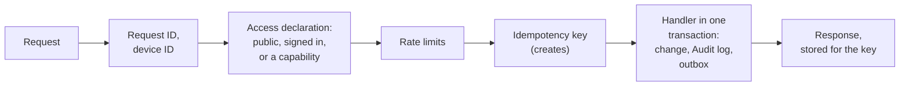
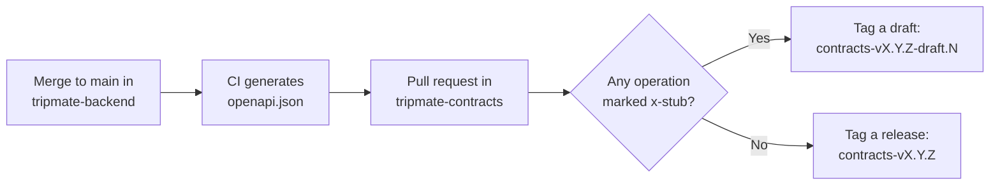
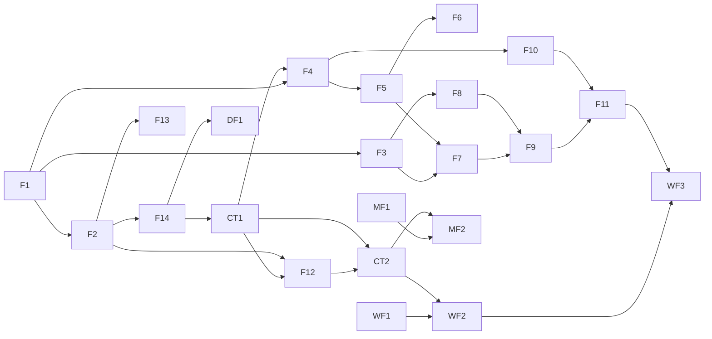

# TripMate -- EPIC-11 Spec: Platform Foundation

**Document type:** Epic Spec\
**Product:** TripMate\
**Status:** Approved\
**Version:** 1.5\
**Stage:** 2--4, epic level\
**Epic:** EPIC-11, first part, Phase 1\
**Page version:** [TripMate EPIC-11 Spec artifact](https://claude.ai/artifact/U3abYrK3zy9Fm2CaQETpT2)

Terms follow [GLOSSARY.md](../../../GLOSSARY.md). This spec builds the
first part of EPIC-11, the platform every endpoint and every screen
uses ([mvp-roadmap.md](../../../mvp-roadmap.md), section 6.1). It does
not repeat what other documents own; it links to them:

| Topic | Owned by |
|-------|----------|
| Containers, modules and their rules, background work, hosting on Render | [architecture.md](../../architecture.md), sections 3, 4, 9, 10 |
| Request conventions, the error format, how the contract moves between repositories | [api-design.md](../../api-design.md), sections 2, 4, 6 |
| Tokens, the access guard, capabilities, rate limits | [security.md](../../security.md), sections 2 and 3 |
| `outbox_events`, `idempotency_keys`, migrations | [data-model.md](../../data-model.md), sections 6 and 8 |
| Test levels and what runs when | [test-strategy.md](../../test-strategy.md), sections 2 to 4 |
| Card kinds, risk levels, the three agents, and the Definition of Done | [docs/development-flow.md](../../development-flow.md), sections 1 to 3 |

This spec answers *what the platform gives every epic, how it is
built, and which cards build it*.

## 1. Scope

| In this part (Phase 1) | Out of this part |
|------------------------|------------------|
| The backend skeleton: layout, the three processes, configuration, the database session, migrations | Trip-scoped capability checks, which need `trip_members` (EPIC-02 plugs them into the guard) |
| The request pipeline: request ID, device ID, the access declaration, token check, rate limits, errors, idempotency | The WebSocket gateway (5.2) |
| The outbox, the Taskiq worker, the scheduler, cleanup jobs | Hardening, load tests, the security assessment, the release plan: EPIC-11, second part, Phase 7 |
| Logs, traces, metrics, error reporting, and the P95 alert | Navigation shells and shared screens: EPIC-10 |
| The local stack in Docker, and production on Render; staging is added before the beta | The Desktop window and installers: EPIC-12 (DESK-01, DESK-07) |
| CI in all five code repositories, the flow checks, and the contract pipeline with draft and released tags | |
| Web and Mobile foundations: project, generated client, mock mode, translations | |

## 2. What the Platform Gives Every Epic

### 2.1 Backend layout

One package per module of [architecture.md](../../architecture.md),
section 4, all with the same shape, so a card names its files the same
way in every module.

```text
tripmate-backend/
├── app/
│   ├── main.py            API process (FastAPI)
│   ├── worker.py          Worker process (Taskiq)
│   ├── scheduler.py       Scheduler process
│   ├── platform/          access, errors, idempotency, outbox, jobs, config, db, logging
│   └── <module>/          identity, trips, money, ...
│       ├── api.py         Routes: access declaration, request and response schemas
│       ├── schemas.py     Pydantic models; the contract is generated from them
│       ├── service.py     The module's public interface
│       ├── <rule>.py      Pure domain rules, named as in architecture.md, section 4
│       ├── repository.py  Queries; every trip-scoped query takes a trip ID
│       ├── models.py      Tables
│       ├── jobs.py        Taskiq jobs
│       └── events.py      Handlers for other modules' events
├── migrations/            Alembic
├── tests/                 unit, property, integration, api, contract
├── .claude/agents/        The test, code, and review agent roles
├── Dockerfile             One image for the three processes
├── render.yaml            Render blueprint
├── compose.yaml           Local PostgreSQL and Redis
└── CLAUDE.md              Setup, commands, coding conventions
```

- `platform` imports no other module. A module imports only another
  module's `service.py` and its data types; import-linter fails CI
  otherwise.
- A module registers with `platform` at start-up (its routes, jobs,
  event handlers, due-work queries, error codes), so `platform` never
  imports it. `platform` finds the modules by scanning `app/`, so
  adding a module changes no shared file.
- The layout is made for cards that run at the same time. The
  skeleton creates one file for each part of `platform` (access,
  errors, rate limits, idempotency, outbox, jobs, logging), holding
  only its interface, so each later card fills its own file. Every
  dependency of 4.1 is in the lock file from the skeleton on, and each
  card's tests are in their own files, named with the card.

### 2.2 The request pipeline

Every request passes the same steps, in this order.



| Step | Rule |
|------|------|
| Request ID | A new ID for every request, returned in `X-Request-Id` and written in every log line and error |
| Device ID | `X-Device-Id` is required on every request except the health check; a missing or malformed one returns `400 request.invalid` |
| Access declaration | Every route declares `public`, `signed_in`, or a capability of [security.md](../../security.md), section 3.2. A route with no declaration fails a test in CI. |
| Token check | For any route that is not `public`: the EdDSA access token's signature and expiry are checked, and `identity` is asked through its registered hook whether the session is still active. A failure returns `401 auth.not_signed_in` or `401 auth.token_expired`. |
| Capability | For a capability route, the guard asks `trips` for the caller's membership (registered by EPIC-02). Until then only `public` and `signed_in` routes exist. |
| Rate limits | The general ceiling of [security.md](../../security.md), section 2.2, on every route; a route can add its own limit with its key. Counters live in Redis. A limit returns `429 rate.limited` with `Retry-After`. When Redis does not answer, a rate-limited route returns `503 server.unavailable`. |
| Idempotency | Every `POST` that creates a record declares it; the platform applies 2.4. |
| Transaction | The handler runs in one database transaction. The change, its Audit log entries, and its outbox events are written together or not at all. |

### 2.3 Errors

- Every error a module returns is one exception type with a status,
  a code, `params`, and `fields`; the platform turns it into the format
  of [api-design.md](../../api-design.md), section 4.1.
- A request that breaks its schema returns `400 request.invalid` with
  one entry in `fields` per problem.
- Anything unexpected returns `500 server.error` with the request ID
  and no detail; the full error goes to error reporting (2.6).
- A module registers the codes it can return. A test fails when a
  registered code has no text in both languages in the pinned
  contracts version.

Codes this epic adds:

| Status | Code | When |
|--------|------|------|
| `400` | `request.idempotency_key_required` | A create `POST` with no `Idempotency-Key` |
| `409` | `request.idempotency_in_progress` | The same key arrives while the first request is still running |
| `500` | `server.error` | Anything unexpected |
| `503` | `server.unavailable` | The health check finds PostgreSQL or Redis unreachable; a rate limit cannot be counted |

`request.invalid`, `request.idempotency_mismatch`, `rate.limited`,
`auth.not_signed_in`, and `auth.token_expired` already exist
([api-design.md](../../api-design.md), section 4.2;
[data-model.md](../../data-model.md), section 6.3).

### 2.4 Idempotency keys

The rules are in [data-model.md](../../data-model.md), section 6.3.
This epic builds them:

| Case | Answer |
|------|--------|
| A new key | The request runs; its status and body are stored with the key |
| The same key and the same body | The stored response, without running the request again |
| The same key and a different body | `409 request.idempotency_mismatch` |
| The same key while the first request runs | `409 request.idempotency_in_progress`; the client retries later |
| The request fails with `5xx` | Nothing is stored, so a retry runs again |

A key belongs to the signed-in user. Before sign-in, for registering,
it belongs to the device ID.

### 2.5 Outbox, worker, and scheduler

- A module adds a domain event with one call inside its transaction;
  `trip_seq` is assigned in the same transaction
  ([data-model.md](../../data-model.md), section 6.2).
- The worker publishes new events in `id` order to the trip's Redis
  channel and sets `published_at`. It runs a few seconds after each
  commit and every few seconds as a sweep
  ([architecture.md](../../architecture.md), section 10).
- Handlers registered by other modules run as Taskiq jobs, one per
  event and handler, and are idempotent.
- The scheduler wakes every minute, runs each registered due-work
  query against PostgreSQL, and enqueues what is due. It keeps no
  timers of its own.
- Cleanup runs daily: idempotency keys after 24 hours, published
  outbox rows after 7 days.

### 2.6 Logs, traces, metrics, and errors

| Signal | What this epic builds |
|--------|-----------------------|
| Logs | JSON lines with request ID, user ID, and trip ID. No email, name, token, or request body; a test checks a log line made from a sign-in request. |
| Traces | OpenTelemetry across the API, the worker, PostgreSQL, Redis, and outgoing HTTP calls |
| Metrics | Request rate, errors, and latency per endpoint; queue depth and job age; outbox rows waiting |
| Errors | Error reporting with the release tag, on the backend, Web, and Mobile |
| Alerts | P95 latency over 500 ms, error rate, job age over 5 minutes, outbox not draining ([architecture.md](../../architecture.md), section 9.4) |

### 2.7 Configuration, secrets, and the health check

- All settings come from environment variables, read once at start-up
  and checked; the app does not start with a missing setting.
- Secrets live only in Render environment groups and GitHub Actions
  secrets. The repositories are public, so `.env.example` lists every
  setting with no value, and a secret scan runs in CI.
- `GET /v1/health` is `public` and returns `200` with the release
  version when PostgreSQL and Redis answer, or `503
  server.unavailable`. Render uses it to decide when an instance takes
  traffic.

### 2.8 Environments

Until the beta there are two environments
([architecture.md](../../architecture.md), section 9.2).

| Environment | What runs | Data | How it starts |
|-------------|-----------|------|---------------|
| Local | `compose.yaml`: the API, worker, and scheduler from the backend image, PostgreSQL, Redis. Web and Mobile run against it. | Seed data ([test-strategy.md](../../test-strategy.md), section 3) | `docker compose up` |
| CI | The same `compose.yaml`, for the end-to-end smoke set | Seed data | On every pull request |
| Production, until the beta | On Render, from `render.yaml`: one instance that runs the API, the worker, and the scheduler together, Postgres and Key Value on their free plans, and the Web static site | The product owner and one or two first users | A tagged release, by hand |
| Production, from the beta | Two API instances, one worker, one scheduler, Postgres with point-in-time recovery, Key Value, and the Web static site | Real | A tagged release, by hand |

- The backend image is published to GitHub Container Registry for
  every release tag; a client's `compose.yaml` runs the image of the
  release its pinned contract came from.
- Migrations run in production as Render's pre-deploy step; a failing
  migration stops the deploy and the previous version keeps serving.
- A rollback is a redeploy of the previous image.
- Until the beta, production has no point-in-time recovery and stops
  for a few seconds at each deploy. The three processes still start
  from the one image with their own commands, so moving them to
  separate instances before the beta changes `render.yaml` only.
- The monthly cost limit is 10 USD until the beta
  ([mvp-roadmap.md](../../../mvp-roadmap.md), section 3). F11 first
  checks that Render's free Postgres plan can hold the data that long;
  if it cannot, the card stops and asks the product owner.
- Staging joins `render.yaml` before the beta (Phase 7), for release
  candidates, Desktop update tests, and the AI evaluation with live
  providers.

### 2.9 CI in every code repository

| Repository | Every pull request runs |
|------------|-------------------------|
| `tripmate-backend` | Ruff, mypy, unit and property tests, integration and API tests against PostgreSQL and Redis service containers, import-linter, one migration head, the access declaration test, the error code text check, Schemathesis against the contract, pip-audit, secret scan, image build |
| `tripmate-contracts` | The breaking-change check against the last tag and the latest draft, the translation check (every key in both languages, valid ICU) |
| `tripmate-web` | ESLint, TypeScript, Vitest, the static build, the generated client and messages against the pinned contracts version |
| `tripmate-mobile` | `flutter analyze`, `flutter test`, the generated client and ARB files against the pinned contracts version, an Android build |
| `tripmate-desktop` | `cargo clippy`, `cargo test` |

The end-to-end smoke set runs in CI against the stack of 2.8: in
`tripmate-backend` with the latest Web release, and in `tripmate-web`
with the backend image of its pinned release.

Every code repository also runs the flow checks of 2.12.

When a repository's CI exists, its checks become required on `main`,
next to the branch protection already set.

### 2.10 The contract pipeline

How drafts and releases work is in
[api-design.md](../../api-design.md), section 6. This epic builds it:



- A stub route is marked `x-stub: true` in the generated contract and
  returns `501`. Every response schema of a stub carries an example,
  which the mock modes of Web and Mobile return.
- The pull request in `tripmate-contracts` is opened with a token kept
  in the backend's GitHub Actions secrets.

### 2.11 Web and Mobile foundations

| | Web | Mobile |
|---|-----|--------|
| Project | Next.js App Router, TypeScript strict, static export ([ADR-0007](../../adr/0007-web-client-is-a-static-build.md)) | Flutter, with two flavors, `dev` and `prod`, so both apps can be installed on one phone |
| API client | Generated from the pinned contracts version with Orval: typed client, TanStack Query hooks | Generated from the pinned contracts version with OpenAPI Generator, `dart-dio` |
| Mock mode | MSW handlers generated with the client, on when `NEXT_PUBLIC_API_MODE=mock` and in screen tests | A Dio interceptor that answers from the contract's examples, on when built with `--dart-define=API_MODE=mock` and in widget tests |
| Headers sent on every request | `X-Device-Id`; `Idempotency-Key` on creates, kept for retries of the same action | The same |
| Translations | `next-intl` messages generated from the files under `translations/` | ARB files generated from the same source |
| Where it runs | `localhost:3000` against the local stack; in production, a Render static site with every `/join/*` path served the join page | The `dev` flavor against the local stack (`10.0.2.2:8000` from the Android emulator, `localhost:8000` from the iOS simulator); `prod` against production |

A mock card ([docs/development-flow.md](../../development-flow.md),
section 1) runs in mock mode; its integration card switches the same
screens to the real API by configuration only.

### 2.12 The flow checks

The rules of [docs/development-flow.md](../../development-flow.md),
section 2.3, are held by five checks. This epic builds them.

| Check | How it works |
|-------|--------------|
| Failing first | Finds the commits with the trailer `Agent: test`, checks out the last one, and runs the tests those commits added. Each must fail or error. |
| Test lock | Compares the tests added by the test commits with the head of the branch. A test that a commit without the trailer changed, skipped, or deleted fails the check. |
| Requirement-to-test report | Collects every test name, reads the requirement ID in it, and compares with `tests/requirement-ids.txt`, the P0 IDs in scope. The first card of each epic adds that epic's IDs. The report is kept with the CI run. |
| Mutation | Runs mutation testing on the rule files the pull request changes. A surviving mutant fails the check unless the pull request lists it with a reason. Backend only. |
| Risk gate | Matches the changed files against the repository's path list for the High items of development-flow.md, section 2.1. A match, or a path no rule names, needs the label `human-approved`. |

- The checks are scripts with their own tests, kept in
  `tripmate-backend` and offered as one reusable workflow. The other
  code repositories call it with their own path list and test command.
- The path list, the workflows, each `CLAUDE.md`, and the agent roles
  are on the path list themselves.

## 3. Acceptance Criteria

Each criterion has at least one test named with its requirement
([docs/development-flow.md](../../development-flow.md), section 3).
The requirements are the cross-cutting rows of
[test-strategy.md](../../test-strategy.md), section 5.11.

| Requirement | Criterion | Levels |
|-------------|-----------|--------|
| Business rules 3 and 4, access | A route with no access declaration fails the build | A |
| Business rules 3 and 4, access | A `signed_in` route refuses a missing, expired, or forged token, and a token of an ended session | A |
| Input validation | A request that breaks its schema returns `400 request.invalid` with its fields; the cases are generated from the contract | C, A |
| Integrity | A command that fails part way writes no record, no Audit log entry, and no outbox event | I |
| Idempotency | Each case of 2.4 returns the answer in its row | I, A |
| Realtime | An outbox event is published only after its transaction commits, in `id` order, once per event | I |
| Background work | A job run twice changes nothing the second time; the scheduler enqueues due work after a restart | I |
| Language tests | A registered error code with no text in either language fails CI | C |
| Cross-client API contract tests | A breaking change against the last tag or the latest draft fails CI in `tripmate-contracts`; Web and Mobile build against the pinned version | C |
| Data protection | A log line from a sign-in request holds no email, password, or token | U |
| Performance | The P95 latency metric and its alert exist in production | M |
| Development flow | A test that passes before its code exists, and a locked test that a later commit weakens, each fail CI | U |
| Development flow | A P0 requirement in scope with no test fails CI | U |
| Development flow | A pull request that reaches a High path cannot merge without the product owner's label | U |

## 4. Technical Design

### 4.1 Backend stack

| Concern | Choice |
|---------|--------|
| Language and packages | Python 3.13, `uv` with a lock file |
| Web framework | FastAPI on Uvicorn, Pydantic v2 |
| Database | SQLAlchemy 2 with `asyncpg`; Alembic for migrations |
| Background jobs | Taskiq with `taskiq-redis` ([architecture.md](../../architecture.md), section 12.1) |
| Logs and traces | `structlog`; OpenTelemetry SDK |
| Quality | Ruff, mypy in strict mode, import-linter |
| Tests | pytest, Hypothesis, Schemathesis, an HTTP test client; `mutmut` for mutation testing |
| Supply chain | pip-audit, a secret scan, Dependabot |

### 4.2 Data

The tables are in [data-model.md](../../data-model.md), section 6.
This epic creates `idempotency_keys` and `outbox_events` in the first
migration. `outbox_events.trip_id` gets its foreign key in the EPIC-02
migration that creates `trips`.

`idempotency_keys` holds `device_id` next to `user_id`, which is empty
before sign-in (2.4); data-model.md says so in the same change.

### 4.3 Each repository's `CLAUDE.md` and agent roles

The skeleton card of each repository writes its `CLAUDE.md`: setup,
commands, coding conventions, and a pointer to `../tripmate-docs/` for
the glossary, prd.md, the architecture documents, and the spec of the
epic being built ([architecture.md](../../architecture.md), section
11). This closes the open question of
[docs/development-flow.md](../../development-flow.md), section 5.2.

The same card writes the three agent roles in `.claude/agents/`: the
test agent, the code agent, and the review agent, each with what it
reads, what it may change, and what it never does
([docs/development-flow.md](../../development-flow.md), section 2.3).

Each `CLAUDE.md` also points to the shared rules in the `CLAUDE.md` of
`tripmate-docs`, and each repository has a `.gitattributes` that fixes
line endings, because the work runs on macOS and on Windows
([docs/development-flow.md](../../development-flow.md), section 1).

## 5. Decisions and Open Questions

### 5.1 Decisions made in this spec

| Decision | Alternatives set aside | Why |
|----------|------------------------|-----|
| Web and Mobile foundations are in this epic | In EPIC-10, cross-platform experience | The mock cards of EPIC-01 need a project, a generated client, and mock mode before they start |
| A route is a stub when the contract marks it `x-stub` | A label on the pull request; a separate draft branch | The contract itself says what is not built yet, so the tag follows from the file |
| Mock responses come from the contract's examples | Hand-written mock data in each client | One source for both clients; a stub without examples fails CI |
| An idempotency key before sign-in belongs to the device ID | No key on register; a key with no owner | Register creates a record and api-design.md asks for a key on every create |
| The WebSocket gateway is built with the first epic that sends an event to a screen | In this epic | The outbox already publishes to Redis; the gateway's rules (subscriptions, Former members) need trips |
| Two environments until the beta: local in Docker, and production | A preview per pull request and a staging environment from Phase 1 | A team of two reviews in CI and locally; production has no real users before the beta. It saves the Render Pro plan and a second server to keep running. Staging is added before the beta. |
| Mobile has two flavors; mock mode is a build setting | One flavor per environment, and one for mock | A flavor is needed only to install two apps on one phone |
| Sentry takes errors from the backend, Web, and Mobile; Grafana Cloud takes traces, metrics, and alerts; both on free plans | Sentry alone; Google Cloud Observability with Firebase Crashlytics; a self-hosted stack | Both take OpenTelemetry and need no payment card. Sentry has SDKs for all three clients with release tags, and Grafana alerts on P95, job age, and the outbox. |
| A fine-grained GitHub token opens the pull request in `tripmate-contracts`, stored as the backend secret `CONTRACTS_TOKEN` | A GitHub App | Five minutes to set up, limited to one repository. The product owner creates it with Contents and Pull requests set to read and write and a one-year expiry, and renews it before it expires. The publishing job runs only on pushes to `main`, never on a pull request, so a changed workflow cannot reach the token. |
| TripMate gets its own `.com` domain through Cloudflare Registrar, bought by the product owner before the beta; production uses `app.` and `api.` under it | `onrender.com` addresses; a free or first-year-discount domain | The Web refresh cookie is `SameSite=Strict` and needs the Web client and the API on one site ([security.md](../../security.md), section 2.1). Invitation links and app links carry the domain, so it must not change once real users have them. Before the beta, production has no real users and runs on `onrender.com`; locally both are `localhost`. |

| The flow checks are scripts with their own tests, shared as one reusable workflow from `tripmate-backend` | A copy in each repository; a marketplace action | One place to change a gate, and the gate is tested like any other code |
| A test commit is marked by a trailer in its message | A separate branch or pull request for tests | One pull request per card stays the rule; the trailer is enough for CI to tell the two kinds of commit apart |
| The requirement IDs in scope are a file in each code repository | CI reads prd.md from `tripmate-docs` | A code repository's CI needs nothing outside it, and the scope grows epic by epic |
| A rate-limited route returns `503 server.unavailable` when Redis does not answer | Let the request through without counting | A limit that cannot be counted is not skipped: sign-in and sign-up limits are a security control |
| Until the beta, production is one instance for the three processes, with free Postgres and Key Value plans | The full setup from the first deploy | One or two people use it before the beta, and the monthly cost limit is 10 USD. The cost: no point-in-time recovery, and a short stop at each deploy. The full setup returns before the beta. |
| The skeleton makes one file per part of `platform`, finds modules by scanning, and installs every dependency at once | Each card creates what it needs | Cards that run at the same time must not change the same file. The lock file and the app's start-up file are where two cards would otherwise meet. |
| Translations are one file per area in each language, `translations/en/<area>.json` | One `en.json` and one `vi.json` | Web, Mobile, and the backend add keys at the same time, from three machines; one file per area keeps their changes apart |
| The Web and Mobile skeleton cards need no contract; generated messages and the flow checks move to WF2 and MF2 | WF1 and MF1 wait for CT1 | The three machines start on the first day instead of two waiting for the backend's first three cards |

### 5.2 Open questions

| Question | Proposed answer | Needed by |
|----------|-----------------|-----------|
| Is the WebSocket gateway part of EPIC-02 or EPIC-03? | EPIC-02, if its exit criterion "Web and Mobile display consistent trip information" needs live updates; otherwise EPIC-03 | EPIC-02 spec |

## 6. Tasks

Each row is one card on the [TripMate board](https://trello.com/b/zsxAnzsz/tripmate),
with the ID of the row in its title, for example
`F5 Access declaration and token check`. Sizes are those of the
[EPIC-01 spec](../epic-01/spec.md), section 6: XS, S, or M. These
cards change no feature screen, so none is split into a mock and an
integration card.

The Risk column is the level of
[docs/development-flow.md](../../development-flow.md), section 2.1.
The product owner reviews the pull request of a High card; a Low card
merges on its own when its checks pass. Most cards of this epic are
High, because they build what that list protects: CI, the checks,
hosting, the access guard, and migrations. F1, F2, and F14 come first,
so the checks exist before the other cards start. WF1 and MF1 need no
contract and start on the first day. Each card's test cases are in
section 7, and which cards run at the same time is in 6.7.



### 6.1 Backend: `tripmate-backend`, module `platform`

| ID | Card | Size | Risk | Depends on | Done when |
|----|------|------|------|------------|-----------|
| F1 | `Backend skeleton and health check` | M | High | -- | The layout of 2.1, with one file per part of `platform`, modules found by scanning, and every dependency of 4.1 in the lock file; the three processes start from one image; settings checked at start-up; `compose.yaml`; `GET /v1/health`; `CLAUDE.md`, `.gitattributes`, and the agent roles (4.3) |
| F2 | `Backend CI` | S | High | F1 | Every backend check of 2.9 that has code to run; the checks are required on `main` |
| F3 | `Database session and migrations` | S | High | F1 | One transaction per request; Alembic set up with its first empty migration; integration tests get a clean database; test builders have their base |
| F4 | `Error format and error codes` | S | High | F1, CT1 | 2.3: one exception type, `request.invalid` with fields, `500 server.error`, request ID; registered codes checked for text in both languages |
| F5 | `Access declaration and token check` | M | High | F4 | 2.2: every route declares its access; the declaration test; device ID required; EdDSA token check with test keys; the session hook for `identity` |
| F6 | `Rate limits` | S | Low | F5 | The general ceiling and per-route limits in Redis; `429 rate.limited` with `Retry-After` |
| F7 | `Idempotency keys` | M | High | F3, F5 | The `idempotency_keys` migration; every case of 2.4 as a test |
| F8 | `Outbox` | S | High | F3 | The `outbox_events` migration; adding an event inside a transaction; the integrity test |
| F9 | `Worker, scheduler, and cleanup` | M | High | F7, F8 | 2.5: Taskiq on Redis, the outbox publisher, event handlers as jobs, the scheduler's due-work queries, daily cleanup; the background work tests |
| F10 | `Logs, traces, metrics, and error reporting` | M | High | F4 | 2.6, sent to Sentry and Grafana Cloud (5.1); the log line test |
| F11 | `Local stack, image, and production on Render` | M | High | F9, F10 | 2.8: `compose.yaml` runs the whole stack with seed data; the image is published for every release tag; `render.yaml` for production until the beta (one instance, free database plans) with migrations as the pre-deploy step; the alerts of 2.6 |
| F12 | `Contract publishing` | S | High | F2, CT1 | 2.10: `openapi.json` generated from the app, `x-stub` on stub routes, examples required on stubs, the pull request in `tripmate-contracts` with `CONTRACTS_TOKEN`, from a job that runs only on pushes to `main` |
| F13 | `Requirement-to-test report` | S | High | F2 | 2.12: the report from test names and `tests/requirement-ids.txt`, kept with each CI run; a P0 ID in scope with no test fails CI |
| F14 | `Flow checks and agent roles` | M | High | F2 | 2.12: failing first, test lock, mutation, and the risk gate as scripts with their own tests, in one reusable workflow, required on `main`; the label `human-approved` exists |

### 6.2 Contract: `tripmate-contracts`

| ID | Card | Size | Risk | Depends on | Done when |
|----|------|------|------|------------|-----------|
| CT1 | `Contracts repository and translation check` | S | High | F14 | `openapi.json`, `events.schema.json`, `translations/en/` and `translations/vi/` in place, one file per area; the translation check of 2.9; the flow checks of 2.12; `CLAUDE.md` and the agent roles (4.3) |
| CT2 | `Draft and release tags` | S | High | CT1, F12 | 2.10: a draft tag when any operation is a stub, a release tag otherwise; the breaking-change check against the last tag and the latest draft |

### 6.3 Web: `tripmate-web`

| ID | Card | Size | Risk | Depends on | Done when |
|----|------|------|------|------------|-----------|
| WF1 | `Web skeleton and CI` | S | High | -- | Next.js static export, TypeScript strict, ESLint, Vitest with Testing Library; the checks of 2.9 that need no contract, required on `main`; `CLAUDE.md`, `.gitattributes`, and the agent roles (4.3) |
| WF2 | `Web API client and mock mode` | M | High | WF1, CT2 | `next-intl` messages generated from the pinned contracts version; the generated client and hooks, MSW handlers from the pinned draft, the headers of 2.11; one test screen reads `GET /v1/health` in both modes; the remaining checks of 2.9 and the flow checks of 2.12 required on `main` |
| WF3 | `Web smoke set and production site` | S | High | WF2, F11 | Playwright runs in CI against the stack of 2.8; the production static site on Render serves the join page for every `/join/*` path |

### 6.4 Mobile: `tripmate-mobile`

| ID | Card | Size | Risk | Depends on | Done when |
|----|------|------|------|------------|-----------|
| MF1 | `Mobile skeleton and CI` | S | High | -- | Flutter project with the two flavors and the mock mode setting of 2.11; `flutter analyze`, `flutter test`, and the Android build required on `main`; `CLAUDE.md`, `.gitattributes`, and the agent roles (4.3) |
| MF2 | `Mobile API client and mock mode` | M | High | MF1, CT2 | ARB files generated from the pinned contracts version; the generated `dart-dio` client, the mock interceptor answering from the contract's examples, the headers of 2.11; one test screen reads `GET /v1/health` in both modes; the remaining checks of 2.9 and the flow checks of 2.12 required on `main` |

### 6.5 Desktop: `tripmate-desktop`

| ID | Card | Size | Risk | Depends on | Done when |
|----|------|------|------|------------|-----------|
| DF1 | `Desktop repository and CI` | S | High | F14 | A Tauri 2 project that builds; the checks of 2.9 and 2.12 required on `main`; `CLAUDE.md` and the agent roles (4.3). The window that loads the Web build is DESK-01, in EPIC-12. |

### 6.6 Checkpoints

| After | The product owner checks |
|-------|--------------------------|
| F14 | On throwaway pull requests: a test that passes before its code, a locked test weakened by a later commit, and a migration with no label each fail CI. From here a Low card merges on its own. |
| F5 | A `signed_in` test route answers with each error of 2.3, and removing its declaration fails CI |
| F11 | `docker compose up` runs the whole stack, and the health check answers locally and in production |
| CT2, WF2, MF2 | A stub route becomes a draft tag, and the test screen on Web and on Mobile shows its example in mock mode. EPIC-01 can start with B0. |

### 6.7 Machines and parallel work

The work runs on three machines, one per group of repositories
([docs/development-flow.md](../../development-flow.md), section 1), so
no two machines change the same repository.

| Wave | Mac 1: backend and contracts | Mac 2: Mobile | Windows: Web and Desktop |
|------|------------------------------|---------------|--------------------------|
| 1 | F1, then F2, then F14 | MF1 | WF1 |
| 2 | CT1, F3, F13 | -- | DF1 |
| 3 | F4, F8, F12, then CT2 | MF2 | WF2 |
| 4 | F5, F10, then F6 and F7 | -- | -- |
| 5 | F9, then F11 | -- | WF3 |

- Cards in one cell of Mac 1 after wave 1 can run at the same time,
  each in its own git worktree and its own session.
- Two cards with a migration, F7 and F8, merge one after the other;
  the second one rebases so there is one migration head.
- The product owner reviews the backend's pull requests first: the
  other two machines wait on the contract.

## 7. Test Cases

Each card has its test cases here: the main cases, the error cases,
and the edge cases, each with its expected result. The product owner
approves them with this spec. The test agent turns each case into one
test before the code is written
([docs/development-flow.md](../../development-flow.md), section 2);
it adds no expected result of its own.

| Column | Meaning |
|--------|---------|
| Case | The card's ID and a number. The pull request maps each case to its test. |
| Kind | Main: the behaviour works. Error: a wrong input or a failure is refused. Edge: a limit, a repeat, or an unusual order. |
| Level | The letter of [test-strategy.md](../../test-strategy.md), section 2 |

A case of level M has no automated test: it is shown once by hand and
recorded in the card's pull request.

### 7.1 Backend

**F1 Backend skeleton and health check**

| Case | Kind | Given | Expected | Level |
|------|------|-------|----------|-------|
| F1-1 | Main | PostgreSQL and Redis answer | `GET /v1/health` returns `200` with the release version | A |
| F1-2 | Error | PostgreSQL does not answer | `503 server.unavailable` | I |
| F1-3 | Error | Redis does not answer | `503 server.unavailable` | I |
| F1-4 | Error | A required setting is missing at start-up | The process stops and names the setting, never a value | U |
| F1-5 | Edge | A setting has a value of the wrong type | The process stops and names the setting | U |
| F1-6 | Main | The one image is started as API, as worker, and as scheduler | Each process starts and stays up | I |
| F1-7 | Main | A new module folder with an `api.py` is added | Its route is served, and no file outside the folder changed | I |
| F1-8 | Edge | A module folder with no `api.py` | The app starts; the folder is skipped | U |

**F2 Backend CI**

Shown once on a throwaway pull request for each case.

| Case | Kind | Given | Expected | Level |
|------|------|-------|----------|-------|
| F2-1 | Main | A pull request with no problem | Every check passes, and each is required on `main` | M |
| F2-2 | Error | A lint error, a type error, or a failing test | The matching check fails | M |
| F2-3 | Error | A module imports another module's `repository.py` | import-linter fails | M |
| F2-4 | Error | A string shaped like a secret is committed | The secret scan fails | M |
| F2-5 | Error | A dependency with a known vulnerability | pip-audit fails | M |
| F2-6 | Error | Two migration heads | The migration check fails | M |

**F3 Database session and migrations**

| Case | Kind | Given | Expected | Level |
|------|------|-------|----------|-------|
| F3-1 | Main | A handler writes a row and returns | The row is stored | I |
| F3-2 | Error | A handler writes a row, then raises | No row is stored | I |
| F3-3 | Edge | Two tests run one after the other | The second sees none of the first one's rows | I |
| F3-4 | Main | An empty database | Migrating up to the head, then down to the base, both succeed | I |
| F3-5 | Edge | A model differs from the migrations | The migration check fails | I |

**F4 Error format and error codes**

| Case | Kind | Given | Expected | Level |
|------|------|-------|----------|-------|
| F4-1 | Main | A module raises its error with a status, a code, and `params` | The response has that status and the format of api-design.md, section 4.1, with `X-Request-Id` equal to `requestId` | A |
| F4-2 | Error | A body that breaks its schema in two fields | `400 request.invalid` with two entries in `fields` | A |
| F4-3 | Error | A body that is not JSON | `400 request.invalid` | A |
| F4-4 | Error | A handler raises something unexpected | `500 server.error` with the request ID; the body holds no message and no stack | A |
| F4-5 | Edge | Two requests | Two different request IDs | A |
| F4-6 | Error | A registered code has no Vietnamese text in the pinned contracts version | The error code text check fails and names the code | C |
| F4-7 | Edge | A registered code has text in both languages | The check passes | C |

**F5 Access declaration and token check**

| Case | Kind | Given | Expected | Level |
|------|------|-------|----------|-------|
| F5-1 | Error | A route with no access declaration | The declaration test fails and names the route | A |
| F5-2 | Main | A `signed_in` route, a valid token, an active session | `200`, and the handler knows the user ID and session ID | A |
| F5-3 | Main | A `public` route with no token | `200` | A |
| F5-4 | Error | A `signed_in` route with no `Authorization` header | `401 auth.not_signed_in` | A |
| F5-5 | Error | A token past its expiry | `401 auth.token_expired` | A |
| F5-6 | Error | A token signed with another key, or with the algorithm `none` | `401 auth.not_signed_in` | A |
| F5-7 | Edge | A valid token whose session the hook reports as ended | `401 auth.token_expired` | A |
| F5-8 | Edge | A token that expires one second from now, and one that expired one second ago | `200`, then `401 auth.token_expired` | A |
| F5-9 | Error | No `X-Device-Id`, or one that is not a UUID | `400 request.invalid` | A |
| F5-10 | Edge | The health check with no `X-Device-Id` | `200` | A |

**F6 Rate limits**

| Case | Kind | Given | Expected | Level |
|------|------|-------|----------|-------|
| F6-1 | Main | Requests up to the limit | Each one passes | A |
| F6-2 | Error | One request over the limit | `429 rate.limited`, with `Retry-After` set to the seconds left in the window | A |
| F6-3 | Edge | The window has passed | The next request passes | A |
| F6-4 | Edge | Two callers with different keys | Each is counted on its own | A |
| F6-5 | Main | A route with its own limit and key | Its limit applies as well as the general ceiling | A |
| F6-6 | Edge | Redis does not answer | `503 server.unavailable`; the request is not let through | I |

**F7 Idempotency keys**

| Case | Kind | Given | Expected | Level |
|------|------|-------|----------|-------|
| F7-1 | Main | A create `POST` with a new key | The request runs once; its status and body are stored | I, A |
| F7-2 | Main | The same key and the same body again | The stored response; no second record | I, A |
| F7-3 | Error | The same key with a different body | `409 request.idempotency_mismatch` | A |
| F7-4 | Edge | The same key while the first request still runs | `409 request.idempotency_in_progress` | I |
| F7-5 | Edge | The first request fails with `5xx` | Nothing is stored; the retry runs | I |
| F7-6 | Edge | The first request is refused with `4xx` | The refusal is stored and returned for the same key and body | I |
| F7-7 | Error | A create `POST` with no key | `400 request.idempotency_key_required` | A |
| F7-8 | Error | A key that is not a UUID | `400 request.invalid` | A |
| F7-9 | Edge | Two users send the same key | Each request runs; neither sees the other's response | I |
| F7-10 | Edge | Before sign-in, two device IDs send the same key | Each request runs | I |

**F8 Outbox**

| Case | Kind | Given | Expected | Level |
|------|------|-------|----------|-------|
| F8-1 | Main | A transaction adds one event and commits | One outbox row with the trip's next `trip_seq` and no `published_at` | I |
| F8-2 | Error | A transaction adds an event, then fails | No outbox row and no record | I |
| F8-3 | Edge | One transaction adds two events | Two rows with consecutive `trip_seq`, in the order added | I |
| F8-4 | Edge | Two transactions of the same trip commit at the same time | Their `trip_seq` values differ and leave no gap | I |
| F8-5 | Edge | Events of two trips | Each trip has its own numbering | I |

**F9 Worker, scheduler, and cleanup**

| Case | Kind | Given | Expected | Level |
|------|------|-------|----------|-------|
| F9-1 | Main | A committed event | It is published to its trip's channel, and `published_at` is set | I |
| F9-2 | Edge | Three events waiting | They are published in `id` order | I |
| F9-3 | Edge | The publisher runs again after publishing | Nothing is published twice | I |
| F9-4 | Error | Redis does not answer while publishing | `published_at` stays empty; the next sweep publishes the event | I |
| F9-5 | Main | An event with two registered handlers | One job per handler | I |
| F9-6 | Edge | A handler's job runs twice for one event | The second run changes nothing | I |
| F9-7 | Main | A due-work query returns one item that is due | The scheduler enqueues it at its next tick | I |
| F9-8 | Edge | The scheduler restarts while work is due | The work is enqueued after the restart | I |
| F9-9 | Main | Idempotency keys of 25 hours and of 23 hours | Cleanup deletes the first and keeps the second | I |
| F9-10 | Edge | A published outbox row of 8 days, and an unpublished one of 8 days | Cleanup deletes the first and keeps the second | I |

**F10 Logs, traces, metrics, and error reporting**

| Case | Kind | Given | Expected | Level |
|------|------|-------|----------|-------|
| F10-1 | Main | Any request | One JSON log line with the request ID, and the user ID when signed in | U |
| F10-2 | Error | A sign-in request with an email, a password, and a token | The log line holds none of the three | U |
| F10-3 | Main | A handler raises something unexpected | Error reporting receives it with the release tag and the request ID | I |
| F10-4 | Main | A request that reads the database | One trace with a span for the request and one for the query | I |
| F10-5 | Edge | Error reporting or the trace collector does not answer | The request still succeeds | I |
| F10-6 | Main | The metrics endpoint or exporter | It carries request rate, errors, latency, queue depth, job age, and outbox rows waiting | I |

**F11 Local stack, image, and production on Render**

| Case | Kind | Given | Expected | Level |
|------|------|-------|----------|-------|
| F11-1 | Main | `docker compose up` on a clean machine, in CI | The health check returns `200` and the seed data is present | E |
| F11-2 | Main | A release tag | The image for that tag is in GitHub Container Registry | M |
| F11-3 | Main | Production after a deploy | The health check returns `200` with the release version; the alerts of 2.6 exist | M |
| F11-4 | Error | A deploy whose migration fails | The deploy stops; the previous version keeps serving | M |
| F11-5 | Edge | A rollback | Redeploying the previous image restores the previous version | M |
| F11-6 | Main | The one production instance | The API answers, a job enqueued by a request runs, and the scheduler ticks | M |

**F12 Contract publishing**

| Case | Kind | Given | Expected | Level |
|------|------|-------|----------|-------|
| F12-1 | Main | The app with no change | Generating `openapi.json` twice gives the same file | C |
| F12-2 | Main | A stub route | The contract marks it `x-stub: true`, and calling it returns `501` | A, C |
| F12-3 | Error | A stub response schema with no example | The check fails and names the operation | C |
| F12-4 | Main | A merge to `main` that changes the contract | A pull request opens in `tripmate-contracts` with the new file | M |
| F12-5 | Edge | A merge to `main` that does not change the contract | No pull request | M |
| F12-6 | Edge | A pull request from a branch that edits the publishing workflow | The publishing job does not run, so the token is never read | M |

**F13 Requirement-to-test report**

| Case | Kind | Given | Expected | Level |
|------|------|-------|----------|-------|
| F13-1 | Main | Tests named with requirement IDs | The report lists each ID in scope with its tests | U |
| F13-2 | Error | A P0 requirement ID in scope with no test | The check fails and names the ID | U |
| F13-3 | Edge | A requirement ID of an epic that is not in scope yet | It is not asked for | U |
| F13-4 | Error | A test named with an ID that is not in the list | The check fails and names the test | U |
| F13-5 | Edge | The only test of an ID is skipped | The ID counts as having no test | U |

**F14 Flow checks and agent roles**

| Case | Kind | Given | Expected | Level |
|------|------|-------|----------|-------|
| F14-1 | Main | Every new test of the test commit fails at that commit | Failing first passes | U |
| F14-2 | Error | One new test of the test commit passes at that commit | Failing first fails and names the test | U |
| F14-3 | Error | A later commit with no `Agent: test` trailer edits, skips, or deletes a test of the test commit | Test lock fails and names the test | U |
| F14-4 | Edge | A later commit with the trailer changes that test | Test lock passes | U |
| F14-5 | Edge | A pull request with no test commit that changes only documents | Failing first and test lock pass | U |
| F14-6 | Main | A diff inside one module, on no listed path | The risk gate passes with no label | U |
| F14-7 | Error | A diff that touches a migration, with no label | The risk gate fails and names the path | U |
| F14-8 | Main | The same diff with the label `human-approved` | The risk gate passes | U |
| F14-9 | Edge | A diff that changes the path list, a workflow, a `CLAUDE.md`, or an agent role | The risk gate treats it as High | U |
| F14-10 | Edge | A diff on a path that no rule names | The risk gate treats it as High | U |
| F14-11 | Error | A changed rule file with a surviving mutant that the pull request does not list | The mutation check fails and shows the mutant | U |
| F14-12 | Main | The three role files in `.claude/agents/` | Each names what it reads, what it may change, and what it never does, as in development-flow.md, section 2.3 | M |

### 7.2 Contract

**CT1 Contracts repository and translation check**

| Case | Kind | Given | Expected | Level |
|------|------|-------|----------|-------|
| CT1-1 | Main | Every key is in both languages, in the file of the same area, with valid ICU | The translation check passes | C |
| CT1-2 | Error | A key is in one language only | The check fails and names the key | C |
| CT1-3 | Error | A message with broken ICU syntax | The check fails and names the key | C |
| CT1-4 | Edge | A message whose two languages use different placeholders | The check fails and names the key | C |

**CT2 Draft and release tags**

| Case | Kind | Given | Expected | Level |
|------|------|-------|----------|-------|
| CT2-1 | Main | A merged contract with one operation marked `x-stub` | A draft tag, `contracts-vX.Y.Z-draft.1` | C |
| CT2-2 | Edge | A second merge while a stub remains | `draft.2` of the same version | C |
| CT2-3 | Main | A merged contract with no stub | A release tag, `contracts-vX.Y.Z` | C |
| CT2-4 | Error | A change that removes a field, against the last release tag | The breaking-change check fails | C |
| CT2-5 | Error | A change that breaks the latest draft | The check fails | C |
| CT2-6 | Edge | A change that only adds an optional field | The check passes | C |

### 7.3 Web

**WF1 Web skeleton and CI**

| Case | Kind | Given | Expected | Level |
|------|------|-------|----------|-------|
| WF1-1 | Main | The project with no problem | Lint, types, tests, and the static build pass, and each is required on `main` | M |
| WF1-2 | Error | A lint error, a type error, or a failing test | The matching check fails | M |
| WF1-3 | Edge | The repository checked out on Windows and on macOS | No file shows as changed | M |

**WF2 Web API client and mock mode**

| Case | Kind | Given | Expected | Level |
|------|------|-------|----------|-------|
| WF2-1 | Main | Mock mode on | The test screen shows the example of `GET /v1/health` from the pinned contract | S |
| WF2-2 | Main | Mock mode off, the local stack up | The test screen shows the real answer | M |
| WF2-3 | Main | Any request | It carries `X-Device-Id`, the same value after a reload | U |
| WF2-4 | Main | A create request that is retried | Both attempts carry the same `Idempotency-Key` | U |
| WF2-5 | Edge | The same action done a second time by the user | A new key | U |
| WF2-6 | Error | The generated client does not match the pinned contracts version | The check fails | C |
| WF2-7 | Edge | A production build with no mock setting | Mock mode is off, and the mock handlers are not in the bundle | U |
| WF2-8 | Main | A screen test of one message key | The key shows its text in Vietnamese and in English | S |
| WF2-9 | Error | The generated messages do not match the pinned contracts version | The check fails | C |
| WF2-10 | Edge | A key the pinned contracts version does not have | The build fails; no key is shown as raw text | S |

**WF3 Web smoke set and production site**

| Case | Kind | Given | Expected | Level |
|------|------|-------|----------|-------|
| WF3-1 | Main | The stack of 2.8 in CI | The smoke set opens the test screen and passes | E |
| WF3-2 | Error | The backend of the stack is down | The smoke set fails; it does not pass on an empty page | E |
| WF3-3 | Main | The production site, at `/join/ABC123` | The join page is served | M |

### 7.4 Mobile

**MF1 Mobile skeleton and CI**

| Case | Kind | Given | Expected | Level |
|------|------|-------|----------|-------|
| MF1-1 | Main | The project with no problem | Analysis, tests, and the Android build pass, and each is required on `main` | M |
| MF1-2 | Main | The `dev` and `prod` flavors on one phone | Both install side by side | M |
| MF1-3 | Error | An analysis warning or a failing test | The matching check fails | M |

**MF2 Mobile API client and mock mode**

| Case | Kind | Given | Expected | Level |
|------|------|-------|----------|-------|
| MF2-1 | Main | Built with `API_MODE=mock` | The test screen shows the example of `GET /v1/health` from the pinned contract | S |
| MF2-2 | Main | The `dev` flavor against the local stack | The test screen shows the real answer | M |
| MF2-3 | Main | Any request | It carries `X-Device-Id`, the same value after the app restarts | U |
| MF2-4 | Main | A create request that is retried | Both attempts carry the same `Idempotency-Key` | U |
| MF2-5 | Edge | An operation whose contract has no example, in mock mode | The interceptor fails with the operation's name; it returns no made-up data | U |
| MF2-6 | Error | The generated client does not match the pinned contracts version | The check fails | C |
| MF2-7 | Main | A widget test of one message key | The key shows its text in Vietnamese and in English | S |
| MF2-8 | Error | The generated ARB files do not match the pinned contracts version | The check fails | C |

### 7.5 Desktop

**DF1 Desktop repository and CI**

| Case | Kind | Given | Expected | Level |
|------|------|-------|----------|-------|
| DF1-1 | Main | The Tauri 2 project with no problem | It builds; `cargo clippy` and `cargo test` pass, and each is required on `main` | M |
| DF1-2 | Error | A clippy warning | The check fails | M |

## 8. Version History

| Version | Date | Changes |
|---------|------|---------|
| 1.0 | 2026-11-20 | First version: scope of the first part of EPIC-11, what the platform gives every epic (backend layout, request pipeline, errors, idempotency, outbox and background work, observability, configuration and health check, Render environments, CI, the contract pipeline, Web and Mobile foundations), two environments until the beta (local and production), acceptance criteria, technical design, decisions and open questions, and 20 cards with checkpoints. |
| 1.1 | 2026-11-20 | The product owner answered three open questions, now decisions in section 5.1: Sentry and Grafana Cloud on free plans; a fine-grained GitHub token for contract pull requests, used only on pushes to `main`; a `.com` domain through Cloudflare Registrar, bought before the beta. |
| 1.2 | 2026-11-23 | Follows the new development flow. Every card has a risk level (section 6); all but F6 are High. Section 7 is new: the test cases of every card, with error and edge cases and their expected results. Section 2.12 and two new cards build the flow checks: F13, the requirement-to-test report, and F14, failing first, test lock, mutation, and the risk gate, with the agent roles. F14 now comes before CT1 and DF1. Each skeleton card also writes the agent roles. One open question added: rate limits when Redis does not answer. 22 cards. |
| 1.3 | 2026-11-23 | Approved by the product owner, with the proposed answer on rate limits: a rate-limited route returns `503 server.unavailable` when Redis does not answer (2.2, 2.3, decision in 5.1, case F6-6). The WebSocket gateway question stays open for the EPIC-02 spec. |
| 1.4 | 2026-11-23 | The product owner set the monthly cost limit to 10 USD until the beta. Section 2.8: until the beta, production is one instance that runs the API, the worker, and the scheduler, with free Postgres and Key Value plans; the full setup returns before the beta. Card F11 follows, checks the free Postgres plan first, and gains case F11-6. Decision added to 5.1. |
| 1.5 | 2026-11-23 | The work runs on three machines, and cards run at the same time. New 6.7: which machine builds what, in which wave. The skeleton (F1) makes one file per part of `platform`, finds modules by scanning, and installs every dependency (2.1; cases F1-7, F1-8). WF1 and MF1 need no contract and start on the first day; generated messages and the flow checks move to WF2 and MF2, with their cases. Translations are one file per area in each language. CI checks for one migration head (case F2-6). Every repository has a `.gitattributes`. Three decisions added to 5.1. |
