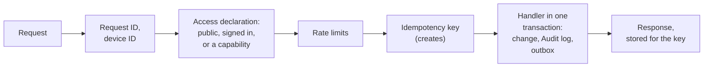
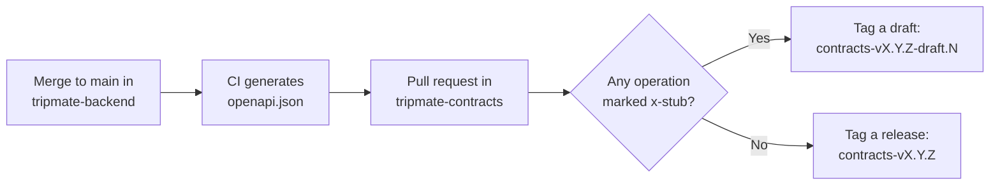
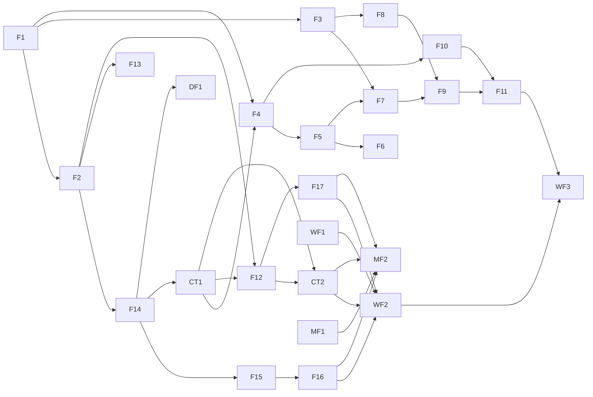

# TripMate -- EPIC-11 Spec: Platform Foundation

**Document type:** Epic Spec\
**Product:** TripMate\
**Status:** Approved\
**Version:** 3.3\
**Stage:** 2--4, epic level\
**Epic:** EPIC-11, first part, Phase 1\
**Page version:** [TripMate EPIC-11 Spec artifact](https://claude.ai/artifact/U3abYrK3zy9Fm2CaQETpT2)

Terms follow [GLOSSARY.md](../../../GLOSSARY.md). This spec builds the
first part of EPIC-11, the platform every endpoint and every screen
uses ([mvp-roadmap.md](../../../mvp-roadmap.md), section 6.1). It does
not repeat what other documents own; it links to them:

| Topic | Owned by |
|-------|----------|
| Containers, modules and their rules, background work, hosting on Render | [architecture.md](../../architecture.md), sections 3, 4, 9, 10 |
| Request conventions, the error format, how the contract moves between repositories | [api-design.md](../../api-design.md), sections 2, 4, 6 |
| Tokens, the access guard, capabilities, rate limits | [security.md](../../security.md), sections 2 and 3 |
| `outbox_events`, `outbox_trip_seqs`, `idempotency_keys`, migrations | [data-model.md](../../data-model.md), sections 6 and 8 |
| Test levels and what runs when | [test-strategy.md](../../test-strategy.md), sections 2 to 4 |
| Card kinds, task files, risk levels, the four agents, and the Definition of Done | [docs/development-flow.md](../../development-flow.md), sections 1 to 3 |

This spec answers *what the platform gives every epic, how it is
built, and in which order its cards run*. The cards themselves, with
their scope and test cases, are in the task file of each repository
(section 6).

## 1. Scope

| In this part (Phase 1) | Out of this part |
|------------------------|------------------|
| The backend skeleton: layout, the three processes, configuration, the database session, migrations | Trip-scoped capability checks, which need `trip_members` (EPIC-02 plugs them into the guard) |
| The request pipeline: request ID, device ID, the access declaration, token check, rate limits, errors, idempotency | The WebSocket gateway (5.2) |
| The outbox, the Taskiq worker, the scheduler, cleanup jobs | Hardening, load tests, the security assessment, the release plan: EPIC-11, second part, Phase 7 |
| Logs, traces, metrics, error reporting, and the P95 alert | Navigation shells and shared screens: EPIC-10 |
| The local stack in Docker, and production on Render; staging is added before the beta | The Desktop window and installers: EPIC-12 (DESK-01, DESK-07) |
| CI in all five code repositories, the flow checks, and the contract pipeline with draft and released tags | |
| Web and Mobile foundations: project, generated client, mock mode, translations | |

## 2. What the Platform Gives Every Epic

### 2.1 Backend layout

One package per module of [architecture.md](../../architecture.md),
section 4, all with the same shape, so a card names its files the same
way in every module.

```text
tripmate-backend/
├── app/
│   ├── main.py            API process (FastAPI)
│   ├── worker.py          Worker process (Taskiq)
│   ├── scheduler.py       Scheduler process
│   ├── platform/          access, errors, idempotency, outbox, jobs, config, db, logging
│   └── <module>/          identity, trips, money, ...
│       ├── api.py         Routes: access declaration, request and response schemas
│       ├── schemas.py     Pydantic models; the contract is generated from them
│       ├── service.py     The module's public interface
│       ├── <rule>.py      Pure domain rules, named as in architecture.md, section 4
│       ├── repository.py  Queries; every trip-scoped query takes a trip ID
│       ├── models.py      Tables
│       ├── jobs.py        Taskiq jobs
│       └── events.py      Handlers for other modules' events
├── migrations/            Alembic
├── tests/                 unit, property, integration, api, contract
├── .claude/agents/        The test, code, test-check, and diff-review agent roles
├── Dockerfile             One image for the three processes
├── render.yaml            Render blueprint
├── compose.yaml           Local PostgreSQL and Redis
└── CLAUDE.md              Setup, commands, coding conventions
```

- `platform` imports no other module. A module imports only another
  module's `service.py` and its data types; import-linter fails CI
  otherwise.
- A module registers with `platform` at start-up (its routes, jobs,
  event handlers, due-work queries, error codes), so `platform` never
  imports it. `platform` finds the modules by scanning `app/`, so
  adding a module changes no shared file.
- The layout is made for cards that run at the same time. The
  skeleton creates one file for each part of `platform` (access,
  errors, rate limits, idempotency, outbox, jobs, logging), holding
  only its interface, so each later card fills its own file. Every
  dependency of 4.1 is in the lock file from the skeleton on, and each
  card's tests are in their own files, named with the card.

### 2.2 The request pipeline

Every request passes the same steps, in this order.



| Step | Rule |
|------|------|
| Request ID | A new ID for every request, returned in `X-Request-Id` and written in every log line and error |
| Device ID | `X-Device-Id` is required on every request except the health check; a missing or malformed one returns `400 request.invalid` |
| Access declaration | Every route declares `public`, `signed_in`, or a capability of [security.md](../../security.md), section 3.2. A route with no declaration fails a test in CI; at run time it is served as it is, with no check added. |
| Token check | For any route that is not `public`: the EdDSA access token's signature and expiry are checked, and `identity` is asked through its registered hook whether the session is still active. A failure returns `401 auth.not_signed_in` or `401 auth.token_expired`. The token is sent as `Authorization: Bearer`; its header is `alg` `EdDSA` with no `kid`, and its claims are `sub` (the user ID), `sid` (the session ID), `iat`, and `exp`, checked with no leeway. The setting `ACCESS_TOKEN_PUBLIC_KEYS` holds one or more PEM public keys one after another, and a token passes when any of them verifies it. The setting is optional at start-up; without it every route that is not `public` returns `401 auth.not_signed_in`. |
| Capability | For a capability route, the guard asks `trips` for the caller's membership (registered by EPIC-02). Until then only `public` and `signed_in` routes exist. |
| Rate limits | The general ceiling of [security.md](../../security.md), section 2.2, on every route except the health check: `RATE_LIMIT_PER_MINUTE` requests a minute, 300 when the setting is not given; `0` turns the ceiling off, so tests that run without Redis can keep it out of the way. It is counted for the IP address and, on a route that is not `public`, also for the user; either count over the ceiling stops the request. The IP address is counted before the token check, so requests with a bad token are limited too; the user, and the route's own limits on a route that is not `public`, are counted after it, so a request with no valid token cannot use up a signed-in route's limit. The IP address is the last entry of `X-Forwarded-For`, the one Render's proxy adds, or the connection's address when the header is missing. A route can add its own limit with its key, and a module's service can count a key itself once it knows it, such as the email of a sign-in or a failed invitation code. Counters live in Redis, one per key and fixed window, which starts at the window's first request and lasts the window's length. A limit returns `429 rate.limited` with `Retry-After` set to the whole seconds left in the window, rounded up; when a request is over more than one limit, the longest of their waits. When Redis does not answer, a rate-limited route returns `503 server.unavailable`. The contract documents `429` with `Retry-After` and `503` as `ErrorResponse` on every operation except the health check. |
| Idempotency | Every `POST` that creates a record declares it; the platform applies 2.4. |
| Transaction | The handler runs in one database transaction. The change, its Audit log entries, and its outbox events are written together or not at all. |

### 2.3 Errors

- Every error a module returns is one exception type with a status,
  a code, `params`, and `fields`; the platform turns it into the format
  of [api-design.md](../../api-design.md), section 4.1.
- A request that breaks its schema returns `400 request.invalid` with
  one entry in `fields` per problem.
- Anything unexpected returns `500 server.error` with the request ID
  and no detail; the full error goes to error reporting (2.6).
- A module registers the codes it can return. A test fails when a
  registered code has no text in both languages in the pinned
  contracts version. Until CT2 adds tags, the backend pins
  `tripmate-contracts` by commit SHA in its file `contracts-ref`; the
  CI job `error-codes` checks that commit out and runs the check.

Codes this epic adds:

| Status | Code | When |
|--------|------|------|
| `400` | `request.idempotency_key_required` | A create `POST` with no `Idempotency-Key` |
| `409` | `request.idempotency_in_progress` | The same key arrives while the first request is still running |
| `400` | `request.field_missing` | Field code in `fields` of `request.invalid`: a value is missing |
| `400` | `request.field_invalid` | Field code in `fields` of `request.invalid`: any other problem, also a body that is not JSON |
| `404` | `request.not_found` | No route has this path |
| `405` | `request.method_not_allowed` | The route does not take this method |
| `500` | `server.error` | Anything unexpected |
| `503` | `server.unavailable` | The health check finds PostgreSQL or Redis unreachable; a rate limit cannot be counted |

`request.invalid`, `request.idempotency_mismatch`, `rate.limited`,
`auth.not_signed_in`, and `auth.token_expired` already exist
([api-design.md](../../api-design.md), section 4.2;
[data-model.md](../../data-model.md), section 6.3).

### 2.4 Idempotency keys

The rules are in [data-model.md](../../data-model.md), section 6.3.
This epic builds them:

| Case | Answer |
|------|--------|
| A new key | The request runs; its status and body are stored with the key |
| The same key and the same body | The stored response, without running the request again |
| The same key and a different body | `409 request.idempotency_mismatch` |
| The same key while the first request runs | `409 request.idempotency_in_progress`; the client retries later |
| The request fails with `5xx` | Nothing is stored, so a retry runs again |

A key belongs to the signed-in user. Before sign-in, for registering,
it belongs to the device ID.

### 2.5 Outbox, worker, and scheduler

- A module adds a domain event with one call inside its transaction;
  `trip_seq` is assigned in the same transaction
  ([data-model.md](../../data-model.md), section 6.2).
- The worker publishes new events in `id` order to the trip's Redis
  channel and sets `published_at`. It runs a few seconds after each
  commit and every few seconds as a sweep
  ([architecture.md](../../architecture.md), section 10).
- Handlers registered by other modules run as Taskiq jobs, one per
  event and handler, and are idempotent.
- The scheduler wakes every minute, runs each registered due-work
  query against PostgreSQL, and enqueues what is due. It keeps no
  timers of its own.
- Cleanup runs daily: idempotency keys after 24 hours, published
  outbox rows after 7 days.

### 2.6 Logs, traces, metrics, and errors

| Signal | What this epic builds |
|--------|-----------------------|
| Logs | JSON lines with request ID, user ID, and trip ID. No email, name, token, or request body; a test checks a log line made from a sign-in request. |
| Traces | OpenTelemetry across the API, the worker, PostgreSQL, Redis, and outgoing HTTP calls. F10 builds them for the API; F9 adds the worker and the scheduler with the same setup. No span holds a query string, a token, or an email. |
| Metrics | Request rate, errors, and latency per endpoint; queue depth and job age; outbox rows waiting. Pushed with the OpenTelemetry exporter to Grafana Cloud, the same way as traces; no metrics route. F10 creates the queue depth and job age metrics, which read 0 until F9 adds the queue and feeds them. |
| Errors | Error reporting with the release tag, on the backend, Web, and Mobile |
| Settings | `SENTRY_DSN` for error reporting, and `OTEL_EXPORTER_OTLP_ENDPOINT` with `OTEL_EXPORTER_OTLP_HEADERS` for Grafana Cloud. All three are optional at start-up for now: without `SENTRY_DSN` nothing goes to Sentry, and without the endpoint no trace or metric leaves the process. A value that is given is checked, and a malformed one stops start-up and names the setting. |
| Alerts | P95 latency over 500 ms, error rate, job age over 5 minutes, outbox not draining ([architecture.md](../../architecture.md), section 9.4) |

### 2.7 Configuration, secrets, and the health check

- All settings come from environment variables, read once at start-up
  and checked; the app does not start with a missing setting.
- Secrets live only in Render environment groups and GitHub Actions
  secrets. The repositories are public, so `.env.example` lists every
  setting with no value, and a secret scan runs in CI.
- `GET /v1/health` is `public` and returns `200` with the release
  version when PostgreSQL and Redis answer, or `503
  server.unavailable`. Render uses it to decide when an instance takes
  traffic.

### 2.8 Environments

Until the beta there are two environments
([architecture.md](../../architecture.md), section 9.2).

| Environment | What runs | Data | How it starts |
|-------------|-----------|------|---------------|
| Local | `compose.yaml`: the API, worker, and scheduler from the backend image, PostgreSQL, Redis. Web and Mobile run against it. | Seed data ([test-strategy.md](../../test-strategy.md), section 3) | `docker compose up` |
| CI | The same `compose.yaml`, for the end-to-end smoke set | Seed data | On every pull request |
| Production, until the beta | On Render, from `render.yaml`: one web instance on the free plan that runs the API, the worker, and the scheduler together, Postgres and Key Value on their free plans, and the Web static site | The product owner and one or two first users | A tagged release, by hand |
| Production, from the beta | Two API instances, one worker, one scheduler, Postgres with point-in-time recovery, Key Value, and the Web static site | Real | A tagged release, by hand |

- The backend image is published to GitHub Container Registry for
  every release tag; a client's `compose.yaml` runs the image of the
  release its pinned contract came from.
- Migrations run in production as Render's pre-deploy step; a failing
  migration stops the deploy and the previous version keeps serving.
- A rollback is a redeploy of the previous image.
- Until the beta, production has no point-in-time recovery and stops
  for a few seconds at each deploy. The three processes still start
  from the one image with their own commands, so moving them to
  separate instances before the beta changes `render.yaml` only.
- The free web instance sleeps when no request comes for a while, and
  the worker and the scheduler sleep with it: the first request after
  a pause is slow, and a job or a due reminder waits until the
  instance wakes. This is accepted while only the product owner and
  one or two first users use it; F11 moves to a paid plan before the
  beta.
- The monthly cost limit is 10 USD until the beta
  ([mvp-roadmap.md](../../../mvp-roadmap.md), section 3). F11 first
  checks that Render's free Postgres plan can hold the data that long;
  if it cannot, the card stops and asks the product owner.
- Staging joins `render.yaml` before the beta (Phase 7), for release
  candidates, Desktop update tests, and the AI evaluation with live
  providers.

### 2.9 CI in every code repository

| Repository | Every pull request runs |
|------------|-------------------------|
| `tripmate-backend` | Ruff, mypy, unit and property tests, integration and API tests against PostgreSQL and Redis service containers, import-linter, one migration head, the access declaration test, the error code text check, Schemathesis against the contract, pip-audit, secret scan, image build |
| `tripmate-contracts` | The breaking-change check against the last tag and the latest draft, the translation check (every key in both languages, valid ICU) |
| `tripmate-web` | ESLint, TypeScript, Vitest, the static build, the generated client and messages against the pinned contracts version |
| `tripmate-mobile` | `flutter analyze`, `flutter test`, the generated client and ARB files against the pinned contracts version, an Android build |
| `tripmate-desktop` | `cargo clippy`, `cargo test` |

The end-to-end smoke set runs in CI against the stack of 2.8: in
`tripmate-backend` with the latest Web release, and in `tripmate-web`
with the backend image of its pinned release.

Every code repository also runs the flow checks of 2.12.

When a repository's CI exists, its checks become required on `main`,
next to the branch protection already set.

### 2.10 The contract pipeline

How drafts and releases work is in
[api-design.md](../../api-design.md), section 6. This epic builds it:



- A stub route is marked `x-stub: true` in the generated contract and
  returns `501`. Every response schema of a stub carries an example,
  which the mock modes of Web and Mobile return.
- Every other operation carries an example on each success (`2xx`)
  response with content, such as `GET /v1/health`, so the mock modes
  can answer it too; a `204` with no content needs none. The backend's
  example check fails and names an operation without one (F17).
- The pull request in `tripmate-contracts` is opened with a token kept
  in the backend's GitHub Actions secrets.

**Version numbers.** CI works out the next version from the tags and
the change; nobody writes a number by hand.

| Last tag | The merge | Next tag | Example |
|----------|-----------|----------|---------|
| None | Any operation marked `x-stub` | The first draft of `0.1.0` | `contracts-v0.1.0-draft.1` |
| None | No stub | The first release | `contracts-v0.1.0` |
| A release `X.Y.Z` | Any operation marked `x-stub` | The first draft of the next minor version | `v1.3.0` to `v1.4.0-draft.1` |
| A release `X.Y.Z` | No stub; adds an operation, a schema field, or an enum value, or changes `events.schema.json` | The next minor version | `v1.3.0` to `v1.4.0` |
| A release `X.Y.Z` | No stub; any other change, such as a parameter, translations, descriptions, or examples | The next patch version | `v1.3.0` to `v1.3.1` |
| A draft `X.Y.Z-draft.N` | Any operation still marked `x-stub` | The next draft of the same version | `v1.4.0-draft.1` to `v1.4.0-draft.2` |
| A draft `X.Y.Z-draft.N` | No stub | The release of that version | `v1.4.0-draft.2` to `v1.4.0` |

- A merge to `main` is tagged only when it changes `openapi.json`,
  `events.schema.json`, or a file under `translations/`. A merge that
  changes only tests, task files, the README, or CI gets no tag.
- Once a tag exists, the change is everything since the last tag, so
  the next merge catches up a merge whose tagging run was cancelled.
  Before the first tag, the change is everything in the repository, so
  the first merge after the pipeline exists tags the contract already
  on `main`, even when that merge changes only scripts or task files.
  A commit that the last tag already holds gets no tag.
- The numbers stay at `0.x` until the MVP launches, which moves them
  to `1.0.0`.

**The breaking-change check.** On every pull request, `oasdiff`
compares the new `openapi.json` with the one at the last release tag
and, when a draft is newer than that release, with the one at the
latest draft. A breaking change against either fails the check:

| Change | The check |
|--------|-----------|
| Removing an operation | Fails |
| Removing a response field or a response header, required or optional | Fails |
| Changing a type so that a client can no longer read or send it, such as widening a response type or narrowing a request type, or making a request field required | Fails |
| Removing an operation, a field, or a header marked `deprecated` before the date in its `x-sunset` | Fails |
| Removing a request field, or a `writeOnly` field | Passes: no client reads it |
| Removing an operation, a field, or a header marked `deprecated`, with no `x-sunset` or after its date | Passes: the way to remove one ([api-design.md](../../api-design.md), section 6) |
| Narrowing a response type, or widening a request type | Passes |
| Adding an optional field, or adding an enum value to a response field | Passes |

- An added enum value is a minor release (table above). Every client
  shows a value it does not know as a neutral fallback and never
  fails on it.
- With no tag yet, there is nothing to compare and the check passes.
- `breaking-change` is a required check on `main`, and a branch must
  be up to date with `main` before it merges, so every pull request is
  compared with the newest tag.
- The check runs the scripts of the pull request itself. A pull
  request that changes them changes `scripts/**` or `.github/**`,
  which are High, so the product owner reads it (2.12).

### 2.11 Web and Mobile foundations

| | Web | Mobile |
|---|-----|--------|
| Project | Next.js App Router, TypeScript strict, static export ([ADR-0007](../../adr/0007-web-client-is-a-static-build.md)) | Flutter, with two flavors, `dev` and `prod`, so both apps can be installed on one phone |
| API client | Generated from the pinned contracts version with Orval: typed client, TanStack Query hooks | Generated from the pinned contracts version with OpenAPI Generator, `dart-dio` |
| Mock mode | MSW handlers generated with the client, on when `NEXT_PUBLIC_API_MODE=mock` and in screen tests | A Dio interceptor that answers from the contract's examples, on when built with `--dart-define=API_MODE=mock` and in widget tests |
| Headers sent on every request | `X-Device-Id`; `Idempotency-Key` on creates, kept for retries of the same action | The same |
| Translations | `next-intl` messages generated from the files under `translations/` | ARB files generated from the same source |
| Where it runs | `localhost:3000` against the local stack; in production, a Render static site with every `/join/*` path served the join page | The `dev` flavor against the local stack (`10.0.2.2:8000` from the Android emulator, `localhost:8000` from the iOS simulator); `prod` against production |

A mock card ([docs/development-flow.md](../../development-flow.md),
section 1) runs in mock mode; its integration card switches the same
screens to the real API by configuration only.

**Mobile project conventions.** MF1 sets them up and writes them in
the `CLAUDE.md` of `tripmate-mobile`; every later Mobile card follows
them.

| Topic | Rule |
|-------|------|
| Flutter version | Pinned to 3.38.5 (Dart 3.10.4), the same in CI and on every machine |
| State | `flutter_bloc`: a Cubit for a simple screen, a Bloc for a flow with many events; tested with `bloc_test` |
| Folder layout | By feature: `lib/app/` (flavors, `API_MODE`, router, theme), `lib/core/` (API, translations, storage), `lib/features/<feature>/{data,logic,ui}/`; `test/` mirrors `lib/` |
| Routing | `go_router`, which also opens the `/join/*` Universal Links and App Links |
| Flavors | On Android and iOS. `prod`: application ID `com.tripmate.app`, name "TripMate". `dev`: `com.tripmate.app.dev`, name "TripMate Dev". |
| Lint | `flutter_lints`; CI runs `flutter analyze --fatal-infos --fatal-warnings` |

### 2.12 The flow checks

The rules of [docs/development-flow.md](../../development-flow.md),
section 2.3, are held by five checks. This epic builds them.

| Check | How it works |
|-------|--------------|
| Failing first | Checks out each commit with the trailer `Agent: test` in turn and runs the tests it adds. Each must fail: a test failure or error (pytest exit 1 or 2), or its own module failing to import. A test file of another language that a test commit adds is run on its own with the caller's test command and must fail: a non-zero exit counts as failing, except an error of the run (below). A test commit that only changes existing tests, such as a correction after the code, is not asked to fail. |
| Test lock | Locks the tests that the test commits add and every other file under `tests/` that they add or change, such as a `conftest.py` or a helper. The check fails when a commit without the trailer changes, skips, or deletes a locked test or file, or adds or changes any `conftest.py`; and when a test commit changes a file outside `tests/`. |
| Requirement-to-test report | Collects every test name, reads the requirement ID in it, and compares with `tests/requirement-ids.txt`, the P0 IDs in scope. The first card of each epic adds that epic's IDs. The report is kept with the CI run. |
| Mutation | Runs mutation testing on the rule files the pull request changes. A surviving mutant fails the check unless the pull request description lists it under `## Surviving mutants`, one line with its name and a reason. Editing the description runs the check again. Backend only. |
| Risk gate | Matches the changed files against the repository's path list for the High items of development-flow.md, section 2.1. A match, or a path no rule names, needs the label `human-approved`, added after the newest commit reached the pull request; a push removes the label (development-flow.md, section 2.1). |

- The checks are scripts with their own tests, kept in
  `tripmate-backend` and offered as one reusable workflow. The other
  code repositories call it with their own path list, test command,
  and test file pattern; failing first runs each test file of another
  language that a test commit adds, and Python tests per function (F15).
- For a test file of another language, an error of the run fails
  failing first and names the file. It is one of three things:
  - the test command cannot start: it is not found or cannot be run
    (exit 126 or 127);
  - the run is killed by a signal, such as an out-of-memory kill; an
    exit code of 128 or more from a wrapper still counts as failing;
  - the runner's output matches the caller's no-test pattern, which
    says the file holds no test. For `node --test --test-reporter=tap`
    it is `^ok \d+ - \S+\.test\.js$`: Node reports a file with no test
    as one passing test named after the file.
- The `failing-first` job sets up the caller's runtime, such as
  Node 24, before the caller's setup command. No unit test covers it.
  F15's pull request shows one CI run with it, and CT2 shows it again
  as the first caller that needs Node.
- Failing first runs the caller's setup command again in the worktree
  of each test commit, before that commit's test files run, so a test
  runs with the dependencies of its own commit (F16). Until F16, a
  caller's test command must work in a worktree with no installed
  dependencies, such as `npx --yes vitest@5.1.1 run` in
  `tripmate-contracts`.
- The path list, the workflows, each `CLAUDE.md`, and the agent roles
  are on the path list themselves.
- On the backend path list, each module's `schemas.py`, `api.py`, and
  `events.py`, all of `app/platform/`, and `app/main.py`,
  `app/worker.py`, and `app/scheduler.py` are High.
- A pull request is judged by the checks of its base, never by its own
  copy: the risk gate runs from `main`'s workflow on
  `pull_request_target`, so a pull request cannot change the check that
  reviews it.
- How each check works in the backend, with its known limits, is in
  the [backend's `CLAUDE.md`, section "Flow checks"](https://github.com/huynguyennang-agilityio/tripmate-backend/blob/main/CLAUDE.md#flow-checks).

## 3. Acceptance Criteria

Each criterion has at least one test named with its requirement
([docs/development-flow.md](../../development-flow.md), section 3).
The requirements are the cross-cutting rows of
[test-strategy.md](../../test-strategy.md), section 5.11.

| Requirement | Criterion | Levels |
|-------------|-----------|--------|
| Business rules 3 and 4, access | A route with no access declaration fails the build | A |
| Business rules 3 and 4, access | A `signed_in` route refuses a missing, expired, or forged token, and a token of an ended session | A |
| Input validation | A request that breaks its schema returns `400 request.invalid` with its fields; the cases are generated from the contract | C, A |
| Integrity | A command that fails part way writes no record, no Audit log entry, and no outbox event | I |
| Idempotency | Each case of 2.4 returns the answer in its row | I, A |
| Realtime | An outbox event is published only after its transaction commits, in `id` order, once per event | I |
| Background work | A job run twice changes nothing the second time; the scheduler enqueues due work after a restart | I |
| Language tests | A registered error code with no text in either language fails CI | C |
| Cross-client API contract tests | A breaking change against the last tag or the latest draft fails CI in `tripmate-contracts`; Web and Mobile build against the pinned version | C |
| Data protection | A log line from a sign-in request holds no email, password, or token | U |
| Performance | The P95 latency metric and its alert exist in production | M |
| Development flow | A test that passes before its code exists, and a locked test that a later commit weakens, each fail CI | U |
| Development flow | A P0 requirement in scope with no test fails CI | U |
| Development flow | A pull request that reaches a High path cannot merge without the product owner's label | U |

## 4. Technical Design

### 4.1 Backend stack

| Concern | Choice |
|---------|--------|
| Language and packages | Python 3.13, `uv` with a lock file |
| Web framework | FastAPI on Uvicorn, Pydantic v2 |
| Database | SQLAlchemy 2 with `asyncpg`; Alembic for migrations |
| Background jobs | Taskiq with `taskiq-redis` ([architecture.md](../../architecture.md), section 12.1) |
| Logs and traces | `structlog`; OpenTelemetry SDK, its OTLP exporter, and its instrumentation for FastAPI, SQLAlchemy, Redis, and HTTPX (outgoing calls, turned on for each client) |
| Error reporting | `sentry-sdk` with no integration turned on; the platform captures each unexpected error itself |
| Tokens and passwords | PyJWT with `cryptography` for EdDSA access tokens; `argon2-cffi` for Argon2id password hashes ([security.md](../../security.md), section 2) |
| Quality | Ruff, mypy in strict mode, import-linter |
| Tests | pytest, Hypothesis, Schemathesis, an HTTP test client; `mutmut` for mutation testing |
| Supply chain | pip-audit, a secret scan, Dependabot |

The skeleton (F1) puts every library in this table in the lock file,
so later cards that run at the same time do not change it.

### 4.2 Data

The tables are in [data-model.md](../../data-model.md), section 6.
F3 sets up Alembic with an empty first migration; F7 and F8 then
create `idempotency_keys` and the outbox tables in their own
migrations. F8 creates `outbox_events` and `outbox_trip_seqs`, the
counter that gives each trip's events their `trip_seq` without a gap
(data-model.md, section 6.2). `outbox_events.trip_id` and
`outbox_trip_seqs.trip_id` get their foreign keys in the EPIC-02
migration that creates `trips`.

`idempotency_keys` holds `device_id` next to `user_id`, which is empty
before sign-in (2.4); data-model.md says so in the same change.

### 4.3 Each repository's `CLAUDE.md` and agent roles

The skeleton card of each repository writes its `CLAUDE.md`: setup,
commands, coding conventions, and a pointer to `../tripmate-docs/` for
the glossary, prd.md, the architecture documents, and the spec of the
epic being built ([architecture.md](../../architecture.md), section
11). This closes the open question of
[docs/development-flow.md](../../development-flow.md), section 5.2.

The same card writes the four agent roles in `.claude/agents/`: the
test agent, the code agent, the test-check agent, and the diff-review
agent, each with what it reads, what it may change, and what it never
does
([docs/development-flow.md](../../development-flow.md), section 2.3).

Each `CLAUDE.md` also points to the shared rules in the `CLAUDE.md` of
`tripmate-docs`, and each repository has a `.gitattributes` that fixes
line endings, because the work runs on macOS and on Windows
([docs/development-flow.md](../../development-flow.md), section 1).

## 5. Decisions and Open Questions

### 5.1 Decisions made in this spec

| Decision | Alternatives set aside | Why |
|----------|------------------------|-----|
| Web and Mobile foundations are in this epic | In EPIC-10, cross-platform experience | The mock cards of EPIC-01 need a project, a generated client, and mock mode before they start |
| The access token's claims are `sub`, `sid`, `iat`, and `exp`, with no `kid`; `ACCESS_TOKEN_PUBLIC_KEYS` lists the trusted PEM public keys, and any of them may verify a token | A `kid` in the header and a map from `kid` to key | Decided by the product owner during F5. Rotation is publishing the new key next to the old one for one token lifetime (security.md, section 2), and EPIC-01 stamps nothing extra on a token. |
| `ACCESS_TOKEN_PUBLIC_KEYS` is optional at start-up for now | Required, so the process stops without it, as for the other settings of 2.7 | Decided by the product owner during F5. Without a key no token can pass, so nothing is opened. Whether production must refuse to start without it is settled by F11 or EPIC-01. |
| `SENTRY_DSN`, `OTEL_EXPORTER_OTLP_ENDPOINT`, and `OTEL_EXPORTER_OTLP_HEADERS` are optional at start-up for now | Required, so the process stops without them, as for the other settings of 2.7 | Decided by the product owner during F10. Local runs and tests need no account, and a missing value only stops what is sent out. Whether production must refuse to start without them is settled by F11. |
| Metrics are pushed with the OpenTelemetry exporter to Grafana Cloud | A Prometheus `GET /metrics` route that Grafana reads | Decided by the product owner during F10. It takes the same path as traces and opens no route on the public API, so no access declaration or scrape token is needed. |
| F10 creates the queue depth and job age metrics, and F9 feeds them | F10 reads a Redis list now; queue depth and job age move to F9 | Decided by the product owner during F10. F9, which adds the queue, comes after F10; F10's test checks that the two metrics exist and read 0, and checks outbox rows waiting for real. |
| Sentry runs with no integration turned on, and the platform captures each unexpected error with the release tag and the request ID | `sentry-sdk` with its FastAPI integration | Decided by the product owner during F10. The integrations patch the whole process and collect request data, which could carry a token or an email, and one process-wide client cannot keep each app's events apart. |
| Outgoing HTTP calls are traced with `opentelemetry-instrumentation-httpx`, turned on for each client | No trace for outgoing calls until a later card | Decided by the product owner during F10. The skeleton's lock file had no HTTP instrumentation; F10 adds it. |
| F9 adds logs, traces, and error reporting to the worker and the scheduler | F10 adds them now | Decided by the product owner during F10. The worker and the scheduler run no job before F9. |
| A route with no access declaration is served as it is at run time | Refused by default with `401 auth.not_signed_in` | Decided by the product owner during F5. The declaration test in CI is the guard 2.2 asks for, and every merged route passes it. |
| A route is a stub when the contract marks it `x-stub` | A label on the pull request; a separate draft branch | The contract itself says what is not built yet, so the tag follows from the file |
| Mock responses come from the contract's examples | Hand-written mock data in each client | One source for both clients; a stub without examples fails CI |
| An idempotency key before sign-in belongs to the device ID | No key on register; a key with no owner | Register creates a record and api-design.md asks for a key on every create |
| The WebSocket gateway is built with the first epic that sends an event to a screen | In this epic | The outbox already publishes to Redis; the gateway's rules (subscriptions, Former members) need trips |
| Two environments until the beta: local in Docker, and production | A preview per pull request and a staging environment from Phase 1 | A team of two reviews in CI and locally; production has no real users before the beta. It saves the Render Pro plan and a second server to keep running. Staging is added before the beta. |
| Mobile has two flavors; mock mode is a build setting | One flavor per environment, and one for mock | A flavor is needed only to install two apps on one phone |
| Sentry takes errors from the backend, Web, and Mobile; Grafana Cloud takes traces, metrics, and alerts; both on free plans | Sentry alone; Google Cloud Observability with Firebase Crashlytics; a self-hosted stack | Both take OpenTelemetry and need no payment card. Sentry has SDKs for all three clients with release tags, and Grafana alerts on P95, job age, and the outbox. |
| A fine-grained GitHub token opens the pull request in `tripmate-contracts`, stored as the backend secret `CONTRACTS_TOKEN` | A GitHub App | Five minutes to set up, limited to one repository. The product owner creates it with Contents and Pull requests set to read and write and a one-year expiry, and renews it before it expires. The publishing job runs only on pushes to `main`, never on a pull request, so a changed workflow cannot reach the token. |
| TripMate gets its own `.com` domain through Cloudflare Registrar, bought by the product owner before the beta; production uses `app.` and `api.` under it | `onrender.com` addresses; a free or first-year-discount domain | The Web refresh cookie is `SameSite=Strict` and needs the Web client and the API on one site ([security.md](../../security.md), section 2.1). Invitation links and app links carry the domain, so it must not change once real users have them. Before the beta, production has no real users and runs on `onrender.com`; locally both are `localhost`. |
| The flow checks are scripts with their own tests, shared as one reusable workflow from `tripmate-backend` | A copy in each repository; a marketplace action | One place to change a gate, and the gate is tested like any other code |
| A test commit is marked by a trailer in its message | A separate branch or pull request for tests | One pull request per card stays the rule; the trailer is enough for CI to tell the two kinds of commit apart |
| The requirement IDs in scope are a file in each code repository | CI reads prd.md from `tripmate-docs` | A code repository's CI needs nothing outside it, and the scope grows epic by epic |
| A rate-limited route returns `503 server.unavailable` when Redis does not answer | Let the request through without counting | A limit that cannot be counted is not skipped: sign-in and sign-up limits are a security control |
| The general ceiling is 300 requests a minute, set by `RATE_LIMIT_PER_MINUTE` | 120 or 600 a minute | Decided by the product owner during F6. Opening a trip takes about ten requests, so a client never meets it, while a script sending five a second is stopped within a minute. security.md, section 2.2, says the values are tuned in beta, so the number is a setting. |
| The ceiling counts the IP address, and also the user on a route that is not `public` | The user only, or the IP address on a `public` route; the device ID as well | Decided by the product owner during F6. It is what security.md, section 2.2, says ("User, and IP address"). A device ID is made by the client and costs nothing to change. |
| The IP address is the last entry of `X-Forwarded-For` | The connection's address only; the first entry | Decided by the product owner during F6. On Render every connection comes from the proxy, and the proxy adds the real address last, so earlier entries are the client's to forge. |
| Counters use a fixed window; the health check is not counted | A sliding window; counting the health check | Decided by the product owner during F6. A fixed window is one `INCR` and one `EXPIRE` in Redis and gives `Retry-After` directly. The health check must still say `503` for Redis itself when Redis is down. |
| The IP address is counted before the token check | Every count after the token check, in the order of the pipeline | Decided by the product owner during F6 review. Otherwise a script sending bad tokens is never limited and every request reaches the session hook. The user count needs the token, so it stays after the check, and so do the own limits of a route that is not `public`, so that bad tokens cannot use them up (R2-1 of the F6 review). |
| A service can count a key itself, with the same counters, `429`, and `503` | Only a key worked out from the request before the handler runs | Decided by the product owner during F6 review. EPIC-01 counts sign-in attempts by email, which is in the body, and invitation codes count only failed attempts (security.md, section 2.2). |
| A request over more than one limit gets the longest wait in `Retry-After` | The shortest wait | Decided by the product owner during F6. api-design.md, section 4.2, says `Retry-After` tells the client when to try again; after the shortest wait the request would still be over the other limit. |
| `RATE_LIMIT_PER_MINUTE` set to `0` turns the general ceiling off | Every test runs with a real Redis and a high ceiling | Decided by the product owner during F6. The tests of earlier cards run with Redis on a closed port; with the ceiling off they still pass unchanged but for the setting, and need no Redis. Production never sets `0`, so it keeps 300. A route's own limit is not turned off. |
| The contract documents `429` and `503` on every operation except the health check | Leave both to api-design.md, section 4.2 | Decided by the product owner during F6. Generated clients then know both answers, and Schemathesis accepts them. It changes the contract, so F6 becomes a High-risk card. |
| Until the beta, production is one instance for the three processes, with free Postgres and Key Value plans | The full setup from the first deploy | One or two people use it before the beta, and the monthly cost limit is 10 USD. The cost: no point-in-time recovery, and a short stop at each deploy. The full setup returns before the beta. |
| Until the beta, the one web instance is on Render's free plan | The Starter plan, about 7 USD a month, which never sleeps | Starter would leave about 3 USD a month for Claude and Google Maps. The cost: the instance sleeps when idle, so the first request is slow and jobs wait until it wakes (2.8). |
| The skeleton makes one file per part of `platform`, finds modules by scanning, and installs every dependency at once | Each card creates what it needs | Cards that run at the same time must not change the same file. The lock file and the app's start-up file are where two cards would otherwise meet. |
| Translations are one file per area in each language, `translations/en/<area>.json` | One `en.json` and one `vi.json` | Web, Mobile, and the backend add keys at the same time, from three machines; one file per area keeps their changes apart |
| The Web and Mobile skeleton cards need no contract; generated messages and the flow checks move to WF2 and MF2 | WF1 and MF1 wait for CT1 | The three machines start on the first day instead of two waiting for the backend's first three cards |
| Mobile uses `flutter_bloc`, `go_router`, a folder per feature, and a pinned Flutter version (2.11) | Riverpod; Navigator with hand-written deep links; folders per layer; the latest stable Flutter in CI | Cubits and Blocs are tested with `bloc_test` from a state and an event, which suits tests written before the code. `go_router` opens the join links. A folder per feature keeps cards that run at the same time apart. A pinned version gives CI and every machine the same result. |
| Failing first knows a test file of another language holds no test from the caller's no-test pattern, matched against the runner's output | A JUnit report from every runner; reading the file's text for `test(` calls; treating an empty file as a passing one | Each runner already prints how many tests it ran, so one input per repository is enough. `flutter test` and `cargo test` write no JUnit report of their own, and reading the text depends on the language. |
| CI works out each contracts version from the tags and the change, starting at `0.1.0`; only a change to the contract or the translations is tagged; `oasdiff` finds breaking changes (2.10) | The backend writes `info.version`; a `VERSION` file edited in each pull request; a tag on every merge; a check written in Node or the `openapi-diff` package | The pull request comes from the backend's CI, so nobody is there to type a number. `0.x` says the API is still taking shape before the MVP. A tag for a README change would give Web and Mobile versions that differ in nothing. `oasdiff` knows far more breaking rules than a check of our own. |
| MF1 has one automated test, MF1-4, next to its manual cases | Manual cases only | `flutter test` needs a test to run, and the test agent needs a case that fails before the code exists |

### 5.2 Open questions

| Question | Proposed answer | Needed by |
|----------|-----------------|-----------|
| Is the WebSocket gateway part of EPIC-02 or EPIC-03? | EPIC-02, if its exit criterion "Web and Mobile display consistent trip information" needs live updates; otherwise EPIC-03 | EPIC-02 spec |

## 6. Tasks

The cards of this epic are in one task file per code repository
([docs/development-flow.md](../../development-flow.md), section 1).
Each task there holds its scope, what it leaves out, its risk level
with the reason, its Done when, its test cases, and its manual checks.
This section keeps what spans repositories: the order of the cards,
the checkpoints, and which machine runs what.

| Repository | Task file | Cards |
|------------|-----------|-------|
| `tripmate-backend` | [tasks/EPIC-11.md](https://github.com/huynguyennang-agilityio/tripmate-backend/blob/main/tasks/EPIC-11.md) | F1 to F17 |
| `tripmate-contracts` | [tasks/EPIC-11.md](https://github.com/huynguyennang-agilityio/tripmate-contracts/blob/main/tasks/EPIC-11.md) | CT1, CT2 |
| `tripmate-web` | [tasks/EPIC-11.md](https://github.com/huynguyennang-agilityio/tripmate-web/blob/main/tasks/EPIC-11.md) | WF1 to WF3 |
| `tripmate-mobile` | [tasks/EPIC-11.md](https://github.com/huynguyennang-agilityio/tripmate-mobile/blob/main/tasks/EPIC-11.md) | MF1, MF2 |
| `tripmate-desktop` | [tasks/EPIC-11.md](https://github.com/huynguyennang-agilityio/tripmate-desktop/blob/main/tasks/EPIC-11.md) | DF1 |

Most cards of this epic are High, because they build what the High
list protects: CI, the checks, hosting, the access guard, and
migrations. F1, F2, and F14 come first, so the checks exist before the
other cards start. WF1 and MF1 need no contract and start on the first
day.



### 6.1 Checkpoints

| After | The product owner checks |
|-------|--------------------------|
| F14 | On throwaway pull requests: a test that passes before its code, a locked test weakened by a later commit, and a migration with no label each fail CI. From here a Low card merges on its own. |
| F5 | A `signed_in` test route answers with each error of 2.3, and removing its declaration fails CI |
| F11 | `docker compose up` runs the whole stack, and the health check answers locally and in production |
| CT2, WF2, MF2 | A stub route becomes a draft tag, and the test screen on Web and on Mobile shows its example in mock mode. EPIC-01 can start with B0. |

### 6.2 Machines and parallel work

The work runs on three machines, one per group of repositories
([docs/development-flow.md](../../development-flow.md), section 1), so
no two machines change the same code repository.

| Wave | Mac 1: backend and contracts | Mac 2: Mobile | Windows: Web and Desktop |
|------|------------------------------|---------------|--------------------------|
| 1 | F1, then F2, then F14 | MF1 | WF1 |
| 2 | CT1, F3, F13 | -- | DF1 |
| 3 | F4, F8, F12, F15, then CT2, F16, and F17 | MF2 | WF2 |
| 4 | F5, F10, then F6 and F7 | -- | -- |
| 5 | F9, then F11 | -- | WF3 |

- Cards in one cell of Mac 1 after wave 1 can run at the same time,
  each in its own git worktree and its own session.
- Two cards with a migration, F7 and F8, merge one after the other;
  the second one rebases so there is one migration head.
- The product owner reviews the backend's pull requests first: the
  other two machines wait on the contract.

## 7. Version History

| Version | Date | Changes |
|---------|------|---------|
| 1.0 | 2026-11-20 | First version: scope of the first part of EPIC-11, what the platform gives every epic (backend layout, request pipeline, errors, idempotency, outbox and background work, observability, configuration and health check, Render environments, CI, the contract pipeline, Web and Mobile foundations), two environments until the beta (local and production), acceptance criteria, technical design, decisions and open questions, and 20 cards with checkpoints. |
| 1.1 | 2026-11-20 | The product owner answered three open questions, now decisions in section 5.1: Sentry and Grafana Cloud on free plans; a fine-grained GitHub token for contract pull requests, used only on pushes to `main`; a `.com` domain through Cloudflare Registrar, bought before the beta. |
| 1.2 | 2026-11-23 | Follows the new development flow. Every card has a risk level (section 6); all but F6 are High. Section 7 is new: the test cases of every card, with error and edge cases and their expected results. Section 2.12 and two new cards build the flow checks: F13, the requirement-to-test report, and F14, failing first, test lock, mutation, and the risk gate, with the agent roles. F14 now comes before CT1 and DF1. Each skeleton card also writes the agent roles. One open question added: rate limits when Redis does not answer. 22 cards. |
| 1.3 | 2026-11-23 | Approved by the product owner, with the proposed answer on rate limits: a rate-limited route returns `503 server.unavailable` when Redis does not answer (2.2, 2.3, decision in 5.1, case F6-6). The WebSocket gateway question stays open for the EPIC-02 spec. |
| 1.4 | 2026-11-23 | The product owner set the monthly cost limit to 10 USD until the beta. Section 2.8: until the beta, production is one instance that runs the API, the worker, and the scheduler, with free Postgres and Key Value plans; the full setup returns before the beta. Card F11 follows, checks the free Postgres plan first, and gains case F11-6. Decision added to 5.1. |
| 1.5 | 2026-11-23 | The work runs on three machines, and cards run at the same time. New 6.7: which machine builds what, in which wave. The skeleton (F1) makes one file per part of `platform`, finds modules by scanning, and installs every dependency (2.1; cases F1-7, F1-8). WF1 and MF1 need no contract and start on the first day; generated messages and the flow checks move to WF2 and MF2, with their cases. Translations are one file per area in each language. CI checks for one migration head (case F2-6). Every repository has a `.gitattributes`. Three decisions added to 5.1. |
| 1.6 | 2026-11-23 | The product owner set the Mobile project conventions (2.11): Flutter 3.38.5 pinned, `flutter_bloc`, `go_router`, a folder per feature, flavors on Android and iOS with their application IDs, and `flutter_lints` with warnings as errors. MF1 follows them and gains case MF1-4, an automated test of the flavor name. Section 6.7: no two machines change the same code repository; `tripmate-docs` may be changed from any machine. Two decisions added to 5.1. |
| 1.7 | 2026-11-23 | Section 4.1 lists the libraries later cards need, so the skeleton puts them all in the lock file: the OpenTelemetry exporter and instrumentation, `sentry-sdk`, PyJWT with `cryptography`, and `argon2-cffi`. Until the beta, the one production web instance is on Render's free plan, which sleeps when idle (2.8, decision added to 5.1). The table of decisions in 5.1 is one table again, so the page shows all its rows. |
| 1.8 | 2026-11-25 | Follows development-flow.md: the cards and their test cases move to a task file in each code repository, with each card's scope, what it leaves out, the reason for its risk level, and its manual checks. Section 6 keeps the order of the cards, the checkpoints (6.1), and the machines (6.2), and links the five task files; section 7, Test Cases, is removed, and the Version History is now section 7. Each skeleton card writes four agent roles (4.3): test, code, test-check, and diff review. |
| 1.9 | 2026-11-26 | Section 2.12 says what the flow checks do as built in F14: failing first checks each test commit in turn and accepts a failure, an error, or the test's own module failing to import; the test lock also covers the support files under `tests/` that a test commit added or changed and any `conftest.py`, and a test commit changes files under `tests/` only; surviving mutants are listed under `## Surviving mutants` in the pull request description; `human-approved` counts only when added after the newest commit, and a push removes it; the backend's High paths; the risk gate runs from `main`'s workflow, so a pull request cannot change the check that reviews it. Section 4.2: F7 and F8 create `idempotency_keys` and `outbox_events` in their own migrations after the empty first one. |
| 2.0 | 2026-11-26 | Section 4.2 and the table of what other documents own: F8 creates `outbox_trip_seqs` next to `outbox_events`, and the EPIC-02 migration adds the foreign key on the `trip_id` of both tables. |
| 2.1 | 2026-11-26 | New card F15, as the product owner decided during CT1: failing first read only Python tests, so it learns each repository's test file pattern and runs the added test files of any language. Section 2.12, the order of the cards, and wave 3 follow. |
| 2.2 | 2026-11-26 | Section 2.3, as the product owner decided during F4: the backend pins `tripmate-contracts` by commit SHA until CT2, and F4 adds four codes: the two field codes of `request.invalid`, `request.not_found`, and `request.method_not_allowed`. |
| 2.3 | 2026-11-26 | Section 2.12, as the product owner decided during F15: a test file of another language fails when its run exits non-zero; an error of the run is a command that cannot start (exit 126 or 127), a run killed by a signal, or runner output that matches the caller's no-test pattern, such as `^ok \d+ - \S+\.test\.js$` for `node --test` with the TAP reporter; the `failing-first` job sets up the caller's runtime, shown on one CI run. Decision added to 5.1. |
| 2.4 | 2026-11-27 | Section 2.12: an error of the run is one of three things, not two (wording only). |
| 2.5 | 2026-11-27 | Section 2.10, as the product owner decided before CT2: CI works out each contracts version from the tags and the change, starting at `0.1.0`; a draft is the next minor version and keeps its number until its release; only a merge that changes the contract or the translations is tagged; `oasdiff` compares each pull request with the last release and the latest draft. Decision added to 5.1. |
| 2.6 | 2026-11-27 | Section 2.2, as the product owner decided during F5: the access token's claims (`sub`, `sid`, `iat`, `exp`, no `kid`), the setting `ACCESS_TOKEN_PUBLIC_KEYS` with one or more PEM public keys, optional at start-up for now, and an undeclared route served as it is at run time while the declaration test fails CI. Three decisions added to 5.1. |
| 2.7 | 2026-11-27 | Section 2.10, as the product owner decided during CT2: the breaking-change rules in a table (any removed response field fails; a removed request field, `writeOnly` field, or deprecated item passes); `breaking-change` is required and branches must be up to date; the risk gate guards the check's own scripts; the change is counted since the last tag, or the merge alone before the first tag; a parameter is a patch. |
| 2.8 | 2026-11-27 | Section 2.10, as the product owner decided after CT2's second review: removing a response header counts as removing a response field; removing a deprecated item before the date in its `x-sunset` fails, for optional fields too; an added enum value in a response passes, and every client shows an unknown value as a neutral fallback; the type rows say which direction fails. |
| 2.9 | 2026-11-27 | New card F16, as the product owner decided during CT2: failing first runs the caller's setup command in the worktree of each test commit, so a test runs with its own commit's dependencies (2.12). F16 follows F15 and comes before WF2 and MF2, in wave 3. |
| 3.0 | 2026-11-27 | Section 2.2, as the product owner decided during F6: the general ceiling of 300 requests a minute in the setting `RATE_LIMIT_PER_MINUTE`, counted for the IP address and also the user on a route that is not `public`; the IP address from the last entry of `X-Forwarded-For`; a fixed window with `Retry-After` rounded up; the health check not counted; `0` turns the ceiling off; the contract documents `429` and `503` on every operation except the health check; the longest wait when a request is over more than one limit; the IP address counted before the token check; a service counting a key itself. Nine decisions added to 5.1. |
| 3.1 | 2026-11-27 | Section 2.10, as the product owner decided after CT2 merged with no tag: before the first tag, the change is everything in the repository, not the merge alone, so the contract that reached `main` before the pipeline gets `contracts-v0.1.0` on the next merge and WF2 and MF2 can pin it. |
| 3.2 | 2026-11-27 | New card F17, as the product owner decided after CT2 tagged `contracts-v0.1.0` with no example on `GET /v1/health`: every success response with content carries an example, not only those of stubs, and the backend's example check names an operation without one (2.10). F17 follows F12 and comes before WF2 and MF2, in wave 3. |
| 3.3 | 2026-11-27 | Sections 2.6 and 4.1, as the product owner decided during F10: `SENTRY_DSN`, `OTEL_EXPORTER_OTLP_ENDPOINT`, and `OTEL_EXPORTER_OTLP_HEADERS` are optional at start-up for now; metrics are pushed with the OpenTelemetry exporter, with no metrics route; F10 creates the queue depth and job age metrics and F9 feeds them; Sentry runs with no integration and the platform captures errors itself; outgoing HTTP is traced with the HTTPX instrumentation; no span holds a query string, a token, or an email; F9 adds the worker and the scheduler. Six decisions added to 5.1. |
