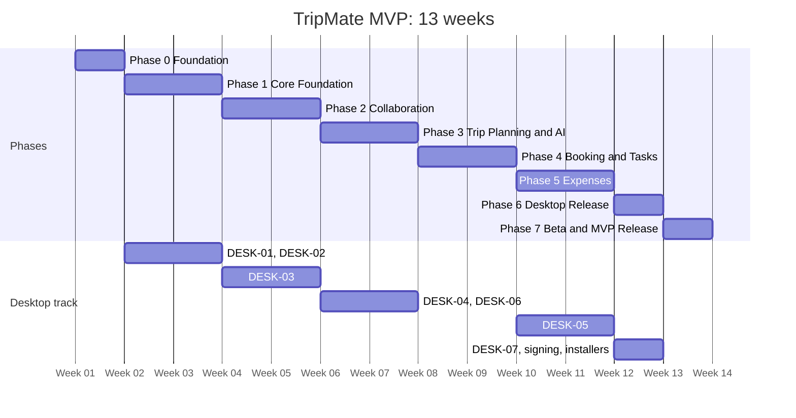

# TripMate -- MVP Roadmap

**Document type:** MVP Roadmap\
**Product:** TripMate\
**Status:** Proposed\
**Version:** 1.9\
**Planning horizon:** 13 weeks (initial estimate)

Terms follow [GLOSSARY.md](GLOSSARY.md); scope follows [prd.md](prd.md).

## 1. Roadmap Objective

Deliver a usable first release of TripMate that allows a group of
friends to organize a trip collaboratively, use AI to draft a plan,
coordinate bookings and tasks, and settle shared expenses.

The roadmap prioritizes a complete, reliable group workflow over a large
number of disconnected features.

The 13-week estimate assumes a small team or a focused solo developer
using AI coding tools. It is a planning baseline, not a delivery
commitment. UX complexity, external integrations, team size, and testing
depth may change the schedule.

## 2. Product and Technology Decisions

### Platforms

-   **Web:** Next.js App Router + TypeScript.
-   **Mobile:** Flutter for iOS and Android.
-   **Desktop:** Tauri 2 (Rust) wrapping the Web client, for macOS and
    Windows, in a separate `tripmate-desktop` repository; also the
    team's Rust learning track.
-   **Backend:** FastAPI.
-   **Database:** PostgreSQL.
-   **Cache and background work:** Redis.
-   **Realtime:** WebSocket.
-   **AI orchestration:** LangChain, with structured outputs and
    controlled tools.
-   **Maps and places:** A selected Maps/Places provider.
-   **File storage:** S3-compatible object storage.
-   **Languages:** Vietnamese and English, following the device
    language; `next-intl` on Web and Desktop, `flutter_localizations`
    with ARB files on Mobile, generated from one shared source of
    translations.

### Architecture decision

Use separate Web, Mobile, and Desktop clients backed by one API and one
set of domain rules. The Desktop client reuses the Web build; its Rust
code only bridges to the operating system.

The Web client must not use Flutter. Next.js is selected for responsive
browser-based planning and management workflows. Flutter remains the
Mobile implementation.

Start with a modular monolith in FastAPI. Do not split into
microservices for the MVP.

## 3. MVP Definition

### MVP promise

A group of friends can create a trip, collaborate on a plan, record
bookings, track shared spending, and settle balances using TripMate
without relying on a separate spreadsheet for the core workflow.

### What is in and what is deferred

The list of what the MVP includes and what is deferred is kept in one
place: [prd.md](prd.md), sections 4.1 and 4.2. The reasons are in
[docs/solution-options.md](docs/solution-options.md).

## 4. Thirteen-Week Roadmap

**Stages and phases.** A stage in
[product-workflow.md](product-workflow.md) is a way of working; a phase
here is a slot in the schedule.

| Phase | Stage of the workflow |
|-------|-----------------------|
| Phase 0 | Finishes the product-level work of stages 1 to 4 |
| Phases 1 to 5 | Stage 5, epic by epic; each epic's spec and design are finished just in time (stages 2 to 4 at epic level) |
| Phases 6 and 7 | Stage 6 |

Desktop work runs alongside each phase: every phase adds the one Rust
feature that matches what the backend just gained, and Week 12 finishes
and ships the Desktop app.

The chart counts weeks from the start of the project; no calendar dates
are set yet.

### Phase 0 -- Product and Technical Foundation (Week 1)

**Objective:** Reduce ambiguity before implementation.

**Deliverables**

-   Approved Product Vision and PRD.
-   User journeys and primary personas.
-   MVP scope and explicit non-goals.
-   Initial wireframes and screen flows.
-   System context and architecture diagram.
-   Initial domain model and entity relationships.
-   API conventions and error format, including error codes instead of
    text.
-   Translation key conventions and the shared translation source.
-   Authentication and authorization approach.
-   Development and evaluation plans.

**Exit criteria**

-   MVP user journey is agreed.
-   Core business rules are documented.
-   Web, Mobile, and Backend responsibilities are clear.
-   High-risk product decisions are recorded.

### Phase 1 -- Core Foundation (Weeks 2--3)

**Objective:** A user can create a trip and invite friends.

**Features**

-   Authentication and session handling.
-   User profile.
-   Create and edit trip.
-   Trip lifecycle: confirm, cancel, archive, and undo by any Member;
    Ongoing and Completed by date.
-   Trip destination, dates, currency, and Budget.
-   Invitation as link, code, and QR code (7-day expiry, revoke,
    regenerate, 20-Member cap, code rate limits).
-   Owner membership powers: remove Members, transfer ownership.
-   Leaving with a Balance and rejoining as the same Member.
-   Audit log for trip changes.
-   Initial Web and Mobile navigation and shared API integration.
-   Desktop: Tauri shell showing the Web client (DESK-01) and
    `tripmate://` Invitation deep links (DESK-02).

**Deliverables**

-   Working authentication flow.
-   Trip management APIs.
-   Trip list and trip detail screens.
-   Invitation and membership flow.
-   Database migrations and authorization tests.

**Exit criteria**

-   A user can create a trip and becomes its Owner.
-   Signed-in users can join through a valid Invitation link, code, or
    QR code.
-   Any Member can change the trip state and undo a confirm, cancel,
    or archive.
-   A trip in Planning or Confirmed becomes Ongoing on its start date.
-   Non-members cannot access private trip data.
-   Web and Mobile display consistent trip information.

### Phase 2 -- Collaboration (Weeks 4--5)

**Objective:** Members can contribute to a shared plan.

**Features**

-   Trip discussion messages.
-   Basic realtime updates.
-   Place Proposals.
-   Yes/No voting with majority of current Members.
-   Rejected, Withdrawn, and Outdated Proposal states.
-   Similar-Proposal warning on create and Duplicate marking.
-   Basic polls if capacity permits.
-   In-app notifications for important events (P1, if capacity
    permits).
-   Readiness checklist pinned in the discussion, with Foundation Gaps
    (dates, destination, Budget).
-   Nudge engine: quiet-chat wait, batching, daily limit, snooze,
    acknowledge, and quick choices plus "Other…".
-   Desktop: native notifications for Nudges (DESK-03).

**Deliverables**

-   Discussion UI on Web and Mobile.
-   Proposal and voting APIs.
-   Realtime message/update flow.
-   Gap rules and Nudge scheduler.
-   Permission, voting rule, and Nudge timing tests.

**Exit criteria**

-   Multiple members can discuss a trip.
-   Members can propose and vote on places.
-   The UI distinguishes open Proposals, Votes, and Decisions.
-   Voting thresholds stay correct when Members join or leave.
-   No Member, including the Owner, can decide alone.
-   Reconnection does not create duplicate messages or corrupt state.
-   No Nudge is posted while the discussion is active.

### Phase 3 -- Trip Planning and AI (Weeks 6--7)

**Objective:** The group can create and refine a useful itinerary.

**Features**

-   Place search and place details.
-   AI destination recommendations.
-   AI Itinerary drafting as Proposals.
-   Trip-context-aware prompts.
-   Structured AI output validation.
-   Manual Itinerary creation and editing.
-   Editing rules by trip state (Proposal required only while
    Confirmed).
-   Marking Itinerary items Visited or Skipped, with a progress view.
-   Estimated cost per Itinerary item.
-   Day window and travel-time estimates from the map provider.
-   Feasibility warnings (time and Budget) on days and Proposals.
-   AI idea capture from the discussion into Idea drafts.
-   Saved places, shared by the whole trip.
-   Itinerary Gaps (empty day, too much travel, day does not fit, over
    Budget) on the checklist and on Proposals.
-   "What's missing?" answered by the assistant from the checklist (P1,
    if capacity permits).
-   Basic map display.
-   Desktop: tray icon with open Gaps (DESK-04) and read-only offline
    Itinerary cache in SQLite (DESK-06).

Idea capture and Saved places are P0 and are not cut. If the phase
runs out of time, these P1 items move to after the MVP first: basic map
display (ITN-05), "What's missing?" (RDY-07), the assistant's budget
estimate (AI-05), and its accommodation and restaurant suggestions
(AI-06).

**Deliverables**

-   AI assistant interface.
-   Places integration.
-   Itinerary domain model and APIs.
-   Proposal and approval workflow.
-   Golden test cases for representative planning requests.

**Exit criteria**

-   AI can return a schema-valid Itinerary Proposal.
-   Users can edit the Itinerary without AI.
-   While the trip is Confirmed, the Itinerary changes only through a
    Decision.
-   Members can mark items Visited or Skipped during the trip.
-   A Member can press Capture ideas and publish an Idea draft as a
    Proposal.
-   A Saved place is visible to every Member of the trip.
-   An overfull day or an over-Budget plan shows a Feasibility warning
    before Members vote, and never blocks a Decision.
-   Invalid or incomplete AI output is rejected or safely handled.
-   External provider failures do not block manual planning.

### Phase 4 -- Booking and Task Coordination (Weeks 8--9)

**Objective:** The group can coordinate responsibilities and keep
booking details together.

**Features**

-   Manual booking records.
-   Flight, hotel, transport, activity, restaurant, and other
    categories.
-   Booking reference, provider, dates, amount, currency, and notes.
-   Responsible member and payer.
-   Check-in/check-out dates for accommodation and departure/arrival for
    transport.
-   Task creation, assignment, due date, and status.
-   Preparation Gaps (night without accommodation, missing transfer,
    unowned work), nudged on Confirm or 14 days before departure.
-   Secure file attachment if capacity permits.
-   External provider links.

**Deliverables**

-   Booking management APIs and screens.
-   Task management APIs and screens.
-   Secure attachment handling if included.
-   Audit and authorization tests.

**Exit criteria**

-   Members can record and view bookings.
-   Tasks can be assigned to trip members.
-   Booking records are clearly distinguished from supplier-verified
    reservations.
-   Unauthorized members cannot access booking documents.
-   A trip from 16 to 18 November with two covered nights shows no
    accommodation Gap; with one covered night it shows one.

### Phase 5 -- Expense Management (Weeks 10--11)

**Objective:** The group can record shared expenses and calculate who
owes whom.

**Features**

-   Add, edit, and review expenses.
-   Payer selection.
-   Participant selection.
-   Equal split.
-   Custom amount split.
-   Individual Balance calculation.
-   Remainder rounding by join order (ADR-0001).
-   Hub Settlement plan (ADR-0004).
-   Recording Settlements by any Member.
-   Spending against the Budget during the trip.
-   Read-only access for a Former member to their own money records
    until their Balance is zero.
-   Desktop: global shortcut for quick-add Expense (DESK-05).

**Deliverables**

-   Expense and expense-split domain models.
-   Deterministic calculation service.
-   Settlement algorithm.
-   Expense and balance screens.
-   Reconciliation and property-based tests.

**Exit criteria**

-   Expense splits sum exactly to each expense total.
-   Sum of member balances is zero under the defined rounding policy.
-   The Settlement plan covers all outstanding Balances, including
    Former members.
-   No Member is instructed to pay themselves.
-   Duplicate submissions are safely handled.
-   Recording a Settlement is an explicit user action.
-   Changes to Expenses and Settlements correctly update Balances and
    audit history.

### Phase 6 -- Desktop Release (Week 12)

**Objective:** Ship a signed Desktop app that matches the Web client.

**Features**

-   Auto-update (DESK-07).
-   Code signing for macOS and Windows.
-   Installer packaging.
-   Desktop polish of DESK-01 to DESK-06.

**Exit criteria**

-   Signed installers install on clean macOS and Windows machines.
-   Invitation deep links, Nudge notifications, tray count, quick-add
    Expense,
    and offline Itinerary work end to end.
-   An update published to the update channel installs automatically.
-   No business logic lives in the Desktop client.

### Phase 7 -- Beta and MVP Release (Week 13)

**Objective:** Validate the end-to-end experience with real groups.

**Activities**

-   End-to-end testing of the full trip lifecycle.
-   Cross-platform testing on Web, iOS, Android, macOS, and Windows.
-   Authorization and file access testing.
-   Expense calculation and settlement verification.
-   Voting threshold and audit log verification.
-   AI schema and Proposal evaluation.
-   Performance and error monitoring.
-   Beta onboarding for 2--3 friend groups.
-   Collect feedback and resolve release-blocking issues.

**Exit criteria**

-   The primary end-to-end scenario passes.
-   No known unresolved critical security or financial correctness
    issue.
-   Core workflows are usable on all supported clients.
-   Logging and monitoring are available for production issues.
-   Beta feedback is recorded and prioritized.

## 5. Milestone Summary

| Milestone | Target | Outcome |
|-----------|--------|---------|
| M0 -- Foundation | Week 1 | Product and technical baseline approved |
| M1 -- Trip Foundation | Week 3 | Create trips and invite members |
| M2 -- Collaboration | Week 5 | Discuss, propose, and vote |
| M3 -- AI Planning | Week 7 | Generate and edit itinerary proposals |
| M4 -- Trip Operations | Week 9 | Manage bookings and tasks |
| M5 -- Financial Workflow | Week 11 | Record expenses and settle balances |
| M6 -- Desktop | Week 12 | Signed Desktop app with all DESK features |
| M7 -- MVP Beta | Week 13 | Validate complete trip lifecycle |

## 6. Suggested Epic Breakdown

Use these Epics in the issue tracker:

1.  **EPIC-01: Authentication and User Profiles**
2.  **EPIC-02: Trip Management and Membership**
3.  **EPIC-03: Trip Collaboration and Voting**
4.  **EPIC-04: AI Travel Assistant**
5.  **EPIC-05: Itinerary and Maps**
6.  **EPIC-06: Booking Management**
7.  **EPIC-07: Task Management**
8.  **EPIC-08: Expense Management**
9.  **EPIC-09: Settlement**
10. **EPIC-10: Cross-Platform Experience**
11. **EPIC-11: Security, Observability, and Release**
12. **EPIC-12: Desktop App (Tauri)**
13. **EPIC-13: Readiness Checklist and Nudges**

Where each phase gets its requirements and epics:

| Phase | PRD requirements | Epics |
|-------|------------------|-------|
| 1 -- Core Foundation | FR-01, FR-02 | EPIC-01, EPIC-02 |
| 2 -- Collaboration | FR-03; FR-10 (checklist, Foundation Gaps, Nudge engine) | EPIC-03, EPIC-13 |
| 3 -- Trip Planning and AI | FR-04, FR-05; FR-10 (Itinerary Gaps) | EPIC-04, EPIC-05, EPIC-13 |
| 4 -- Booking and Task Coordination | FR-06, FR-07; FR-10 (Preparation Gaps) | EPIC-06, EPIC-07, EPIC-13 |
| 5 -- Expense Management | FR-08 | EPIC-08, EPIC-09 |
| 6 -- Desktop Release | DESK-01 to DESK-07, built across Phases 1 to 5 | EPIC-12 |
| 7 -- Beta and MVP Release | PRD section 9 | EPIC-11 |
| Every phase | PRD section 6 | EPIC-10 |

FR-10 (Readiness checklist and Nudges) is delivered across three
phases under EPIC-13, so its rules have one spec. FR-09 (Trip Summary
and Memories, P1 and P2) is planned for after the MVP and has no epic
yet.

Each Epic should be decomposed into user stories with:

-   User value.
-   Preconditions and business rules.
-   Acceptance criteria.
-   API and UI impact.
-   Test requirements.
-   Dependencies.
-   Definition of Done.

## 7. Development Workflow

How a task goes from issue to merged is described once, in
[product-workflow.md](product-workflow.md), Stage 5 (AI-native SDLC):
the AI plans, a person approves the plan, the AI implements, tests and
an independent AI review run, a person reviews, and nothing merges
until every quality gate passes.

For a small team, Web, Mobile, and Backend work can proceed in parallel
after API contracts and domain behavior are agreed. Avoid parallel
implementation against unstable contracts.

## 8. Evaluation Strategy

### Conventional software tests

-   Unit tests for domain rules and calculations.
-   Integration tests for database and service behavior.
-   API/contract tests for Web and Mobile clients.
-   End-to-end tests for primary user journeys.
-   Authorization tests for every trip-scoped domain.
-   Property-based tests for expense splits and settlement invariants.
-   Concurrency tests for important shared updates.

### AI evaluation

Create a small golden dataset covering:

-   Different destinations and trip durations.
-   Different group sizes and budgets.
-   Conflicting preferences.
-   Requests to modify an existing itinerary.
-   Chat excerpts with ideas to capture, including an idea raised
    twice and messages that contain no idea.
-   Missing or ambiguous information.
-   Unsupported or unverifiable place claims.
-   Attempts to change the Itinerary directly instead of through a
    Proposal.

**Measure**

-   Structured output validity.
-   Place relevance.
-   Constraint satisfaction.
-   Itinerary feasibility.
-   Grounding and source attribution.
-   Proposal acceptance rate.
-   Latency and cost.

AI quality must not be assessed only by whether an answer sounds
plausible.

### Release gates

-   No unresolved critical security issue.
-   No known financial calculation defect.
-   All critical end-to-end journeys pass.
-   Authorization tests pass.
-   AI outputs are validated and become Proposals, never direct changes.
-   Voting threshold tests pass, including Members joining and leaving.
-   Every state and financial change is audited.
-   Gap rules are deterministic and Nudge timing tests pass.
-   Desktop installers are signed and auto-update works.
-   Every screen works in Vietnamese and English with no missing
    translation keys.
-   Monitoring and rollback procedures are available.

## 9. Product Metrics for Beta

**Track**

-   Trips created.
-   Invitations sent and accepted.
-   Active members per trip.
-   Proposals created and share reaching a Decision.
-   Trips confirmed.
-   AI Proposals generated and decided.
-   Itinerary items marked Visited or Skipped.
-   Booking records created.
-   Expenses recorded per trip.
-   Percentage of trip expenses captured.
-   Settlement plan transfers recorded.
-   Trips completed.
-   Repeat trip creation.

Use beta observations to establish realistic conversion and retention
targets.

## 10. Key Risks and Dependencies

| Risk / Dependency | Mitigation |
|-------------------|------------|
| Maps API cost and quota | Set budgets, cache suitable results, monitor usage. |
| AI output inconsistency | Structured output, validation, golden dataset, approval workflow. |
| Realtime complexity | Start with limited event types and reliable persistence. |
| Cross-platform divergence | Shared API contracts and backend business rules. |
| Expense correctness | Deterministic domain service and invariant-based tests. |
| Booking provider complexity | Manual booking records in MVP; integrations later. |
| Scope growth | Enforce MVP non-goals and review change requests. |
| Phase 3 overload | Idea capture and Saved places are P0; defer the P1 items of Phase 3 first, in the order given there; re-estimate after Phase 0. |
| Small-team capacity | Prioritize complete vertical slices and defer P1/P2 work when needed. |

## 11. Post-MVP Opportunities

After validating the core workflow:

-   Offline editing on Desktop (queued changes synced later).
-   Mobile push notifications.
-   Booking email and receipt import.
-   Deeper flight and accommodation search integrations.
-   Weather-aware itinerary recommendations.
-   Multi-currency expense handling.
-   Trip summary and Budget comparison (FR-09).
-   Trip memories and shared albums.
-   Advanced group preference modeling.
-   Optional payment provider integrations, subject to legal and
    operational review.

## 12. Roadmap Governance

This roadmap is a baseline. Re-estimate after Phase 0 and after the
first working vertical slice.

Any proposed scope change should document:

-   User problem being addressed.
-   Expected product value.
-   Engineering and operational cost.
-   Impact on existing milestones.
-   New risks and acceptance criteria.

Do not add a feature solely because it is technically interesting. It
should strengthen the core group travel workflow or be supported by user
feedback.

## 13. Version History

| Version | Date | Changes |
|---------|------|---------|
| 1.0 | 2026-11-16 | Initial MVP roadmap. |
| 1.1 | 2026-11-16 | Aligned with PRD v1.1 decisions; rewritten in English and moved to tripmate-docs. |
| 1.2 | 2026-11-16 | Added idea capture, Readiness checklist and Nudge work to the phases and release gates. |
| 1.3 | 2026-11-16 | Desktop in the MVP: 13-week plan, desktop work in each phase, Phase 6 Desktop Release, milestone M6, EPIC-12, desktop release gate. |
| 1.4 | 2026-11-16 | Languages: Vietnamese and English following the device language; translation conventions in Phase 0; language release gate. |
| 1.5 | 2026-11-16 | Added this version history; follows PRD v1.5. |
| 1.6 | 2026-11-17 | Phase 1: Invitation as link, code, and QR code; follows PRD v1.6. |
| 1.7 | 2026-11-17 | Follows PRD v1.7. |
| 1.8 | 2026-11-17 | Readability only, no scope or schedule changed: run-together lists split into list items, milestone and risk tables fixed, a 13-week chart in section 4, and a table of phases, PRD requirements, and epics in section 6 (with two open points noted). Follows PRD v1.8. |
| 1.9 | 2026-11-17 | Aligned with the decisions in PRD v1.9: idea capture and Saved places are P0 in Phase 3, with the P1 items to defer first; in-app notifications are P1 and Desktop notifies for Nudges; undo of Confirm and automatic Ongoing in Phase 1; Former member read access in Phase 5. New EPIC-13 for Readiness and Nudges; FR-09 after the MVP. Stages and phases explained. The MVP list and the development workflow now link to prd.md and product-workflow.md instead of repeating them. Cross-references no longer name a version. |
