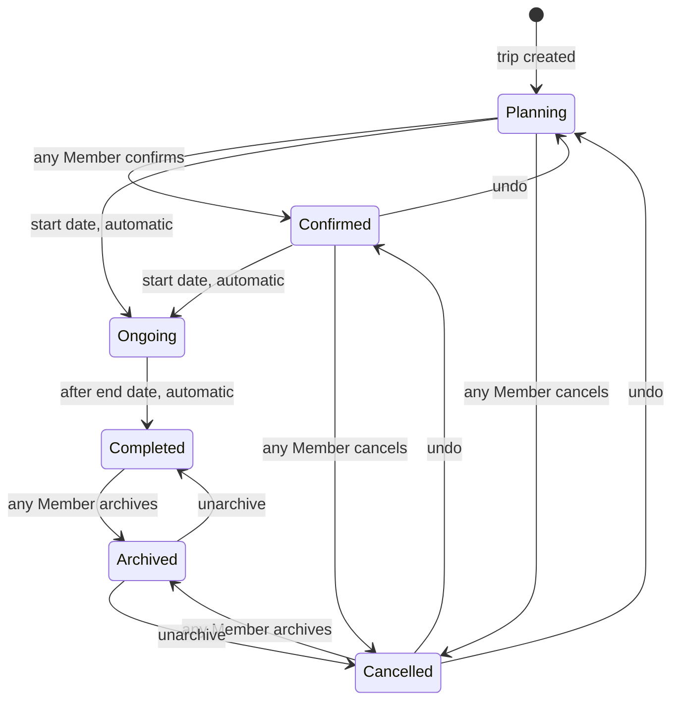
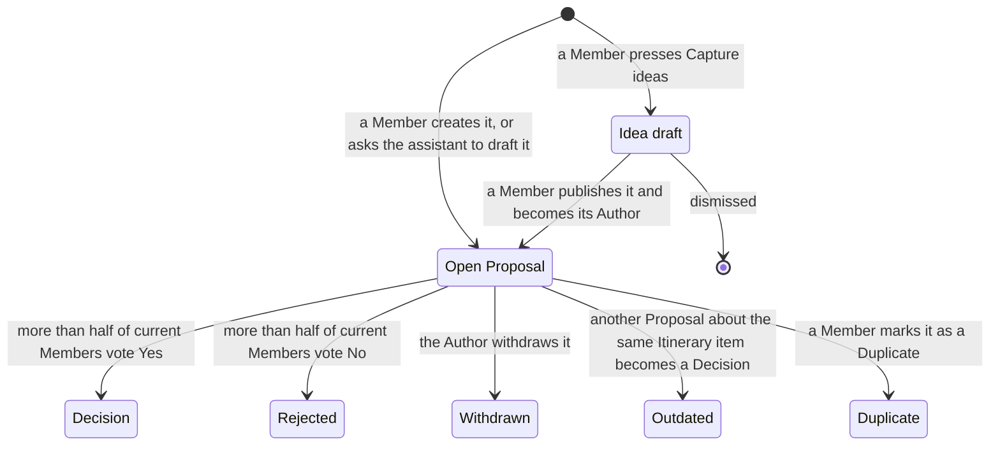
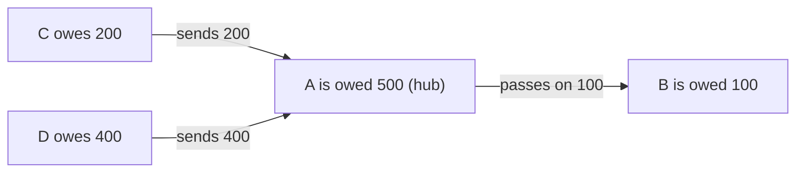
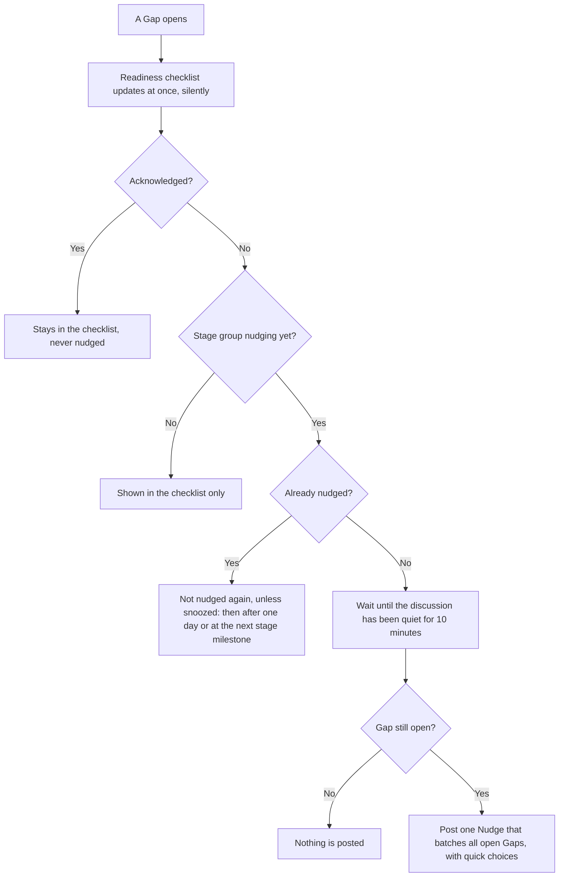

# TripMate -- Product Requirements Document (PRD)

**Document type:** Product Requirements Document\
**Product:** TripMate\
**Status:** Approved\
**Version:** 1.9\
**Platforms:** Web, iOS, Android, Desktop (macOS, Windows)\
**Languages:** Vietnamese and English, following the device language

Terms in this document follow [GLOSSARY.md](GLOSSARY.md). Decisions
with lasting consequences are recorded in [docs/adr](docs/adr/).

## 1. Purpose

This PRD defines the product requirements for TripMate, a collaborative
group travel planning application for friends. It describes the target
users, product scope, functional requirements, business rules,
acceptance criteria, and non-functional requirements for the initial
release.

The PRD is intended to guide UX design, architecture, implementation,
and evaluation. Detailed API contracts, database schemas, and screen
specifications should be maintained in separate technical and design
documents.

## 2. Product Summary

TripMate is a shared workspace where a group of friends plan a trip
together as equals, track progress while travelling, and settle shared
costs fairly at the end. No single person decides for the group:
decisions are made by majority vote.

The group can:

- Create and manage a trip.
- Invite friends and manage membership.
- Discuss plans and vote on Proposals.
- Capture the right ideas: turn ideas from the discussion into Proposals
  and catch duplicates.
- See when a plan cannot be followed in a day or exceeds the Budget.
- Discover places with AI assistance.
- Create and edit a day-by-day Itinerary.
- Record bookings and assign preparation tasks.
- Track progress during the trip: Itinerary items visited and spending
  against the Budget.
- Track shared Expenses and settle Balances.
- Review a trip summary.

## 3. Users and Roles

### 3.1 User types

- **Owner:** The one Member who manages membership: removing Members,
  creating and revoking the Invitation, and handing ownership to another
  Member. The Owner has no extra say in decisions.
- **Member:** Anyone who has joined the trip. All Members, including
  the Owner, have equal rights over the trip's plan, state, bookings,
  tasks, and money.
- **Former member:** A person who has left or been removed. They take
  no part in new activity but remain in past Expenses, Balances, and
  history. While their Balance is not zero they can still read their
  own money records (section 3.2).

Someone who holds the Invitation link but has not joined is not a Member
and has no role.

### 3.2 Authorization principles

- Every trip-scoped operation must verify the authenticated user's
  membership and permissions on the backend.
- A client-provided trip ID or user ID must never be treated as proof
  of authorization.
- Members have equal rights over trip content and trip state
  ([ADR-0002](docs/adr/0002-equal-rights-for-members.md)).
- Only the Owner can remove Members, create or revoke the Invitation,
  and transfer ownership.
- The Owner can transfer ownership to any other Member and must do so
  before leaving the trip.
- A Former member whose Balance is not zero keeps read-only access to
  the Expenses they took part in, their own Balance, and the Settlement
  plan, and to nothing else. The access ends when their Balance reaches
  zero ([ADR-0003](docs/adr/0003-members-may-leave-with-a-balance.md)).
- Every change to trip state, Itinerary, bookings, tasks, Expenses, and
  Settlements must be written to an audit log recording who changed
  what and when. The audit log is the main safeguard in an equal-rights
  model.

**Rights at a glance**

| What | Owner | Member | Former member |
|------|-------|--------|---------------|
| Read the trip: discussion, Itinerary, bookings, tasks, and money | Yes | Yes | Only the Expenses they took part in, their own Balance, and the Settlement plan, until their Balance is zero |
| Edit trip details; confirm, cancel, or archive the trip, and undo each | Yes | Yes | No |
| Discuss, create Proposals, and vote | Yes | Yes | No |
| Edit the Itinerary, bookings, tasks, Expenses, and Settlements | Yes | Yes | No |
| See and share the Invitation | Yes | Yes | No |
| Create, revoke, and regenerate the Invitation | Yes | No | No |
| Remove Members and transfer ownership | Yes | No | No |
| Leave the trip | After transferring ownership | Yes | -- |
| Counted in Balances and the Settlement plan | Yes | Yes | Yes, until their Balance is zero |
| Rejoin through the Invitation as the same Member | -- | -- | Yes |

## 4. Product Scope

Why the scope looks like this, and which options were set aside, is in
[docs/solution-options.md](docs/solution-options.md).

### 4.1 MVP In Scope

- Authentication and user profile.
- Trip creation, editing, cancelling, and archiving, with undo.
- Invitation link and membership management.
- Basic trip discussion.
- Proposals (places, Itinerary changes, polls) and majority voting.
- Duplicate warnings and marking.
- Feasibility warnings for time and Budget, with Estimated costs.
- Readiness checklist of Gaps and timed Nudges in the discussion.
- AI-assisted place discovery and Itinerary drafting.
- AI idea capture from the discussion.
- Manual Itinerary editing.
- Saved places, shared by the whole trip.
- Trip progress: marking Itinerary items Visited or Skipped, and
  spending against the Budget.
- Map display and basic route information where provider coverage
  permits.
- Manual booking records.
- Task assignment and status tracking.
- Expense recording and split rules.
- Balance calculation and the Settlement plan.
- Nudges on every client; personal in-app notifications (P1).
- Responsive Web, Flutter mobile, and Tauri desktop clients using the
  same backend.
- Interface in Vietnamese and English, following the device language.
- Desktop operating-system features: tray, Invitation deep links, native
  notifications, quick-add Expense shortcut, offline Itinerary cache,
  and auto-update.

### 4.2 Out of Scope for MVP

- Direct flight or hotel purchase.
- Payment processing or holding user funds.
- Bank account integrations.
- Automated booking cancellation or modification.
- Public social feed.
- Public read-only trip links.
- Mobile push and email notifications (email is used only for
  authentication).
- Full travel marketplace.
- Multiple currencies within one trip.
- Automated import from every email or booking provider.
- AI actions that directly confirm purchases or settle payments.
- A language setting inside the app, and translation of content that
  Members write.

## 5. Functional Requirements

| Priority | Meaning |
|----------|---------|
| **P0** | Required for MVP. |
| **P1** | Valuable, but may be deferred if capacity is constrained. |
| **P2** | Future release. |

### FR-01 -- Authentication and User Profile

| ID      | Requirement                                  | Priority |
|---------|----------------------------------------------|----------|
| AUTH-01 | Users can register and sign in.              | P0       |
| AUTH-02 | Users can sign out and manage their session. | P0       |
| AUTH-03 | Users can view and edit their profile.       | P0       |
| AUTH-04 | Users can set a display name and avatar.     | P1       |
| AUTH-05 | Social sign-in is supported.                 | P1       |

**Acceptance criteria**

- Unauthenticated users cannot access protected trip data.
- The backend validates authentication on every protected request.
- A user can update their profile without changing another user's data.

### FR-02 -- Trip Management

| ID      | Requirement                                                                                  | Priority |
|---------|----------------------------------------------------------------------------------------------|----------|
| TRIP-01 | A user can create a trip.                                                                    | P0       |
| TRIP-02 | Any Member can edit the trip name, destination, dates, currency, Budget, and Day window.     | P0       |
| TRIP-03 | The Owner can create, revoke, and regenerate the trip's Invitation.                          | P0       |
| TRIP-04 | A signed-in user can join the trip with a valid Invitation link, code, or QR code.           | P0       |
| TRIP-09 | Members can see the Invitation as a link, a short code, and a QR code, and share any of them. | P0       |
| TRIP-05 | Members can view the Member list, including Former members.                                  | P0       |
| TRIP-06 | The Owner can remove Members and transfer ownership.                                         | P0       |
| TRIP-07 | Any Member can confirm, cancel, or archive the trip, and undo a confirm, cancel, or archive. | P0       |
| TRIP-08 | Any Member can leave the trip at any time, regardless of their Balance.                      | P0       |

**Trip lifecycle**

Undoing Confirm returns the trip to Planning. Undoing Cancel, and
unarchiving, return the trip to the state it was in. The diagram shows
the paths; the table below is the rule.

| State     | Entered when                                               |
|-----------|------------------------------------------------------------|
| Planning  | The trip is created, or a Member undoes Confirm.           |
| Confirmed | Any Member confirms the trip.                              |
| Ongoing   | Automatically, on the start date, from Planning or Confirmed. A trip does not need to be Confirmed to start. |
| Completed | Automatically, after the end date.                         |
| Cancelled | Any Member cancels from Planning or Confirmed. Undo returns the trip to the state it was in. |
| Archived  | Any Member archives a Completed or Cancelled trip. Unarchiving returns it to that state. |

**Invitation rules**

- Each trip has one shared Invitation at a time. It can be shared in
  three forms: a link, a short Invitation code, and a QR code that
  holds the link. All three belong to the same Invitation.
- The Invitation code is 8 characters, upper-case letters and digits,
  without look-alike characters (0, O, 1, I, L), shown as two groups of
  four (for example `K7QM-4XPA`). Codes are not case-sensitive.
- A signed-in user joins with a code from "Join with code" on the trip
  list. Scanning the QR code opens the link, so any phone camera works.
- An Invitation expires 7 days after it is created.
- Revoking or regenerating the Invitation invalidates the previous link,
  code, and QR code together, immediately.
- Failed code attempts are rate-limited per user and per device, and
  the response does not reveal whether a trip exists.
- Joining requires signing in.
- A trip has at most 20 Members.
- A Former member who joins again is restored as the same Member with
  the same Balance ([ADR-0003](docs/adr/0003-members-may-leave-with-a-balance.md)).

**Acceptance criteria**

- A trip must have a name and a valid date range if dates are provided.
- The creator becomes the Owner and the first Member.
- Users who are not Members cannot access trip details.
- Cancelling or archiving a trip never deletes Expense, Settlement, or
  booking history.
- The Owner cannot leave until ownership has been transferred.
- A trip in Planning or Confirmed becomes Ongoing on its start date; a
  Cancelled or Archived trip does not.
- A Former member whose Balance is not zero can read the Expenses they
  took part in, their own Balance, and the Settlement plan, and cannot
  read or change anything else. This access ends when their Balance
  reaches zero.
- When a Member leaves, their Votes on open Proposals are discarded and
  tasks assigned to them become unassigned.

### FR-03 -- Collaboration and Decisions

| ID     | Requirement                                                                  | Priority |
|--------|------------------------------------------------------------------------------|----------|
| COL-01 | Members can post messages in the trip discussion.                            | P0       |
| COL-02 | Members can view discussion history.                                         | P0       |
| COL-03 | Members can create Proposals for places and Itinerary changes.               | P0       |
| COL-04 | Members can comment on Proposals.                                            | P1       |
| COL-05 | Members can vote Yes or No on Proposals.                                     | P0       |
| COL-06 | Members can create poll Proposals for other trip decisions.                  | P1       |
| COL-07 | Members receive in-app notifications for relevant updates.                   | P1       |
| COL-08 | The Author can withdraw a Proposal that has not been decided.                | P0       |
| COL-09 | When creating a Proposal, the Member is warned about similar open Proposals. | P0       |
| COL-10 | Any Member can mark a Proposal as a Duplicate of an earlier open Proposal.   | P0       |

**Voting rules** ([ADR-0002](docs/adr/0002-equal-rights-for-members.md))

- Each current Member has one Vote per Proposal and can change it until
  the Proposal closes. Nobody votes automatically, including the Author.
- A Proposal becomes a **Decision** when more than half of the current
  Members vote Yes.
- A Proposal becomes **Rejected** when more than half of the current
  Members vote No.
- The threshold is recomputed whenever a Member joins or leaves, which
  can decide or reject an open Proposal without a new Vote.
- Proposals never expire. The Author can withdraw one (**Withdrawn**).
- When a Proposal about an Itinerary item becomes a Decision, other open
  Proposals about the same item become **Outdated**.
- A Proposal marked as a **Duplicate** closes; its Votes do not carry
  over to the earlier Proposal.
- Feasibility warnings are shown on a Proposal before Members vote, but
  never block it from becoming a Decision.
- No Member, including the Owner, can decide a Proposal on behalf of the
  group.

**Proposal lifecycle**

Idea drafts are defined in FR-04.

**Acceptance criteria**

- Messages and Proposals belong to a trip and an authenticated Author.
- A Member cannot create content in a trip they have not joined.
- A Decision does not automatically create a booking.
- The UI clearly distinguishes discussion messages from Proposals and
  Decisions.
- When in-app notifications are built (COL-07), they cover at least: a
  task assigned to me, a new Proposal to vote on, and an Expense that
  involves me.

### FR-04 -- AI Travel Assistant

| ID    | Requirement                                                                     | Priority |
|-------|---------------------------------------------------------------------------------|----------|
| AI-01 | The assistant can suggest places for a destination.                             | P0       |
| AI-02 | The assistant can draft a day-by-day Itinerary.                                 | P0       |
| AI-03 | The assistant uses trip dates, group size, Budget, and preferences when available. | P0    |
| AI-04 | Members can request changes to a drafted Itinerary through conversation.        | P0       |
| AI-05 | The assistant can estimate a budget with assumptions stated.                    | P1       |
| AI-06 | The assistant can suggest accommodation and restaurants.                        | P1       |
| AI-07 | The assistant can propose a route order.                                        | P1       |
| AI-08 | The assistant explains the basis and limitations of recommendations.            | P1       |
| AI-09 | On request, the assistant turns ideas from the trip discussion into Idea drafts. | P0      |
| AI-10 | The assistant can prefill Estimated costs for Itinerary items.                  | P1       |

Suggested tools/capabilities: `get_trip_context`, `search_places`,
`get_place_details`, `get_route`, `get_weather`, `estimate_budget`,
`propose_itinerary`.

**Acceptance criteria**

- AI outputs must be validated against a defined schema before being
  displayed or persisted.
- The assistant must identify estimates and unverified information.
- The assistant must not claim that a price, opening hour, route, or
  availability is current unless verified by a suitable source.
- AI-drafted Itinerary changes are Proposals authored by the Member who
  asked for them. They follow the same voting rules as any other
  Proposal and never change the Itinerary directly.
- Before an AI draft becomes a Proposal, the backend runs the Gap and
  Feasibility rules on it. The assistant revises the draft up to two
  times to clear them; any that remain are shown on the Proposal.
- Idea drafts are produced only when a Member presses "Capture ideas".
  They cannot be voted on. Any Member can publish one, which turns it
  into a Proposal with that Member as Author; unpublished drafts can be
  dismissed.
- Prefilled Estimated costs are always labeled as AI estimates.
- Backend authorization and validation must run independently of the AI
  response.
- AI unavailability must not prevent manual trip planning.

### FR-05 -- Itinerary, Map, and Progress

| ID     | Requirement                                                          | Priority |
|--------|----------------------------------------------------------------------|----------|
| ITN-01 | Members can create Itinerary days.                                   | P0       |
| ITN-02 | Members can add places or activities to a day.                       | P0       |
| ITN-03 | Members can edit time, notes, and order.                             | P0       |
| ITN-04 | Members can remove an Itinerary item.                                | P0       |
| ITN-05 | Members can view Itinerary locations on a map.                       | P1       |
| ITN-06 | Members can view route and travel-time estimates.                    | P0       |
| ITN-07 | Members can save places for later consideration; Saved places are shared by the whole trip. | P0 |
| ITN-08 | During the trip, Members can mark an Itinerary item Visited or Skipped. | P0    |
| ITN-09 | Members can see how many Itinerary items are Visited, Skipped, and remaining. | P0 |
| ITN-10 | An Itinerary item can have an optional Estimated cost.               | P0       |
| ITN-11 | The system shows Feasibility warnings on each day and on Proposals.  | P0       |

**Feasibility warnings**

- **Time:** a day is flagged when its planned items plus travel time
  between them do not fit in the trip's Day window (default 08:00–22:00,
  editable by any Member). Travel time comes from the map provider.
- **Budget:** the trip is flagged when the sum of Estimated costs, plus
  Expenses already recorded, exceeds the Budget.
- Warnings show on the affected day and on any Proposal that would
  cause or worsen them, before Members vote.
- Warnings inform; they never block editing, voting, or a Decision.

**Editing rules by trip state**

| Trip state                       | How the Itinerary changes                         |
|----------------------------------|---------------------------------------------------|
| Planning                         | Any Member edits directly.                        |
| Confirmed                        | Every change goes through a Proposal.             |
| Ongoing                          | Any Member edits directly, so plans can adapt on the road. |
| Completed, Cancelled, Archived   | Any Member edits directly.                        |

**Acceptance criteria**

- An Itinerary item has a day, a place or activity, and an optional
  planned time and notes.
- The system prevents dates outside the trip period unless explicitly
  allowed.
- Concurrent edits must not silently overwrite another Member's changes.
- Route estimates must be labeled as estimates and attributed to the
  map provider.
- While the trip is Confirmed, the Itinerary changes only when a
  Proposal becomes a Decision.
- Every direct edit is recorded in the audit log and visible to other
  Members.
- Feasibility warnings update whenever items, times, Estimated costs,
  the Day window, or the Budget change.
- When travel time is unavailable, the time warning says it could not be
  checked rather than staying silent.
- A Saved place is visible to every Member of the trip, whoever saved
  it, and can be offered as a quick choice in a Nudge.

### FR-06 -- Booking Management

| ID      | Requirement                                                                                  | Priority |
|---------|----------------------------------------------------------------------------------------------|----------|
| BOOK-01 | Members can create a manual booking record.                                                  | P0       |
| BOOK-02 | A booking can be categorized as flight, hotel, transport, activity, restaurant, or other.    | P0       |
| BOOK-03 | A booking records the responsible Member and payer.                                          | P0       |
| BOOK-04 | A booking can store provider, booking reference, dates, amount, currency, and notes.         | P0       |
| BOOK-05 | Members can attach confirmation documents or images.                                         | P1       |
| BOOK-06 | Members can track booking status.                                                            | P0       |
| BOOK-07 | The product can link to an external booking provider.                                        | P1       |
| BOOK-08 | Direct booking API integration is supported.                                                 | P2       |
| BOOK-09 | Accommodation bookings record check-in and check-out dates; transport bookings record departure and arrival times and places. | P0 |

**Acceptance criteria**

- A booking record is clearly labeled as manually recorded unless
  verified through an integration.
- Any Member can edit any booking; every edit is audited.
- Sensitive booking documents are accessible only to Members.
- The application does not imply that saving a booking record completes
  a purchase.

### FR-07 -- Task Management

| ID      | Requirement                                 | Priority |
|---------|---------------------------------------------|----------|
| TASK-01 | Members can create a trip task.             | P0       |
| TASK-02 | A task can be assigned to a Member.         | P0       |
| TASK-03 | A task can have a due date and notes.       | P0       |
| TASK-04 | Members can update task status.             | P0       |
| TASK-05 | Members can view outstanding tasks.         | P0       |

Task statuses: To Do, In Progress, Completed, Cancelled.

**Acceptance criteria**

- Assignees must be current Members of the trip.
- Any Member can edit any task; changes are visible to all Members.
- When an assignee leaves, the task becomes unassigned.
- Completing a task does not automatically mark a related booking as
  completed unless an explicit business rule defines that behavior.

### FR-08 -- Expense Management and Settlement

| ID     | Requirement                                                       | Priority |
|--------|-------------------------------------------------------------------|----------|
| EXP-01 | Members can add an Expense.                                       | P0       |
| EXP-02 | An Expense records the payer.                                     | P0       |
| EXP-03 | An Expense records its Participants.                              | P0       |
| EXP-04 | Expenses can be split equally.                                    | P0       |
| EXP-05 | Expenses can be split by custom amounts.                          | P0       |
| EXP-06 | Expenses can be split by percentage.                              | P1       |
| EXP-07 | Members can view trip spending totals.                            | P0       |
| EXP-08 | Members can view individual Balances.                             | P0       |
| EXP-09 | The system generates a Settlement plan.                           | P0       |
| EXP-10 | Any Member can record a Settlement.                               | P0       |
| EXP-11 | Multiple currencies can be reconciled.                            | P2       |
| EXP-12 | Members can see actual spending against the Budget during the trip. | P0     |

Core calculation:
`Balance(member) = AmountPaid(member) - AmountOwed(member)`

- Positive Balance: the Member should receive money.
- Negative Balance: the Member should pay money.
- Zero Balance: the Member is settled.

**Money rules** ([ADR-0001](docs/adr/0001-single-currency-and-rounding.md))

- Every Expense and Settlement in a trip uses the Trip currency, stored
  as an integer number of the currency's smallest unit.
- When an equal split leaves a remainder, the leftover units go one each
  to the Participants in the order they joined the trip.

**Settlement plan** ([ADR-0004](docs/adr/0004-hub-settlement-plan.md))

- The Member with the largest positive Balance is the hub; ties are
  broken by join order.
- Every Member with a negative Balance sends their whole debt to the hub.
- The hub sends each other Member with a positive Balance what they are
  owed.
- Former members are included until their Balance is zero.

Example, in thousands of VND. Balances: A +500, B +100, C -200,
D -400. A has the largest positive Balance, so A is the hub. Three
transfers bring every Balance to zero:

**Acceptance criteria**

- The sum of all Balances must equal zero.
- Expense splits must sum exactly to the Expense total.
- Only selected Participants are charged for an Expense.
- The payer is not automatically assumed to be the only Participant.
- The system must prevent duplicate Expense submissions through
  idempotency or equivalent safeguards.
- The Settlement plan never creates real payments.
- A Settlement takes effect as soon as any Member records it; no second
  confirmation is required.
- Any Member can edit or delete any Expense or Settlement, including
  after Settlements exist. Every change is audited and triggers a
  consistent recalculation of Balances and the Settlement plan.
- No Member is ever told to pay themselves.

### FR-09 -- Trip Summary and Memories

| ID     | Requirement                                          | Priority |
|--------|------------------------------------------------------|----------|
| MEM-01 | Members can view a trip summary.                     | P1       |
| MEM-02 | The summary compares the Budget and actual spending. | P1       |
| MEM-03 | Members can upload trip photos.                      | P2       |
| MEM-04 | Members can create a travel journal.                 | P2       |
| MEM-05 | Members can export a trip report.                    | P2       |

### FR-10 -- Readiness Checklist and Nudges

| ID     | Requirement                                                                                         | Priority |
|--------|-----------------------------------------------------------------------------------------------------|----------|
| RDY-01 | The system keeps a Readiness checklist of each trip's Gaps, computed by deterministic backend rules. | P0       |
| RDY-02 | The Readiness checklist is pinned at the top of the trip discussion with the number of open Gaps.   | P0       |
| RDY-03 | A Proposal that would open or worsen a Gap shows that Gap on the Proposal before Members vote.      | P0       |
| RDY-04 | The system posts Nudges in the trip discussion according to the nudge rules below.                  | P0       |
| RDY-05 | Any Member can snooze a Nudge or acknowledge a Gap as intentional; both can be undone.              | P0       |
| RDY-06 | Nudges and assistant questions offer quick choices plus an "Other…" free-text option.               | P0       |
| RDY-07 | Members can ask the assistant "what's missing?" and get an answer based on the Readiness checklist. | P1       |
| RDY-08 | The assistant can suggest fixes for a Gap; any suggestion that changes the plan is a Proposal.      | P1       |

**Gap types**

| #  | Gap                          | Stage group | Open when |
|----|------------------------------|-------------|-----------|
| 1  | No trip dates                | Foundation  | The trip has no start and end date. |
| 2  | No destination               | Foundation  | The trip has no destination. |
| 3  | No Budget                    | Foundation  | The trip has no Budget. |
| 4  | Empty day                    | Itinerary   | A trip day has no Itinerary items. |
| 5  | Too much travel              | Itinerary   | Travel time between cities exceeds 30% of the trip's total Day window hours (threshold editable by any Member). Depends on ITN-06. |
| 6  | Day does not fit             | Itinerary   | The time Feasibility warning for a day is active. |
| 7  | Over Budget                  | Itinerary   | The Budget Feasibility warning is active. |
| 8  | Night without accommodation  | Preparation | A night of the trip is not covered by an accommodation booking or an overnight transport booking. |
| 9  | Missing transfer             | Preparation | The Itinerary moves to another city with no transport booking covering the move. |
| 10 | Unowned work                 | Preparation | A booking has no responsible Member, or a task is unassigned. |

Nights needed = end date − start date. A trip from 16 to 18 November
needs two nights (16 and 17).

**Nudge rules**

- The Readiness checklist updates immediately and silently.
- Gaps on a Proposal (RDY-03) show immediately, on the Proposal card,
  not as a discussion message.
- A Nudge is posted only after the discussion has been quiet for 10
  minutes. If the Gap closes while waiting, nothing is posted.
- When each stage group starts nudging:
  - **Foundation:** from trip creation.
  - **Itinerary:** once a related Proposal exists, or the Itinerary
    covers at least half of the trip days.
  - **Preparation:** when a Member presses Confirm, or 14 days before
    the start date (editable by any Member). Before then these Gaps
    appear only in the checklist.
- Each Gap is nudged once. A snoozed Gap is nudged again after one day
  or at the next stage milestone, whichever comes first.
- Open Gaps are batched into one message, at most one Nudge per trip
  per day, plus one when a Member presses Confirm and one the day
  before departure.
- Wording suggests rather than blames and names nobody, for example:
  "Nobody has a place to sleep on the night of 17 Nov yet. Can someone
  take it? [Take it] [Already sorted] [Remind me later]".

How one Gap leads to a Nudge, or does not:

The posted Nudge is subject to the limit above: at most one per trip
per day, plus one on Confirm and one the day before departure. A Gap on
a Proposal (RDY-03) does not follow this flow; it shows on the Proposal
card at once.

**Quick choices plus "Other…"**

- Every Nudge, assistant question, and poll Proposal offers at most four
  choices drawn from the trip's data, plus "Other…" for free text.
- Example: "Where do we sleep on the night of 17 Nov?" offers the two
  saved hotels, "Overnight bus", "Staying with friends", and "Other…".
- Free text from "Other…" is posted as a discussion message. If it would
  change the plan, it becomes a Proposal authored by that Member.

**Acceptance criteria**

- The same trip data always produces the same Gaps.
- Acknowledged Gaps stay visible in the checklist, marked as
  acknowledged, and are never nudged; acknowledging is audited.
- When travel time is unavailable, Gap 5 says it could not be checked
  rather than staying silent.
- Itinerary days can be created only after trip dates are set;
  discussion and place Proposals work without dates.
- Nudges are in-app, and also native notifications on desktop.

## 6. Cross-Platform Requirements

TripMate has separate Web, Mobile, and Desktop clients that use the same
backend and shared domain rules.

### Web client

- Built with Next.js and TypeScript.
- Responsive layouts for desktop, tablet, and mobile browsers.
- Optimized for trip setup, discussion, Itinerary editing, booking
  administration, and Expense review.
- Uses the same API contracts and authorization rules as Mobile.

### Mobile client

- Built with Flutter for iOS and Android.
- Optimized for quick updates during travel: marking Itinerary items,
  Expense entry, and checking progress against the Budget.
- Uses the same backend and business rules as Web.

### Desktop client

- A separate `tripmate-desktop` repository, built with Tauri 2: a Rust
  shell around the static build of the Web client, for macOS and
  Windows. It is also the team's Rust learning track.
- Rust handles operating-system features only:

| ID      | Requirement                                                                                     | Priority |
|---------|-------------------------------------------------------------------------------------------------|----------|
| DESK-01 | The desktop app shows the Web client in a native window.                                        | P0       |
| DESK-02 | `tripmate://join/...` Invitation links open the desktop app at the join screen.                 | P0       |
| DESK-03 | Native notifications for Nudges, following the Nudge rules; and for in-app notification events once COL-07 is built. | P0 |
| DESK-04 | A tray icon shows the number of open Gaps across the user's trips.                              | P0       |
| DESK-05 | A global shortcut opens a quick-add Expense window.                                             | P0       |
| DESK-06 | The Itinerary of each trip is cached locally (SQLite) and readable offline.                     | P0       |
| DESK-07 | The app updates itself and is signed for macOS and Windows.                                     | P0       |

- Money, voting, and Gap rules stay in the backend; the desktop client
  only displays, caches, and bridges to the operating system.
- The offline cache is read-only in the MVP: changes need a connection,
  and the cache shows when it was last synced.

**Acceptance criteria**

- Signed installers install on clean macOS and Windows machines.
- A `tripmate://join/...` link opens the desktop app at the join screen.
- A Nudge appears as a native notification, under the same timing and
  limits as in the discussion.
- The tray count equals the number of open Gaps across the user's trips.
- The global shortcut opens the quick-add Expense window, and the
  Expense is saved through the backend like any other.
- Without a connection the cached Itinerary can be read, shows when it
  was last synced, and cannot be changed.
- An update published to the update channel installs automatically.
- No money, voting, or Gap logic runs in the desktop client.

### Shared requirements

- Consistent data and permissions across clients.
- No duplicated financial, voting, or authorization logic in the
  frontend.
- API contracts must be documented and versioned.
- UI behavior may differ by platform, but domain behavior must remain
  consistent.
- The interface follows the device language: Vietnamese when the device
  is set to Vietnamese, English otherwise. There is no in-app language
  setting.
- All interface text comes from translation files, never hard-coded.
- Messages from TripMate itself (Nudges, Gap cards, status changes)
  are stored as a message key with parameters, so each Member sees them
  in their own language.
- Content written by Members (chat, Ideas, Proposals, notes) is shown
  as written and never translated.
- The backend returns error codes, not text; clients show the text.

## 7. Business Rules

1. Every trip has exactly one current Owner.
2. Every trip-scoped resource belongs to a trip.
3. Only Members can access private trip resources; a Former member
   keeps read-only access to their own money records until their
   Balance is zero.
4. All Members have equal rights over trip content and state; the Owner
   only manages membership.
5. A Proposal becomes a Decision only by a majority of current Members.
6. A Proposal is not a Decision, and a Decision is not a booking.
7. A booking record is not proof of supplier-side confirmation unless
   independently verified.
8. AI cannot bypass backend permissions or the voting rules; an Idea
   draft is not a Proposal until a Member publishes it.
9. Feasibility warnings and Gaps inform the group and never block a
   Decision or Confirm; only Itinerary days require trip dates.
10. Expense calculations use deterministic backend logic.
11. The Settlement plan is a set of instructions between Members, not
    payment execution.
12. Leaving or removing a Member never erases financial records.
13. Every change to trip state and financial records is traceable.
14. Concurrent edits must be handled through versioning or optimistic
    concurrency.
15. Nudges must not interrupt the discussion: they wait for a quiet
    chat, are batched, and are limited to one per trip per day.

## 8. Non-Functional Requirements

| Category      | Requirement |
|---------------|-------------|
| Performance   | Target API P95 under 500 ms for ordinary internal operations, excluding external provider latency. |
| Realtime      | New discussion messages, Votes, and important trip updates should appear promptly for connected Members. |
| Security      | Authentication, trip-level authorization, secure file access, and input validation. |
| Privacy       | Members can access only trips and files they are authorized to view. |
| Integrity     | Financial operations use database transactions and idempotency safeguards. |
| Auditability  | Every state, Itinerary, booking, task, and financial change is recorded with who made it and when. |
| Reliability   | External service failures must not corrupt trip data. |
| Compatibility | Responsive Web, supported iOS/Android versions, and macOS and Windows for Desktop. |
| Observability | Structured logs, metrics, tracing, and actionable error reporting. |
| AI safety     | Schema validation, bounded tool permissions, source/uncertainty communication, and Proposals instead of direct changes. |
| Accessibility | Keyboard support and accessible labels on Web; platform accessibility semantics on Mobile. |

## 9. MVP Release Acceptance

The MVP is accepted when a real group can complete this end-to-end
scenario. Every step uses only P0 requirements: a requirement that may
be deferred never appears in this scenario or in the list of tests
below.

1. Member A creates a trip for five friends.
2. A shares the Invitation; members B, C, D, and E join.
3. Members discuss in chat; one presses "Capture ideas" and publishes
   the useful Idea drafts as Proposals. A duplicate is caught and marked.
4. The AI assistant drafts a three-day Itinerary as a Proposal, with a
   Feasibility warning on an overfull day that the group fixes before
   voting.
5. The group votes the Itinerary into a Decision and confirms the trip.
6. Members create booking records and assign booking tasks. On
   Confirm, a Nudge flags a night without accommodation; a Member
   answers it by picking a saved hotel.
7. During the trip, Members mark Itinerary items Visited or Skipped,
   record shared Expenses, and check spending against the Budget.
8. The application calculates Balances and the Settlement plan.
9. Members record completed Settlements.
10. All Members see consistent trip data on Web, Mobile, and Desktop;
    one Member joins from a `tripmate://` link and reads the Itinerary
    offline on desktop.

The MVP must also pass:

- Authorization tests for membership and the Owner's membership powers.
- Voting threshold tests, including Members joining and leaving.
- Feasibility warning tests for the Day window and the Budget.
- Duplicate marking tests.
- Gap rule tests (including night counting) and Nudge timing tests.
- Expense calculation, rounding, and Settlement plan tests.
- Cross-client API contract tests.
- Desktop tests: deep links, Nudge notifications, offline cache, signed
  installers on macOS and Windows.
- Language tests: every screen in Vietnamese and English, with no
  missing translation keys and no clipped text.
- Critical user journey end-to-end tests.
- AI schema and Proposal tests.
- Audit log coverage tests.
- Basic security and file access tests.

**Requirements and success metrics**

How each group of requirements is measured. The metrics are defined in
[product-vision.md](product-vision.md), section 10.

| Requirements | Success metrics |
|--------------|-----------------|
| FR-01, FR-02: accounts, trips, Invitation | Trip creation rate; Invitation acceptance rate; percentage of trips with at least two active members |
| FR-03: discussion, Proposals, voting | Planning completion rate |
| FR-04: AI assistant, idea capture | AI proposal acceptance rate |
| FR-05: Itinerary, map, progress | Planning completion rate; share of Itinerary items marked Visited or Skipped (proposed metric) |
| FR-06, FR-07: bookings and tasks | Booking record completion rate |
| FR-08: Expenses and Settlement | Expense coverage; Settlement completion rate |
| FR-10: Readiness checklist and Nudges | Planning completion rate |
| Section 6: Web, Mobile, Desktop | Share of trips used on two or more platforms (proposed metric) |
| All of the above | Successfully Organized Trips (North Star); repeat trip creation rate |

FR-09 (Trip Summary and Memories) is planned for after the MVP and has
no metric yet.

## 10. Resolved Product Decisions

| Question | Decision |
|----------|----------|
| Can non-members view a read-only Itinerary through a public link? | No, not in the MVP. |
| Can an Owner transfer ownership? | Yes, to any Member; required before the Owner leaves. |
| What happens to outstanding Balances when a Member leaves? | They stay; the person becomes a Former member and remains in the Settlement plan ([ADR-0003](docs/adr/0003-members-may-leave-with-a-balance.md)). |
| Can Members edit confirmed Itinerary items, or must they propose changes? | While the trip is Confirmed, changes need a Proposal; in other states Members edit directly ([ADR-0002](docs/adr/0002-equal-rights-for-members.md)). |
| Who can confirm group decisions? | Nobody alone: a majority of current Members ([ADR-0002](docs/adr/0002-equal-rights-for-members.md)). |
| Can an Expense be edited after settlement has started? | Yes, by any Member; Balances are recalculated and the change is audited. |
| What is the policy for currency precision and rounding? | One currency per trip in smallest units; remainders by join order ([ADR-0001](docs/adr/0001-single-currency-and-rounding.md)). |
| How long do Invitation links remain valid? | 7 days; revocable and regenerable by the Owner. The code and QR code share the same expiry. |
| How can friends join? | With the Invitation link, the 8-character code, or the QR code; all three are the same Invitation. |
| Which notifications are in-app, push, or email? | Nudges appear in the discussion on every client and as native notifications on desktop (P0). Personal in-app notifications are P1 (COL-07). No mobile push in the MVP; email only for authentication. |
| Is the desktop app in the MVP? | Yes: a Tauri app with all seven DESK requirements, built alongside each phase plus one release week. |
| How does the group know what the trip is still missing? | A Readiness checklist of Gaps from deterministic rules, pinned in the discussion, with timed Nudges that never block. |
| When may TripMate nudge the group? | After 10 quiet minutes, by stage group, batched, at most once per day. Gaps on a Proposal show immediately. |
| How do Members answer a Nudge or assistant question? | Up to four quick choices plus "Other…"; free text that changes the plan becomes a Proposal. |
| Does a trip that nobody confirmed still start? | Yes. A trip in Planning or Confirmed becomes Ongoing on its start date; Confirm is not required. |
| Can Confirm be undone? | Yes, by any Member; the trip returns to Planning and the change is audited ([ADR-0002](docs/adr/0002-equal-rights-for-members.md)). |
| What can a Former member still see? | While their Balance is not zero: the Expenses they took part in, their own Balance, and the Settlement plan, read-only. Nothing after that ([ADR-0003](docs/adr/0003-members-may-leave-with-a-balance.md)). |
| Can the MVP acceptance scenario include a requirement that may be deferred? | No, only P0. Idea capture (AI-09) and Saved places (ITN-07) are therefore P0. In-app notifications (COL-07) stay P1, so the desktop app must notify for Nudges only. |
| Who sees a Saved place? | Every Member of the trip. |
| Which languages does the app support? | Vietnamese and English, following the device language (Vietnamese device → Vietnamese, anything else → English); no in-app setting; content Members write is not translated. |

## 11. Dependencies

- Maps and Places provider selection, API coverage, quotas, and
  pricing.
- LLM provider selection and operational cost controls.
- Object storage and secure file access.
- Deployment, monitoring, and secrets management.
- Code-signing certificates for macOS (Apple Developer ID) and Windows.
- Mobile push notification providers (after the MVP).

## 12. Risks and Mitigations

| Risk | Mitigation |
|------|------------|
| Incorrect AI recommendations | Validate places through external provider data and label uncertainty. |
| Stale prices or opening hours | Show source and last-checked time where available; avoid unsupported guarantees. |
| Concurrent editing | Use record versions or optimistic concurrency. |
| Incorrect Expense calculations | Deterministic domain service, unit tests, property-based tests, and reconciliation invariants. |
| Unauthorized access | Backend authorization on every trip-scoped operation. |
| Accidental or careless changes under equal rights | Undoable Cancel and Archive, audit log on every change, and visibility of who changed what. |
| Proposals stalling without a majority | Show who has not voted yet; in-app notifications for new Proposals once COL-07 is built. |
| Good ideas lost in chat or raised twice | AI idea capture on request, duplicate warnings when creating a Proposal, and Duplicate marking. |
| A voted plan that cannot be followed or is too expensive | Feasibility warnings for time and Budget before Members vote. |
| Misleading feasibility warnings from wrong map or cost estimates | Warnings never block; they show their source and say when a check could not run. |
| Nudges interrupting or annoying the group | Wait for a quiet chat, stage groups, batching, a daily limit, snooze, and acknowledge. |
| Desktop scope slows the MVP while the team learns Rust | Build one desktop feature per phase alongside the matching backend work; keep business logic in the backend; read-only offline cache. |
| External API outage | Graceful degradation and manual planning fallback. |
| High AI or Maps costs | Caching, quotas, rate limits, and usage monitoring. |
| Booking misunderstanding | Clearly distinguish manually entered records from verified supplier confirmations. |

## 13. Version History

| Version | Date | Changes |
|---------|------|---------|
| 1.0 | 2026-11-16 | Initial PRD. |
| 1.1 | 2026-11-16 | Grilling outcomes: Owner and Member roles with equal rights, majority voting, trip lifecycle with undo, Itinerary changes by Proposal once Confirmed, one currency per trip and rounding by join order, leaving with a Balance, hub Settlement plan (ADR-0001 to ADR-0004). Document rewritten in English and moved to tripmate-docs. |
| 1.2 | 2026-11-16 | Idea capture from the discussion and duplicate warnings. New FR-10 Readiness Checklist and Nudges (Gap types, Nudge timing, quick choices). AI drafts checked for Gaps and Feasibility before they become Proposals. |
| 1.3 | 2026-11-16 | Desktop app (Tauri) in the MVP: DESK-01 to DESK-07, native notifications on desktop, desktop tests and risks. |
| 1.4 | 2026-11-16 | Interface in Vietnamese and English following the device language; no in-app language setting; Member content not translated. |
| 1.5 | 2026-11-16 | Added this version history. |
| 1.6 | 2026-11-17 | Invitation can also be shared as an 8-character code and a QR code (TRIP-04, new TRIP-09); all three forms share expiry and revoke; code attempts are rate-limited. |
| 1.7 | 2026-11-17 | Section 4 links to the new docs/solution-options.md for the reasons behind the MVP scope. No requirement changed. |
| 1.8 | 2026-11-17 | Readability only, no requirement changed: rights-at-a-glance table (section 3.2), priorities as a table, diagrams for the trip lifecycle (FR-02), the Proposal lifecycle (FR-03), a Settlement plan example (FR-08), and the Nudge flow (FR-10). |
| 1.9 | 2026-11-17 | Status: Approved. A trip in Planning also becomes Ongoing on its start date. Confirm can be undone (TRIP-07). A Former member with a Balance keeps read-only access to their own money records. The acceptance scenario uses only P0: idea capture (AI-09) and Saved places (ITN-07) become P0, Saved places are shared by the trip, in-app notifications stay P1 and DESK-03 requires native notifications for Nudges only. Acceptance criteria for the desktop client. Requirements-to-metric table. Section 6 and Compatibility now name Desktop. |
