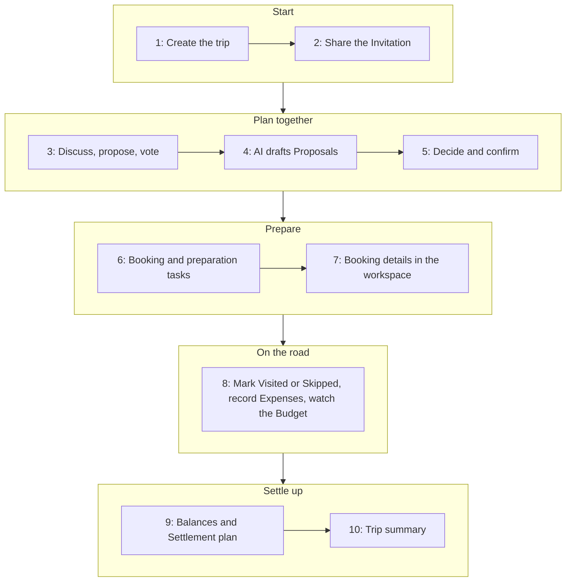

# TripMate -- Product Vision

**Document type:** Product Vision\
**Product:** TripMate\
**Status:** Approved\
**Version:** 1.9

Terms follow [GLOSSARY.md](GLOSSARY.md).

## 1. Product Overview

TripMate is a collaborative group travel planning platform that helps
friends organize an entire trip in one shared workspace. It brings
together group discussions, destination discovery, AI-assisted itinerary
planning, booking coordination, task assignment, expense tracking, and
post-trip settlement.

TripMate is designed for groups of friends who want to plan and enjoy
trips together without scattering decisions, booking details, and
financial records across messaging apps, spreadsheets, and unrelated
services.

**Product category:** Collaborative Group Travel Planner\
**Target audience:** Groups of friends, typically 3--10 people\
**Platforms:** Web, iOS, Android, and Desktop (macOS, Windows, Linux)\
**Core promise:** Plan together as equals, track progress on the road,
and settle expenses fairly.

## 2. Problem Statement

Planning a group trip requires many small decisions and coordinated
activities. Today, groups commonly use several disconnected tools:

-   Messaging apps for discussion and decisions.
-   Search engines and social media for destination discovery.
-   Spreadsheets and documents for itineraries.
-   Airline and hotel websites for bookings.
-   Chat messages or separate task apps for assigning responsibilities.
-   Spreadsheets or expense-splitting apps for tracking shared costs.

This creates several problems:

1.  Important decisions are buried in long conversations.
2.  Ideas, votes, and agreed plans are difficult to distinguish.
3.  Itineraries become outdated when plans change.
4.  Booking information and responsibilities are scattered.
5.  Members cannot easily see who has paid and who owes money.
6.  One person ends up organizing and deciding for everyone.
7.  When many people plan at once, the same idea is raised twice, good
    ideas get lost, and a plan everyone voted for can still be
    impossible to follow in a day or blow the budget.

**Core problem:** Many people act and plan at the same time, yet the
group still has to capture the right ideas and turn them into a sensible
plan, with no reliable, shared place to plan, coordinate, execute, and
settle the trip.

## 3. Vision Statement

> To become the all-in-one collaborative travel workspace where friends
> discover destinations, plan trips together, coordinate bookings,
> manage shared expenses, and enjoy their journey without the hassle of
> organizing everything across multiple apps.

## 4. Target Users

### Primary audience

Groups of friends organizing domestic or international trips
independently. A typical group has 3--10 members, a shared destination
or travel idea, a budget range, and a need to coordinate
responsibilities.

### Core personas

| Persona | What they do | What they need | Main pain point |
|---------|--------------|----------------|-----------------|
| **The Initiator** | Starts the trip and shares the Invitation. Nudges the group toward Decisions but decides nothing alone. | Visibility into open Proposals, progress, and outstanding tasks. | Becoming the default decision-maker for everyone. |
| **The Explorer** | Finds places, restaurants, and activities. Creates Proposals and votes. | An easy way to share and compare ideas. | Ideas get lost in chat. |
| **The Booking Coordinator** | Handles flights, accommodation, transport, or activities. | A shared record of booking details and documents. | Booking information is scattered. |
| **The Budget Keeper** | Tracks shared spending and outstanding balances. | Accurate, transparent calculations. | Manually reconciling payments after the trip. |

One person may perform multiple personas within the same trip.

## 5. Value Proposition

TripMate combines five sources of value:

1.  **Collaborative planning:** Every Member can propose, discuss, vote,
    and contribute to a shared plan, with an equal voice.
2.  **AI-assisted discovery and idea capture:** An assistant uses the
    group's destination, dates, preferences, and budget to suggest
    places and draft itineraries, and turns ideas scattered in the chat
    into drafts the group can publish as Proposals.
3.  **Sensible plans:** Duplicate ideas are caught, and the group is
    warned before voting when a day cannot be done in time or the plan
    exceeds the Budget. A Readiness checklist shows what the trip is
    still missing (dates, a night with nowhere to sleep, too much
    travel for the trip's length), and gentle Nudges wait for a quiet
    moment in the chat, offering quick choices to fix each Gap.
4.  **Trip coordination:** Itineraries, booking records, and assigned
    tasks are available in one workspace, and progress is visible
    during the trip.
5.  **Financial transparency:** Shared Expenses, individual Balances,
    and the Settlement plan are calculated consistently.

## 6. Product Differentiation

### Collaboration-first

TripMate is not a personal itinerary generator that simply exports a
plan to friends. The group itself is the planning unit. Proposals,
Votes, and Decisions have explicit states, and no single Member,
including the Owner, decides for the group: Decisions need a majority.

### Context-aware AI

The AI assistant should use the trip's shared context, including:

-   Destination and dates.
-   Group size and member preferences.
-   Budget targets.
-   Open Proposals and Decisions.
-   Existing itinerary and constraints.
-   Booking and travel information where relevant.

Its changes are Proposals that the group votes on, never silent edits.

### End-to-end trip workspace

The product supports the trip lifecycle: idea, planning, booking
coordination, travel, expense tracking, and settlement.

### Reliable financial operations

Expense calculations and settlement are deterministic backend
operations, not LLM-generated answers.

## 7. Product Principles

1.  **One Trip, One Workspace:** Each trip has a shared source of truth.
2.  **Equal Voices:** Every Member has the same rights; the Owner only
    manages membership. Decisions are made by majority.
3.  **Human-in-the-loop, No Silent Changes:** AI proposes; the group
    decides. AI never overwrites the Itinerary or booking data directly.
4.  **Mobile-first in the field:** Mobile should be convenient during
    travel; Web should be efficient for planning and administration;
    Desktop brings the Web experience into a native app with tray,
    notifications, and offline reading.
5.  **Transparent Expenses:** Every expense records who paid, who
    participates, and how the amount is split.
6.  **Reliable over Smart:** Booking and financial data must be
    dependable even when AI services are unavailable.
7.  **Trust, but Trace:** Only Members can access a trip, and every
    change records who made it, so equal rights stay safe.

## 8. Product Goals

-   Reduce the effort required to organize a group trip.
-   Keep trip decisions and operational information in one place.
-   Help groups discover relevant places and build practical
    itineraries.
-   Make booking responsibilities visible.
-   Show progress during the trip: places visited and spending against
    the Budget.
-   Make shared expenses transparent and settlement straightforward.
-   Deliver a consistent experience across Web, iOS, Android, and
    Desktop.

## 9. Non-Goals

The initial product is not intended to:

-   Operate as an airline, hotel, or travel booking marketplace.
-   Purchase tickets or accommodation on behalf of users.
-   Process or custody user payments.
-   Replace every messaging or social networking platform.
-   Guarantee availability, prices, opening hours, or travel conditions
    from AI-generated content.
-   Provide a public social feed or travel influencer marketplace.

## 10. Product Success

The proposed North Star Metric is **Successfully Organized Trips**:
trips where a group has collaborated, completed a usable itinerary,
recorded trip expenses, and completed settlement.

Supporting metrics:

-   Trip creation rate.
-   Invitation acceptance rate.
-   Percentage of trips with at least two active members.
-   Planning completion rate.
-   AI proposal acceptance rate.
-   Booking record completion rate.
-   Expense coverage.
-   Settlement completion rate.
-   Repeat trip creation rate.
-   Share of Itinerary items marked Visited or Skipped by the end of
    the trip.

Targets should be established after observing beta usage rather than
assumed before product validation.

How each goal in section 8 is measured:

| Goal | Metric |
|------|--------|
| Reduce the effort required to organize a group trip | Planning completion rate |
| Keep trip decisions and operational information in one place | Percentage of trips with at least two active members |
| Help groups discover relevant places and build practical itineraries | AI proposal acceptance rate |
| Make booking responsibilities visible | Booking record completion rate |
| Show progress during the trip | Share of Itinerary items marked Visited or Skipped by the end of the trip |
| Make shared expenses transparent and settlement straightforward | Expense coverage; settlement completion rate |
| Deliver a consistent experience across Web, iOS, Android, and Desktop | None in the MVP; a metric is chosen after the MVP (candidate: share of trips used on two or more platforms) |

Trip creation rate, Invitation acceptance rate, and repeat trip
creation rate measure adoption as a whole, together with the North
Star Metric.

## 11. Product Experience

A typical trip lifecycle:

1.  A member creates a trip and enters the destination, dates, and
    budget.
2.  The creator shares the Invitation link with friends.
3.  Members discuss options, create Proposals, and vote.
4.  The AI assistant drafts places, an Itinerary, and budget estimates
    as Proposals.
5.  The group votes the plan into Decisions and confirms the trip.
6.  Members receive booking and preparation tasks.
7.  Booking details are stored in the shared workspace.
8.  During the trip, Members mark Itinerary items Visited or Skipped,
    record Expenses, and watch spending against the Budget.
9.  After the trip, TripMate calculates Balances and a Settlement plan:
    everyone who owes pays whoever paid the most, who passes on the rest.
10. The group reviews the trip summary.

## 12. Product Principles for Trust

TripMate must distinguish between:

| State | Meaning |
|-------|---------|
| **Proposal** | An option open for Votes. |
| **Decision** | A Proposal that more than half of the current Members voted Yes on. |
| **Booked** | A real-world reservation or purchase recorded by a Member. |

A Decision is not proof that a booking exists. A booking record is
not proof that a supplier has independently verified the reservation.
The product should communicate these distinctions clearly.

## 13. Long-Term Direction

After validating the core group workflow, TripMate may expand into:

-   Live travel assistance and weather-aware itinerary adjustments.
-   Deeper flight and accommodation data integrations.
-   Booking email and receipt import.
-   Multi-currency expense handling.
-   Trip memories, photo albums, and travel reports.
-   More advanced group preference and recommendation features.

These are future opportunities, not prerequisites for the initial
product.

## 14. Version History

| Version | Date | Changes |
|---------|------|---------|
| 1.0 | 2026-11-16 | Initial product vision. |
| 1.1 | 2026-11-16 | Aligned with PRD v1.1: equal rights for Members and majority decisions; rewritten in English and moved to tripmate-docs. |
| 1.2 | 2026-11-16 | Core problem: many people plan at once but the group must still capture the right ideas; "Sensible plans" value with the Readiness checklist and Nudges. |
| 1.3 | 2026-11-16 | Desktop added to platforms, principles and goals; removed from long-term direction. |
| 1.4 | 2026-11-16 | Added this version history. |
| 1.5 | 2026-11-17 | Readability only, no content changed: personas and the Proposal / Decision / Booked distinction as tables, run-together lists split into list items, and a diagram of the trip lifecycle in section 11. |
| 1.6 | 2026-11-17 | Section 10: a table that gives every goal a metric, with two proposed metrics for progress during the trip and consistency across platforms. |
| 1.7 | 2026-11-17 | Status: Approved. The product owner closed Stage 1; see docs/discovery.md for the conditions and the waiver. |
| 1.8 | 2026-11-17 | Metrics: share of Itinerary items marked Visited or Skipped is agreed and added to the supporting metrics; the metric for consistency across platforms is left until after the MVP. |
| 1.9 | 2026-11-19 | Platforms: Desktop also covers Linux, following prd.md. |
