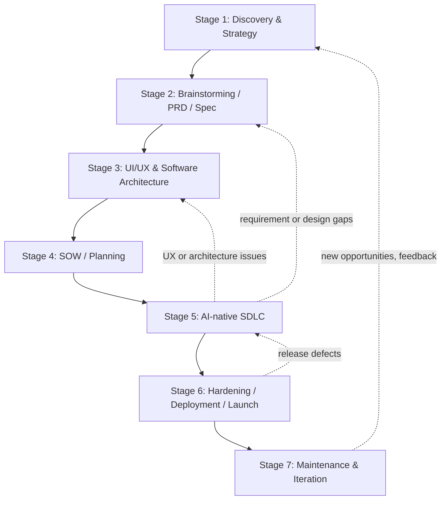
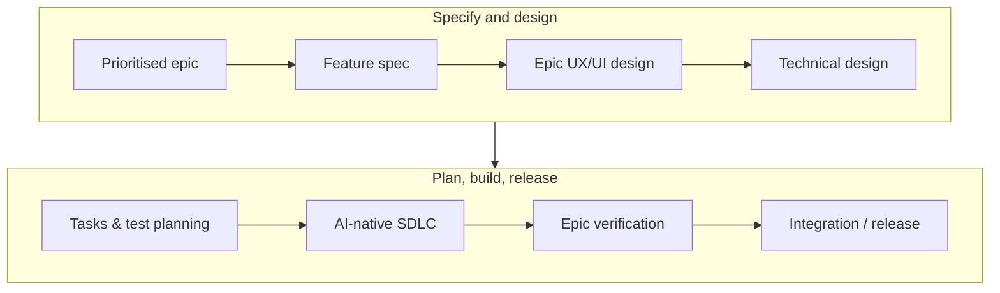
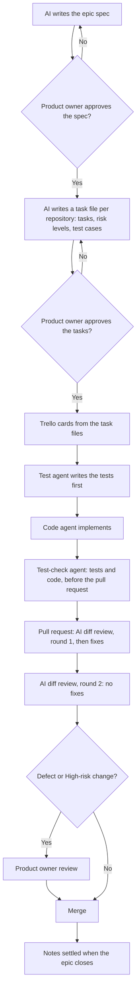

# TripMate -- Product Workflow

**Document type:** Product Workflow\
**Product:** TripMate\
**Status:** Proposed\
**Version:** 2.12\
**Visual version:** [TripMate Product Workflow artifact](https://claude.ai/artifact/8yk7w1MUE79bXX58HL1QhA)\
**Live status:** [TripMate Build Tracker](https://claude.ai/artifact/2ZRasgxPpxxeR2WH3SjmxU)

Terms follow [GLOSSARY.md](GLOSSARY.md). This file is the source of
truth for how TripMate is built; the artifact shows the same content as
an interactive page and is updated with every version of this file.

This document describes the process only. It changes when the process
changes. Where the work stands today, which documents exist, and the
daily reports live in the Build Tracker.

## 1. Overview

Seven stages take TripMate from the user's problem to a product that is
operated and improved. Work moves forward, but any stage can send work
back when it finds a problem it cannot solve on its own. It is not a
strict waterfall.

Solid arrows lead to the next stage; dotted arrows are feedback loops.
Section 5 lists every loop.

## 2. Two Levels of Planning

TripMate is never specified in full detail up front. Planning happens
at two levels.

| Level | When | Covers |
|-------|------|--------|
| Product level | Once for the MVP; updated when a later stage sends work back | Vision and strategy; PRD and MVP scope; high-level epic breakdown; product-level UX/UI; high-level architecture; initial roadmap; overall test and AI evaluation strategy |
| Epic level, just in time | Before each epic | Review the epic and its requirements; finish the feature spec; finish the epic's UX flow and UI; confirm technical design and dependencies; break down into tasks; add acceptance criteria and test mapping; update test plan and AI evaluation cases; build through the AI-native SDLC |

Steps may overlap, but before a task is implemented its requirements,
design, and acceptance criteria must be clear.

## 3. Stages

Every stage gate is approved by the product owner.

### Stage 1 -- Discovery & Market Research & Strategy

**Goal:** Understand the real problem, the target users, the market,
and the opportunity; decide what TripMate should solve and why.

- **Activities:** discover and validate the problem; user research,
  interviews, and surveys; target users and personas; competitor and
  market analysis; pain points, unmet needs, and market gaps; product
  vision and strategy; value proposition and positioning; business
  model and revenue opportunities; goals, success metrics, and
  principles; non-goals and assumptions to test.
- **Deliverables:** Problem Statement, User Research Findings, User
  Personas, Competitor Analysis, Market Research, Product Vision,
  Product Strategy, Value Proposition, Product Positioning, Business
  Model Hypothesis, Success Metrics, Product Principles, Assumptions &
  Risks.
- **Documents:** [product-vision.md](product-vision.md);
  [docs/discovery.md](docs/discovery.md).
- **Ready to move on when:** at least five conversations or tests with
  real groups are done; each core assumption is marked validated,
  rejected, or still open; vision, goals, non-goals, and principles are
  written and each goal has a metric.

### Stage 2 -- Brainstorming / PRD / Spec

**Goal:** Turn the opportunity and strategy into a solution, an MVP
scope, and requirements that can be built and tested.

- **Activities:**
  - *Brainstorming:* explore solution directions and feature options;
    weigh impact, effort, risk, and feasibility; prioritise the MVP; set
    scope and out of scope.
  - *PRD:* goals and users; capabilities and feature groups;
    product-level user stories and use cases; functional and
    non-functional requirements; MVP scope and dependencies; high-level
    acceptance criteria linked to success metrics.
  - *Feature spec, just in time per epic:* behaviour and business rules;
    preconditions and postconditions; validation and permissions; errors
    and edge cases; state transitions; API or integration expectations;
    detailed acceptance criteria.
- **Deliverables:** Brainstorming Notes / Solution Options, Feature
  List, MVP Scope & Prioritization, PRD, Epic / Feature Breakdown,
  Feature Specifications, Acceptance Criteria, Scope & Out-of-scope,
  Requirements-to-Metric Mapping.
- **Documents:** [docs/solution-options.md](docs/solution-options.md);
  [prd.md](prd.md); `docs/specs/<epic>/spec.md`;
  [GLOSSARY.md](GLOSSARY.md).
- **Ready to move on when:** every P0 requirement has acceptance
  criteria; MVP scope and out of scope are agreed; the epic about to be
  built has a feature spec.

### Stage 3 -- UI/UX & Software Architecture Design

**Goal:** Design the user experience and the technical architecture so
the product is consistent, feasible, and able to grow.

- **Activities:**
  - *Product-level UX/UI (first):* information architecture; global
    user journey; navigation; high-level core flows and wireframes;
    design system foundation; overall prototype of the key flows;
    initial usability review. This is not a design of every screen.
  - *Epic-level UX/UI (per epic):* review the epic's spec; detailed
    flows and wireframes; high-fidelity UI; interactive prototype;
    usability testing; design review and refinement; design handoff.
    Design follows the MVP and its dependencies; not every epic is
    designed before development starts.
  - *Software architecture:* architecture style and system boundaries;
    module boundaries; Web, Mobile, Desktop, and Backend
    responsibilities; data model; API contracts; authentication and
    authorization; real-time communication; third-party integrations;
    caching and background jobs; security, privacy, and data
    protection; observability; performance, scalability, and
    reliability; key decisions as ADRs.
- **Deliverables:** Product Information Architecture, Global User
  Journey, Navigation Map, High-level User Flow Diagrams, Design System
  Foundation, High-level Wireframes, Overall Product Prototype, Initial
  Usability Findings, Epic Design Packages, Software Architecture
  Document, Component / Module Design, Database ERD, API Contracts,
  Integration Design, Security Architecture, Deployment /
  Infrastructure Overview, ADRs.
- **Documents:** prototype canvases; the
  [design system](https://claude.ai/artifact/NDUCBnrHZE3Boubq3s8XjX) artifact;
  [docs/information-architecture.md](docs/information-architecture.md);
  [docs/ux-review.md](docs/ux-review.md);
  [docs/architecture.md](docs/architecture.md);
  [docs/data-model.md](docs/data-model.md);
  [docs/api-design.md](docs/api-design.md);
  [docs/security.md](docs/security.md); [docs/adr](docs/adr/); the technical design
  section of each `docs/specs/<epic>/spec.md`.
- **Ready to move on when:** every core journey can be clicked through;
  key states are designed; a usability test is done and serious issues
  are fixed or decided; the architecture is reviewed and the data model
  and API contracts are ready for the next epic.

### Stage 4 -- SOW / Planning

**Goal:** Turn the agreed scope and design into a plan that can be
tracked, estimated, and controlled.

- **Activities:**
  - *Scope of work:* scope, deliverables, milestones, timeline,
    responsibilities, assumptions, constraints, dependencies, and
    acceptance conditions. TripMate is a small internal project, so a
    short scope and plan replaces a formal SOW.
  - *Development planning:* Product → Epic → Feature → Task breakdown;
    dependencies and order; estimates; milestones and release plan;
    ownership; risks and mitigation; Definition of Done.
  - *Test strategy:* test levels (unit, integration, contract,
    end-to-end); test types (functional, regression, security,
    performance, usability); environments and test data; ownership.
    Every acceptance criterion has at least one test or a recorded
    reason for the exception.
  - *AI evaluation plan:* golden dataset; metrics and thresholds; output
    quality and structured output; tool calling and retrieval;
    grounding; prompt injection and unsafe tool behaviour; latency,
    tokens, and cost; regression evaluation and release gates.
- **Deliverables:** SOW / Project Scope, Development Plan, Epic /
  Feature / Task Breakdown, Dependency Map, Estimates & Milestones,
  Risk Register, Definition of Done, Test Strategy,
  Requirements-to-Test Matrix, AI Evaluation Plan, Golden Dataset
  (initial version), Release Plan.
- **Documents:** [mvp-roadmap.md](mvp-roadmap.md);
  [docs/test-strategy.md](docs/test-strategy.md);
  [docs/ai-golden-dataset.md](docs/ai-golden-dataset.md); a task file
  in each code repository, with every task of the epic and its test
  cases; tasks as cards on the Trello board, created from the approved
  task files.
- **Ready to move on when:** every epic is ordered with its
  dependencies; every task for the next epic has scope, dependencies,
  and a test; the Definition of Done and AI release gates are written.

### Stage 5 -- AI-native SDLC

**Goal:** Build each task, feature, and epic with AI help while keeping
human oversight, independent verification, and quality gates.

- **Activities:**
  - *Task preparation:* pick a task with clear scope, linked to its
    epic, feature spec, design, and acceptance criteria; note
    dependencies and test expectations; create the Trello card and the
    branch.
  - *AI analysis and planning:* once per epic, the AI reads the
    requirements, the codebase, and conventions; analyses impact;
    proposes the epic's spec. Once the product owner approves it, the
    AI writes a task file for each code repository: the tasks, a risk
    level for each, and their test cases with their edge cases. The
    product owner approves the task files before any card starts.
  - *Implementation:* one agent writes the card's tests first, from
    its test cases; a separate agent then writes the code within the
    task's scope, following architecture, coding standards, and
    security constraints. Neither sees the other's reasoning.
  - *Verification:* unit, integration, contract, end-to-end, and
    regression tests; static analysis and lint; security checks; UI and
    design QA where relevant; AI evaluation where relevant.
  - *Review:* before the pull request, an independent AI check that the
    tests match the task and the code meets the tests. On the pull
    request, an independent AI review of the diff for correctness,
    security, scope, and what the change affects outside the task, in
    two rounds: the first is fixed, the second fixes nothing and turns
    its suggestions into notes with a proposed fix, settled when the
    epic closes. The product owner reviews High-risk changes (a shared
    contract, the schema, access, money, a major dependency, or the
    checks themselves) and any change whose second round found a
    defect. Reviewers do not change code.
  - *Git workflow:* Trello card → branch → commit → merge request; tests and
    lint run before a merge request is opened or updated.
- **Quality gates:** acceptance criteria met; related tests pass; no
  open Critical or High defect; security checks pass; AI evaluation
  meets its threshold for AI features; no unapproved out-of-scope
  change; the product owner's approval done for a High-risk change.
- **Deliverables:** Implemented Code, Automated Tests, Test /
  Evaluation Results, AI Review Findings, Human Review Approval, Merge
  Request, Updated Technical Documentation.
- **Documents:** [docs/development-flow.md](docs/development-flow.md)
  (the detailed loop and the Definition of Done); code repositories.

### Stage 6 -- Hardening / Deployment / Launching

**Goal:** Make sure the product is safe, stable, and ready to operate
before users get it.

- **Activities:**
  - *Security:* authentication and authorization review; OWASP checks;
    API security and input validation; secret management; rate
    limiting and abuse prevention; dependency scanning; prompt
    injection and tool boundary checks.
  - *Performance and reliability:* load and stress tests; profiling;
    timeouts, retries, and circuit breakers; idempotency and duplicate
    requests; failure recovery; database tuning.
  - *Operations:* structured logging; metrics and tracing; dashboards
    and alerts; backup and restore checks; disaster recovery; incident
    response.
  - *AI hardening:* model timeouts and fallbacks; token and cost limits;
    tool permission boundaries; human approval for risky actions;
    structured output validation; AI regression evaluation.
  - *Deployment preparation:* environments; database migrations; CI/CD
    and release pipeline; feature flags; rollback; monitoring readiness;
    app store, desktop signing, and web release.
  - *Launch:* internal testing → closed beta → soft launch → public
    launch, with feedback collection and issue triage.
- **Deliverables:** Security Assessment, Performance / Load Test
  Results, Operational Readiness Checklist, Deployment Runbook,
  Migration & Rollback Plan, Monitoring / Alerting Setup, Release
  Candidate, Launch Checklist, Release Notes, Launch Feedback Summary.
- **Documents:** `docs/release-plan.md`.
- **Ready to move on when:** the release gates in the roadmap pass;
  beta groups complete a trip end to end; operations are stable.

### Stage 7 -- Maintenance & Iteration

**Goal:** Watch the product's health, handle operational issues, and
keep improving from real data and feedback.

- **Activities:**
  - *Monitoring and operations:* availability, errors, and latency;
    infrastructure and database health; API and integration failures;
    AI quality, latency, and cost; incidents and production bugs.
  - *Product analytics:* activation and onboarding; feature adoption;
    engagement and retention; conversion; journey drop-off.
  - *Feedback and improvement:* collect feedback; analyse support
    issues; find usability problems; prioritise fixes and improvements;
    update the roadmap and backlog.
  - *Technical maintenance:* security patches; dependency upgrades;
    database and infrastructure maintenance; technical debt;
    performance and reliability.
- **Deliverables:** Product Analytics Reports, User Feedback Summary,
  Incident / Bug Reports, Maintenance Backlog, Technical Debt Backlog,
  Updated Product Roadmap, Iteration Plan.
- **Documents:** updates to [mvp-roadmap.md](mvp-roadmap.md),
  [prd.md](prd.md), and [docs/discovery.md](docs/discovery.md); backlog
  as cards on the Trello board.

## 4. Recommended Approach for TripMate

1. Finish product-level discovery, vision, strategy, and PRD at a level
   that sets direction.
2. Agree the MVP and the priority epics.
3. Do product-level UX/UI and high-level software architecture.
4. Write the development plan, test strategy, and AI evaluation plan at
   product level.
5. For each priority epic, finish the spec, detailed design, technical
   design, and task breakdown just in time.
6. Build the epic through the AI-native SDLC with independent
   verification, and human approval of the plan and of High-risk
   changes.
7. Harden, release, and launch as readiness allows.
8. Watch data and feedback, and keep iterating.

**Core principle:** set the overall direction and design first, then
deliver epic by epic. Not every detail is specified up front, but every
epic must be clear before implementation starts.

## 5. Feedback Loops

When a stage finds a problem it cannot solve on its own, the work goes
back to the stage that owns the decision. The fix is made there, its
document gets a new version, and the work moves forward again.

| Found | Go back to | Update |
|-------|------------|--------|
| Problem or market assumptions are wrong | 1. Discovery & Strategy | discovery.md, product-vision.md |
| Product scope or requirements are unclear | 2. PRD / Spec | prd.md, epic spec |
| A UX flow or the UI does not meet the need | 3. UI/UX Design | Prototype, [ux-review.md](docs/ux-review.md) |
| The architecture does not meet the requirements | 3. Software Architecture | [architecture.md](docs/architecture.md), ADR |
| Scope, estimates, or dependencies are not feasible | 4. Planning | mvp-roadmap.md |
| Implementation or tests find a defect | 5. AI-native SDLC | Code, tests |
| A production issue needs a code fix | 5. AI-native SDLC | Code, tests |
| Deployment or operational readiness is not met | 6. Hardening / Deployment | release-plan.md |
| User feedback opens a new opportunity | 1. Discovery or 2. PRD / Spec | discovery.md or prd.md |

## 6. Document Map

One document per question, created only when there is real content for
it. Every change bumps the document's version, adds a row to its
version history, and is tagged in this repository. Which documents
exist today, and their versions, is shown in the Build Tracker.

| Document | Answers | Stage |
|----------|---------|-------|
| [GLOSSARY.md](GLOSSARY.md) | What do our words mean? | All |
| [docs/discovery.md](docs/discovery.md) | Whose problem, what evidence, which competitors and market, which strategy and business model, which assumptions are still open? | 1 |
| [product-vision.md](product-vision.md) | What is the product and why build it? Vision, value, positioning, goals, metrics, principles | 1 |
| [docs/solution-options.md](docs/solution-options.md) | Which ways of solving each problem were considered, which was chosen, and why features are in or out of the MVP? | 2 |
| [prd.md](prd.md) | What must it do? MVP scope, requirements, business rules, acceptance criteria | 2 |
| `docs/specs/<epic>/spec.md` | How does this epic behave, how is it built, how is it verified? One file: behaviour, rules, acceptance criteria, technical design, the order of the cards across repositories, checkpoints | 2--4 |
| Prototype canvases | How will people use it? | 3 |
| [Design system](https://claude.ai/artifact/NDUCBnrHZE3Boubq3s8XjX) (artifact) | What do screens look like? Colour, type, spacing tokens, usage rules, and components, the same for every client | 3 |
| [docs/information-architecture.md](docs/information-architecture.md) | Where do things live and how do people move between them? Places, Navigation Map, user journey, high-level flows, the same for every platform | 3 |
| [docs/ux-review.md](docs/ux-review.md) | What did testing show and what changed? | 3 |
| [docs/architecture.md](docs/architecture.md) | How is the system organised? Drivers, containers, modules, change flow, integrations, clients, hosting, repositories | 3 |
| [docs/data-model.md](docs/data-model.md) | What is stored and which rules does the database keep? Entities, ERD, conventions, constraints | 3 |
| [docs/api-design.md](docs/api-design.md) | How do clients talk to the backend? REST conventions, resources, error codes, realtime protocol, the contract across repositories | 3 |
| [docs/security.md](docs/security.md) | How are accounts, trips, and money records kept safe? Authentication, capabilities, data protection, threats and controls | 3 |
| [docs/adr](docs/adr/) | Why this decision over the alternatives? | 3 |
| [mvp-roadmap.md](mvp-roadmap.md) | In what order and by when? Phases, milestones, risks, release gates | 4 |
| [docs/test-strategy.md](docs/test-strategy.md) | How is TripMate tested? Test levels, requirements-to-test mapping, AI evaluation plan | 4 |
| [docs/ai-golden-dataset.md](docs/ai-golden-dataset.md) | Which cases is the assistant evaluated on, and what is expected in each? | 4 |
| `tasks/<epic>.md`, in each code repository | Which tasks build this epic in this repository? Each task with its risk level, scope, and test cases, as its Trello card will say | 4 |
| `tasks/<epic>-notes/<card>.md`, in each code repository | Which suggestions did the second review round leave, how would each be solved, and what was decided when the epic closed? | 5 |
| [docs/development-flow.md](docs/development-flow.md) | How does a task go from an approved spec to merged? Task files, Definition of Done | 5 |
| `docs/release-plan.md` | How do we harden, ship, roll back, and measure? | 6 |

**Rules**

- **The PRD is not a technical spec.** The PRD says what the product
  does; the epic spec says how the system does it.
- **One technical design per epic.** It lives inside the epic spec.
  There is no separate detailed design document; a design review is a
  meeting, not a document.
- **Traceability through IDs.** Tests carry the requirement ID in their
  name (for example `RDY-03`), so the requirements-to-test table is
  generated instead of maintained by hand.
- **ADRs only for real trade-offs** that are hard to reverse and would
  surprise a future reader.
- **Status says who has agreed.** Every document header carries one of
  three values: *Draft* (still being written), *Proposed* (waiting for
  the product owner's approval), *Approved* (the product owner has
  approved it).
- **Cross-references name the document, not its version**, so a change
  in one document does not force a new version of another.

## 7. Working with Claude Code

**Give it the right context**

- Every repository is cloned side by side in one `tripmate/` folder,
  so a code repository reads the documents at `../tripmate-docs/`
  without copying them. The layout is in
  [docs/architecture.md](docs/architecture.md), section 11.
- Each code repository has a `CLAUDE.md` that points to the glossary,
  the PRD, and the current epic spec under `../tripmate-docs/`.
- Tasks are written in each code repository's task file, then copied
  to cards on the Trello board. The documents stay in this repository;
  a task links to them.
- The requirement ID ties a card to its code, as the table below
  shows.

| Where | Carries the requirement ID | Example |
|-------|----------------------------|---------|
| Trello card title | At the start | `INV-01 Create an Invitation` |
| Trello card description | Its task, copied from the task file, and a link to it | `tasks/EPIC-02.md`, INV-01 |
| Branch name | After the type | `feat/INV-01-create-invitation` |
| Test name | In the name | `test_INV_01_invitation_expires_after_7_days` |
| Pull request | Attached to the card by Trello's GitHub Power-Up | -- |

- Claude Code does not read the Trello board. A task starts by giving
  it the card's text or its requirement ID; it reads the spec from
  `../tripmate-docs/`.
- If a task needs a decision the spec does not make, Claude Code stops
  and asks instead of guessing.

**Verify what it builds**

- Automated tests, an independent AI test check, and two rounds of
  independent AI review run before any human review.
- AI features (idea capture, Itinerary drafts, Gap revisions) get
  evaluation sets with expected outcomes, run on every change.
- The product owner approves every epic plan and every stage gate,
  and every task file, and reviews every High-risk change, and every
  change whose second review round found a defect, before it merges.
  Every other change merges when its checks and its AI review pass.

## 8. Version History

| Version | Date | Changes |
|---------|------|---------|
| 1.0 | 2026-11-17 | First version: eight stages, feedback loops, two planning levels, current status, document map, Claude Code practices. |
| 1.1 | 2026-11-17 | Status corrected: only stage 4 (UX/UI Design) is in progress; all other stages are not started. |
| 2.0 | 2026-11-17 | Seven-stage workflow: Discovery & Strategy, Brainstorming / PRD / Spec, UI/UX & Software Architecture, SOW / Planning, AI-native SDLC, Hardening / Deployment / Launch, Maintenance & Iteration. Adds the AI-native SDLC loop and quality gates, the epic execution loop, and `docs/test-strategy.md` in the document map. Current status and next steps moved to the Build Tracker. |
| 2.1 | 2026-11-17 | Document map: added docs/solution-options.md for stage 2 (brainstorming notes and solution options). |
| 2.2 | 2026-11-17 | Diagrams only, no process changed: the overview no longer shows "Unsupported markdown: list" in the stage boxes (labels now read "Stage 1: ..."), and the overview and the epic loop are laid out so they stay readable at page width. |
| 2.3 | 2026-11-17 | docs/discovery.md now exists and is linked. Two rules added to the document map: the Status values Draft, Proposed, and Approved, and cross-references that name the document without its version. |
| 2.4 | 2026-11-17 | Document map: added docs/information-architecture.md for stage 3 (places, Navigation Map, user journey, and high-level flows, shared by all platforms). |
| 2.5 | 2026-11-18 | Document map: added the design system artifact for stage 3 (Design System Foundation: tokens, usage rules, and components for every client). It is the source of truth, like the prototype canvases; there is no .md copy. |
| 2.6 | 2026-11-18 | docs/ux-review.md now exists and is linked from the Stage 3 documents and the document map. |
| 2.7 | 2026-11-19 | docs/architecture.md now exists and is linked from the Stage 3 documents, the feedback loops, and the document map. Three companion documents added for stage 3: docs/data-model.md (Database ERD), docs/api-design.md (API Contracts), and docs/security.md (Security Architecture). |
| 2.8 | 2026-11-19 | Tasks are tracked as cards on a Trello board instead of issues (Stages 4, 5 and 7, the SDLC loop, the document map). Section 7: repositories are cloned side by side so code reads the documents at `../tripmate-docs/`, and the requirement ID ties a Trello card to its branch, tests and pull request. |
| 2.9 | 2026-11-20 | docs/test-strategy.md and docs/ai-golden-dataset.md now exist and are linked from the Stage 4 documents and the document map. The golden dataset has its own document, so the test strategy holds only what changes rarely. |
| 2.10 | 2026-11-20 | docs/development-flow.md now exists and is linked from the Stage 5 documents and the document map: the Trello board and Definition of Ready, the steps from card to merge, the Definition of Done, and defect severities. |
| 2.11 | 2026-11-23 | Stage 5 follows docs/development-flow.md: the product owner approves each epic's plan (spec, cards, risk levels, test cases) and reviews only High-risk changes; a test agent writes the tests before a separate code agent writes the code; every other change merges when its checks and its independent AI review pass. Section 7 says the same. |
| 2.12 | 2026-11-25 | Stage 4 and 5 follow docs/development-flow.md: after the spec is approved, a task file in each code repository lists the epic's tasks with their risk levels and test cases, the product owner approves it, and the Trello cards are created from it. An AI test check runs before the pull request; the AI diff review runs on the pull request in two rounds, and the second round's suggestions become notes settled when the epic closes. The document map adds the task files and the notes files; the epic spec keeps what spans repositories. |
