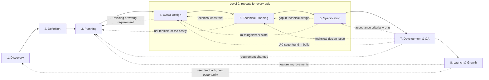

# TripMate -- Product Workflow

**Document type:** Product Workflow\
**Product:** TripMate\
**Status:** Proposed\
**Version:** 1.0\
**Visual version:** [TripMate Product Workflow artifact](https://claude.ai/artifact/8yk7w1MUE79bXX58HL1QhA)

Terms follow [GLOSSARY.md](GLOSSARY.md). This file is the source of
truth; the artifact shows the same content as an interactive diagram
and is updated with every version of this file.

Eight stages take TripMate from the user's problem to a released
product. Work moves forward, but any stage can send work back when it
finds a problem it cannot solve on its own. Stages 4 to 6 repeat for
every epic, and stage 7 follows its own Development Flow.

## 1. Overview

Solid arrows lead to the next stage; dotted arrows are feedback loops.
Stage 7 is detailed in `docs/development-flow.md` (to be written).

## 2. Two Levels of Planning

| Level | When | Covers |
|-------|------|--------|
| Level 1: product-wide | Once for the MVP; updated when a later stage sends work back | Product vision, PRD, MVP roadmap, glossary; core user journeys as a clickable prototype; system architecture and technical strategy |
| Level 2: feature by feature | Before every epic | Review the epic's screens and states (stage 4); technical design where needed (stage 5); spec, business rules, acceptance criteria, tasks (stage 6); build through the Development Flow (stage 7) |

Level 2 means TripMate is never specified in full detail up front: only
the epic about to be built is detailed, then handed to developers and
Claude Code.

## 3. Where TripMate Is Now

| Stage | Status | What exists | Missing |
|-------|--------|-------------|---------|
| 1. Discovery | In progress | Problem statement and target users in the vision | No user interviews or tests yet; assumptions unvalidated |
| 2. Definition | Draft done | [product-vision.md](product-vision.md) v1.4: value, goals, principles | Success metrics need numbers after beta |
| 3. Planning | Draft done | [prd.md](prd.md) v1.5, [mvp-roadmap.md](mvp-roadmap.md) v1.5, [GLOSSARY.md](GLOSSARY.md), ADR-0001 to ADR-0004 | Backlog as issues |
| 4. UX/UI Design | In progress | Clickable prototypes for Web, Mobile and Desktop, in Vietnamese and English, including sign-in to invite | Usability test, design system |
| 5. Technical Planning | In progress | Stack chosen; repo split; desktop on Tauri | Architecture doc, data model, API conventions, Maps provider |
| 6. Specification | In progress | PRD has acceptance criteria, 15 business rules and requirement IDs | Per-epic specs and tasks |
| 7. Development & QA | Not started | -- | Development Flow doc, repos, CI |
| 8. Launch & Growth | Not started | Release gates and beta metrics in the roadmap | Release plan, code signing, store review |

**Next three steps**

1. **Test the prototype with a real group.** Four or five friends plan
   a trip in the Mobile prototype. Check the riskiest assumptions:
   majority voting, Nudges, idea capture.
2. **Write the architecture doc and pick the Maps provider.** The Maps
   choice blocks ITN-06 and the travel-time Gap.
3. **Run Level 2 for the first epic: Auth, Trip and Invitation.** Its
   prototype is ready, so the spec and tasks can follow straight away.

## 4. Feedback Loops

When a stage finds a problem it cannot solve on its own, the work goes
back to the stage that owns the decision. The fix is made there, its
document gets a new version, and the work moves forward again.

| Found in | Problem | Go back to | Update |
|----------|---------|------------|--------|
| 4. UX/UI Design | A requirement is missing, wrong, or conflicts with the design | 3. Planning | prd.md |
| 5. Technical Planning | The design needs something the platform cannot do well | 4. UX/UI Design | Prototype |
| 5. Technical Planning | A feature is not feasible or costs too much for the MVP | 3. Planning | prd.md, roadmap |
| 6. Specification | The spec needs data or an API the architecture does not have | 5. Technical Planning | architecture.md, ADR |
| 6. Specification | A flow, screen or state was never designed | 4. UX/UI Design | Prototype |
| 7. Development & QA | Acceptance criteria are wrong, missing or untestable | 6. Specification | Epic spec |
| 7. Development & QA | The technical design does not work in practice | 5. Technical Planning | architecture.md, ADR |
| 7. Development & QA | Building the screen shows the UX does not work | 4. UX/UI Design | Prototype, ux-review.md |
| 7. Development & QA | The product requirement itself changed | 3. Planning | prd.md, roadmap |
| 8. Launch & Growth | Beta use shows features to improve or add | 3. Planning | Roadmap, prd.md |
| 8. Launch & Growth | Feedback shows a new problem or opportunity | 1. Discovery | discovery.md |

## 5. Stage Details

Every stage gate is approved by the product owner.

### Stage 1 -- Product Discovery

**Goal:** Understand the problem before deciding what to build.

- **Activities:** describe the problem and when it happens; interview or
  observe groups who plan trips together; look at how people manage
  today (chat apps, spreadsheets, Splitwise); list assumptions and test
  the riskiest ones.
- **Deliverables:** `docs/discovery.md`: problem, personas, competitors,
  assumptions with evidence.
- **Exit criteria:** at least five conversations or tests with real
  groups; each core assumption marked validated, rejected, or still
  open.
- **Feedback loops in:** from Launch & Growth when feedback shows a new
  problem or opportunity.

### Stage 2 -- Product Definition

**Goal:** Agree on what the product is, for whom, and what success
looks like.

- **Activities:** write vision and value proposition; set goals and
  non-goals; choose success metrics; write product principles.
- **Deliverables:** [product-vision.md](product-vision.md).
- **Exit criteria:** vision, goals, non-goals, and principles written;
  each goal has a metric; product owner approves.
- **Feedback loops in:** from Discovery when the problem turns out to be
  different from what we thought.

### Stage 3 -- Product Planning

**Goal:** Turn the direction into a scoped, ordered plan.

- **Activities:** find features from the core journeys; prioritise into
  MVP and later; write requirements with IDs and acceptance criteria;
  plan epics and milestones; name domain terms in the glossary.
- **Deliverables:** [prd.md](prd.md) (with MVP scope and business
  rules), [mvp-roadmap.md](mvp-roadmap.md), [GLOSSARY.md](GLOSSARY.md),
  backlog of epics as issues.
- **Exit criteria:** every P0 requirement has acceptance criteria; MVP
  scope and out-of-scope agreed; the roadmap orders every epic.
- **Feedback loops in:** from UX/UI Design (missing or wrong
  requirement), Technical Planning (not feasible or too costly),
  Development (requirement changed), Launch & Growth (feature
  improvements).

### Stage 4 -- UX/UI Design

**Goal:** Design how people will use it, and check it with real users.

- **Activities:** map journeys and flows for the epic; design screens
  for Web, Mobile, and Desktop, in Vietnamese and English; cover empty,
  loading, error, and success states; build a clickable prototype; test
  it with target users and fix serious issues.
- **Deliverables:** prototype canvases; `docs/ux-review.md` with
  findings and changes.
- **Exit criteria:** every core journey can be clicked through; key
  states designed; usability test done, serious issues fixed or
  decided.
- **Feedback loops out:** to Planning when a requirement is missing or
  wrong.
- **Feedback loops in:** from Technical Planning (constraint),
  Specification (missing flow or state), Development (UX problem found
  while building).

### Stage 5 -- Technical Planning

**Goal:** Design the technical solution that meets the requirements and
the design.

- **Activities:** define architecture and module boundaries; design the
  data model and API conventions; plan infrastructure, CI/CD,
  monitoring, and security; assess third-party risks (AI, Maps); record
  hard trade-offs as ADRs.
- **Deliverables:** `docs/architecture.md`; ADRs in
  [docs/adr](docs/adr/).
- **Exit criteria:** architecture reviewed; data model and API contracts
  ready for the next epic; major risks have a mitigation.
- **Feedback loops out:** to UX/UI Design (technical constraint), to
  Planning (not feasible or too costly).
- **Feedback loops in:** from Specification (gap in technical design),
  Development (design does not work in practice).

### Stage 6 -- Specification & Implementation Planning

**Goal:** Say exactly how the epic behaves and how it will be built and
checked.

- **Activities:** specify behaviour, rules, validation, permissions,
  errors, and edge cases; write testable acceptance criteria; add the
  technical design for the epic; split into Backend, Web, Mobile, and
  Desktop tasks with dependencies; review tasks for gaps and overlap.
- **Deliverables:** `docs/specs/<epic>/spec.md`; tasks as issues, linked
  to requirement IDs.
- **Exit criteria:** every acceptance criterion is testable; every task
  has scope, dependencies, and a test; a developer or Claude Code can
  start without guessing a requirement.
- **Feedback loops out:** to Technical Planning (gap in technical
  design), to UX/UI Design (missing flow or state).
- **Feedback loops in:** from Development (acceptance criteria wrong or
  missing).

### Stage 7 -- Development & Quality Assurance

**Goal:** Build in small increments and verify each one.

- **Activities:** follow the Development Flow (issue, branch, implement,
  test, review, merge, deploy); unit, integration, contract, and
  end-to-end tests; AI evaluations for AI features; verify against
  acceptance criteria and the approved design.
- **Deliverables:** code, tests, merged pull requests, release
  candidate; `docs/development-flow.md` describes the loop.
- **Exit criteria:** all acceptance criteria verified; no open critical
  defect; the release gates in the roadmap pass.
- **Feedback loops out:** to Specification, Technical Planning, UX/UI
  Design, or Planning, depending on where the problem lies.

### Stage 8 -- Launch & Growth

**Goal:** Release, measure, learn, and improve.

- **Activities:** prepare production, rollback, and monitoring; sign
  desktop builds and pass store review; run a beta with real groups;
  track adoption, retention, and feedback; update the roadmap.
- **Deliverables:** `docs/release-plan.md`; beta report; updated
  roadmap.
- **Exit criteria:** beta groups complete a trip end to end; operations
  stable; next improvements prioritised.
- **Feedback loops out:** to Planning (feature improvements), to
  Discovery (new problem or opportunity).

## 6. Document Map

One document per question, created only when there is real content for
it. Every change bumps the document's version, adds a row to its
version history, and is tagged in this repository.

| Document | Answers | Stage | Status |
|----------|---------|-------|--------|
| [GLOSSARY.md](GLOSSARY.md) | What do our words mean? | All | v1.3 |
| `docs/discovery.md` | Whose problem, what evidence, which assumptions are still open? | 1 | To create |
| [product-vision.md](product-vision.md) | What is the product and why build it? | 2 | v1.4 |
| [prd.md](prd.md) | What must it do? Includes MVP scope, business rules, acceptance criteria | 3 | v1.5 |
| [mvp-roadmap.md](mvp-roadmap.md) | In what order and by when? | 3 | v1.5 |
| Prototype canvases | How will people use it? | 4 | In progress |
| `docs/ux-review.md` | What did testing show and what changed? | 4 | After first test |
| `docs/architecture.md` | How is the system organised? Data model, API conventions, infrastructure | 5 | To create |
| [docs/adr](docs/adr/) | Why this decision over the alternatives? | 5 | 0001--0004 |
| `docs/specs/<epic>/spec.md` | How does this epic behave, how is it built, how is it verified? One file: behaviour, rules, acceptance criteria, technical design, tasks | 6 | Per epic |
| `docs/development-flow.md` | How does a task go from issue to merged and deployed? | 7 | To create |
| `docs/release-plan.md` | How do we ship, roll back, and measure? | 8 | Before beta |

**Rules**

- **The PRD is not a technical spec.** The PRD says what the product
  does; the epic spec says how the system does it.
- **One technical design per epic.** It lives inside the epic spec.
  There is no separate detailed design document; a design review is a
  meeting, not a document.
- **Traceability through IDs.** Tests carry the requirement ID in their
  name (for example `RDY-03`), so the requirements-to-test table is
  generated instead of maintained by hand.
- **ADRs only for real trade-offs** that are hard to reverse and would
  surprise a future reader.

## 7. Working with Claude Code

**Give it the right context**

- Each code repository has a `CLAUDE.md` that points to the glossary,
  the PRD, and the current epic spec.
- Tasks link to the spec section and requirement IDs they implement.
- If a task needs a decision the spec does not make, Claude Code stops
  and asks instead of guessing.

**Verify what it builds**

- Automated tests and an AI code review run before any human review.
- AI features (idea capture, Itinerary drafts, Gap revisions) get
  evaluation sets with expected outcomes, run on every change.
- A person approves every stage gate and every merge.

## 8. Version History

| Version | Date | Changes |
|---------|------|---------|
| 1.0 | 2026-11-17 | First version: eight stages, feedback loops, two planning levels, current status, document map, Claude Code practices. |
